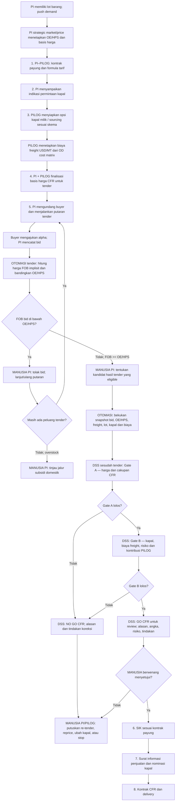
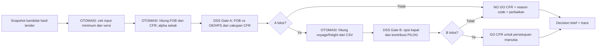

# Rencana Iterasi 3 — tender PI → keputusan GO/NO GO CFR PILOG

**Status 8 Oktober 2026:** **simulasi teknis Iterasi 3 sudah diimplementasikan dan diuji; menunggu kritik/penerimaan mentor**. Ini bukan kebijakan tender PI, quotation, atau keputusan komersial otomatis. Iterasi 3 tetap bagian dari siklus `simulation → iteration 1..N → final simulation validation → MVP`.

**Tujuan satu kalimat:** setelah PI menjalankan tender dan memperoleh kandidat bid, DSS membantu PILOG/PI memutuskan **GO atau NO GO untuk pelaksanaan CFR**, dengan alasan bisnis, angka yang dapat ditelusuri, risiko, dan tindakan lanjut yang jelas. Proses FOB adalah playbook PI yang sudah berjalan; Iterasi 3 **tidak membangun DSS pemilihan FOB versus CFR** dan **tidak memilih pemenang tender menggantikan PI**.

## 1. Sumber kebenaran dan koreksi terhadap rencana lama

Urutan rujukan untuk rencana ini: (1) klarifikasi mentor yang disampaikan pengguna pada 7 Oktober 2026; (2) [skema resmi ekspor CFR/impor FOB](official_flowchart.jpeg) dan [kotretan mentor](kotretan.jpeg); (3) kontrak dan hasil simulasi Iterasi 2; (4) referensi domain lain. Bagian rencana lama yang bertentangan dengan klarifikasi terbaru **digantikan oleh file ini**. Detail tulisan tangan di `kotretan.jpeg` yang tidak terbaca jelas tidak diperlakukan sebagai formula atau aturan yang sudah disetujui.

| Pokok | Arahan mentor yang dipakai sekarang | Konsekuensi desain |
|---|---|---|
| Permintaan pasar | PI Group melakukan **push demand**: barang/lot tersedia, lalu PI mengundang buyer ke tender/live auction. | Input DSS bukan `buyer_not_approached` pra-penawaran seperti Iterasi 2, melainkan hasil/snapshot tender yang sudah terjadi. |
| Alpha | **Seluruh nilai alpha berasal dari buyer**; PI tidak mengatur angka alpha yang ditawar buyer melalui aturan pengikat yang membatasi buyer. | Jangan membuat alpha seller, alpha kedua, atau beta buyer untuk membagi hasil PI–PILOG. PI tetap menetapkan persyaratan tender dan memutuskan menerima/menolak bid. |
| OE/HPS | Untuk konteks ini gunakan istilah **OE/HPS (Owner's Estimate/Harga Perkiraan Sendiri)**, **bukan HPP/COGS**. Tim strategic market/price PI menghitungnya dengan metode internal; angka yang diberikan kepada proses ini sudah **fixed**. | DSS menerima OE/HPS sebagai input dari PI. Ia **tidak menghitung OE**, tidak mengasumsikannya sebagai biaya produksi, dan tidak menyimpulkan laba/rugi akuntansi PI dari `FOB − OE`. |
| Freight | Keluaran **OD cost matrix adalah biaya freight USD/MT** dan **langsung ditambahkan ke FOB untuk membentuk harga CFR buyer**. Basis FOB dan biaya freight diketahui sebelum buyer mengajukan alpha. | `C_OD_per_mt` tetap dicatat sebagai **biaya**, sedangkan salinan nilainya dalam formula harga diberi peran `F_CFR_per_mt = C_OD_per_mt`. Kesamaan angka **tidak** berarti biaya OD otomatis pendapatan PILOG. |
| Tender | “Buyer dengan margin positif” yang dimaksud mentor adalah buyer dengan **selisih FOB bid terhadap OE/HPS yang dapat diterima**. Harga FOB hasil bid **di bawah OE/HPS** ditolak; **sama dengan atau di atas OE/HPS diterima** (`>=`). Jika putaran berulang tidak menghasilkan harga yang dapat diterima, PI dapat mempertimbangkan barang untuk subsidi domestik karena overstock. | `margin_tender = FOB_bid − OE_HPS`, dan rule penerimaan adalah `margin_tender ≥ 0`. Nilai nol diterima; nama “margin” ini **bukan** laba akuntansi PI. |
| Titik DSS | **Sesudah tender**, bukan sebelum undangan dan bukan mesin e-auction. | DSS membaca kandidat/snapshot hasil tender; menguji kelayakan CFR dan mengeluarkan aksi `GO`/`NO_GO` beserta kategori alasan. |
| Data simulasi | Dataset Aqaba turunan yang dipakai di Iterasi 2 dinilai mentor **cukup untuk eksperimen logika**. Tidak ada akses ke spreadsheet bid/auction. | Simulasikan bid dengan fixture manual dan gunakan CSV yang ada untuk ekonomi voyage; jangan menunggu integrasi sumber data nyata atau mengklaim data ini transaksi aktual. |

**Koreksi terminologi penting:** revenue adalah penerimaan penjualan. Mentor mengonfirmasi bahwa “margin buyer” dalam diskusi ini berarti **`FOB_bid − OE_HPS`**; nama kode yang lebih aman ialah `margin_tender` atau `gap_OE`, **bukan `net_profit` atau margin akuntansi PI**. OE/HPS tidak boleh diam-diam diganti nama menjadi HPP. Alpha positif tidak menjamin `FOB ≥ OE/HPS`; alpha negatif juga tidak otomatis gagal. **Rule eksplisit: `margin_tender ≥ 0`, termasuk nol.**

## 2. Siapa melakukan apa, dan di mana batas sistem

| Pelaku | Tugas dalam alur ini | Tidak boleh diasumsikan dilakukan DSS |
|---|---|---|
| Tim strategic market/price PI | Menyediakan OE/HPS fixed dan dasar/basis harga yang dipakai tender. | Membuka formula internal OE atau meminta PILOG menghitung ulang OE. |
| PI Commercial/panitia tender | Mendorong penjualan, mengundang buyer, menjalankan putaran tender, menyaring bid terhadap OE/HPS, dan menetapkan kandidat/hasil tender. | Menyerahkan kewenangan award kepada DSS. |
| Buyer | Menawar nilai alpha/penawaran menurut mekanisme tender PI. | Menetapkan freight PILOG atau pembagian pendapatan internal PI–PILOG. |
| PILOG BusDev/Chartering/Operations | Memberikan **biaya freight USD/MT** dari OD cost matrix, menyiapkan opsi kapal, dan menilai kesanggupan serta ekonomi jasa freight. | Menentukan OE/HPS komoditas PI atau menyebut biaya OD sebagai tarif jual PILOG tanpa definisi terpisah. |
| DSS Iterasi 3 | Membaca snapshot hasil tender, menghitung ulang indikator deterministik, memeriksa rule CFR, lalu memberi rekomendasi GO/NO GO yang preskriptif dan dapat diaudit. | Menjalankan tender, mengirim bid/quotation, memesan kapal, menandatangani kontrak, atau mengubah sistem operasional. |
| Pimpinan/pejabat berwenang | Menyetujui/menolak rekomendasi dan mengeksekusi proses lanjutan jika disetujui. | Menganggap `GO` dari DSS sebagai persetujuan final. |

**Batas dokumen resmi:** [diagram resmi](official_flowchart.jpeg) menunjukkan (1) kontrak payung formula tarif, (2) indikasi permintaan kapal PI ke PILOG, (3) kapal milik atau sourcing COA/VC/TC Trip, (4) rapat finalisasi harga CFR, (5) penawaran CFR/tender ke buyer, (6) SIK sesuai kontrak payung, (7) surat informasi penjualan dan nominasi kapal, (8) kontrak CFR dan delivery. Rencana ini menyisipkan **DSS setelah hasil tahap 5 dan sebelum komitmen tahap 6–8**. Langkah 1–4 merupakan **proses penyiapan/penetapan**, bukan output rekomendasi DSS. Kotretan mentor memperkuat pemakaian OD matrix dan formula harga, tetapi rincian persis sel matriks belum tersedia dalam repo.

## 3. Flowchart bisnis end-to-end yang diperbarui

Diagram di bawah adalah **alur TO-BE Iterasi 3**; label `[OTOMASI]` adalah kalkulasi/validasi deterministik, `[DSS]` adalah interpretasi keputusan, dan `[MANUSIA]` tetap pemegang kewenangan. Tender dan penetapan OE/HPS **berada di luar DSS**.



**Bacaan singkat:** `basis harga + biaya freight OD yang fixed → buyer menawar alpha → PI menyelesaikan tender → DSS memeriksa kandidat CFR → manusia menyetujui/tidak → dokumen dan delivery`. Bila `FOB < OE/HPS`, kasus **tidak masuk sebagai kandidat GO**; jika `FOB = OE/HPS`, kasus **lolos batas tender**. Sistem dapat menyimpan bid tertolak sebagai riwayat audit.

### Flow internal DSS setelah tender



Diagram ini adalah **alur bisnis target**. Kode I3 sekarang mengevaluasi snapshot tender **sintetis** pasca-bid dengan dua Gate terpisah dari I2; kode I2 tetap pra-penawaran. Pada kasus NO GO karena tidak ada bid eligible, engine menghitung ekonomi voyage hanya sebagai **diagnostik** dan tidak menjalankan Gate B sebagai persetujuan.

## 4. Kontrak angka: jangan campur harga, batas tender, dan biaya PILOG

Gunakan satu lot, satu rute, satu spesifikasi barang, satu mata uang/satuan, dan satu snapshot tender per evaluasi. Untuk simulasi awal, kuantitas fisik sekaligus basis perhitungan adalah **45.000 MT**, mengikuti koreksi mentor di Iterasi 2. Tidak ada 46.000 MT alokasi kedua.

| Simbol/objek | Arti yang benar | Pemilik/asal simulasi |
|---|---|---|
| `I` | Acuan/basis harga barang untuk formula bid, dalam USD/MT; bukan OE/HPS. | Untuk fixture I3: rata-rata dua benchmark **FOB Southeast Asia urea granular** dari Argus dan Fertecon, dengan provenance masing-masing. Pemakaian sebagai basis tender PI nyata tetap perlu konfirmasi PI. |
| `alpha_buyer` | Differential yang ditawar buyer untuk bid tersebut; boleh positif, nol, atau negatif. | Snapshot bid buatan/manual dalam simulasi; kelak hasil tender. |
| `FOB_bid` | Harga barang hasil bid pada basis FOB yang sebanding. | `I + alpha_buyer` **jika** itulah formula resmi undangan tender yang dipakai dalam kasus. |
| `OE_HPS` | Angka estimasi/batas yang dihitung tim strategic market/price PI. | Input fixed dari PI; **bukan HPP/COGS** dan bukan keluaran PILOG. |
| `C_OD_per_mt` | **Biaya freight USD/MT** hasil OD cost matrix untuk origin–destination dan lot tersebut. | PILOG; **bukan** tarif jual/revenue PILOG. Perlu diketahui apakah matriks sudah mencakup seluruh biaya voyage/komisi. |
| `F_CFR_per_mt` | Komponen freight yang ditambahkan ke harga FOB untuk menjadi harga CFR buyer. | **Dikonfirmasi sama angkanya dengan `C_OD_per_mt`** dalam skema ini. Tetap simpan dua peran/objek agar biaya tidak berubah nama menjadi revenue. |
| `F_PILOG_sell_per_mt` | Tarif jasa freight yang menjadi pendapatan PILOG dari PI dalam transaksi ini. | Untuk **simulasi I3**, kandidat inputnya adalah kolom `Freight rate (USD/MT)` di CSV yang **sudah didefinisikan sebagai tarif jual PILOG dalam kontrak I2**; kesesuaian dengan kontrak tender I3 tetap perlu dikonfirmasi. **Jangan diturunkan otomatis dari biaya OD**. |
| `C_voyage` | Estimasi total biaya PILOG melaksanakan pengangkutan dari perhitungan voyage Iterasi 2. | Dataset dan fungsi voyage economics. Bandingkan/rekonsiliasi dengan `C_OD_per_mt × Q`; **jangan jumlahkan keduanya sebagai dua biaya independen tanpa bukti**. |
| `CFR_bid` | Harga ke buyer untuk pengiriman CFR. | **`FOB_bid + C_OD_per_mt`**, yakni menambahkan biaya freight OD langsung; alpha tetap **sekali**. |

Jika buyer sesungguhnya mengisi **harga total** alih-alih kolom alpha dalam aplikasi tender, sistem dapat merekonstruksi `alpha_buyer` sebagai `FOB_bid − I` atau `CFR_bid − I − F_CFR_per_mt`, tetapi **jangan mengklaim buyer mengetik kolom alpha** tanpa bukti formulir. Klarifikasi mentor menetapkan **asal nilai ekonominya dari buyer**, bukan format UI/bid sheet-nya. Karena tidak ada spreadsheet auction, Iterasi 3 memakai fixture manual yang secara jelas diberi label `synthetic_bid`.

Rumus dan maknanya:

```text
FOB_bid (USD/MT)        = I + alpha_buyer
margin_tender (USD/MT)  = FOB_bid - OE_HPS             [bukan laba akuntansi]
eligible_tender         = (margin_tender >= 0)
biaya_OD_total          = C_OD_per_mt × cargo_MT
F_CFR_per_mt            = C_OD_per_mt                   [nilai sama, peran harga berbeda]
CFR_bid (USD/MT)        = FOB_bid + F_CFR_per_mt
revenue_buyer_CFR       = CFR_bid × cargo_MT
revenue_freight_PILOG   = F_PILOG_sell_per_mt × cargo_MT [jika tarif jual diketahui]
kontribusi_PILOG        = revenue_freight_PILOG - biaya_freight_yang_berlaku
gate_B_margin_PILOG     = (kontribusi_PILOG >= 0)       [ambang dikonfirmasi mentor]
```

`margin_tender < 0` berarti **gagal batas tender**, bukan bukti pembukuan rugi. `margin_tender ≥ 0`, **termasuk nol**, lolos syarat harga tender; belum membuktikan laba PI atau kelayakan CFR. `C_OD_per_mt × Q` adalah **biaya**, sekalipun angka yang sama muncul di harga CFR buyer; itu **bukan otomatis revenue PILOG**. Tarif jual PILOG harus diketahui terpisah sebelum kontribusi dapat dihitung. Jangan memakai `OE_HPS` sebagai pengganti biaya voyage; jangan pula menghitung biaya OD dan `C_voyage` dua kali bila keduanya merepresentasikan biaya pengiriman yang sama.

**Yang sudah pasti dan yang belum:** OD matrix menghasilkan **biaya freight USD/MT**, dan **angka biaya itu langsung ditambahkan pada FOB untuk harga CFR buyer**. Untuk E2E simulasi, kolom `Freight rate (USD/MT)` CSV dapat dipakai sebagai **tarif jual PILOG versi I2**, dengan label bahwa pengikatannya ke transaksi I3 belum dibuktikan. Yang belum jelas ialah apakah biaya OD merupakan ringkasan komponen voyage I2 atau perkiraan lain untuk dibandingkan, serta apakah tarif jual I2 berlaku dalam skema kontrak I3. Simpan objek harga buyer, tarif jual PILOG, biaya OD, dan biaya detail voyage terpisah. **Jangan menganggap biaya OD sebagai pendapatan atau menjumlahkan dua estimasi biaya untuk voyage yang sama.**

### Contoh logika paling kecil, bukan angka transaksi

Misalkan `I = 420`, `OE/HPS = 425`, `C_OD_per_mt = 30` USD/MT, dan `Q = 45.000 MT` hanya untuk tes batas tender. Sesuai jawaban mentor, harga CFR **langsung menambahkan biaya freight OD**:

| Alpha dari buyer | FOB bid | CFR bid | `FOB − OE/HPS` | Arti |
|---:|---:|---:|---:|---|
| `−10` | `410` | `440` | `−15` | **Tolak/lanjut tender**; biaya freight tidak boleh menutupi kegagalan batas FOB. |
| `+10` | `430` | `460` | `+5` | Lolos batas harga tender; **belum otomatis GO CFR** sebelum tarif jual, biaya, dan kapal PILOG diperiksa. |

Contoh tersebut **tidak** menghitung laba PI atau PILOG. OE/HPS bukan biaya produksi; biaya OD tersedia, tetapi **tarif jual PILOG belum diberikan**.

## 5. Batas tender versus dua Gate DSS

**Tender PI lebih dulu:** PI mengumpulkan bid, menghitung/membandingkan harga setara, menolak setiap bid dengan `FOB_bid < OE_HPS`, **menerima batas `FOB_bid = OE_HPS`**, melanjutkan putaran jika perlu, dan menetapkan kandidat berdasarkan aturan tender. Mentor mengonfirmasi “margin buyer” sebagai **`margin_tender = FOB_bid − OE_HPS`**; untuk mesin gunakan rule **`margin_tender ≥ 0`**, bukan `net_profit`. Jika tidak ada kandidat hingga terlalu lama/overstock, PI meninjau opsi subsidi domestik. Jumlah putaran maksimum, definisi “terlalu lama”, dan cara memilih di antara bid setara belum tersedia—**jangan hardcode**.

**Gate A — apakah kandidat pasca-tender boleh dibawa ke penilaian CFR?**

1. Ada hasil tender/kandidat yang dibekukan, bukan sekadar buyer hipotetis atau indikasi pra-tender.
2. Identitas lot, kuantitas 45.000 MT pada kasus contoh, origin–destination, basis harga, alpha bid, `OE_HPS`, `C_OD_per_mt`, dan Incoterm dapat dibaca konsisten.
3. Harga FOB implisit dihitung dengan **satu alpha**; `FOB_bid < OE_HPS` menghasilkan aksi `NO_GO` dengan reason code `NO_ELIGIBLE_BID_FOB_BELOW_OE_HPS` atau `SELECTED_BID_FOB_BELOW_OE_HPS` dan instruksi kembali ke tender PI. **`FOB_bid = OE_HPS` lolos Gate A** karena mentor memilih `>=`; ini **bukan** klaim laba PI positif.
4. Bila hanya harga CFR total tersedia, peroleh harga barang setara FOB dengan **`CFR_bid − C_OD_per_mt`** untuk basis harga yang sama; harga tersebut yang dibandingkan dengan OE/HPS. Ini sah karena mentor mengonfirmasi biaya OD ditambahkan langsung pada FOB dalam skema ini.
5. Kekurangan input yang membuat hitungan tidak sah menghasilkan aksi **`NO_GO` dengan `reason_category = DATA_ISSUE`**, bukan angka nol atau GO semu. Ini berarti **belum aman melanjutkan**, bukan penolakan komersial terhadap buyer.

**Gate B — apakah PILOG dapat melaksanakan CFR secara masuk akal?**

1. Ada opsi kapal yang relevan dengan 45.000 MT; screen DWT Supramax/Handysize Iterasi 2 hanya bukti awal. Kesesuaian DWCC aktual, draft, terminal, laycan, dan availability tidak boleh dianggap terbukti oleh DWT saja.
2. **Tarif jual jasa freight PILOG** dan **biaya freight OD USD/MT** ditempatkan pada objek yang berbeda. Rekonsiliasi biaya OD dengan rincian voyage I2 agar tidak dihitung dua kali; hitung revenue jasa, biaya, komisi yang memang berlaku, dan kontribusi secara deterministik.
3. Mentor menetapkan **kontribusi freight PILOG minimal `≥ 0`** untuk keputusan simulasi. Kontribusi negatif → aksi `NO_GO` dengan reason `NEGATIVE_PILOG_FREIGHT_CONTRIBUTION`; nilai nol → lolos ambang ini, tetapi bukan bukti laba positif. Jika tarif jual atau definisi biaya tidak sah → `NO_GO / DATA_ISSUE`, bukan GO semu.
4. Sajikan risiko utama yang dapat mengubah keputusan (kapal/laycan, perubahan biaya bunker/pelabuhan, validitas biaya OD), tetapi jangan menciptakan hard gate hukum/operasi tanpa aturan dan data yang disetujui.
5. Jika lolos, rekomendasi **`GO` untuk review manusia**. Ini berarti **layak dibawa ke pejabat berwenang**, bukan kontrak otomatis. Jika gagal, **`NO_GO`** dengan alasan dan tindakan spesifik: lanjut tender, revisi freight, cari kapal lain, atau koreksi data.

**Aturan prioritas keluaran I3:** hanya **`GO` atau `NO_GO`**. Kegagalan batas harga → `NO_GO / TENDER_PRICE_FLOOR`; input/perhitungan tidak sah → `NO_GO / DATA_ISSUE` (**bukan** penolakan buyer); kegagalan ekonomi/kapal → `NO_GO / CFR_EXECUTION_OR_ECONOMICS`; semua rule simulasi lolos → `GO / CFR_REVIEW_CANDIDATE`. `reason_category` wajib ditampilkan bersama aksi agar label biner tidak menyembunyikan penyebabnya.

**FOB setelah NO GO CFR:** tampilkan “serahkan ke playbook FOB PI untuk ditinjau” bila relevan, bukan `FOB_RECOMMENDED` dari perbandingan laba dua Incoterm yang sistem ini belum mampu buktikan. Begitu pula keputusan subsidi domestik sepenuhnya milik PI.

## 6. Data dan kontrak simulasi Iterasi 3

Tidak ada bid sheet/auction API yang dapat diakses. Karena mentor menilai data Aqaba-turunan cukup untuk simulasi logika, gunakan **input manual terkontrol**, tanpa membangun integrasi dan tanpa menjadikan provenance sebagai proyek utama Iterasi 3. Pemeriksaan tipe, unit, nilai kosong, dan konsistensi formula tetap wajib agar mesin tidak salah hitung.

| Kelompok input | Minimum untuk simulasi | Sumber/penanda |
|---|---|---|
| Lot PI | Case ID, komoditas/grade, origin, destination, quantity, intended Incoterm. | Fixture manual; data rute/voyage dari `data/processed/dataset_ready.csv` bila memang sesuai kasus. CSV turunan Aqaba dengan override Bontang→ECI **bukan bukti rute nyata**. |
| Harga PI | `I`, `OE_HPS`, currency, unit, versi snapshot tender. | Fixture manual mewakili angka fixed dari tim PI; **bukan formula OE lokal**. |
| Tender | Round ID, bid ID, buyer anonim, alpha/total bid, waktu, status eligible/candidate, alasan penolakan. | Fixture JSON/CSV sintetis; tidak ada scraping auction atau bid sheet asli. |
| Freight OD | Origin–destination, **biaya freight USD/MT**, cakupan komponen biayanya, versi matriks. | Fixture manual mewakili keluaran OD cost matrix; matriks asli belum tersedia. **Tidak diklasifikasikan sebagai revenue.** |
| Harga jasa freight | Komponen harga CFR buyer **sudah sama angkanya dengan biaya OD**; tarif jual PILOG ke PI tetap objek tersendiri. | `Freight rate (USD/MT)` pada CSV menjadi **tarif jual simulasi** sesuai kontrak I2. Apakah tarif itu berlaku dalam skema kontrak I3 masih perlu dikonfirmasi; jika input yang diperlukan tidak sah, aksi `NO_GO / DATA_ISSUE`. |
| Voyage PILOG | Kapal/kelas, hari, bunker, running, port/other, komisi yang berlaku, opsi kapal. | Kalkulasi modular Iterasi 2 dan CSV; biaya tidak diisi ulang sebagai OE/HPS. |
| Keputusan | Formula/rule version, hasil tiap Gate, reason code, next action, owner, status approval. | Dihasilkan deterministik dan diringkas untuk manusia. |

**Snapshot per putaran:** bid yang ditolak dan kandidat yang diteruskan harus tetap dapat dibedakan. Satu kasus DSS memproses **satu kandidat hasil tender** dan dapat melampirkan ringkasan putaran sebelumnya; ia tidak perlu membangun engine live auction. Jika nilainya berubah setelah putaran baru, hasil lama tetap historis dan run baru dibuat dari snapshot baru. Data pribadi buyer atau dokumen tender rahasia tidak boleh dimasukkan ke repo publik tanpa izin.

## 7. Cara rekomendasi menjadi preskriptif dan mudah dibaca stakeholder

Urutan decision brief yang wajib:

1. **Keputusan satu kalimat:** `GO CFR untuk review` atau `NO GO CFR` beserta kategori alasan. Jika input rusak: `NO GO — DATA_ISSUE; belum aman memberi rekomendasi GO`, bukan klaim harga buyer gagal.
2. **Mengapa:** dua–tiga alasan utama dalam bahasa bisnis, bukan kode/rumus di paragraf pembuka.
3. **Angka penentu:** FOB hasil bid vs OE/HPS (USD/MT dan total selisih), CFR ke buyer bila formula harganya jelas, serta **biaya freight OD, tarif jual dan kontribusi PILOG** bila ketiganya diketahui.
4. **Apa yang belum pasti:** misalnya apakah tarif jual PILOG versi I2 berlaku pada kontrak I3, apakah biaya OD sudah mencakup semua komponen voyage, kapal baru lolos screen DWT, atau biaya rute masih simulasi.
5. **Apa yang harus dilakukan berikutnya:** satu tindakan, pemilik tindakan (PI Commercial, PILOG Chartering, pimpinan), dan apakah perlu tender ulang/konfirmasi sebelum tahap 6–8.
6. **Lampiran audit:** input snapshot, versi matriks/formula/rule, trace perhitungan, seluruh reason code, dan status approval manusia.

Contoh bahasa brief **tanpa mengarang hasil bisnis nyata**:

> **NO GO CFR — kembali ke tender PI.** Harga barang setara FOB dari bid ini berada di bawah OE/HPS yang diberikan PI. Komponen freight tidak boleh dipakai untuk menutupi selisih harga barang. PI Commercial melanjutkan/mengevaluasi putaran tender; PILOG belum menerbitkan komitmen kapal. Perhitungan rinci terlampir dalam trace.

Untuk bid yang lolos OE/HPS tetapi **tarif jual PILOG** atau rekonsiliasi biaya OD/voyage tidak sah: “**NO GO — DATA_ISSUE; lengkapi ekonomi freight PILOG**”, bukan “GO karena alpha positif”. Untuk kasus yang seluruh syarat simulasi terpenuhi: “**GO CFR untuk review pejabat berwenang**”, bukan “tender dimenangkan dan kapal difixture”.

## 8. Batch implementasi — bukti teknis dan review pending

| Batch | Tujuan dan pekerjaan | Artefak/acceptance criteria |
|---|---|---|
| **I3-0 — bekukan kontrak bisnis** | Catat jawaban yang sudah pasti: `margin_tender = FOB − OE/HPS`, batas `≥ 0`, biaya OD USD/MT **langsung ditambahkan ke FOB untuk CFR**, serta kontribusi PILOG `≥ 0`. Klarifikasi tarif jual PILOG, rekonsiliasi biaya OD dengan voyage I2, format input bid, dan kapan kandidat dianggap hasil tender. Inventarisasi kontrak I2 yang menjadi historis. | `.agents/DECISIONS.md` dan kontrak I3 mencatat *confirmed vs pending*; tidak ada nama HPP di logika baru. |
| **I3-1 — model input tender pasca-bid** | Tambahkan model lot, round, bid buyer, snapshot OE/HPS, OD rate, kandidat; fixture manual untuk ≥2 putaran tanpa bid sheet nyata. | Kasus uji dapat mereplay bid ditolak, putaran lanjut, dan kandidat yang lolos tanpa aplikasi tender. |
| **I3-2 — modul harga & aturan tender** | Fungsi Python `Decimal` menghitung FOB/CFR, alpha sekali, gap OE/HPS, dan rekap putaran. Ini kalkulasi/otomasi proses tender, **belum DSS**. | Tes unit untuk alpha negatif/positif, `FOB <`, `=`, dan `>` OE/HPS, CFR total yang diurai ke FOB, freight tidak menutupi floor. |
| **I3-3 — bridge voyage/freight** | Pakai ulang perhitungan I2; pisahkan **biaya OD**, komponen harga CFR, tarif jual PILOG, rincian biaya voyage, dan kontribusi. Tetap pada kapal milik yang memang dapat dihitung dari dataset; cabang COA/VC/TC dalam diagram resmi dicatat sebagai konteks yang belum ada model biayanya. | Tidak ada double count biaya OD dengan voyage/port/bunker; biaya OD tidak menjadi revenue; angka I2 tetap dapat direplay; Handysize 45k tetap gagal screen DWT awal. |
| **I3-4 — dua Gate DSS pasca-tender** | Gate A memeriksa kandidat dan OE/HPS; Gate B memeriksa ekonomi/kelayakan CFR; keputusan GO/NO GO disertai kategori alasan dan tindakan. | Tidak ada GO dari bid di bawah OE, tidak ada GO palsu karena data kosong, tidak ada klaim laba PI dari OE. |
| **I3-5 — decision brief & E2E** | Perbarui laporan agar bahasa stakeholder berada di depan, trace teknis di belakang. Jalankan skenario positif, negatif, batas, no-bid, dan kapal/biaya gagal. | Satu perintah pipeline menghasilkan snapshot, kalkulasi, evaluasi Gate, dan brief yang dapat direview mentor; tidak ada write-back. |
| **I3-6 — review dan refleksi** | Mentor mengkritik aturan, contoh dan output; catat perubahan dan putuskan apakah perlu Iterasi 4. | Review I3, test evidence, decision log, dan iteration state diperbarui **setelah** eksekusi/review; tidak otomatis melompat ke MVP. |

**Implementasi aktual yang menjaga I2:** `validation/iteration_03.py` membaca fixture/CSV khusus I3; `calculations/tender.py` memakai `Decimal` dan modul physical/cost I2; `decisions/iteration_03.py` menjalankan Gate pasca-tender; `orchestration/iteration_03.py` menyusun snapshot → hitung → Gate → brief; `reporting/iteration_03.py` menyajikan hasil; `scripts/run_iteration_03.py` menjalankan dua fixture. Test I2 disimpan sebagai regresi historis; Gate I2 **tidak** diubah menjadi Gate I3.

**Status batch:** jalur alpha-bid I3-0 sampai I3-5 sudah diimplementasikan dan diuji; I3-6 menunggu mentor. Cabang input **harga CFR all-in yang perlu diurai balik ke FOB** masih contoh aljabar/kontrak rancangan, **belum dipakai CLI**, sebab format bid aktual belum diberikan. Jangan mengklaim cabang itu sudah teruji end-to-end. Demikian juga OD matrix resmi, harga pasar aktual, dan charter belum diintegrasikan.

## 9. Matriks uji minimum yang harus ada sebelum review mentor

1. Alpha buyer `−10` dapat lolos bila FOB masih ≥ OE/HPS; alpha `+10` dapat gagal bila FOB masih < OE/HPS. Tanda alpha **tidak** menjadi rule GO.
2. `FOB < OE/HPS` → bid ditolak/lanjut tender dan aksi `NO_GO / TENDER_PRICE_FLOOR`; **`FOB = OE/HPS` lolos floor** sesuai aturan `>=` mentor.
3. **`CFR = I + alpha_buyer + C_OD_per_mt`**, alpha dan biaya freight OD masing-masing **sekali**; bila hanya total CFR tersedia, `FOB_implied = CFR − C_OD_per_mt`. Kesamaan angka biaya OD dan komponen harga CFR tidak mengubah biaya OD menjadi revenue PILOG.
4. Dua buyer/dua putaran: snapshot lama tidak berubah; hanya kandidat sah pasca-tender masuk DSS. Bid tertinggi nominal dengan syarat tak sebanding tidak otomatis dijadikan kandidat oleh mesin.
5. `OE_HPS` tidak pernah masuk rumus biaya voyage, PILOG contribution, atau klaim net profit PI.
6. `C_OD_per_mt × Q` adalah biaya, **bukan** revenue PILOG; biaya OD dan rincian voyage tidak dijumlahkan dua kali. Jika kontribusi PILOG `< 0` → NO GO; `= 0` lolos ambang `>= 0`; tarif jual tidak sah → `NO_GO / DATA_ISSUE`.
7. Kasus quantity 45.000 MT dengan kelas Handysize 20–40 ribu DWT gagal screen awal; Supramax yang lolos DWT **belum otomatis available**.
8. Missing OE/alpha/biaya OD, **tarif jual yang dibutuhkan**, atau unit tidak cocok → `NO_GO / DATA_ISSUE`; tidak diganti nol dan tidak dianggap penolakan buyer. Missing sumber data produksi dicatat sebagai keterbatasan simulasi, bukan integrasi dadakan.
9. Tidak ada eligible bid setelah beberapa putaran → proses manusia mempertimbangkan tender lanjut atau jalur domestik; DSS tidak mengeluarkan GO dan tidak memutus subsidi.
10. Replay run Iterasi 2 tetap menghasilkan hasil historisnya; perubahan formula/rule I3 diberi versi baru dan tidak menimpa snapshot lama.

## 10. Pertanyaan yang masih perlu mentor putuskan, tanpa menghambat rancangan

| Prioritas | Pertanyaan tepat untuk mentor | Mengapa penting bagi kode/keputusan |
|---|---|---|
| **P0** | Apakah `FOB_bid = I + alpha_buyer` adalah formula aktual tender ini, atau buyer memasukkan harga all-in dan alpha direkonstruksi? | Menentukan input contract; asal nilai tetap buyer dalam kedua mode. |
| **P0** | **Biaya OD sebagai komponen harga CFR sudah jelas.** Apakah tarif jual PILOG ke PI pada transaksi I3 sama dengan `Freight rate (USD/MT)` CSV seperti pada I2, atau ada angka kontrak lain? | Menentukan revenue PILOG. Harga CFR buyer yang memakai biaya OD **tidak otomatis** membuktikan berapa yang dibayar PI ke PILOG. |
| **P0** | Apakah `C_OD_per_mt × Q` adalah biaya voyage yang sama dengan rincian running+bunker+port dari engine I2, atau estimasi alternatif/benchmark yang harus direkonsiliasi? | Mencegah biaya dihitung dua kali dan menentukan biaya mana yang masuk Gate B. |
| **P1** | Apakah angka OE/HPS dan OD rate dibekukan per invitation, per putaran, atau per award? Jika jadwal bergeser, siapa yang mengeluarkan snapshot baru? | Menentukan versioning dan kapan hasil lama harus dihitung ulang. Mentor menyatakan harga fixed, tetapi horizon waktunya belum diketahui. |
| **P1** | Ambang kontribusi freight PILOG **`≥ 0` sudah dijawab**. Komisi mana yang benar berlaku dalam kasus tender CFR ini, dan apakah sudah tercakup dalam biaya OD? | Menentukan biaya Gate B tanpa mendobel komisi. |
| **P1** | Pada skema CFR ini, tender menghasilkan satu kandidat pemenang yang sudah diputus PI, atau DSS perlu membaca beberapa kandidat eligible tanpa memilih pemenang? | Memastikan DSS tidak merebut kewenangan tender. |
| **P2** | Untuk cabang kapal sewa COA/VC/TC pada diagram resmi, apakah ada data biaya/availability untuk simulasi berikutnya? | Diagram bisnis lengkap, tetapi implementasi I3 tidak boleh mengarang model charter dari biaya kapal milik. |

**Batas hasil saat ini:** simulasi sintetis dapat dijalankan dan dibahas sekarang, tetapi **tidak dapat dijadikan keputusan transaksi nyata** sampai pertanyaan P0, sumber harga sebenarnya, matriks OD resmi, serta kontrak PI–PILOG dikonfirmasi mentor/pemilik proses.

## 11. Hardening dataset Iterasi 3 — rencana dan hasil awal

**Status 8 Oktober 2026: fixture I3 sudah dibuat; CSV I2 tetap utuh.** Tujuannya ialah menyediakan satu kasus **urea** yang jujur tentang sumber angka, ramping untuk logika I3, dan tetap dapat direplay tanpa merusak simulasi I2. `data/processed/dataset_ready.csv` adalah **satu kasus voyage berbentuk 61 baris key–value**, bukan 61 transaksi. Audit awal menemukan 0 nilai kosong dan 0 nama variabel duplikat; masalah utamanya ialah **semantik dan asal angka**, bukan sel kosong.

### 11.1 Temuan yang mempengaruhi keputusan

| Temuan dari input saat ini | Dampak pada I3 | Tindakan yang direncanakan |
|---|---|---|
| Baris komoditas masih `ROCK PHOSPHAT SF 28-35'`. | Mengganti teks saja menjadi urea akan memberi kesan palsu bahwa rate pelabuhan, stowage, kapal, biaya, dan rute telah divalidasi untuk urea. `SF 28-35'` tidak boleh dibawa ke deskripsi urea. | Buat **kasus turunan baru** berlabel **urea granular bulk dari Bontang**, sesuai konfirmasi pengguna; setiap nilai voyage yang diwarisi Aqaba ditandai `inherited_experimental`, bukan `urea_verified`. |
| `Loading port = Bontang`, `Discharging port = ECI`, `Q = 45.000 MT` berasal dari kasus eksperimen dengan route override. | Nama rute tidak membuktikan jarak laden/ballast, biaya pelabuhan, produktivitas, atau kapal benar untuk Bontang–ECI. | Pertahankan sebagai **skenario sintetis Bontang→ECI**. Jangan menamainya voyage urea nyata atau quotation. Tetap satu basis 45.000 MT. |
| `data/processed/iteration_02_pre_offer_simulation.json` masih memakai indeks `250`, alpha `3`, status `pre_offer`, dan `cfr_adjustment = 0`; sumbernya berlabel demo. | Angka itu tidak berasal dari laporan pasar/buyer dan posisi waktunya salah untuk DSS pasca-tender. | **Jangan salin ke fixture I3.** Indeks masuk dari catatan laporan pasar, alpha dari bid sintetis terpisah, OE/HPS dari input PI, dan tidak ada adjustment generik tanpa definisi baru. |
| `Freight rate (USD/MT) = 20` pada CSV didefinisikan kontrak I2 sebagai **tarif jual PILOG**, bukan biaya freight. | Salah bila nilai 20 langsung dipakai sebagai biaya OD atau sebaliknya. | Pertahankan sebagai **kandidat `freight_selling_rate` simulasi**; hitung biaya voyage dari input fisik. `OD_cost_per_mt` menjadi objek terpisah. |
| Biaya I2 berasal dari running kapal milik + bunker + `Other voyage costs total` 200.000 USD; tiga komisi terpisah. | Belum terbukti apakah OD cost matrix mencakup komponen yang sama atau sudah termasuk komisi; risiko hitung ganda. | Derivasi `voyage_cost_per_mt = voyage_cost_total / 45.000` dapat menjadi **proxy OD untuk simulasi**, diberi nama `derived_OD_proxy`, **bukan keluaran matriks OD resmi**. Perbandingkan dengan keluaran OD asli bila kelak tersedia; pilih satu biaya otoritatif, jangan dijumlah. |
| `Reference DWT = 63.500 MT` dan spesifikasi Supramax rinci adalah **kapal referensi**, sedangkan `DWT = 58.000 MT` adalah kapal kasus. | Mencampur kedua profil akan menghasilkan screen kapasitas yang tampak valid tetapi salah. | Pisahkan `case_vessel` dari `reference_vessel`; gunakan hanya profil kasus untuk hitungan I3 yang benar-benar didukung. DWT bukan bukti DWCC/availability. |

**Batas penting atas ucapan “semuanya bisa diturunkan dari Aqaba”:** untuk simulasi, data Aqaba cukup sebagai **bahan menghitung voyage days, bunker, running/port cost, biaya freight per MT, dan kontribusi PILOG jika tarif jual diketahui**. Namun **harga indeks pasar, OE/HPS PI, alpha buyer, hasil tender, dan aturan tarif internal PI→PILOG bukan turunan matematis dari voyage Aqaba**. Kelima objek itu perlu input dengan pemilik/sumber masing-masing. Mengisi angka tebakan di kode hanya akan menyembunyikan gap tersebut.

### 11.2 Aturan memilih indeks urea dari laporan

**Pilihan simulasi yang sudah dikonfirmasi pengguna:** produknya **urea granular bulk dari Bontang**; indeks `I` memakai **rata-rata aritmetika Argus + Fertecon**, masing-masing seri **FOB Southeast Asia (SEA) granular**, bukan pasangan regional–Indonesia. Pada [laporan Fertecon Nitrogen 10 September 2026](<../../../references/Market Reports/Fertecon Nitrogen Market Report 2026-09-10.pdf>, "halaman 1"), kandidat regionalnya adalah **`FGUAA04` FOB SE Asia urea granular, USD/MT**. `FBIEA04` FOB Indonesia granular/basis Bontang adalah **pembanding lokal**, **tidak ikut rata-rata** yang dipilih pengguna. [Metodologi S&P Global](https://www.spglobal.com/energy/en/pricing-benchmarks/our-methodology/subscriber-notes/070225-platts-launches-se-asia-urea-assessments-changes-methodology-for-existing-se-asia-urea-assessments-july-3) menjelaskan assessment FOB SEA sebagai turunan dari harga Indonesia dan Brunei, sehingga kedekatannya dengan Bontang tidak boleh disamakan dengan kuotasi pasti lot **45.000 MT**.

Untuk penerbit kedua, gunakan seri **Argus urea granular FOB Southeast Asia** setelah nama seri, tanggal, satuan, dan sel low–high pada PDF diverifikasi. [Metodologi Argus](https://www.argusmedia.com/-/media/project/argusmedia/mainsite/english/documents-and-files/methodology/argus-nitrogen.pdf?rev=9b5f35d1641a457db8ab31e25d38c140) menyebut cakupan Asia Tenggara termasuk Indonesia, Malaysia, dan Brunei. PDF Argus Nitrogen lokal terenkripsi dan **angka aktual belum berhasil diekstrak/diverifikasi** di lingkungan ini. Karena itu **belum ada indeks numerik gabungan** untuk contoh laporan 10 September; jangan menebak harga Argus atau memakai angka demo `250`.

Aturan hitung deterministik untuk **observasi pada tanggal pelaporan yang sebanding**, dalam USD/MT, FOB, granular:

```text
P_Argus     = (Argus_low + Argus_high) / 2     # midpoint bila berupa rentang
P_Fertecon  = (Fertecon_low + Fertecon_high) / 2 # midpoint bila berupa rentang
I_simulasi  = (P_Argus + P_Fertecon) / 2
```

Untuk fixture I3 saat ini **kedua penerbit direpresentasikan sebagai rentang low–high**; bila kelak sumber hanya punya satu harga, isi low = high dan tetap simpan provenance. Simpan low/high asli, midpoint, dan hasil rata-rata terpisah agar bisa diaudit; kode memakai `Decimal`. **Jangan** mencampur FOB dengan CFR, granular dengan prilled, USD/MT dengan mata uang/satuan lain, atau tanggal/definisi assessment yang tidak sebanding. Bila salah satu observasi hilang/tidak sah, aksi `NO_GO / DATA_ISSUE`; dua harga **sintetis berlabel jelas** diperbolehkan untuk replay teknis, bukan disamarkan sebagai observasi pasar.

Laporan bertanggal **10 September 2026** adalah **fixture historis** untuk eksperimen Oktober, bukan harga live pada tanggal tender. Rekam `publisher`, `report_issue_date`, `series_id`, `commodity`, `grade`, `Incoterm`, `location_basis`, `price_field`, `low`, `high`, `midpoint`, `unit`, `page`, dan `verified_by`. Perbedaan cakupan regional, ukuran lot assessment dengan **45.000 MT**, serta metode dua penerbit ditampilkan sebagai **keterbatasan benchmark**, tidak dikoreksi dengan faktor volume spekulatif. Dua PDF ammonia bukan sumber indeks urea. Nilai proprietary disimpan lokal/terkendali sesuai izin lisensi; **jangan otomatis commit report atau tabel harganya ke Git publik**. Rata-rata dua penerbit ini adalah **asumsi eksperimen yang diminta pengguna**, belum terbukti sebagai formula resmi tender PI; konfirmasi sebelum penggunaan bisnis nyata.

### 11.3 Bentuk data I3 yang diusulkan

**Jangan overwrite `data/processed/dataset_ready.csv` atau katalog I2.** Loader I2 saat ini mengharuskan dataset dan catalog memiliki jumlah/baris yang sama; menghapus kolom/row di situ akan mematahkan replay 26 tes historis. Bentuk data turunan yang lebih kecil, versi baru, dan pisahkan menurut pemiliknya:

```text
data/processed/dataset_ready.csv                    # tetap: bukti eksperimen I2, rock phosphate
data/processed/variable_catalog.csv       # tetap: kontrak 61 variabel I2
data/processed/i3_urea_v1.csv                  # 29 input fisik/ekonomi aktif, dengan unit dan source_status per baris
data/processed/i3_go_urea.json                 # input market/OE/bid/seleksi PI sintetis — kasus GO
data/processed/i3_no_go_urea.json              # input market/OE/bid/seleksi PI sintetis — kasus NO GO
src/pilog_cfr_dss/validation/iteration_03.py # kontrak field/unit/lineage, terpisah dari I2
```

File di atas **sudah dibuat**. Label `confirmed_case` berarti spesifikasi contoh yang dikonfirmasi pengguna, **bukan validasi operasional seluruh voyage**; `inherited_experimental` berarti angka dari dataset I2; `simulation_only_synthetic`/`simulation_only_assumption` berarti input/aturan contoh yang **tidak** berasal dari dataset atau laporan aktual. OE/HPS PI dan angka bid ada pada fixture JSON, bukan konstanta Python. `derived_od_cost_proxy_usd_mt` dihitung dari voyage cost/Q, **bukan** matriks OD resmi. Snapshot run menyimpan semua input dan versi rumus. Observasi pasar nyata berlisensi **belum** disalin ke repo.

**Field aktif yang dipertahankan:** identitas komoditas/grade/rute/45.000 MT; jarak laden–ballast, speed, rate muat–bongkar, canal days; DWT kapal kasus dan allowances; konsumsi/harga fuel dan parameter auxiliary-port; running cost dan biaya port/other agregat; tarif jual freight PILOG; komisi hanya bila relevansi/basisnya jelas. **Field yang dipindah ke referensi/ditunda, bukan dihapus dari arsip:** hire, daily cost assumption, kurs, hire comparison days, label benchmark, kapal referensi 63.500 DWT beserta crane/hold/grain/bale, scrubber/fuel policy, fuel-at-port yang maknanya belum jelas, dan kurva speed alternatif yang belum dipakai. Kapasitas volumetrik urea tidak boleh diaktifkan tanpa stowage factor dan data terminal yang cocok.

### 11.4 Langkah kerja dan acceptance criteria sebelum engine I3

1. **Bekukan I2:** simpan CSV/katalog/fixture lama sebagai historis; jalankan tes I2 sebelum dan sesudah perubahan untuk membuktikan regresi tidak terjadi.
2. **Catat spesifikasi kasus yang sudah diputuskan:** urea **granular bulk** dari **Bontang**, 45.000 MT sebagai lot simulasi I3. Verifikasi kemudian apakah rate, jarak, kapal, dan biaya turunan Aqaba cocok untuk rute/produk tersebut; sementara itu beri label `inherited_experimental`.
3. **Buat matriks lineage per field:** tandai `keep_active`, `reference_only`, `derived_output`, atau `not_available`; catat unit, route dependency, komoditas dependency, pemilik, dan apakah nilai diwarisi Aqaba atau diverifikasi untuk urea.
4. **Buat fixture urea I3 baru:** pindahkan hanya field aktif; ubah deskripsi menjadi urea granular bulk; pertahankan angka voyage yang disepakati sebagai eksperimen, bukan data rute/produk tervalidasi. Tidak ada 46.000 MT kedua.
5. **Dua observasi indeks untuk replay:** fixture memakai angka **sintetis**, masing-masing berlabel `simulation_only_synthetic`, basis FOB SEA granular, tanggal yang sama, dan seri Fertecon `FGUAA04`; midpoint dan rata-rata dihitung Python. Angka ini **bukan** kutipan Argus/Fertecon. Untuk input pasar nyata nanti, verifikasi langsung sel/halaman laporan, satuan, tanggal, seri, dan izin lisensi. Salah satu input hilang → `NO_GO / DATA_ISSUE`.
6. **Turunkan biaya, jangan hardcode:** gunakan fungsi I2 untuk menghitung total voyage cost dan `cost_per_mt` dari field aktif; bandingkan dengan keluaran OD matrix bila tersedia. Simpan `derived_OD_proxy` dan `official_OD_cost` sebagai dua objek, bukan dua biaya yang dijumlahkan.
7. **Pisahkan tender dari voyage:** alpha dan bid rounds berasal dari fixture buyer sintetis; OE/HPS dari PI sebagai input fixed; keduanya bukan isi CSV Aqaba. `CFR = index + alpha + OD_cost_per_mt` hanya setelah source OD yang dipilih tercatat.
8. **Uji E2E dan kasus gagal:** kandidat dengan `FOB <`, `=`, `>` OE/HPS; alpha positif/negatif; dua midpoint dan rata-rata; satu penerbit hilang; basis/Incoterm salah; kontribusi negatif; `selling_rate ≠ OD_cost_per_mt`; urea 45k dengan Handysize gagal screen; missing field menghasilkan `NO_GO / DATA_ISSUE`, bukan nol. Brief menyebut semua nilai yang masih sintetis. Uji lanjutan untuk tanggal tidak sebanding, kebijakan kapal rusak, dan source status yang salah tetap relevan.

**Selesai untuk tahap dataset** bila satu kasus urea I3 bisa dijalankan ulang dari file input, setiap angka penting memiliki `source_status`, grade/price object/units cocok, tidak ada duplikasi biaya atau alpha, dan I2 tetap menghasilkan hasil historisnya. Ini **belum** membuktikan quotation nyata: route Bontang→ECI, produktivitas pelabuhan, biaya aktual, kapal, dan assessment pasar lot 45k masih perlu validasi domain sebelum dipakai operasional.

## 12. Definition of done Iterasi 3

Iterasi 3 **siap direview**, bukan siap produksi, bila: (a) flow tender dan titik DSS cocok dengan skema mentor; (b) OE/HPS terpisah dari HPP dan voyage cost; (c) alpha hanya dari buyer dan dihitung sekali; (d) OD freight, revenue PILOG, dan biaya PILOG tidak tercampur; (e) GO/NO GO serta `reason_category` memiliki next action; (f) dua fixture sintetis menjalankan pipeline end-to-end tanpa bid sheet; (g) tes boundary/regresi lulus; (h) decision brief bisa dibaca pimpinan tanpa membaca JSON; dan (i) mentor memberi feedback tertulis untuk memutuskan Iterasi 4 atau final simulation validation. **Butir teknis (a)–(h) siap untuk review, butir (i) masih menunggu mentor. MVP tetap di luar scope sampai logika simulasi diterima.**
