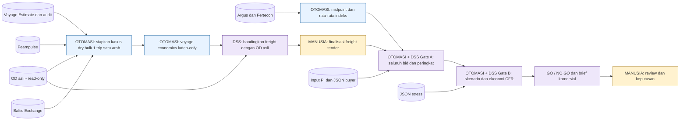

# Rencana Iterasi 4 — simulasi tender dan DSS CFR

**Terbaru D-069:** format hasil dua desimal §7.16/K0..K3 selesai teknis, I4-BRIEF.8. Sumber/angka internal/quote/gate tetap; minimum impas memakai CEILING dua desimal. Review menjelaskan verifikasi unit/regresi/browser, tiga brief baru dan proteksi 357 file existing. Presisi form input/audit/JSON/raw tetap, bukan angka tampilan untuk menghitung ulang.

**Terbaru D-067, 28 Oktober:** J0..J5/§7.15 selesai teknis. UI satu pemilih kapal di Step 1, sumber harga terpisah, Step 2 kebutuhan bahan bakar/biaya dan empat analisis pendukung ringkas. Footer berulang dihapus. 21 AppTest + 18 integrasi lulus, satu AppTest final copy diulang lulus, browser tiga hasil PASS/0 JS error dan 347 hash terlindungi identik. Rumus/gate/sumber/quote/report backend/histori tetap; tidak membuat run presentasi baru. Review dan README menjelaskan alur terbaru; acceptance manusia tetap terpisah.

**Hasil terbaru D-065, 28 Oktober:** H0..H6/§7.14 selesai teknis. 227 tes dan browser GO/NO GO ekonomi/NO GO floor lulus, 0 JS error; 538 assertion independen tiga snapshot cocok. I4-BRIEF.7/COST-FORECAST.1/I4-COMMERCIAL.1/COMMERCIAL-REVIEW.1 aktif. Gate A lolos tetapi B gagal terbukti dengan quote/bid yang sama dan reforecast biaya eksplisit. Run, rating kritis dan batas ada di review I4; acceptance manusia tetap terpisah. Tidak ada sumber/histori ditulis ulang, RBAC/award/transaksi/MVP atau server tes agent yang ditinggalkan.

**Execute terbaru D-064, 28 Oktober:** penguatan commercial review §7.14 disetujui. Wajib membuktikan NO GO ekonomi walaupun bid tertinggi lolos Gate A, dengan harga freight tetap dan biaya terbaru. Benchmark, target, indikasi dan penawaran dipisahkan; perbandingan kapal adil, brief tindakan dan skenario gabungan diperkuat. Sumber/histori dan threshold tetap. RBAC masih iterasi mendatang; tidak memerlukan izin execute ulang untuk task H.

**Hasil terbaru D-063:** G0..G5 selesai teknis; 200 tes lulus, dua tes UI terkait diulang setelah kartu final lulus, browser smoke GO/NO GO/logo/unduhan/narrow PASS, 108 assertion independen dua run cocok. I4-INPUT.2/OD-DISTANCE.1/I4-BRIEF.6 aktif. Review mencatat run baru komisi nol dan batas; sumber/histori utuh, server uji dihentikan. Acceptance pengguna dan RBAC/MVP tetap terpisah.

**Revisi terbaru D-062, 27 Oktober — execute disetujui:** seluruh komisi menjadi 0%; OD hanya sumber jarak NM (`Input - OD Intl!H11` Bontang–Mundra = 3.906); tabel tender per putaran dengan FOB/CFR turunan; profil fisik versus benchmark pasar diperjelas, singkatan bahan bakar diperluas dan copy diringkas. Logo asli dari `public/Pupuk_Indonesia_Logistik.png` menggantikan identitas teks kiri atas. §7.13 menggantikan kontrak penggunaan tarif OD dan komisi kasus baru pada bagian terdahulu. RBAC/dashboard per peran dicatat untuk iterasi mendatang (sementara I5), bukan build ini. Bukti implementasi/tes dan run terbaru dicatat di review.

**Hasil terbaru D-060, 27 Oktober:** I4-F0..F6 selesai teknis. Fearnpulse terhubung melalui snapshot publik, empat profil workbook aktif, dua kartu sumber, harga bertimestamp dan putaran tetap 180 detik. **180/180 tes**, smoke browser dan 82 assertion rekonsiliasi independen lulus. Sumber awal/histori utuh; UI lokal belum berarti approval transaksi/RBAC/MVP. §7.12 di bawah adalah kontrak desain yang sudah dilaksanakan, dengan konfirmasi lama digantikan D-059. Daftar nilai tetap/proxy dan rule dijelaskan pada **§7.12.10**.

**Otorisasi terbaru D-059, 27 Oktober 2026:** execute seluruh revisi §7.12 disetujui. Gunakan empat profil Sheet1/AQABA/Sby/Godau, Supramax batas atas; 1-year T/C Fearnpulse diterima sebagai target TCE pada owned mode tanpa hire tambahan. Godau memakai proxy pasar kelompok kecil yang dilabeli eksplisit, bukan quote Handymax palsu. Dua pertanyaan §7.12.9 telah dijawab; batas tunggu execute D-058 di bawah adalah histori. Putaran bid dikonfirmasi **3 menit tetap sejak dibuka**, tidak reset saat bid masuk. Jadwal/timestamp bid eksplisit divalidasi pada kasus baru; replay legacy tetap. Tidak ada autorisasi transaksi/auction/RBAC produksi.

**Rencana revisi terbaru D-058 — Fearnpulse, dua profil kapal, dua kartu sumber dan timestamp harga.** Keenam takeaway pengguna dirinci di **§7.12**. Penelusuran publik dan workbook sudah dilakukan; implementasi/kode/data aktif belum diubah. Dua konfirmasi masih diperlukan pada §7.12.9. D-056 hanya mengizinkan UI awal yang sudah selesai, bukan otomatis execute revisi sumber/perhitungan ini. §7.12 menggantikan rencana lama yang masih memakai profil Baltic untuk kalkulasi; histori sumber/output tetap dipertahankan.

**Terbaru D-056/D-057 — UI interaktif selesai teknis.** Setelah rencana D-055, pengguna menerima pilihan profil manual dan memberi EXECUTE seluruh batch. Acuan UI **§7.11**, I4-U0..U5: Streamlit lokal, shared preparation, data/profil, fixed freight, tender editor dan brief. **151 tes + browser smoke lulus**; evidence pada review/task. Engine/brief I4-BRIEF.4 dan rule I4 tetap. Larangan UI lama berlaku pada histori pekerjaan brief; UI lokal kini diizinkan/terimplementasi, bukan approval transaksi/mentor/MVP.

**Revisi aktif D-053: stakeholder brief lima bagian dan pemisahan pendapatan, selesai teknis.** Acuan terbaru §7.10; I4-D1..D4 telah diimplementasikan: I4-BRIEF.4, I4-FINANCIALS.1, 123 tes dan dua run final pada review. Kontrak §7.9 yang berbeda layout/copy digantikan bagian ini; gate/input/mode tetap. UI belum dibangun, acceptance mentor belum dicatat.

**Penguatan terbaru, 23 Oktober (D-051): commercial decision brief GO/NO GO selesai teknis.** I4-C1..C5 telah dieksekusi: I4-BRIEF.3, 109 tes lulus, dua run final dan self-review tersedia pada review I4. Rating subjektif GO 9/10 dan NO GO 9,5/10, bukan skor otomatis dari checklist. Baca §7.9, §8.4 dan §9.3 untuk kontrak; UI tidak dibangun. Dataset, rumus/gate/threshold, harga tetap, OD dan histori tidak diubah. Acceptance mentor/MVP belum diberikan.

**Eksekusi revisi disetujui 23 Oktober (D-048).** Brief/audit/JSON adalah laporan internal PI/PILOG, bukan tampilan buyer. OE/HPS, gap **FOB − OE/HPS**, alpha minimum floor, ranking buyer lain dan ekonomi PILOG adalah informasi internal; jangan dibagikan kepada buyer. Freight yang ditawarkan tetap terlihat oleh buyer. Revisi ini tidak membangun portal/export buyer atau kontrol akses produksi.


Revisi spesifikasi: **23 Oktober 2026**, berdasarkan review output untuk direksi/commercial/operasi dan persetujuan arah pengguna. Implementasi awal 22 Oktober tetap baseline; kontrak revisi §7, §8.2 dan §9.2 telah **diimplementasikan lokal sesuai D-048 dan lulus 91 tes**. Evidence tersedia di review/task, bukan acceptance mentor. Dokumen ini tetap satu acuan I4, bukan iterasi/MVP baru. Audit pengguna selesai; koreksi OD dan aturan bisnis sebelumnya tetap berlaku.

Bukti implementasi awal, peta kode, 67 tes dan hasil lokal ada di [review I4](../../.agents/reviews/ITERATION_04.md). Bukti baseline dibedakan dari 91 tes/run revisi 23 Oktober. [Task I4-R1 sampai I4-R7](../../.agents/tasks/ITERATION_04.md) menurunkan revisi menjadi pekerjaan. Dokumen ini tetap spesifikasi, bukan penerimaan mentor.

## 1. Tujuan, otoritas dan batas simulasi

**Tujuan I4:** menguji alur push demand PI dari persiapan freight dan tender sampai rekomendasi **GO/NO GO CFR PILOG**, lengkap dengan alasan, hitungan dan risiko yang mudah dibaca. Fokusnya ketepatan logika; bukan keputusan transaksi nyata atau MVP.

Dokumen ini adalah **acuan utama implementasi I4**. [Task eksekusi](../../.agents/tasks/ITERATION_04.md) menerjemahkan setiap bagian menjadi pekerjaan dan acceptance criteria, bukan spesifikasi bisnis alternatif. `.agents/PLANS.md` adalah ringkasan; `ITERATION_STATE.json` mencatat posisi pekerjaan; `DECISIONS.md` menyimpan histori. Jika berbeda, gunakan klarifikasi terbaru pengguna/mentor dan perbarui dokumen yang bertentangan sebelum kode dibuat. D-042 dan D-043 mengoreksi penafsiran OD dan tanggal pada D-038/D-040/D-041; keputusan lama tidak dihapus dari histori.

| Pemilik | Tanggung jawab |
|---|---|
| PI Group | Menjual barang, menyediakan OE/HPS, menyelenggarakan tender dan menetapkan award |
| Buyer | Melihat bahwa penawaran adalah CFR beserta freight tetapnya; memasukkan alpha dan revisi bid |
| PILOG | Menyediakan jasa freight, menghitung ekonomi pelaksanaan dan memberikan pertimbangan CFR |
| Sistem | Menghitung, mengevaluasi aturan, membuat ranking kandidat dan rekomendasi dengan bukti |
| Manusia | Meninjau rekomendasi, memilih/menetapkan pemenang dan menyetujui tindakan komersial |

Tidak ada e-auction UI, auto-award, transaksi, integrasi produksi, live scraper wajib, charter execution, hedge/FFA aktif atau MVP pada I4. Fleetra adalah domain pekerjaan terpisah, bukan dependency/sumber kebutuhan DSS. LLM tidak menghitung angka bisnis; fungsi Python deterministik/Decimal yang menghitung. Target 40% CFR tidak dipaksakan menjadi hasil GO.

## 2. Kasus dan arti OD yang sudah diklarifikasi

### Kasus dry bulk yang dihitung sistem

- Urea granular bulk, kapal milik, Handysize, **30.000 MT**.
- Muat Bontang → pelayaran bermuatan → bongkar Mundra/WCI.
- **1 trip satu arah/laden-only**; waiting/transit yang relevan masuk sesuai input kasus. Perjalanan balik tidak dimasukkan ke hari, BBM atau running sistem I4.
- Acuan jarak **3.906 NM satu arah**, digunakan sekali. Ini referensi workbook, belum jarak navigasi yang diverifikasi independen.
- Muat dan bongkar tetap masuk penuh sekali. Cargo, revenue, komisi atau lumpsum tidak otomatis dibagi dua.
- Sesuai konteks mentor, liquid/gas memakai round voyage/pergi–pulang; implementasi tanker/gas tidak termasuk I4 ini. Ini konvensi proyek, bukan aturan universal industri.

Histori I3 tetap 45.000 MT/Supramax pada fixture tersendiri. Jangan menimpa histori atau memaksa kasus I4 melalui validator I3.

### OD: pisahkan basis penawaran dari cakupan biaya

**Klarifikasi mentor: tarif OD adalah tarif untuk satu pengiriman satu arah. Rumus biaya internal OD memang memasukkan perjalanan balik.** Pengali dua bukan lagi pertanyaan terbuka dan bukan bukti bahwa harga OD dijual untuk dua pengiriman.

Bukti workbook yang dibaca: `Process - Intl!P65` mengambil jarak dari `Input - OD Intl!H11`; rumus efektif `R65 = P65*2/(Q65*24)` menghitung Sailing Days dengan jarak pergi–pulang. `Output - Freight!F12` mengambil tarif dari `Process - Intl!AG65`. Arti komersial tarif mengikuti konfirmasi mentor, tidak ditentukan hanya dari pengali dalam rumus.

| Aspek | Sistem I4 | OD asli |
|---|---|---|
| Rute acuan | Bontang–Mundra/WCI | Bontang–Mundra/WCI |
| Cargo dan kelas | 30.000 MT, Handysize | 30.000 MT, Handysize |
| Basis tarif yang ditampilkan | USD/MT untuk satu pengiriman satu arah | USD/MT untuk satu pengiriman satu arah, menurut mentor |
| Cakupan hitungan biaya | Satu arah bermuatan dan fase pelabuhan terkait | Memasukkan perjalanan balik dalam perhitungan internal |
| Peran | Freight hasil kalkulasi kasus dan ekonomi PILOG | Referensi kontrak payung/pembanding informatif yang read-only |

**Keduanya sama pada basis penawaran satu arah; perbedaan yang masih diketahui adalah cakupan biaya**, bukan otomatis perbedaan jumlah pengiriman yang ditawarkan. Karena itu:

1. Tampilkan tarif sistem dan tarif OD asli dengan penjelasan cakupan biaya.
2. Jangan membagi OD dengan dua, menghitung ulang workbook OD, membuat OD rebase, atau menyalin hasil engine menjadi pembanding.
3. Jangan menyalin Sailing Days OD yang sudah memakai pengali dua menjadi hari kasus satu arah, lalu menggandakannya lagi.
4. Selisih tarif bukan margin PILOG atau bukti penghematan. Jika diperlukan, selisih aritmetis ditempatkan di audit teknis dengan keterangan cakupan biaya.
5. OD bukan cek Lolos/Gagal dan tidak menentukan GO/NO GO.
6. Arahan mentor “round trip = dua kali tarif satu trip” adalah konvensi estimasi tarif untuk kebutuhan tersebut. Kasus I4 tidak membangun pengiriman balik kedua atau menggandakan revenue, cargo dan seluruh biaya secara otomatis.

Kontribusi I4 hanya menjawab batas model satu arah. Jangan menyatakan GO membuktikan profit seluruh siklus kapal ketika biaya balik tidak masuk model sistem. Mengubah sistem agar turut mengalokasikan biaya balik akan menjadi revisi batas model tersendiri, bukan perubahan diam-diam agar hasilnya sama dengan OD.

### Jarak dan terminal

Penelusuran eksternal 22 Oktober belum memperoleh hasil sea-distance Bontang–Mundra independen yang dapat diverifikasi. **3.906 NM tetap acuan simulasi dari workbook, bukan klaim aktual terverifikasi.** Verifikasi eksternal yang belum lengkap tidak menjadi hard gate baru.

Garis lurus bukan jarak laut navigabel. Estimasi port-to-port juga berbeda dari jarak aktual kapal. Konfirmasi lanjutan dapat memakai export sea-distance dengan endpoint, jalur/passage, NM dan tanggal; jarak aktual memerlukan evidence voyage/track nyata. [NGA — Distances Between Ports](https://msi.nga.mil/Publications/DBP), [SeaRoutesNav — batas estimasi](https://searoutesnav.com/disclaimer).

Port umum Bontang dapat memakai alias Badak LNG, sedangkan sumber Pupuk Kaltim menunjukkan contoh ekspor urea melalui Dermaga BSL. Jangan menganggap dua terminal itu sama atau menetapkan berth kasus ini hanya dari contoh berita. [Daftar port AtoBviaC](https://www.atobviaconline.com/ReleaseInformation/PortsList/1/), [Pupuk Kaltim — ekspor urea BSL](https://pupukkaltim.com/en/r/ekspor-urea-ke-australia-perkuat-diplomasi-dan-ketahanan-pangan-regional).

## 3. Sumber data dan toleransi kualitas simulasi

### Sumber dan perannya

| Sumber | Diambil/dipakai untuk | Aturan pemakaian |
|---|---|---|
| Voyage Estimate asli dan register audit semua sheet | Input fisik/operasi/biaya dan lineage | Gunakan nilai sumber yang relevan; review Sby acuan struktur/makna, bukan semua angkanya disalin ke rute lain |
| Review mentor pada Sby | Makna agregat port/other dan pemetaan variabel | USD 250.000 adalah total pada kasus Sby, bukan tambahan di atas loading/discharge disbursements dan bukan otomatis biaya Mundra |
| [Fearnpulse — Dry Bulk](https://fearnpulse.com/#2) | Snapshot target TCE/market context Handysize, USD/hari | Seri, tanggal dan basis dicatat; proxy bukan quote spot Bontang–Mundra atau invoice hire kapal milik |
| [Baltic — Dry Services](https://www.balticexchange.com/en/data-services/market-information0/dry-services.html) | Referensi profil benchmark kapal, DWT dan pasangan speed–consumption | Pisahkan benchmark dari kapal nyata; jangan merangkai angka dari profil berbeda tanpa label |
| Argus + Fertecon | Dua seri urea granular FOB SEA; midpoint kemudian rata-rata | Produk, basis dan USD/MT harus sesuai; tanggal masing-masing boleh berbeda untuk simulasi ini |
| OD asli | Tarif referensi Bontang–Mundra/Handysize 30.000 MT untuk satu arah | Baca tarif utuh; jelaskan bahwa biaya internalnya mencakup balik; tidak diubah |
| PI / fixture simulasi | OE/HPS dan lot tender | OE/HPS input PI, bukan HPP/COGS yang dihitung PILOG |
| Buyer / fixture simulasi | Identitas buyer/bid, alpha, round dan status | Sintetis bila tidak tersedia; bukan ID pemaksa pemenang |
| Skenario / fixture simulasi | Shock harga BBM dan tambahan hari menurut fase | Asumsi stress, bukan forecast atau hedge |

I3 masih memakai freight 20 USD/MT dan derived OD proxy pada jalur historis. **I4 menghitung ulang freight sistem dan membaca OD asli secara terpisah**; jangan mewarisi 20 USD/MT sebagai harga baru atau menyebut biaya engine sebagai OD resmi.

### Tanggal berbeda diperbolehkan — logika tetap harus benar

Mentor memperbolehkan perbedaan tahun/tanggal seluruh sumber selama fase simulasi untuk menguji logika. Tidak perlu menyamakan tanggal dengan mengganti metadata atau mengulang audit. Peningkatan kualitas/freshness dilakukan bertahap setelah logika siap.

| Kondisi | Perlakuan I4 |
|---|---|
| Tahun/tanggal OD, biaya, market quote atau laporan indeks berbeda | Catatan sumber/asumsi simulasi; bukan otomatis NO GO |
| Dua laporan Argus/Fertecon berbeda tanggal tetapi seri dan unit cocok | Boleh dirata-ratakan untuk simulasi; tampilkan tanggal asli dan batas interpretasinya |
| Tanggal/source/as-of belum tersedia | Catat belum tersedia; jangan mengarang tanggal; tidak otomatis menjadi hard gate provenance |
| Indeks berbeda produk, basis FOB/CFR atau unit tidak dapat dipetakan | Kesalahan semantik/teknis, bukan sekadar beda tahun; jangan dirata-ratakan diam-diam |
| Nilai kritis hilang, NaN/infinite, speed/rate nol, unit salah, biaya berganda atau konfigurasi tidak masuk akal | Gagal validasi yang relevan; NO GO dengan alasan data, bukan GO dari default nol |
| Bid withdrawn/expired/replaced atau tidak aktif pada cutoff kasus | Tetap dievaluasi menurut aturan tender; toleransi tahun sumber tidak menghapus aturan bid aktif |

Gunakan **waktu evaluasi kasus simulasi**, bukan otomatis tanggal komputer, untuk menentukan keberlakuan bid. Jangan membuat semua bid historis kedaluwarsa hanya karena CLI dijalankan pada tahun berbeda. Tanggal pembacaan/snapshot tidak sama dengan tanggal observasi pasar.

Hasil diberi label **simulasi/advisory-only**, bukan harga terkini, quotation atau kelayakan operasi aktual. Toleransi kualitas sumber tidak menghilangkan validasi matematika dan struktur.

### Snapshot input dan freight tetap

“Dibekukan” mempunyai dua makna yang berbeda:

- **Snapshot input:** simpan nilai yang dipakai beserta unit, seri/profil, tanggal asli bila tersedia, sumber/sel dan asumsi. Hasil dapat diulang tanpa membaca halaman live setiap run.
- **Freight tetap sebelum tender:** tetapkan satu freight tender per lot/basis yang sama; semua buyer melihat dan memakai angka tersebut. Stress tidak menaikkan pendapatan tender secara otomatis.

Snapshot numerik telah dipilih pada task implementasi setelah execute, bukan karena audit pengguna belum selesai. Indeks dua laporan menjadi 415 USD/MT; quote Fearnpulse belum terverifikasi sehingga target TCE memakai AQABA L38 13.000 USD/hari sebagai proxy berlabel. Angka yang tidak tersedia boleh menjadi asumsi simulasi transparan, tidak boleh dilabeli sebagai quote/report aktual atau dianggap nol. Perubahan input menghasilkan versi/run baru, bukan menulis ulang snapshot hasil lama.

## 4. Kontrak data dan struktur I4

### Lokasi dan pemisahan tanggung jawab

| Lokasi | Peran |
|---|---|
| `data/raw/Voyage Estimate.xlsx` | Salinan sumber asli; tidak ditimpa |
| `data/raw/Voyage_Estimate_all_sheets_variable_value_units.xlsx` | Register audit semua sheet; bukan input runtime siap-jalan |
| `docs/it_4/Simulasi Tarif Internasional_Mei 2025.xlsx` | OD asli read-only |
| `data/processed/i4_voyage.csv` | Input fisik/biaya I4, 26 field beserta unit, sumber dan peran |
| `data/processed/i4_context.json` | Snapshot market/indeks, OE/HPS, bid, stress, basis pricing dan referensi OD; varian GO |
| `data/processed/i4_no_go.json` | Varian floor tender NO GO pada basis voyage/market yang sama |
| `outputs/runs/<run_id>/` | Brief, audit, hasil JSON dan snapshot tiap run |

File input di atas telah dibuat; run/bukti teknis dirujuk pada review I4. Satu input voyage dipakai banyak varian tender/NO GO; perubahan variabel setiap varian harus jelas. Rute, Q dan profil berasal dari input, bukan pengecekan nama pelabuhan yang di-hardcode di fungsi.

Setiap field menyimpan `key/value/unit`, referensi sumber bila tersedia, serta peran **input / turunan / referensi / asumsi simulasi**. Field lama yang tidak dipakai diberi alasan; jangan dipaksa menjadi wajib hanya untuk mengikuti schema 29-field I3.

### Pemakaian fisik dan biaya

- Basis Q tunggal 30.000 MT untuk loading/discharge, screen kapasitas, freight revenue, komisi dan biaya per MT; tidak ada alokasi 46.000 MT.
- Kasus menyimpan kategori dry bulk, satu arah laden, asal/tujuan, distance, speed dan consumption sesuai fase. Ballast dari sumber dapat disimpan sebagai referensi `outside_voyage_boundary`; bukan nol aktual atau missing kritis kasus ini.
- Satu profil kapal simulasi harus konsisten. Jika profil sumber tidak cocok dengan Handysize atau belum lengkap, nyatakan substitusi/asumsinya sebelum dipakai; jangan menyebutnya spesifikasi kapal PILOG aktual. Baltic benchmark bukan bukti kapal tersedia.
- Pair speed dan konsumsi harus dijaga. Konsumsi yang sudah mencakup main + auxiliary tidak ditambah auxiliary lagi. Unit MT/hari berbeda dari kg/kWh × kW × jam; konversi eksplisit.
- Port/other memakai agregat atau rincian dengan rekonsiliasi, **bukan keduanya dijumlahkan**. Angka source yang berlabel ambigu dipetakan memakai catatan mentor; total historis tidak ditransplantasi tanpa alasan.
- Biaya bunker, running kapal milik, port/other dan komisi yang relevan dihitung sekali. Target TCE untuk pricing tidak menjadi biaya kas hire tambahan.
- Tidak menyalin pengali dua internal OD ke legs, fuel atau running I4. OD hanya reference, bukan mesin kalkulasi I4.

Nilai yang perlu diasumsikan disimpan pada input berlabel `simulation_only`, tidak ditanam di kode. Validator boleh menjaga unit/tipe dan aturan aritmetika, tetapi tidak mengunci 30.000 MT atau nama rute sebagai aturan universal.

## 5. Workflow, modul dan perhitungan

### Workflow bisnis



Ini rancangan, bukan diagram integrasi produksi yang sudah berjalan. OE/HPS PI dan alpha buyer masuk ke tender/Gate A, bukan rata-rata indeks. Langkah manusia dibekukan melalui input snapshot pada simulasi, bukan membangun UI approval.

Skema resmi PI: tahap 1 kontrak payung/OD; tahap 2–3 kebutuhan dan persiapan kapal/ekonomi freight; tahap 4 finalisasi basis CFR; tahap 5 tender/evaluasi dan DSS; tahap 6–8 SIK, nominasi, kontrak dan delivery **setelah keputusan manusia**, di luar eksekusi simulasi. Push demand: PI mempunyai barang dan mengundang buyer, bukan menunggu buyer datang.

[PNG final pengguna untuk slide](flowchart.png) tetap dipertahankan. `ITERATION_04_WORKFLOW.drawio` adalah draft lama; teks yang menyebut tarif OD round voyage perlu ditafsirkan sesuai koreksi di dokumen ini, bukan menjadi spesifikasi baru. File gambar/deck/Draw.io asli tidak diubah pada task revisi rencana ini. [Referensi layout pengguna](https://app.diagrams.net/#G1hGrv-E1p662nMcix_0hCA2LykYzkTqmd#%7B%22pageId%22%3A%22pCAf6jFEmqHEiNGAWUpp%22%7D).

### Batas modul implementasi

| Urutan | Modul/tanggung jawab | Input → output |
|---|---|---|
| 1 | Loader dan validasi I4 | CSV/JSON → kasus bertipe, satuan, pemetaan sumber dan catatan tanggal |
| 2 | Kalkulasi fisik | Distance/speed/Q/rate/fase → hari pelayaran, pelabuhan dan total |
| 3 | Kalkulasi biaya/pricing | Fuel, running, port/other, komisi dan target TCE → biaya serta freight sistem |
| 4 | Referensi OD dan freeze freight | Baca tarif OD utuh + hasil sistem → konteks pembanding dan freight tender tetap |
| 5 | Tender | Indeks + seluruh bid + cutoff/OE-HPS → FOB/CFR per bid, bid terakhir dan ranking |
| 6 | Skenario dan gate | Freight tetap + biaya baseline/stress + kandidat → kontribusi, cek dan GO/NO GO |
| 7 | Pelaporan dan persistensi | Hasil fungsi → brief singkat, audit rinci, JSON dan snapshot |

Gunakan pemisahan repo yang sudah ada: `models/`, `validation/`, `calculations/`, `decisions/`, `orchestration/`, `reporting/`, `scripts/` dan `tests/`. Entry point I4 adalah `scripts/run_iteration_04.py`; loader/orchestrator/gate/renderer berada pada file `iteration_04.py` di lapisan relevan. Kalkulasi terpisah pada `voyage_04.py`, `pricing_04.py`, dan `tender_04.py`. Reuse fungsi murni dari `voyage_days.py`, `fuel.py`, `costs.py`, `capacity.py`, `pricing.py` dan `economics.py` jika kontraknya cocok; pertahankan perilaku I2/I3 melalui regresi. Jangan menyimpan rumus di renderer, prompt atau JSON, atau membuat monolit baru yang menggabungkan seluruh lapisan.

### Hubungan harga dan biaya yang wajib dipertahankan

- Midpoint penerbit = (low + high) / 2; jika sumber hanya satu nilai, gunakan sebagai nilai observasinya secara eksplisit.
- Indeks = rata-rata observasi Argus dan Fertecon seri FOB SEA granular yang dipilih.
- FOB setiap bid = indeks + alpha buyer, **sekali saja**.
- CFR setiap bid = FOB + freight tender tetap. Tidak ada alpha kedua, beta atau adjustment generik tersembunyi.
- Revenue jasa PILOG = freight tender × Q; revenue barang PI bukan revenue freight PILOG.
- Hari laut = jarak satu arah / (speed laden × 24). Hari loading = Q/loading rate; hari discharge = Q/discharge rate.
- Total hari menjumlahkan fase yang dimodelkan sekali, termasuk waiting/transit bila berlaku; bukan total ditambah rinciannya lagi.
- Bunker = penjumlahan konsumsi × harga per jenis BBM/fase; running = USD/hari × total hari kasus.
- Kontribusi PILOG = revenue freight − komisi yang berlaku − bunker − port/other − running.
- FOB − OE/HPS adalah selisih terhadap floor tender, **bukan laba akuntansi PI atau HPP**.

TCE, target TCE dan kontribusi setelah running harus dibedakan. Kontrak I4.1 yang diterapkan: **TCE = (revenue − komisi − bunker − port/other) / hari**, sebelum running. Freight = **(bunker + port/other + target TCE × hari) / (Q × (1 − total fraksi komisi))**, dibulatkan naik 4 desimal USD/MT. Target dianggap net komisi untuk simulasi; running dikurangkan pada kontribusi, tidak ditambahkan lagi ke target TCE. Inverse/reconciliation diuji. Quote dengan basis gross yang belum dinormalisasi ditolak; asumsi net bukan ketentuan broker yang telah diverifikasi.

Tidak menambahkan target TCE sebagai invoice hire pada biaya kapal milik atau menjalankan dua metode pricing sekaligus. Pricing menghasilkan freight; baseline kemudian mengevaluasi freight yang telah tetap terhadap biaya. Jangan menghitung ulang harga jual agar setiap skenario otomatis untung. Fee persentase menggunakan basis yang dinyatakan; total komisi harus valid dan biaya tercakup tidak ditambahkan lagi.

Jika rute/Q/freight sama antarbuyer, alpha mengubah harga barang dan ranking PI, **bukan** otomatis bunker atau kontribusi freight PILOG.

### Baseline dan stress

Baseline memakai harga/operasi kasus yang dipilih. Skenario BBM naik dan delay mengubah biaya pada fase satu arah yang relevan, sementara freight dan Q tetap. Tambahan hari diberi fase dan konsumsi yang sesuai, tidak otomatis dianggap satu tambahan hari laut. Tidak menambahkan revenue, kompensasi FFA atau pendapatan perjalanan balik rekaan.

Snapshot harga yang dipakai untuk pricing dan asumsi baseline harus dapat ditelusuri. Uji NO GO ekonomi tidak memaksa label hasil: gunakan input biaya/freight yang memang menghasilkan baseline negatif setelah freight dibekukan, atau unit test boundary yang dilabeli; jangan menaikkan freight lagi untuk menyembunyikan kerugian.

## 6. Gate dan pemilik keputusan

### Gate A — kelayakan kandidat tender

1. Hitung FOB/CFR seluruh bid untuk audit, bukan hanya bid pemenang.
2. Pada cutoff kasus, tentukan bid terakhir per buyer menurut urutan round/submission. Bid terakhir yang withdrawn/expired/tidak aktif tidak menghidupkan bid lama yang sudah diganti.
3. Bid yang aktif dinilai dengan **FOB ≥ OE/HPS**, termasuk sama dengan floor.
4. Rank kandidat eligible berdasarkan FOB/alpha tertinggi untuk indeks/lot/Q/freight yang sama.
5. Kandidat teratas/ties adalah usulan review; PI tetap menetapkan award. Tiga round default, jumlahnya data-driven.
6. Tidak ada kandidat eligible → NO GO dengan alasan tender. Tidak ada ID JSON yang memaksa sistem menerima bid tidak valid.

Kandidat untuk evaluasi dapat diambil dari hasil ranking eligible sebagai **kandidat simulasi**, bukan award otomatis. Jika PI menyediakan pilihan eksplisit, pilihan itu harus valid/aktif dan ditampilkan; tidak boleh mengubah kelayakan atau hasil hitungan. Ties tetap ditampilkan bersama, bukan diselesaikan lewat asumsi tersembunyi. Untuk kasus dengan freight/Q/rute sama, ekonomi freight sama bagi kandidat-kandidat tersebut; laporan tidak mengarang perbedaan laba PILOG karena alpha.

### Gate B — ekonomi pelaksanaan CFR PILOG

Setelah Gate A lolos, periksa **screen awal kapal** berdasarkan profil/cargo kasus dan **kontribusi baseline ≥ 0**. Screen DWT hanya indikatif, bukan pembuktian lengkap DWCC, draft, terminal, availability atau jadwal aktual.

| Kondisi | Outcome simulasi |
|---|---|
| Gate A, cek wajib dan baseline lolos | GO untuk review manusia |
| Baseline tepat nol | GO dengan keterangan impas, bukan menguntungkan |
| Baseline negatif atau cek wajib gagal | NO GO dengan alasan yang spesifik |
| Input kritis tidak dapat dihitung | NO GO karena data; cek yang belum dapat dievaluasi tidak diberi Lolos |
| Baseline lolos tetapi stress negatif | Tetap GO; risiko dan besarnya dampak ditampilkan |

Jika Gate A gagal, Gate B tidak digunakan untuk menerima bid tersebut. Kalkulasi ekonomi diagnostik boleh tetap tersedia; tandai belum dievaluasi sebagai persetujuan kandidat, bukan “Lolos”.

Tidak menambah gate freshness, persamaan tarif dengan OD, source approval, atau margin minimum baru pada I4. Laycan ditampilkan sebagai konteks/review jadwal bila tersedia, bukan hard gate otomatis tanpa window, estimasi kesiapan dan rule yang disepakati. Negative stress tidak veto GO; jika biaya berubah menjadi baseline pada run baru, evaluasi kembali. Tidak ada fallback otomatis profit FOB.

Outcome publik hanya **GO/NO GO**. “Belum dapat dicek”, label sumber, kategori alasan dan status approval manusia adalah penjelasan internal, bukan outcome bisnis ketiga.

## 7. Revisi commercial decision brief — kontrak keluaran

### 7.1 Tujuan review dan arti preskriptif

Review 22 Oktober menilai brief awal **6/10 sebagai kualitas produk**, bukan persentase akurasi. Perhitungan 96 nilai per kasus pada dua snapshot cocok saat dihitung ulang independen, tetapi brief belum cukup mandiri untuk pembaca direksi. Kekurangan utama: tindak lanjut generik, asal/status freight belum tegas, kandidat lain tidak terlihat, NO GO floor masih menonjolkan ekonomi positif, dan belum ada batas ekonomi yang membantu interpretasi risiko.

Revisi harus menjawab: **keputusan apa untuk kasus mana → mengapa → angka pendukung → batas model/risiko → tindakan berikutnya dan pemiliknya → kapan evaluasi ulang dibutuhkan**. Tindakan berupa usulan review manusia, bukan instruksi award/delivery otomatis. Tidak menambah syarat sumber, minimum margin atau veto stress.

### 7.2 Urutan brief dan informasi inti

1. **Header kasus:** Case ID, commodity, Q, rute, kelas/mode kapal, cutoff tender dan putaran bid yang dirujuk; sumber berupa simulasi. Bedakan cutoff kasus dari waktu file dibuat/tanggal komputer.
2. **GO/NO GO dan alasan spesifik:** rekomendasi terhadap kandidat/penawaran dan batas model, bukan keputusan perusahaan memakai CFR secara umum.
3. **Ringkasan harga dan tabel bid terakhir:** indeks, OE/HPS, alpha minimum matematis, freight yang terlihat buyer, basis sumber/status tarif, kandidat/ties/pilihan PI bila ada.
4. **Tabel cek wajib:** dari engine, memisahkan Input, keberlakuan bid, floor PI, screen kapal dan kontribusi. Cek tidak dijalankan ditulis “Belum dievaluasi”, bukan “Lolos”.
5. **Ekonomi satu pengiriman:** durasi, pendapatan estimasi dan pemisahan biaya yang dimodelkan, kontribusi dan batas impas. Bila Gate A gagal, rincian ekonomi menjadi diagnostik sekunder, bukan headline yang bersaing dengan alasan NO GO.
6. **OD dan risiko:** OD utuh/informatif; baseline dan stress diberi dampak serta arti praktis, bukan hanya daftar angka.
7. **Tindakan berikutnya:** siapa perlu meninjau apa, alasan dan pemicu evaluasi ulang; tautan audit rinci di folder run yang sama.

Gunakan bahasa Indonesia sederhana. Jangan memasukkan hash, kode reason mentah atau dump JSON ke brief eksekutif. Nominal USD umumnya dua desimal; freight/CFR USD/MT empat desimal; angka keputusan memakai presisi penuh di engine. Pembulatan tampilan tidak boleh membalik kesan Lolos/Gagal; jelaskan jika nilai sangat dekat batas. Tidak menjanjikan tepat satu halaman jika tabel/data kasus bertambah.

### 7.3 Tabel bid — freight wajib terlihat

**Konfirmasi ulang pengguna, 23 Oktober: buyer mengetahui penawaran CFR dan freight-nya; yang ditawar buyer adalah alpha.** Tabel brief dan tabel seluruh bid di audit harus memperlihatkan freight numerik yang dipakai pada setiap baris. Jangan hanya menyebut freight di paragraf lain atau menyembunyikannya di CFR.

Semua harga dalam **USD/MT**. Indeks dan OE/HPS bersama ditampilkan tepat di atas tabel untuk mengurangi kolom berulang.

| Peringkat eligible | Buyer / Bid / Putaran | Alpha buyer | FOB | Freight terlihat buyer | CFR | Selisih FOB−OE/HPS | Status / alasan |
|---|---|---:|---:|---:|---:|---:|---|
| Dari hasil ranking | Identitas bid terakhir pada cutoff | Dari bid | Indeks + alpha | Freight tender yang sama | FOB + freight | Gap floor, bukan profit PI | Aktif/eligible/gagal/terpilih untuk review |

Aturan tabel:

- Satu bid terakhir **per buyer pada cutoff**, bukan seluruh riwayat di brief dan bukan hanya kandidat teratas. Riwayat seluruh putaran tetap di audit, juga dengan kolom freight.
- Latest withdrawn/expired/replaced tetap terlihat dengan alasan; **jangan menghidupkan bid lama** yang sudah diganti. Bid setelah cutoff tidak menjadi bid terakhir pada waktu evaluasi.
- Peringkat hanya untuk eligible; bid ineligible diberi tanda “—”, bukan diperlakukan sebagai kandidat sah. Untuk diagnosis NO GO, tampilkan penawaran aktif terbaik beserta identitas, harga dan shortfall.
- Ties ditampilkan bersama dan tidak dipecahkan melalui auto-award. Jika pilihan PI yang valid tersedia, bedakan “pilihan PI” dari “kandidat ranking tertinggi”; tidak mengklaim pilihan PI selalu ranking pertama.
- Freight satu lot/basis sama **identik antarbuyer** dan sama dengan rate pada CFR, revenue freight serta stress. Tidak menambah freight per buyer atau alpha kedua.
- Alpha mengubah harga barang/ranking PI, bukan otomatis kontribusi freight PILOG pada Q/rute/rate/biaya yang sama.
- Jika Gate A gagal karena tidak ada bid aktif sama sekali, jangan menyebut bid superseded/withdrawn sebagai “penawaran aktif terbaik”.
- Data kritis tidak tersedia tidak diisi nol atau angka contoh; tampilkan alasan data.

Contoh target tampilan dari snapshot baseline yang sudah direview, **bukan nilai hardcoded untuk renderer**: indeks 415, OE/HPS 420 USD/MT, freight 24,8957 USD/MT.

| Peringkat | Buyer / bid terakhir | Alpha | FOB | Freight terlihat | CFR | Gap OE/HPS | Status |
|---|---|---:|---:|---:|---:|---:|---|
| 1 | BUYER-1 / R3-B1 | 12 | 427 | 24,8957 | 451,8957 | +7 | Lolos; kandidat ranking |
| 2 | BUYER-2 / R3-B2 | 8 | 423 | 24,8957 | 447,8957 | +3 | Lolos |
| 3 | BUYER-3 / R3-B3 | 6 | 421 | 24,8957 | 445,8957 | +1 | Lolos |

Ketiga buyer melihat freight yang sama. Seluruh angka tabel dihasilkan dari input dan kalkulasi, bukan dicetak sebagai template konstan.

### 7.4 Asal tarif dan pemisahan pricing dari evaluasi

Bedakan dua hal:

- **Indikasi freight hasil model:** kalkulasi target TCE/biaya untuk persiapan penawaran. Hasilnya bukan quotation yang sudah diterima buyer.
- **Freight tetap untuk evaluasi tender:** record harga yang sengaja ditetapkan sebagai basis eksperimen/penawaran. Dalam simulasi, sumbernya tetap berlabel simulasi; adanya nilai tetap **bukan approval komersial nyata**.

Kontrak implementasi menggunakan kemampuan `freight_tender` yang sudah ada, bukan membangun aplikasi approval/e-auction baru:

1. Tahap persiapan menghitung indikasi freight melalui fungsi pricing Python.
2. Paket tender simulasi berikutnya menyimpan nilai terpilih pada record `freight_tender` bersama unit, source status dan referensi dasar pricing/input snapshot. Nilainya diturunkan dari kalkulasi, tidak ditanam di kode.
3. Evaluasi bid, baseline baru dan stress memakai record tersebut sebagai selling rate tetap. Perubahan biaya/target TCE tidak boleh menimpanya otomatis.
4. Kalkulasi indikasi pembanding boleh tetap tersedia di audit, tetapi tidak mengganti rate tender yang dipakai.
5. Input/snapshot lama yang tidak mempunyai record freight tetap tetap dapat dibaca sebagai jalur indikasi historis; brief harus menyebut asal tarifnya. Jangan memalsukan approval, menimpa input pengguna, atau merusak replay histori.
6. Perubahan tarif setelah tender dibahas merupakan versi kasus/penawaran baru yang disengaja, bukan respons otomatis terhadap stress atau shortfall floor komoditas.

Brief menunjukkan **rate yang dipakai, sumber/modenya dan batas statusnya**. Jangan memberi klaim bahwa baseline positif membuktikan penerimaan harga pasar: pricing berbasis target TCE dapat membuat kontribusi dasar positif karena asumsi target itu sendiri.

### 7.5 Informasi turunan ekonomi — bukan gate baru

Aritmetika berikut harus berada pada `calculations/`, memakai Decimal dan unit eksplisit. Renderer hanya memformat hasil. Tidak menambah variabel input baru jika nilai bisa diturunkan dari input yang sudah ada.

| Informasi | Hubungan matematis / basis | Batas interpretasi |
|---|---|---|
| Alpha minimum untuk memenuhi floor | OE/HPS − indeks, USD/MT | Bisa positif, nol atau negatif; bukan alpha yang diwajibkan kepada buyer, bukan laba PI |
| Gap floor setiap bid | FOB − OE/HPS, USD/MT | Untuk alasan eligible; bukan kontribusi PILOG |
| Shortfall bid aktif yang gagal | Besarnya kekurangan terhadap floor jika gap negatif | Terikat indeks/OE/HPS kasus; jangan mengubah freight untuk menutup floor FOB |
| Kontribusi per MT | Kontribusi baseline / Q | Hanya biaya/cakupan model, bukan profit bersih |
| Freight impas | Biaya kas baseline sebelum komisi / [Q × (1 − total fraksi komisi)] | Termasuk efek komisi yang sama; bukan tarif minimum SOP atau rekomendasi menurunkan harga |
| Tambahan biaya satu hari pelabuhan | Running USD/hari + konsumsi DO pelabuhan MT/hari × harga DO USD/MT | Pada model sekarang; port/other lumpsum tidak otomatis bertambah dan biaya lain tidak dianggap nol aktual |
| Tambahan delay sampai impas | Kontribusi baseline / tambahan biaya per hari, bila baseline positif dan penyebut > 0 | Hari tambahan **di atas baseline**, bukan total voyage days, SLA, allowance kontrak atau izin terlambat |

Boundary wajib:

- Baseline nol: tetap GO bila cek wajib lolos, tampilkan **impas**, tanpa klaim untung/buffer positif.
- Baseline negatif: tidak menyajikan delay negatif sebagai “toleransi”. Jelaskan baseline sudah rugi; ukuran buffer tambahan tidak berlaku.
- Tambahan biaya harian nol: jangan membagi nol atau menampilkan infinity sebagai jaminan aman; jelaskan ambang tidak dapat diturunkan dari model biaya harian tersebut.
- Input kritis salah: metrik dependen tidak dihitung; tidak ada nilai default nol.
- Angka impas tidak menjadi margin minimum, SLA atau veto stress baru. Nilai berdekatan dengan batas ditampilkan tanpa kesan aman akibat rounding.
- Stress adalah contoh kondisi, **bukan probabilitas/worst-case**. Pertahankan skenario existing; kombinasi shock dapat diuji sebagai edge case tanpa wajib menambah tabel panjang atau risk rule baru.

### 7.6 Penjelasan dan tindakan menurut penyebab

| Kondisi | Pesan inti | Usulan langkah manusia, bukan eksekusi otomatis |
|---|---|---|
| GO, kontribusi positif | Kandidat lolos floor; ekonomi freight nonnegatif pada batas model | Ajukan kandidat beserta rate dan batas biaya untuk review PI/PILOG; soroti risiko dominan dan perubahan asumsi yang memerlukan evaluasi ulang |
| GO, kontribusi nol | Lolos rule impas, bukan menguntungkan | Nyatakan tidak ada buffer kontribusi; keputusan manusia tetap diperlukan tanpa mengubah threshold >= 0 |
| NO GO karena floor | Bid aktif terbaik masih di bawah OE/HPS; sebut buyer, bid, FOB dan shortfall | PI meninjau/menjalankan putaran berikut sesuai kewenangan; tampilkan alpha minimum matematis, bukan perintah menetapkan alpha buyer |
| NO GO karena bid tidak aktif/pilihan PI tidak eligible | Bid tidak dapat dipakai pada cutoff | Tinjau status/keberlakuan atau pilihan PI; jangan memilih/menghidupkan bid lain otomatis untuk menyembunyikan kegagalan |
| NO GO karena kontribusi baseline negatif | Harga freight tetap tidak menutup biaya model setelah komisi | PILOG meninjau driver biaya/operasi; jangan mengikat pelaksanaan berdasarkan kasus ini atau melakukan repricing otomatis |
| NO GO karena screen kapal | Profil/cargo gagal screen awal yang disepakati | Tinjau profil/quantity/rencana operasi; tidak mengarang availability atau memilih kapal pengganti tanpa data |
| NO GO karena data kritis | Kasus belum aman dihitung | Sebut field/unit/error yang perlu diperbaiki dan langkah evaluasi ulang; tidak menyimpulkan buyer rugi atau menambahkan outcome HOLD |

Bila beberapa cek gagal, jelaskan penyebab yang benar-benar dievaluasi. Jangan menyatakan kapasitas atau kontribusi lolos sebagai keputusan bila Gate A gagal. Jangan membuat owner/nama pejabat, tenggat, limit risiko, fee atau tindakan kontrak yang belum disepakati.

Untuk baseline lolos tetapi stress rugi, outcome tetap GO sesuai rule; rekomendasi menjelaskan dampak dan kebutuhan review risiko, bukan membatalkannya diam-diam. Jika harga/biaya/jadwal yang menjadi baseline berubah, rekomendasikan evaluasi ulang dengan harga tender yang tetap bila belum direvisi manusia.

### 7.7 Ekonomi, operasi, OD dan audit

- Tampilkan estimasi revenue, **komisi, bunker, port/other, running secara terpisah**, biaya gabungan yang basisnya jelas, kontribusi baseline dan durasi. Semua dalam unit yang tepat.
- Di NO GO floor, fokus utama adalah tender gagal. Ekonomi tetap tersedia di audit/JSON sebagai diagnostik; ringkasan opsional diberi label “jika ada kandidat yang memenuhi floor”, bukan revenue yang telah diterima.
- Pisahkan “sudah dihitung” (days/cost/gross DWT) dari “belum dibuktikan” (kesiapan kapal/terminal/jadwal/DWCC/availability). Tidak menambah hard gate tanpa data/rule.
- Kontribusi berlaku satu pengiriman satu arah yang dimodelkan, **bukan laba bersih atau profit seluruh siklus kapal**. Return/overhead/risiko yang belum dimodelkan tidak dinyatakan tercakup.
- OD tetap menampilkan **dua tarif per pengiriman satu arah**, dengan penjelasan biaya internal OD termasuk balik. Tidak dibagi dua/direbase, tidak diberi centang Lolos/Gagal, tidak disebut margin/penghematan.
- Proxy sumber penting (termasuk target TCE historis), input sintetis dan perbedaan tahun tetap transparan. Ini bukan permintaan mengulang audit data atau menjadikan freshness sebagai blocker.
- Audit rinci menyimpan seluruh bid beserta freight, metrik turunan, formula/basis/unit, alasan, snapshot dan provenance. Tautan relatif dari brief menuju `calculation_audit.md` harus dapat dibuka.
- Tambahkan identitas revisi brief/decision-support saat implementasi. Pisahkan dari formula harga/rule yang tidak berubah; jangan merusak input schema atau mengklaim snapshot lama dihasilkan oleh versi baru.

Kontrak file tetap `commercial_decision_brief.md`, `calculation_audit.md`, `result.json`, `input_snapshot/` pada run baru. **Jangan menimpa dua run baseline atau snapshot historis.** Tidak perlu menyalin workbook lengkap ke setiap run.

### 7.8 Batas perubahan dan hubungan dengan arah produk

Ini revisi preskriptif/penjelasan pada fondasi simulasi, bukan menambah AI, live ingestion, hedging, produksi, approval UI atau MVP. Paper 1–2 menopang disiplin objek harga/unit; Paper 3 menghubungkan hitungan ke proposal yang dapat ditelusuri; Paper 4 membantu memisahkan hitungan, cek wajib dan residual risk; majalah ADMISI memberi arah orkestrasi informasi yang lebih luas. Tidak semua fitur referensi dibangun sekarang.

Target CFR internal tetap konteks manfaat, bukan dorongan memperbanyak GO. Fleetra tetap domain terpisah. Penilaian selesai revisi harus melihat apakah mentor/pembaca dapat menjelaskan keputusan dan tindak lanjut dari brief tanpa membongkar JSON; rating lama bukan bukti bahwa perbaikan sudah berhasil.


### 7.9 Penyempurnaan commercial decision brief — kontrak yang telah diimplementasikan

**Permintaan pengguna, 23 Oktober (D-050), lalu EXECUTE D-051:** fokus hanya commercial decision brief GO dan NO GO menuju rating kualitas terbaik dalam scope simulasi. **UI secara eksplisit dikeluarkan.** Kontrak bagian ini telah diterapkan melalui C1..C5; I4-R1..R7/91 tes tetap baseline sebelum penguatan. Pengguna mengklarifikasi 10/10 sebagai rating, bukan jumlah kriteria. Evidence aktual dan penilaian jujur berada di review; tidak mengubah data atau membuat iterasi baru.

#### A. Arti target “10/10” dan batas

Targetnya kualitas brief **dalam scope simulasi I4**: benar terhadap hasil engine, jelas untuk direksi, preskriptif, dapat ditelusuri, dan dapat dipakai untuk review komersial tanpa membongkar JSON. Bukan klaim akurasi 100%, semua risiko dunia nyata telah terjawab, approval mentor, kesiapan voyage aktual atau otomatis naik MVP. Sepuluh kriteria §9.3 harus dibuktikan dari output nyata; self-rating tidak menggantikan bukti dan review pengguna/mentor.

Tetap berlaku:

- Outcome bisnis hanya GO/NO GO; “belum ditinjau”, “belum dievaluasi” dan error UI bukan outcome komersial ketiga.
- FOB = indeks + alpha; CFR = FOB + freight tetap; gap internal = FOB−OE/HPS.
- Gate A/B, floor inklusif, kontribusi >=0, gross-DWT screen, aturan latest/ranking/ties/pilihan PI dan stress bukan veto **tidak diubah**.
- Buyer melihat freight; **seluruh brief, audit dan JSON hanya internal PI/PILOG**, bukan materi buyer. OE/HPS, gap, alpha minimum, bid buyer lain dan ekonomi PILOG tidak dipublikasikan.
- Tidak mengulang audit sumber, mengganti dataset/OD atau menjadikan tahun/freshness/approval sumber sebagai blocker simulasi.
- Tidak ada rencana UI, framework, adapter frontend, portal, e-auction, transaksi, award, approval workflow atau MVP pada pekerjaan ini.

#### B. Hierarki informasi menurut penyebab, bukan satu template panjang untuk semua

| Keadaan engine | Informasi utama dalam brief | Informasi lanjutan |
|---|---|---|
| GO, kontribusi positif | Kandidat/buyer/bid, mengapa floor dan baseline lolos, freight, kontribusi model, risiko utama, tindak lanjut | Seluruh latest bid; rincian biaya/durasi/impas; sumber dan audit |
| GO, tepat impas | GO menurut rule, kandidat, kontribusi nol dan tidak ada buffer positif | Jangan memakai copy “menguntungkan” atau menghitung toleransi negatif |
| NO GO karena floor PI | Tidak ada kandidat eligible; best active bid jika ada, FOB, OE/HPS, shortfall, alpha minimum internal, tindak lanjut tender; Gate B belum dievaluasi | Ekonomi freight dipindahkan ke audit diagnostik; brief cukup menjelaskan mengapa nilai positif tidak menyelamatkan tender, bukan menampilkan tabel revenue/kontribusi positif penuh |
| NO GO karena bid/pilihan PI | Status bid/pilihan yang invalid dan tindakan peninjauan; tanpa menghidupkan bid lama atau otomatis mengganti pilihan | Tabel latest tetap utuh; jangan menyebut semua kasus ini sebagai floor gagal |
| NO GO karena ekonomi PILOG | Kandidat/floor yang sudah lolos, kontribusi negatif, freight tetap dan driver biaya yang relevan | Ekonomi menjadi bukti utama, bukan disembunyikan seperti NO GO floor |
| NO GO karena screen kapal | Cek yang gagal, nilai cargo/DWT/kelas dan batas screen | Ekonomi hanya informasi; tidak mengarang kapal pengganti atau kesiapan aktual |
| NO GO karena data kritis | Field/unit/error, hitungan mana tidak tersedia, langkah koreksi | Tidak ada kartu nol pengganti, best-bid palsu atau stale GO dari run sebelumnya |

Jika beberapa cek gagal, tampilkan semua penyebab yang benar-benar dievaluasi; penentuan “alasan utama” hanya urutan penjelasan dari hasil engine, bukan rule/ranking keputusan baru. Nilai diagnostik tidak berubah menjadi approval Gate B.

#### C. Kartu keputusan paling atas

Dalam blok pertama, pembaca harus mendapatkan: **GO/NO GO → untuk kasus/kandidat mana → alasan utama → dampak ekonomi yang relevan → risiko/batas → tindakan berikutnya**.

- Case ID, produk/Q/rute/kelas, kandidat buyer/bid/putaran atau “tidak ada kandidat eligible”.
- Bedakan kandidat ranking, ties dan pilihan PI; jangan memaksa pilihan PI menjadi peringkat pertama atau menyebut kandidat sudah awarded.
- Tulis “rekomendasi berdasarkan model simulasi; bukan award/instruksi pelaksanaan otomatis”. Tetap keputusan kelayakan CFR, bukan mengganti tujuan DSS menjadi sekadar viewer.
- Angka diikat pada field hasil, bukan contoh yang ditanam di kalimat/renderer.
- Human approval tetap status hasil yang sebenarnya, umumnya belum ditinjau; jangan centang approved otomatis.
- Run ID, waktu pembuatan evaluasi, cutoff tender, formula/rule/report version dan link audit. Waktu pembuatan bukan tanggal indeks dan bukan cutoff.

**Contoh penerimaan berbasis dua run final terbaru, bukan teks hardcoded:**

> GO — kandidat BUYER-1/R3-B1 untuk urea granular bulk 30.000 MT, Bontang–Mundra. FOB 427 memenuhi OE/HPS 420 USD/MT; freight tetap 24,8957 USD/MT menghasilkan kontribusi model 188.856,76 USD. Delay pelabuhan tambahan 30 hari dapat menghasilkan kontribusi minus 50.164,04 USD. Ajukan hasil untuk review PI/PILOG; kesiapan operasi dan keputusan manusia tetap terpisah.

> NO GO — belum ada bid terakhir aktif yang memenuhi floor PI. Penawaran aktif tertinggi BUYER-3/R3-B3 memiliki FOB 401, masih kurang 19 USD/MT terhadap OE/HPS 420. Gate B belum dievaluasi. PI meninjau langkah tender berikut; kontribusi freight diagnostik tidak membuat bid barang yang gagal floor menjadi eligible.

Contoh berlaku pada input existing. Bila input/hasil/cause berubah, subjek, angka dan copy harus ikut berubah.

#### D. Harga PI dan ekonomi PILOG dipisahkan secara eksplisit

Tabel latest buyer tetap mencakup alpha, FOB, **freight terlihat buyer**, CFR, gap floor internal, rank dan alasan. Tidak menghapus buyer gagal dari tabel.

Diikuti penjelasan singkat:

> Ranking penawaran barang membantu PI menilai kandidat tender. Pada quantity, freight, voyage dan biaya yang sama, perubahan alpha mengubah harga barang/ranking PI, bukan otomatis kontribusi freight PILOG.

Bagian PILOG memisahkan revenue, komisi, bunker, port/other, running, total biaya dan kontribusi. Komisi menampilkan **rate agregat dan basis gross freight revenue sesuai model**, bukan hanya nominal, serta label asumsi simulasi; tidak mengarang penerima komisi atau kontrak. Jangan menamai gap floor PI sebagai laba atau kontribusi model sebagai laba bersih/siklus kapal.

Freight fixed versus indication tetap terlihat. Perbandingan OD tetap informatif dengan cakupan internal balik dijelaskan, tanpa pass/fail, “hemat”, atau menjadikannya dasar mengubah rate.

#### E. Risiko dan tindak lanjut harus memiliki hasil review yang diminta

Ganti instruksi generik “bahas risiko” menjadi penjelasan berstruktur:

| Field usulan | Maksud |
|---|---|
| Hal yang perlu ditinjau | Misalnya asumsi durasi/biaya yang dapat mengubah baseline atau kesiapan operasi yang belum dibuktikan |
| Pihak peninjau (peran) | PI, PILOG atau pemilik input yang relevan; bukan nama pejabat/departemen hasil tebakan |
| Hasil review yang dibutuhkan | Konfirmasi/revisi asumsi dasar, penjelasan kesiapan, atau catatan penanganan risiko untuk keputusan manusia |
| Pemicu evaluasi ulang | Input biaya/jadwal/cargo/rate atau status bid berubah; bukan threshold risiko baru |
| Status bukti manusia | “Belum tercatat” bila tidak ada catatan; tidak mengklaim diterima/approved |

Untuk kasus delay: tampilkan dampak USD dan konteks tambahan hari; minta peninjauan apakah durasi masih layak menjadi baseline, apakah biaya perlu diperbarui, dan bagaimana risiko residual dibawa ke keputusan manusia. Bila biaya/jadwal berubah menjadi baseline, evaluasi ulang **dengan freight tetap**, kecuali ada revisi harga penawaran yang sengaja dibuat manusia.

Ini **permintaan hasil review**, bukan implementasi approval workflow, syarat input baru atau hard gate. Tidak menebak siapa menanggung kerugian, term kontrak, probabilitas delay, kompensasi, demurrage, FFA atau hedge. Bila belum ada, sebut belum dimodelkan/belum tercatat. Stress rugi tetap bukan veto otomatis dan hari impas bukan SLA/izin terlambat.

#### F. Kontrak penjelasan yang konsisten dengan hasil engine

Perubahan terkecil yang dibutuhkan: gunakan data hasil existing untuk menyusun subjek, alasan dan actions terstruktur, lalu renderer menampilkan brief berdasarkan penyebab. Tidak perlu membangun framework presentation, domain baru atau salinan engine.

| Elemen | Sumber / titik perubahan yang direncanakan | Batas |
|---|---|---|
| Identitas hasil | Orchestration menambahkan run_id, generated_at dan versi sekali pada run tersimpan; cutoff tetap dari kasus | Waktu pembuatan bukan tanggal indeks/cutoff; jangan mengubah snapshot lama atau mengarang metadata legacy |
| Keputusan/subjek | recommendation + tender candidate/latest/best active/ranking/ties/PI selection | Assembling penjelasan dari gate existing, bukan keputusan baru; data invalid tidak diberi kandidat/angka palsu |
| Harga/ekonomi/risiko | index, pricing, baseline, metrics, scenarios, vessel_screen, od_comparison | Semua nilai numerik dari calculations; tidak ada rumus bisnis pada renderer, prompt, JSON atau LLM |
| Tindakan dan hasil review yang diminta | next_steps diperinci dengan peran, hasil yang dibutuhkan dan trigger | Status manusia belum tercatat bukan approved; bukan form atau workflow approval baru |
| Tata letak sesuai sebab | reporting merender keputusan yang sama dengan penekanan GO, NO GO floor, NO GO ekonomi, dan sebab lain | Detail tidak hilang dari audit/JSON; no new outcome/minimum margin atau auto-award |
| Jejak bukti | brief menuju calculation_audit.md dan identitas input/run | File run tetap satu paket internal; hash/snapshot bukan sertifikasi sumber benar |

Kontrak file tetap commercial_decision_brief.md, calculation_audit.md, result.json dan input_snapshot/. Rekomendasi, harga, angka dan tindakan harus konsisten antarberkas. Bentuk field tambahan diputuskan pada C2 dan bersifat additive; pertahankan input I4.1 dan formula/rule I4.1. Naikkan report version saat implementasi, bukan melabeli run lama dengan versi baru.

Tidak mengubah persiapan harga, input CSV/JSON, rumus metrik atau data sumber untuk mengejar tampilan bagus. Bila ditemukan error nyata, catat dan perbaiki sesuai scope terpisah, jangan menyembunyikannya dalam copywriting.

#### G. Batas panjang dan prioritas pembaca

Brief utama memakai lapisan informasi: keputusan/alasan utama dan angka penentu terlebih dahulu; tabel cek, tender, risiko dan actions berikutnya; detail kalkulasi di audit. Arah awal sekitar 400–600 kata per kasus sebagai panduan editorial **bukan threshold**, dengan pengecualian wajar untuk banyak buyer/kegagalan. Jangan menghapus bukti/unknown penting hanya untuk mengejar jumlah kata atau satu halaman.

NO GO floor seharusnya lebih fokus daripada brief GO; jangan menyalin seluruh tabel ekonomi dan stress diagnostik ke brief jika Gate B belum dievaluasi. NO GO ekonomi tetap memerlukan angka negatif dan driver biayanya di bagian utama.

Gunakan istilah sederhana: kontribusi bukan laba bersih, bid terakhir bukan otomatis pemenang, screen DWT bukan kapal siap, dan “belum dievaluasi” berbeda dari “gagal”. Format USD dua desimal/harga per MT empat desimal sesuai kontrak; nilai dekat nol tidak boleh dibulatkan sehingga mengubah kesan keputusan. Status wajib berupa teks, bukan mengandalkan warna. Role/name dan bahasa campuran dipangkas bila tidak membantu keputusan.


### 7.10 Revisi stakeholder brief — D-053, menggantikan layout §7.9

Tujuan: pembaca langsung membedakan pendapatan kotor PI, pendapatan kotor PILOG, biaya penyelenggaraan voyage, komisi dan hasil neto PILOG tanpa menyamakan OE/HPS dengan HPP. Lima bagian satu brief: (1) Commercial decision / keputusan komersial sebagai utama, (2) Exposure / eksposur ekonomi satu pengiriman, (3) Risk / risiko, (4) Logistics impact / dampak logistik, (5) Pricing consequences / konsekuensi harga. Diadaptasi dari diagram ADMISI Q3 2026 halaman cetak 14 (PDF halaman 3); bukan klaim seluruh orchestration/AI/integrasi majalah sudah dibangun.

Kontrak angka:
- Estimasi pendapatan kotor barang PI = FOB bid × quantity; biaya dan neto barang PI tidak tersedia, bukan nol dan bukan FOB−OE/HPS.
- Estimasi pendapatan kotor freight PILOG = freight × quantity.
- Biaya voyage untuk ringkasan = bunker + port/other satu kali + running. Ini cakupan biaya model, bukan istilah voyage expenses TCE yang mengecualikan running.
- Total pengurang PILOG = biaya voyage ringkasan + komisi gross freight.
- Hasil neto setelah biaya voyage dan komisi = contribution_usd existing. Bukan net_revenue_usd existing (yang baru setelah komisi), bukan laba bersih perusahaan, bukan realisasi kas.
- Nilai penawaran CFR buyer = CFR × quantity adalah nilai gabungan penawaran, bukan tambahan pendapatan di atas pendapatan PI dan PILOG dan bukan laporan konsolidasi grup.
- Seluruh perkalian/penjumlahan di calculations, Decimal; renderer hanya format. Tambahan ringkasan bersifat additive; formula/rule I4.1 dan metrik impas existing tetap.
- GO: tabel utama ekonomi yang jelas. NO GO floor/invalid choice/no active: keputusan penolakan utama; nilai freight tetap hanya potensi jika terlaksana, bukan transaksi diterima atau Gate B Lolos. Neto negatif dan beberapa kegagalan tidak disembunyikan.
- Bid seri atau pilihan PI non-rank1 memakai identitas/basis yang benar; tanpa bid aktif tidak mengarang pendapatan PI/penawaran CFR.
- Exposure hanya biaya/harga dalam satu pengiriman, bukan VaR, credit limit, pre-funding, portfolio exposure atau kerugian maksimum.
- Risk memakai skenario/delta yang sudah dihitung, tanpa probabilitas/kompensasi/hedge/risiko tambahan rekaan. Logistics memisahkan screen DWT dari kesiapan aktual. Pricing menampilkan freight terlihat buyer dan floor hanya internal; OD beda cakupan biaya tetap bukan margin/gate.
- Brief tidak memakai banner/jargon “simulasi”, “butuh audit”, “butuh pertimbangan”. Ganti dengan bahasa estimasi, tindakan langsung dan satu catatan sumber/kewenangan yang jujur. Unknown operasional tetap singkat/faktual; mode/data sintetis/proxy/approval status tidak dihapus dari JSON/audit atau diklaim aktual.
- Satu paket output existing (brief/audit/result/snapshot), bukan lima file ringkasan terpisah. Tidak membangun UI pada task ini.

Task dan penerimaan:
1. I4-D1: kontrak ini dan task/state/keputusan sebelum kode.
2. I4-D2: fungsi ringkasan finansial murni, field terstruktur untuk setiap bid + shared PILOG; edge/missing/finite/nonnegative revenue tests; jangan mutasi baseline atau rekomendasi.
3. I4-D3: renderer lima bagian, human-readable gross→cost→net, tone langsung, internal dan scope tetap; perbarui ekspektasi copy tes tanpa melemahkan assert aturan.
4. I4-D4: seluruh regresi + tes baru, dua run, rekonsiliasi nilai/paritas baru dan protected hashes; baca output sebagai stakeholder dan update review/state. Mentor acceptance tetap pending.

**Evidence pelaksanaan §7.10:** 123/123 tes; 14 tambahan summary/brief. Rekalkulasi snapshot final 189 nilai numerik per kasus / 504 assertion total cocok; baseline/scenarios/tender/recommendation dan input identik dengan sebelum revisi. Review terbaru menilai kualitas komunikasi GO/NO GO masing-masing 9,5/10 secara subjektif, bukan acceptance mentor. Hasil dan batas tersedia di review/task/state. UI, transaksi dan MVP belum dikerjakan.

### 7.11 Rencana UI interaktif — dari data, pilihan kapal dan freight ke tender dan keputusan

#### 7.11.1 Tujuan produk dan penilaian rancangan pengguna

Acuan visual: [Desktop - 1.png](Desktop%20-%201.png). Acuan bisnis: [flowchart.png](flowchart.png), kontrak I4 di dokumen ini, engine dan brief I4-BRIEF.4. Rencana U0 berikut disetujui D-056 dan telah diterapkan sebagai UI lokal dengan 151 tes dan browser smoke; penerimaan mentor/MVP tetap terpisah. Bahasa utama antarmuka Indonesia dengan istilah freight, voyage, TCE dan alpha tetap diberi keterangan pendek.

**Pendapat desain:** kekuatan produk ini terletak pada hubungan input → biaya → tarif → penawaran buyer → rekomendasi yang dapat dijelaskan. Antarmuka harus membuat hubungan itu terlihat. Memindahkan tabel output CLI ke halaman web saja belum cukup membantu mentor menguji logika. Sebaliknya, menambah banyak grafik, peta kapal atau chatbot belum menjawab kebutuhan inti ini.

Tiga keputusan pengguna berbeda dan harus terlihat terpisah:

1. **Sebelum tender:** profil kapal dan input voyage mana yang dipakai untuk menyusun indikasi freight?
2. **Menyiapkan tender:** tarif freight mana yang sengaja ditetapkan sebagai basis tender internal ini?
3. **Setelah bid tersedia:** bid mana memenuhi aturan tender, dan apakah pelaksanaan CFR PILOG direkomendasikan GO/NO GO?

Penetapan tarif di aplikasi adalah pencatatan basis kasus uji, bukan persetujuan komersial nyata. Human award/approval tetap di luar aplikasi ini.

| Bagian rancanganmu | Yang dipertahankan | Penyempurnaan yang diusulkan dan alasannya |
|---|---|---|
| Judul dan palet biru/putih | Tampilan bersih dan fokus bisnis | Judul `PILOG CFR DSS`, subjudul singkat tentang analisis freight, tender dan keputusan; hilangkan lorem ipsum. Identitas kasus/rute/volume/profil terlihat di atas |
| Review Data, tiga kolom | Ringkasan sumber sebelum hitungan | Tiga kartu ringkas: Voyage & kapal; Pasar freight & indeks barang; OD & OE/HPS. Detail tabel dibuka saat diperlukan. Pisahkan fungsi sumber di dalam kartu, jangan menyatukan semua angka menjadi satu “index” |
| Vessel Options Dropdown | Pilihan profil sebelum Voyage Economics | Tampilkan profil lengkap dan dampaknya, bukan mengganti nama kelas saja; lihat §7.11.4 |
| Voyage Economics dengan tabel dan penjelasan | Angka diikuti arti bisnis | Ringkasan hari, biaya voyage, komisi, indikasi freight, freight tetap dan kontribusi; rincian di expander. Pisahkan nominal USD, USD/MT dan USD/hari |
| Start Button setelah Voyage Economics | Aksi eksplisit pengguna | Pecah menjadi `Hitung ekonomi voyage`, `Tetapkan freight untuk tender`, dan `Evaluasi tender & DSS`. Satu Start tidak menjelaskan apa yang dihitung, kapan harga tetap, atau kapan bid dibaca |
| Tendering satu tabel | Bid mudah dilihat dan diubah untuk eksperimen | Editor input bid dan tabel hasil terpisah; freight terlihat numerik setiap baris; kolom turunan read-only. Semua bid tetap tersedia, latest-bid view menjadi default |
| Brief: tabel + penjelasan | Hasil ringkas dan alasan | Utamakan keputusan, cek Lolos/Tidak lolos/Belum dievaluasi, gross PI/PILOG, biaya dan neto PILOG. Empat sudut pendukung tidak menenggelamkan keputusan utama |
| Satu halaman panjang | Urutan tahap mudah dipahami saat demo | Navigasi bagian dan ringkasan kasus yang konsisten; kurangi ruang kosong dan tabel raksasa. Pada layar sempit kartu ditumpuk; tabel lebar boleh digeser |

Tidak perlu mengganti gambar atau flowchart pengguna untuk menjalankan rencana ini.

#### 7.11.2 Hubungan bisnis, paper dan pola produk industri

Target CFR memerlukan kemampuan menawarkan freight yang dapat dipertanggungjawabkan dan memahami konsekuensinya. UI mendukung proses push demand: menyiapkan ekonomi pengiriman sebelum tender, menerima bid sebagai input analisis, lalu memperjelas GO/NO GO. UI ini belum menjadi sistem e-auction yang dipakai buyer.

**Hubungan yang harus dijelaskan di layar:** pada Q, freight tetap dan biaya yang sama, perubahan alpha mengubah harga barang/pendapatan PI dan kelayakan Gate A. Perubahan itu tidak menaikkan kontribusi freight PILOG. Pilihan kapal mengubah dasar biaya dan dapat mengubah indikasi freight sebelum tender; setelah tarif tetap, kenaikan biaya mengurangi kontribusi PILOG. Inilah alasan vessel options dan editor alpha tidak boleh diperlakukan sebagai dua tombol yang menghasilkan jenis manfaat sama.

| Dasar | Hubungan dengan rencana UI | Batas penerapan |
|---|---|---|
| Paper 1–2 | Pengguna dapat memeriksa unit dan membedakan indeks barang, alpha, FOB, freight, CFR, target TCE serta benchmark | Tidak menyebut indeks freight sebagai harga urea, atau gap OE/HPS sebagai laba PI |
| Paper 3 dan ringkasan §23.3–23.7 | UI menjadi dialog pengguna dengan data/model/rule; tahapan ingestion, normalisasi, hitungan, skenario, penjelasan dan jejak hasil terlihat. What-if dijalankan melalui engine yang sama | Tidak mengklaim seluruh paper, agent, nowcast, RAG atau feed pasar telah diimplementasikan. LLM tidak menghitung |
| Paper 4 | Alternatif dibandingkan dengan basis yang jelas dan hasil dapat ditinjau kembali | Tidak menambah veto risiko/minimum margin baru |
| Diagram orchestration ADMISI | Keputusan utama diikuti exposure, risk, logistics impact dan pricing consequences | Satu hasil per run dengan lima sudut pembacaan, bukan lima keputusan yang saling lepas |

Referensi publik ditinjau 23 Oktober 2026. Ini pembacaan dokumentasi vendor dan halaman publik, bukan uji langsung akun produk berbayar, penilaian independen akurasi, atau klaim vendor terbaik.

| Referensi | Pola relevan untuk produk kita | Yang tidak dibawa ke scope awal |
|---|---|---|
| [Veson IMOS Chartering](https://veson.com/products/imos/chartering/) | Voyage estimates, skenario kapal berdampingan, hubungan TCE/pasar dan kontinuitas menuju kontrak. Turunan desain kita: profil → hitungan → penetapan tarif → tender tetap tersambung | Fleet scheduling, contract execution, kolaborasi produksi dan optimisasi penuh |
| [CMNavigator Freight Calculator](https://cmnavigator.com/freight-calculator) | Rute, ukuran kapal, cargo dan perbandingan USD/MT. Turunan desain: parameter kasus dan dasar perbandingan selalu terlihat | Multi-port/combo trades, klaim akurasi vendor, live rate dan booking |
| [VoyageX Chartering](https://voyagex.ai/ship-chartering-software/) | Parameter distance, fuel dan port costs serta visibility proses. Turunan desain: biaya dapat diperiksa sebelum keputusan | Laytime settlement otomatis, ERP dan financial reconciliation produksi |
| [Maindeck](https://www.maindeck.io/) | Matriks perbandingan dan cost/report views membantu pembaca memeriksa keputusan | Produk ini berfokus dry-docking; bukan sumber aturan tender cargo PI |
| [ABS Nautical Systems](https://www.abswavesight.com/products/nautical-systems/) | Kelompok fungsi dan tampilan menurut kebutuhan pengguna | Bukan alasan memasukkan crew/maintenance/Fleetra ke DSS ini |

#### 7.11.3 Stack yang direkomendasikan

**Rekomendasi: Streamlit + engine Python existing, dijalankan lokal.** Alasan utamanya: engine dan pengujian sudah Python; desain membutuhkan formulir, tabel, langkah proses, what-if dan brief. Satu runtime mengurangi pekerjaan integrasi sehingga waktu pengembangan dapat digunakan untuk menjaga angka, alur dan keterpahaman. Ini pilihan untuk kebutuhan sekarang, bukan klaim bahwa Streamlit selalu paling baik untuk seluruh produk maritim.

| Lapisan | Pilihan | Tanggung jawab |
|---|---|---|
| UI | Streamlit, tema biru/putih, komponen native | Form, pilihan profil, editor bid, status proses, tabel dan unduhan |
| Workflow aplikasi | Modul Python kecil yang tidak mengimpor Streamlit | Urutan tahap, versi draft, validasi prasyarat, pemanggilan engine dan penyimpanan |
| Model/aturan | `validation/`, `calculations/`, `decisions/` I4 existing | Satu sumber rumus Decimal dan aturan; UI tidak menulis ulang matematika |
| Penyimpanan | Snapshot JSON/CSV dan `outputs/runs/` existing | Draft lokal eksplisit dan hasil immutable, tanpa database awal |
| Penyajian tabel | Data struktur Python; pandas hanya bila diperlukan komponen tabel | Format/tampilan, tanpa menjadikannya mesin matematika uang |
| Verifikasi | unittest existing + tes service/state + Streamlit AppTest + smoke browser | Paritas CLI/UI dan interaksi sebenarnya |

Dependency UI terpisah di `requirements-ui.txt`: **Streamlit 1.66.1**, diuji pada Python 3.12.14 dalam `.venv`. `requirements-ui-test.txt` menambah Playwright 1.64.1 untuk Edge headless. Core CLI tidak perlu mengimpor atau memasang Streamlit. Dependency awal baru dipasang setelah D-056 memberi execute; lingkungan global tidak diubah.

React + TypeScript + Vite + FastAPI merupakan alternatif bila kebutuhan berubah menjadi aplikasi dengan desain sangat khusus, beberapa pengguna/role dan deployment layanan terpisah. Kebutuhan itu belum ditetapkan; membangun dua aplikasi frontend/backend sekarang menambah kontrak API dan pengujian tanpa manfaat utama bagi demo logika pertama. Pemisahan service dari UI menjaga jalur perubahan tersebut tetap terbuka.

Dasar teknis resmi: [forms](https://docs.streamlit.io/develop/concepts/architecture/forms) membatch perubahan sebelum submit; [Session State](https://docs.streamlit.io/develop/concepts/architecture/session-state) menyimpan state sepanjang rerun dalam satu sesi; [AppTest](https://docs.streamlit.io/develop/api-reference/app-testing) menguji interaksi tanpa browser. Session State bukan penyimpanan permanen; AppTest bukan pengganti pengecekan visual browser.

#### 7.11.4 Vessel options: pilih profil, bukan label kapal

**Fakta repo:** `i4_voyage.csv` memakai profil Handysize benchmark 38.200 DWT, 12 knot, sea FO 18 MT/hari + DO 0,1 MT/hari, dengan port/running dan biaya lain berlabel proxy. `vessel_classes.json` hanya kebijakan rentang DWT, bukan katalog lengkap spesifikasi kapal. Dataset I2 tetap historis; jangan otomatis mengambil profil/cargo/route I2 sebagai kasus aktif I4.

[Baltic Dry Services](https://www.balticexchange.com/en/data-services/market-information0/dry-services.html) menjelaskan profil Handysize tersebut dan benchmark Supramax 63.500 DWT. Angka Supramax itu berada di luar policy mentor 50.000–60.000 DWT saat ini. Jangan mengubah policy atau memasang nama Supramax pada profil Handysize agar dropdown tampak bekerja. [Fearnpulse](https://fearnpulse.com/#2) adalah kandidat sumber pasar freight/TCE; halaman dinamis belum memberi quote numerik yang terverifikasi untuk kasus ini. Target TCE 13.000 USD/hari tetap proxy AQABA berlabel, bukan hasil fetch Fearnpulse.

Rencana capability:

1. **Pilihan aktif pertama:** profil Handysize I4 yang sudah tersedia. Kartu profil menunjukkan DWT, speed, konsumsi laut/pelabuhan, running, target TCE, mode owned dan status sumber. Tampilkan kemampuan current case secara jujur.
2. **Pilihan Supramax:** sediakan status `Profil belum disiapkan` sampai mapping lengkap tersedia. Telusuri spesifikasi historis yang ada sebagai kandidat; bila memakai proxy, labeli per field dan jangan menyatakannya sebagai kapal aktual. Profil yang belum siap tidak menghalangi eksperimen Handysize yang sudah siap.
3. **Perbandingan sebelum tender:** setelah kedua profil siap, panggil hitungan yang sama untuk rute, Q dan market snapshot yang sama. Tampilkan profil, screen DWT, durasi, bunker, running, total biaya, indikasi freight dan kontribusi masing-masing. OD Handysize 30.000 MT tidak otomatis menjadi pembanding cocok untuk Supramax; tampilkan tidak sebanding pada dimensi kelas.
4. **Pemilihan awal diusulkan manual setelah melihat tabel.** Auto-rekomendasi kapal memerlukan tujuan pilihan tersendiri. Freight terendah belum tentu kontribusi tertinggi; membandingkan kontribusi ketika setiap kapal sekaligus diberi tarif hasil target TCE-nya sendiri dapat menyesatkan. Jangan menetapkan optimizer/aturan baru melalui dropdown.
5. **Setelah freight tetap:** profil/rute/Q/basis pricing dikunci untuk tender itu. Untuk mengubahnya, buat revisi kasus/tender baru dan hitung ulang dengan sadar; jangan diam-diam menyalin bid lama ke tarif baru. Perubahan biaya untuk stress tetap dievaluasi pada freight tetap melalui skenario engine existing.

Pilihan kapal adalah bagian tahap desain alternatif; Gate B tetap screen gross DWT dan ekonomi, bukan bukti kapal tersedia, terminal cocok atau DWCC aktual aman. Urutan “vessel options sebelum tender” tidak memindahkan Gate A/B atau mengubah rule.

**D-056 mengonfirmasi pilihan manual transparan.** Tidak ada pertanyaan pilihan otomatis yang masih menghalangi scope ini. Handysize aktif; Supramax ditandai belum mempunyai profil lengkap. Jika kelak ingin otomatis, tujuan ranking merupakan requirement baru. Baseline I4 tidak diubah melalui dropdown.

#### 7.11.5 Isi layar, input dan tindakan

| Tahap | Yang terlihat | Aksi dan hasil |
|---|---|---|
| 1. Kasus & data | Case ID, produk, Bontang–Mundra/WCI, Q, satu arah, profil kapal; nilai/unit/sumber; kartu indeks barang, freight market, OD dan OE/HPS | `Muat contoh GO`, `Muat contoh NO GO`, `Buat salinan kasus`; ubah field yang diizinkan lalu `Terapkan input` |
| 2. Ekonomi voyage | Pilihan profil sebelum hitung; hari laut/muat/bongkar, BBM, biaya port/other, running, komisi; indikasi freight dan arti target TCE | `Hitung ekonomi voyage`; rincian formula/asal input dibuka bila diperlukan. Belum ada rekomendasi tender atau buyer palsu |
| 3. Basis freight tender | Indikasi hasil model dibanding tarif tetap dan OD, dengan catatan beda cakupan biaya | `Tetapkan freight untuk tender` mencatat nilai, basis, profil dan input hash; bukan approval komersial. Fixture yang sudah fixed dimuat sebagai fixed, tidak otomatis ditimpa hasil hitung baru |
| 4. Tender | Indeks barang dan freight tetap; OE/HPS hanya internal. Editor buyer, bid ID, round, sequence, alpha, status dan waktu bila tersedia. Default tiga putaran, boleh ditambah | `Terapkan bid`, kemudian `Evaluasi tender & DSS`. Hasil seluruh bid, latest pada cutoff, FOB, freight, CFR, floor, ranking/tie; tidak auto-award |
| 5. Keputusan | GO/NO GO dan alasan; tabel cek Gate A/B; pendapatan kotor PI, pendapatan kotor PILOG, biaya voyage, komisi, hasil neto PILOG | Buka empat view pendukung dan audit; unduh brief/JSON/snapshot dari run yang sama; identitas run terlihat |

Input utama diedit dalam kelompok yang jelas: voyage/cost, market snapshot/OE-HPS/target TCE, profil dan tender. Nilai turunan tidak bisa diketik ulang. Parameter rute baru hanya boleh dipakai bersama jarak/biaya/OD yang sesuai; memilih teks pelabuhan bukan layanan pencari jarak. Tahap awal tidak perlu parser upload workbook sembarang. Data template yang sudah diproses dimuat sebagai kasus awal; sumber workbook/OD read-only.

Bid editor tidak mengubah freight per buyer. Alpha boleh negatif/nol/positif; jangan memaksa alpha positif. Bid valid tapi di bawah floor tetap harus bisa dievaluasi untuk menghasilkan NO GO. Keadaan tidak ada bid sebelum tender adalah tahap persiapan; jika pengguna meminta evaluasi akhir tanpa input wajib, tampilkan masalah input secara tepat, bukan membuat bid dummy.

Lima bagian hasil mengikuti brief yang sudah disetujui arah komunikasinya:

1. **Keputusan komersial:** GO/NO GO, subjek/buyer, alasan, cek wajib, gross PI/PILOG → biaya/komisi → neto PILOG dan langkah berikutnya. Neto PILOG memakai `contribution_usd`, bukan `net_revenue_usd`; neto PI tidak tersedia, OE/HPS bukan HPP.
2. **Exposure:** besarnya pendapatan/biaya yang terpapar dalam cakupan model, tanpa mengarang cashflow atau kredit buyer.
3. **Risiko:** baseline dan skenario BBM/delay existing, dampak nominal serta arti bisnis; stress rugi bukan veto baru.
4. **Dampak logistik:** durasi, cargo/profil, screen DWT dan hal operasional yang belum tercakup; tidak menyamakan screen dengan approval dispatch.
5. **Konsekuensi harga:** indeks + alpha = FOB, FOB + freight = CFR, freight tetap, floor internal dan OD sebagai informasi dengan batas cakupan.

Default hasil untuk NO GO harus menonjolkan alasan penolakan. Gate A gagal → Gate B belum dievaluasi; angka diagnostik tidak diberi tanda lolos atau dianggap pendapatan terlaksana. Warna selalu disertai teks, sehingga merah/hijau bukan satu-satunya penanda.

#### 7.11.6 Arsitektur dan perubahan kode yang benar-benar diperlukan

Pemeriksaan kode menemukan `validation/iteration_04.py::load_case()` mewajibkan bids nonempty, sementara `orchestration/iteration_04.py::evaluate()` menjalankan seluruh alur. Karena UI perlu tahap voyage sebelum tender, **jangan sekadar memanggil evaluator penuh dengan bid palsu**. Pisahkan persiapan voyage dari evaluasi tender dengan kontrak kecil yang dapat dipakai ulang.

```text
Form UI / salinan kasus
  -> service workflow: terapkan input dan validasi tahap
  -> persiapan voyage (validator + calculations existing)
  -> indikasi freight + OD informasional
  -> tindakan eksplisit menetapkan freight + snapshot basis
  -> input bid dan cutoff
  -> evaluator I4 penuh / Gate A -> Gate B
  -> persist_run existing
  -> brief, view hasil dan unduhan dari run yang sama
```

Struktur UI yang diterapkan, dengan katalog profil tambahan hanya bila datanya siap:

```text
pilog-cfr-dss/
  apps/
    streamlit_app.py                      # entrypoint tipis, tanpa rumus
  src/pilog_cfr_dss/
    application/
      interactive_case.py                  # tahap, draft, fingerprint, pemanggilan engine
    ui/
      views.py                             # form, tabel, hasil, formatting; tanpa rumus
    validation/iteration_04.py              # refactor shared parsing + validasi per tahap
    orchestration/iteration_04.py           # persiapan reusable + evaluator final existing
    calculations/                          # pemilik matematika existing
    decisions/                             # rule existing
    reporting/                             # brief/audit existing
  data/
    raw/                                   # sumber tetap, tidak ditulis UI
    processed/                             # template I4; katalog profil bila siap
  outputs/
    ui_cases/<draft_id>/                    # salinan JSON/CSV lokal, revisi eksplisit
    runs/<run_id>/                         # snapshot dan hasil existing, immutable
  tests/
    unit/test_interactive_case.py
    integration/test_ui_engine_parity.py
    ui/test_streamlit_app.py
  .streamlit/config.toml                    # tema dan konfigurasi lokal saat implementasi
  requirements-ui.txt
```

Modul baru tetap kecil dan tidak dipecah menjadi banyak wrapper. `data/` tetap hanya raw/processed. UI tidak memindahkan file historis, menulis hasil ke workbook audit atau menghapus run lama. README yang sama memuat panduan menjalankan; tidak membuat banyak panduan MD terpisah.

| Komponen | Kontrak implementasi yang diusulkan | Bukti penerimaan |
|---|---|---|
| Shared parsing/validator | Validasi voyage/pricing sebelum tender secara terpisah; validasi bids/cutoff/selection tetap wajib pada evaluasi penuh | Validator final tidak dilonggarkan; route/unit/finite/commission error tetap jelas; regresi CLI tetap |
| Persiapan voyage | Fungsi kecil memakai voyage, pricing dan precision Decimal yang sama dengan evaluator; tidak mengarang indeks/bid untuk menghitung biaya | Nilai persiapan sama dengan bagian voyage/pricing hasil CLI pada input sama |
| Workflow service | Form → draft snapshot → hitung → fixed record → final evaluate/persist; tidak ada hitungan bisnis tersembunyi | Aksi berulang tidak mereprice fixed rate atau menggandakan run tanpa submit baru |
| Profile mapping | Salin seluruh field profil dengan lineage dan normalisasi unit eksplisit | Nama kelas/DWT/speed/consumption/running/target selaras; OD mismatch tidak diam-diam dipaksa cocok |
| UI rendering | Membaca nilai yang telah dihitung dan pesan terstruktur; satu format nominal konsisten | Tabel/brief/JSON/audit memakai run dan nominal sama |

Angka uang/alpha/rate dibawa sebagai string desimal lalu diparse validator/Decimal. Gunakan editor kolom teks yang terkontrol untuk nilai uang bila komponen numerik akan mengubahnya menjadi float. UI tidak menghitung FOB/CFR, komisi, total cost atau persentase dengan JavaScript/pandas/float. Angka tampilan dibulatkan hanya untuk membaca; gate tetap memakai presisi engine.

#### 7.11.7 State, perubahan input dan penyimpanan

State UI usulan: `DRAFT → DATA_READY → VOYAGE_CALCULATED → FREIGHT_FIXED → BIDS_READY → DSS_EVALUATED`. Ini status aktivitas layar, bukan outcome komersial tambahan. Outcome tetap hanya GO/NO GO; masalah teknis final mengikuti NO_GO/DATA_ISSUE I4.

- Gunakan form untuk menerapkan perubahan secara eksplisit. Jangan menjalankan engine/menulis run pada setiap rerun widget atau setiap membuka tab.
- Pisahkan input widget yang belum diterapkan, draft tersimpan, basis tarif tetap dan snapshot hasil. Tombol unduh hasil hanya memakai hasil input yang sudah diterapkan. Sebelum edit, masuk mode revisi dan tandai hasil lama sebagai hasil versi sebelumnya; jangan menyajikan hasil itu sebagai evaluasi field yang sedang diketik.
- Fingerprint voyage/pricing/profile menentukan apakah hasil persiapan masih cocok. Setelah harga tetap, mengubahnya memerlukan revisi kasus baru. Mengubah bid/cutoff/scenario hanya membatalkan hasil akhir yang terkait; freight tetap tidak ikut berubah. Skenario stress tidak mengubah baseline.
- Kasus GO/NO GO example dimuat sebagai salinan; fixed freight yang sudah ada tidak ditimpa otomatis. Pengguna dapat memulai kasus baru tanpa fixed freight untuk menguji tahap persiapan secara nyata.
- `Simpan draft` mencatat revisi JSON/CSV di `outputs/ui_cases/`; pemuatan ulang memakai snapshot yang sama. Session State saja tidak menjamin bertahan setelah tab/server ditutup.
- Evaluasi berhasil dipersist satu kali per tindakan final yang diterapkan. Render/refresh/download tidak membuat run baru. Jika persisting gagal, beri pesan jelas; jangan menampilkan tautan unduhan yang sebenarnya tidak ada.
- Reset hanya membersihkan pilihan/state sesi; tidak menghapus template, draft yang sudah disimpan atau run sebelumnya.
- Status proses mengikuti pekerjaan sungguhan: membaca input, menghitung, mengevaluasi bid, membuat hasil. Tidak ada progress palsu/delay buatan atau klaim streaming live.

#### 7.11.8 Scope awal, keamanan data dan tahapan berikutnya

Default pertama: satu pengguna lokal pada laptop ini, bind localhost; tidak mempublikasikan case/brief ke layanan eksternal. Semua tampilan dan unduhan tetap **internal PI/PILOG**. Freight terlihat buyer dalam proses bisnis tidak berarti buyer boleh melihat layar internal berisi OE/HPS, gap, bid pesaing atau ekonomi PILOG.

Tidak ada e-auction multiuser, koneksi Fleetra/SAP/AIS, login produksi, auto-award, FFA/hedge execution, live scraping wajib, database/cloud atau UI buyer dalam rencana awal. Kartu Fearnpulse/Baltic menampilkan sumber/snapshot yang benar, bukan indikator “live” jika belum terhubung. Jangan menambah freshness/source approval hard gate yang ditunda mentor. Unknown/domain proxy tetap tercatat, tanpa menutupi label sumber di audit.

Setelah demo lokal berhasil, mentor dapat menguji perubahan alpha, penambahan round, biaya dan profil, lalu memberi feedback. Kebutuhan akses beberapa laptop, role-based access, integrasi data dan deployment ditentukan terpisah bila benar-benar diperlukan. UI yang berjalan tidak otomatis menyelesaikan final validation atau menjadi MVP.

#### 7.11.9 Batch implementasi dan definisi selesai

Urutan pelaksanaan setelah D-056: U1 → U2 → U3 → U4 → U5. Pengguna menerima pilihan manual dan seluruh batch selesai teknis. Acceptance di bawah tetap kontrak, evidence aktual pada task/review; bukan klaim penerimaan mentor.

| Task | Pekerjaan | Penerimaan |
|---|---|---|
| I4-U0 | Review gambar, industry patterns, stack, service gap, vessel scope dan rencana | Dokumen ini dan task/state sinkron; tidak ada runtime/dependency/data berubah |
| I4-U1 | Shared service/validation persiapan dan kontrak state | Voyage dapat dihitung tanpa bid; evaluasi penuh tetap memerlukan inputnya; paritas dan regresi 123 tes existing dipertahankan |
| I4-U2 | Kerangka UI, data review, profil dan voyage economics | Pilihan profil mengubah paket input dengan benar; data/source/unit terlihat; Handysize berfungsi; profil belum siap tidak menghasilkan angka palsu |
| I4-U3 | Fixed freight, draft dan tender editor | Fixed tidak berubah pada rerun/alpha; round bertambah; latest/tie/withdrawn/cutoff benar; hasil lama tidak disajikan sebagai hasil baru |
| I4-U4 | Keputusan lima bagian dan unduhan | UI/brief/JSON/audit sama; finansial PI/PILOG terpisah; GO dan NO GO jelas; no auto-award; snapshot tepat |
| I4-U5 | Tes interaksi, browser dan demo mentor | Coba alur persiapan→tender→hasil, loading existing fixed case, NO GO floor/ekonomi/data, reset/reload dan dirty state; review tertulis dengan bukti |

Perbandingan dua profil dimasukkan U2 jika kontrak/data profil dan tujuan pilihan sudah jelas. Jika belum, implementasi single-profile yang disetujui tidak diberi label seolah perbandingan/auto-rekomendasi sudah tersedia.

Pemeriksaan wajib pada implementasi:

1. Seluruh 123 tes baseline tetap lulus ditambah tes yang bermakna untuk service/state. Tidak mengklaim pengujian baru sudah dilakukan pada tahap rencana ini.
2. Input sama melalui CLI dan UI menghasilkan Decimal/biaya/freight/tender/gate/financials sama; metadata run yang memang berbeda dikecualikan dari perbandingan angka.
3. Tanpa bid: persiapan voyage berjalan; permintaan keputusan akhir menampilkan masalah input, tidak menciptakan buyer/bid.
4. Alpha saja berubah: FOB/CFR/Gate A dapat berubah; freight tetap, biaya dan kontribusi PILOG tidak berubah pada basis sama.
5. Biaya naik dengan fixed freight: indikasi baru dapat berubah, fixed rate tidak; skenario/baseline sesuai input, rugi tidak ditutupi repricing.
6. Floor equality, contribution equality, no active bid, tie, withdrawn/latest dan tambahan round mengikuti engine; Gate A gagal tidak membuat Gate B “Lolos”.
7. Profil tidak lengkap/berbeda unit/DWT di luar policy tidak menghasilkan perbandingan fiktif; OD beda basis hanya informasi.
8. Invalid/non-finite/empty numeric, zero speed/rate, invalid commission dan path tidak diizinkan ditolak dengan pesan field yang membantu; tidak bocor stack trace/berkas arbitrer melalui file picker.
9. Edit input, apply, recalculation, switch template, reload draft, session reset dan unduh tidak menampilkan hasil stale atau mengubah histori.
10. Cek visual pada desktop/laptop: tabel terbaca, satuan dan tombol jelas, tidak ada overflow kritis, warna disertai teks, lima view konsisten. AppTest dilengkapi browser smoke, bukan dianggap bukti visual.

**Selesai tahap UI pertama:** pengguna dapat mengikuti satu kasus end-to-end tanpa mengedit JSON secara manual, memahami asal tarif dan hasil, mengubah input yang diizinkan, serta mengunduh hasil yang sesuai snapshot. Batas model dan otorisasi manusia tetap jelas. Readiness teknis ini terpisah dari acceptance mentor dan izin MVP.

Evidence teknis 23 Oktober: **151/151 tes** (123 baseline + 16 service + 5 paritas/E2E + 7 AppTest), smoke Edge headless GO/NO GO/input error/editor/download MD+JSON+ZIP dan viewport 390 px tanpa page overflow/JS error. `prepare_voyage`/`voyage_basis` berbagi engine dengan CLI, evaluator final tetap strict. Dari 180 file pembanding lama, 178 identik dan dua perubahan memang validator/orchestration; sembilan file src/tests baru, tidak ada penghapusan. Data dan histori run identik; OD tidak ditulis, tetapi sedang terkunci sehingga hash ulang tidak diklaim berhasil. Screenshot dan review ada pada outputs/ui_review serta review I4. Uji memakai storage sementara agar tidak mengisi histori run dengan percobaan browser.

### 7.12 Rencana revisi berdasarkan enam takeaway pengguna

#### 7.12.1 Tujuan dan batas pekerjaan

Tujuan revisi: menampilkan data pasar Fearnpulse yang benar-benar dipakai, menyediakan dua profil kapal yang dapat dihitung, mengurangi teks teknis di layar dan memberi waktu asal/perhitungan/penetapan pada harga. Data, pemilihan profil dan hasil harus tersambung; menambahkan kartu Fearnpulse tanpa mengikat nilainya ke engine belum memenuhi kebutuhan.

**Tahap ini rencana, bukan execute.** UI yang berjalan, kode, CSV/JSON input, workbook, OD dan run historis tidak diubah. Tanggal/tahun berbeda tetap boleh untuk pengujian logika sesuai D-043; transparansi tanggal tidak diam-diam menjadi hard gate freshness. Pilihan kapal tetap manual, output bisnis tetap GO/NO GO, award tetap manusia, Fleetra terpisah. RBAC adalah kebutuhan desain berikutnya, belum diimplementasikan pada revisi ini.

| Takeaway | Perubahan yang direncanakan | Bukti penerimaan |
|---|---|---|
| 1. Fearnpulse harus terlihat dan dipakai | Adapter sumber, snapshot, tabel tarif/BBM, seri terpilih dan mapping ke target TCE/harga bunker | Angka UI = snapshot = input engine = audit, bukan angka dekorasi |
| 2. Baltic bukan sumber kalkulasi lagi | Profil aktif berasal workbook; pasar dari Fearnpulse; hapus ketergantungan Baltic pada kasus aktif | Tidak ada field aktif diam-diam memakai 38.200 DWT/18 MT/hari dari profil Baltic lama atau sekadar berganti label |
| 3. Hilangkan teks kecil tak perlu | Hapus kode kasus/revisi/proses internal dari header utama dan rapikan caption | Label/satuan/tanggal harga/alasan bisnis tetap terlihat; detail teknis dipindah ke audit |
| 4. Dua kartu sumber | Gabungkan Voyage Estimate dan AQABA; market references pada kartu kedua | Dua kartu ringkas, tabel variable/value/unit/source tetap tersedia |
| 5. Lengkapi vessel options | Dua paket profil workbook dan pasangan benchmark pasar yang eksplisit, lalu hitung melalui engine sama | Kedua opsi benar-benar menghitung; bukan dua label dengan spesifikasi salin-tempel |
| 6. Timestamp semua harga akhir | Record harga beserta sumber/as-of/calculated/fixed time, propagasi ke tender/brief/export | Waktu baru tidak dipalsukan menjadi waktu harga lama; refresh pasar tidak mengubah tarif tender tetap |

#### 7.12.2 Temuan sumber yang sudah diverifikasi

Pada 23 Oktober 2026, [Fearnpulse](https://fearnpulse.com/#2) berhasil dirender melalui browser publik tanpa akun. Halaman menampilkan laporan 21 Oktober 2026. Respons data yang dipakai halaman juga berhasil dibaca; bukan hanya cuplikan mesin pencari. Penelusuran ini belum berarti adapter sudah terpasang pada aplikasi.

| Data publik yang diperiksa | Nilai saat pemeriksaan | Basis yang harus dipertahankan |
|---|---:|---|
| Supramax, nominal 58.000 DWT | 17.500 USD/hari | 1-year T/C, observasi 2026-10-21 |
| Handysize, nominal 38.000 DWT | 14.500 USD/hari | 1-year T/C, observasi 2026-10-21 |
| Singapore 380 CST | 458 USD/MT | Titik data API 2026-07-01, bukan tanggal laporan Oktober |
| Singapore MGO | 902 USD/MT | Titik data API 2026-07-01, bukan tanggal fetch |

Fearnpulse menyediakan data pasar/ukuran nominal; bagian yang diperiksa tidak menyediakan paket speed, konsumsi mesin dan running kapal untuk kasus kita. Tarif period charter bukan otomatis quote voyage Bontang–Mundra, dan bukan tarif freight USD/MT. Basis net/gross komisi tarif T/C belum dinyatakan oleh metadata yang diperiksa. Angka tabel adalah evidence riset, **bukan konstanta untuk dimasukkan ke kode**.

Jalur data publik yang diamati: pembacaan seri melalui `https://hasura.fearnpulse.com/v1/graphql` dan time series dari `https://fearnpulse.com/api/marketapi/TS`. Ini endpoint yang dipakai halaman, bukan janji API integrasi resmi/stabil. Adapter hanya memakai pembacaan publik yang tersedia; tidak memerlukan admin, mutation, akses data privat atau menyalin token browser. Bila respons berubah/gagal, pakai penanganan eksplisit, bukan scrape field lain berdasarkan tebakan.

Mapping time-series bunker yang diperiksa: ID 306 = Singapore 380 CST, 307 = Singapore MGO. Payload memiliki `columns`, `index`, `data`; kolom tanggal berupa Unix epoch milidetik, sehingga wajib didekode, bukan mengganti tanggal dengan `date_to` pada URL. GraphQL seri dua kelas mengembalikan label kelas, kategori BULK/TC, tanggal dan nilai. Caption halaman menyatakan 1-year T/C. Nama seri/periode ikut disimpan agar angka USD/hari tidak kehilangan artinya.

Workbook dibuka read-only, bukan disimpan ulang. Kandidat profil fisik:

| Field | Profil kecil: `Sheet1` | Supramax: `AQABA` | Alamat sumber |
|---|---:|---:|---|
| DWT | 36.009 MT | 58.000 MT | `C16` masing-masing sheet |
| Speed laden | 12 knot | 14 knot | `D3` |
| FO laut laden | 25 MT/hari | 29 MT/hari | `H6` |
| DO laut laden | 0,1 MT/hari | 0,1 MT/hari | `I6` |
| DO pelabuhan | Formula sumber, dihitung Python pada implementasi | Formula sumber, dihitung Python pada implementasi | `J6` |
| Running | 5.612 USD/hari | 5.612 USD/hari | `F44` |

File: `data/raw/Voyage Estimate.xlsx`. `Sby!C16` juga 58.000 MT, sedangkan `Godau!C16` 47.175 MT. Karena itu Godau tidak boleh disebut Handysize hanya agar cocok dengan benchmark 38.000 DWT. `Sheet1` adalah kandidat yang lebih cocok dengan rentang Handysize 20–40 ribu yang sudah dipakai. Nama kelas/mapping profil ini masih perlu konfirmasi pengguna; ukuran nominal benchmark 38.000 tidak mengganti DWT workbook 36.009.

Profil kapal diambil sebagai satu paket dari satu sheet, bukan memilih speed paling murah dari sheet lain. Pemindahan profil tidak ikut mengganti rute, jumlah cargo, distance, port aggregate atau ketentuan satu arah kasus I4. Struktur hitung hasil audit Sby tetap acuan; biaya pelabuhan dari rute lama tidak dianggap tarif aktual Mundra.

#### 7.12.3 Kontrak sumber dan ingestion yang diusulkan

```text
Fearnpulse publik
  -> ambil respons yang relevan
  -> simpan payload asli + waktu fetch + hash
  -> parse nilai, tanggal, unit, periode dan kelas
  -> pilih snapshot untuk kasus
Voyage Estimate.xlsx / Sheet1 + AQABA
  -> mapping profil fisik dengan sheet/cell
Kasus I4 + indeks urea + OD asli
  -> gabungkan input dengan basis sumber jelas
  -> hitung dua profil / pilih manual
  -> tetapkan freight beserta timestamp dan basis snapshot
  -> tender alpha -> Gate A -> Gate B -> brief dan ekspor
```

| Input/objek | Sumber utama usulan | Pemakaian dan batas |
|---|---|---|
| Tarif acuan per kelas USD/hari | Fearnpulse, seri yang disepakati | Kandidat pengganti proxy AQABA L38 sebagai target TCE; **bukan** tambahan hire untuk kapal milik. Tunggu konfirmasi basis pada §7.12.9 |
| Harga FO/DO USD/MT | Fearnpulse Singapore 380 CST/MGO | Benchmark biaya bunker, bukan bukti pembelian di Singapore. Tipe fuel dan tanggal masing-masing tersimpan |
| DWT/speed/konsumsi/running | Profil workbook sesuai sheet | Bukan dari Fearnpulse dan tidak lagi mengandalkan profil Baltic aktif |
| Index urea | Argus + Fertecon existing | Tetap harga barang; tidak diganti BDI, T/C atau LPG/FOB di Fearnpulse |
| Alpha dan bid | Input buyer/tender | Tidak ditarik dari komentar pasar atau dimodelkan sebagai tambahan freight kedua |
| OE/HPS | Input PI pada kasus | Tetap floor harga barang, bukan biaya kapal atau harga sumber Fearnpulse |
| Rute/Q/jarak/handling/port aggregate | Kasus I4 dan lineage workbook existing | Tetap satu arah Bontang–Mundra, Q 30.000 MT untuk perbandingan awal; tidak disalin dari rute berita pasar |
| OD | Workbook OD asli, read-only | Informasi pembanding; beda cakupan biaya dan ketidakcocokan kelas tetap dijelaskan |

Record snapshot pasar minimum: `snapshot_id`, provider, URL/query/series identifier, label asli, kelas nominal, wilayah/rute bila memang ada, periode kontrak, unit, nilai desimal sebagai string, `source_observed_on/at`, tanggal laporan bila ada, `fetched_at`, payload hash, parser version. Klaim “dipakai sistem” hanya untuk seri yang terikat pada input kasus; seri lain diberi label informasi.

Gunakan respons terstruktur yang sudah dipakai halaman sebagai jalur utama, dengan browser-rendered extraction sebagai fallback terkontrol jika mapping label/unit/tanggal dapat dipastikan. Jangan mengunci bundle JavaScript hash atau mengambil semua segmen tanker/gas/Capesize. Jangan memakai cuplikan search engine, komentar naratif atau label $0 saat belum termuat sebagai quote yang sah.

`Perbarui data pasar` hanya mengambil snapshot baru. `Gunakan untuk kasus` mengikat snapshot pada draft sebelum freight tetap. Setelah fixed, refresh tetap boleh untuk informasi tetapi tidak mereprice tender atau memindahkan bid ke harga baru. Cache menyimpan snapshot asli dan last-successful fetch, dengan tampilan tanggal yang benar. Kegagalan fetch ditampilkan; jangan mengaku live atau diam-diam kembali ke 13.000 AQABA sebagai nilai Fearnpulse. Kasus historis tetap dapat direplay offline.

#### 7.12.4 Dua profil kapal dan perbandingan

Usulan default yang menunggu konfirmasi: profil fisik `Sheet1` 36.009 DWT dipasangkan dengan acuan kelas Fearnpulse Handysize 38.000, dan profil fisik `AQABA` 58.000 dengan acuan Supramax 58.000. Pasangan pertama adalah benchmark kelas dengan beda nominal DWT yang dinyatakan, bukan kapal identik.

- Dropdown berisi dua profil yang benar-benar lengkap. Profil terpilih mengganti DWT, speed, konsumsi laut/pelabuhan, running dan record acuan pasar yang sesuai. Lineage tiap field ikut berubah.
- Tabel perbandingan menampilkan profil/DWT, sumber fisik, seri pasar/tanggal, durasi, biaya bunker, running, total biaya, indikasi freight dan kontribusi. Semua nilai dihitung oleh fungsi Python existing; tidak ada rumus finansial di UI.
- Bandingkan rute, Q, port aggregate, komisi dan batas laden-only yang sama. OD Handysize tidak otomatis dianggap matched untuk Supramax. Tidak ada aturan bahwa freight harus lebih murah dari OD.
- Pemilihan tetap manusia. Jika masing-masing profil memakai target TCE berbeda, jelaskan bahwa indikasi freight berbeda bukan hanya karena efisiensi kapal. Tidak membuat “kapal terbaik” dari DWT/kontribusi tertinggi tanpa tujuan ranking yang disepakati.
- Hanya dua kelompok yang disepakati yang masuk pemilihan. Tidak memperluas otomatis ke Ultramax, Panamax, tanker atau gas karena respons sumber memuatnya. Kapal lebih kecil tidak diasumsikan punya benchmark 38k atau kapasitas cukup untuk Q 30k tanpa mapping profil.
- Hilangkan profil Baltic dari kasus aktif dengan mengganti nilai **beserta sumbernya**, bukan hanya menyembunyikan URL Baltic. Referensi pengetahuan dan snapshot historis Baltic boleh tetap menjadi histori. Tidak mengunjungi Baltic untuk memasok data hitungan baru.

Tidak ada rumus core baru yang dibutuhkan untuk mengganti sumber/pricing input. Bila istilah Handymax ternyata dimaksudkan secara khusus, policy rentang/nama kelas dan pasangan seri harus diputuskan sebelum mapping, bukan dianggap sinonim Handysize.

#### 7.12.5 Timestamp harga dan kesiapan RBAC

Timestamp bukan sekadar menambahkan jam sekarang di pojok layar. Record harga harus menghubungkan nilai dengan input dan peristiwa yang benar.

| Field waktu | Makna | Tampilan/pemakaian |
|---|---|---|
| `source_observed_on/at` | Tanggal/waktu observasi harga yang dikembalikan sumber | Tanggal data pasar; jika date-only jangan mengarang jam/zona observasi |
| `report_published_on/at` | Tanggal/waktu laporan bila tersedia | Berbeda dari tanggal titik data masing-masing seri |
| `fetched_at` | Saat aplikasi menerima respons | “Diambil pada”; tidak mengganti tanggal data |
| `calculated_at` | Saat harga turunan dihitung dari snapshot input | Untuk indikasi freight, average index, FOB/CFR dan hasil perhitungan bid |
| `fixed_at` | Saat pengguna sengaja menetapkan freight kasus | Melekat pada fixed freight yang sama sampai ada revisi harga baru |
| `submitted_at` | Saat bid masuk, jika benar-benar diketahui | Jangan mengisi waktu sekarang pada bid lama tanpa timestamp |
| `run_generated_at` | Saat paket keputusan disimpan | Metadata laporan; bukan tanggal penetapan tarif lama |
| `valid_until` | Batas berlaku harga jika memang ditentukan | Opsional; tidak mengarang masa berlaku atau gate expiry baru |

Simpan event aplikasi dalam UTC berzona; tampilkan waktu lokal WIB dengan label zona, dan simpan nilai UTC di audit. Date-only pasar ditampilkan sebagai tanggal, bukan timestamp palsu. Semua record nilai akhir mencantumkan unit, ID/versi harga, jenis harga, `calculated_at` atau `fixed_at` sesuai peristiwa, market/profile snapshot ID dan basis kalkulasi.

Freight tetap, harga FOB per bid dan CFR per bid mempunyai jejak waktu berbeda. Alpha terbaru dapat membuat FOB/CFR baru, tetapi tidak mengubah `fixed_at` freight yang sama. Semua bid dalam satu batch evaluasi boleh mempunyai `calculated_at` batch sama; itu bukan waktu buyer mengirim bid. Bid tanpa submitted_at tetap mengikuti aturan cutoff/order I4 existing, dengan status waktu masuk tidak tersedia.

Legacy fixed record tanpa waktu ditampilkan “Waktu penetapan tidak tersedia”, bukan waktu run saat ini. Kasus baru menghasilkan event waktu yang nyata. Tambahkan field secara kompatibel untuk replay; snapshot lama tidak di-backfill atau ditulis ulang.

Siapkan `actor_id`, `actor_type` dan `actor_role` pada event perubahan/penetapan harga agar kelak bisa terhubung ke RBAC. Pada aplikasi lokal tanpa identitas terverifikasi, actor bukan nama pengguna/approver rekaan; gunakan null/local-session dengan arti yang eksplisit. Role/approval tidak disamakan dengan timestamp. Backend RBAC, login, penyimpanan multiuser dan pembatasan distribusi buyer adalah pekerjaan berikutnya, bukan klaim selesai sekarang. OE/HPS/gap/ekonomi internal tetap tidak dibuka ke buyer hanya karena freight terlihat.

#### 7.12.6 Rancangan dua kartu dan pengurangan copy

Pertahankan biru-putih, tipografi tegas dan tabel existing. Bagian Review Data cukup dua kartu:

| Kartu | Informasi utama | Detail yang bisa dibuka |
|---|---|---|
| **Voyage Estimate** | Origin–destination, cargo/Q, profil terpilih/DWT, jarak, speed, batas satu arah | Tabel variable/value/unit/source, file/sheet/cell, asumsi input; gabungkan isi kartu Voyage Estimates dan AQABA lama |
| **Market References** | Default tab Fearnpulse: tarif dua kelas, basis/periode, bunker yang dipakai, tanggal data dan waktu diambil | Tab ringkas Fearnpulse / indeks urea / OD. Tabel sumber–seri–nilai–unit–tanggal–pemakaian; snapshot detail di expander |

Tabel sumber lama dipertahankan dan diperkaya, bukan dihapus. Harga target yang dipakai di voyage harus menunjuk baris Fearnpulse terpilih, atau diberi label input manual jika diubah. Setelah fixed, tunjukkan tarif tetap dan waktunya; data pasar yang baru diambil tetapi belum diterapkan tidak boleh diberi tanda dipakai engine.

| Copy/tampilan saat ini | Perlakuan revisi |
|---|---|
| “Kasus UI-… · revisi 0 · Persiapan data” pada header | Hapus dari layar utama; identitas teknis tetap pada audit/draft |
| Kode raw run/schema/formula pada caption utama/footer | Pindahkan ke detail audit; jangan menghapus jejak dari ekspor |
| Caption berulang tentang simulasi/proxy/proses internal | Ringkas jadi sumber/basis singkat dekat field atau detail sumber; jangan menyatakan proxy sebagai aktual |
| “Tarif tetap dimuat dari kasus …” dan instruksi berulang | Sederhanakan menjadi nilai tarif, timestamp dan aksi yang jelas |
| Peringatan developer atau komentar pribadi | Tidak muncul pada UI; tidak ada kata mentor |
| Satuan, sumber, waktu harga, status belum dihitung, error input dan Gate A/B | Pertahankan karena memengaruhi pembacaan/keputusan |
| Catatan OE/HPS internal dan rekomendasi bukan award | Cukup satu lokasi yang jelas; tidak diulang tiap bagian |

Nomor internal tahap/step tidak wajib menjadi kalimat copy. Navigasi Review Data/Voyage/Tender/Brief tetap membantu. Caption kecil yang tidak perlu dihapus, bukan diperbanyak untuk menjelaskan penghapusannya.

#### 7.12.7 Modul, data dan pelaksanaan

Struktur tambahan yang diusulkan, belum dibuat:

```text
src/pilog_cfr_dss/
  sources/fearnpulse.py             # read-only public fetch, payload capture, bounded retry
  validation/market_sources.py      # parse, units, dates, class/series mapping
  application/interactive_case.py   # apply snapshot/profile, price events, fixed rate lifecycle
  orchestration/iteration_04.py     # captured source inputs + time propagation
  ui/views.py                      # two cards, real source data, compact copy, timestamps
data/raw/                          # immutable market response captures + original workbooks
data/processed/                    # normalized market snapshots and versioned vessel profiles
outputs/ui_cases/                  # materialized active case copies with selected source/profile
outputs/runs/                      # results + exact selected inputs, immutable
```

Tidak menambah lapisan database/frontend/API baru untuk revisi ini. Adapter jaringan tidak dipanggil dari fungsi kalkulasi. Rumus days/fuel/cost/TCE/pricing dan GO/NO GO tetap deterministik/Decimal. Raw JSON angka desimal diparse tanpa round-trip float yang mengubah nilai sumber; angka bukan konstanta baru di kode.

Input I4 awal dan run lama tetap dapat direplay sebagai baseline/regresi. Jalur UI aktif memakai factory/komposisi kasus dari profil workbook dan snapshot pasar baru, dengan semua field profil Baltic lama diganti atau dikeluarkan dari input aktif. Tidak cukup memuat legacy fixed freight lalu mengganti caption menjadi Fearnpulse. Kasus aktif baru menghitung indikasi baru dan menetapkannya secara eksplisit. Tidak perlu menyalin banyak file GO/NO GO permanen: fixture bid dan source snapshot dapat dipakai ulang pada draft kasus yang sama basisnya, dengan varian alpha yang jelas.

Tambahkan record versi input/market/profile/price sesuai kebutuhan; jangan menaikkan formula/rule version hanya karena caption berubah. Bila policy kelas berubah setelah jawaban pengguna, catat perubahan tersebut terpisah dari versi parser. Histori lama tidak dihapus agar perubahan nilai setelah pergantian sumber dapat dijelaskan.

| Task | Pekerjaan | Penerimaan |
|---|---|---|
| I4-F0 | Riset Fearnpulse/workbook dan rencana enam takeaway | Selesai sebagai dokumen; runtime belum berubah |
| I4-F1 | Pastikan dua profil dan basis tarif pasar | Jawaban §7.12.9 tercatat, unit/net-hire/kelas jelas sebelum kode |
| I4-F2 | Adapter/snapshot/normalisasi Fearnpulse | Respons relevan tertangkap, angka/tanggal/seri dapat ditelusuri, parser fixture/offline tests dan kegagalan jaringan jelas |
| I4-F3 | Profil workbook dan perbandingan dua opsi | Satu paket field per profil, lineages benar, tidak ada Baltic input aktif, hasil tiap opsi dihitung nyata |
| I4-F4 | Price records/timestamps/lifecycle | Fixed timestamp immutable, source/fetch/calc/fix dibedakan, legacy unknown jujur, snapshot lama utuh |
| I4-F5 | Dua kartu, tabel sumber, cleanup copy dan tampilan waktu | Fearnpulse yang ditampilkan benar-benar dipakai; unit/sumber/waktu dan error tetap jelas |
| I4-F6 | Regresi, replay, browser dan handoff | Paritas, replay offline dan input-source binding terbukti; read-through seluruh harga/peran/copy |

Tes yang diperlukan setelah execute: parse schema JSON/GraphQL berubah; nilai kosong/zero-placeholder/nonfinite; tanggal per-seri berbeda dari tanggal laporan/fetch; date-only; unit USD/hari versus USD/MT; pemetaan kelas/periode; kegagalan fetch dan cache berlabel; provenance/hash; dua profil nyata; perubahan pilihan mengubah paket lengkap; refresh tidak mereprice fixed; bid edit tidak mengubah fixed_at; perhitungan baru menghasilkan calculated_at baru; legacy timestamp null; semua nilai UI/brief/JSON/snapshot sama. Tes jaringan memakai fixture tersimpan agar regresi tidak bergantung situs live. Live smoke terpisah, tidak dipakai sebagai satu-satunya bukti parser benar.

UI diperiksa desktop dan narrow, termasuk dua kartu, tabel dengan satuan/waktu, dropdown, GO/NO GO dan unduhan. Tidak membuat nilai golden dari LLM; hitung ulang melalui Python dan rekonsiliasi dengan input setelah sumber baru dipilih. Baseline 151 tes tetap bukti versi sebelumnya; hasil revisi dicatat hanya setelah benar-benar dijalankan.

#### 7.12.8 Hubungan dengan arah produk

Revisi ini menguatkan alur Paper 3: ingestion dengan sumber nyata → normalisasi dan mapping → hitungan → skenario/aturan → keluaran yang dapat dijelaskan → audit. Paper 1–2 membantu memisahkan objek harga/basis pasar; Paper 4 mendukung disiplin perbandingan. Tidak ada kebutuhan LLM runtime untuk scrape dan menghitung harga. UI dan timestamp membantu trader/operator menilai kapan/basis apa angka berlaku; RBAC kelak mengatur siapa boleh melihat, mengubah atau menetapkan harga.

Meningkatkan jumlah sumber tidak otomatis meningkatkan ketepatan. Nilai tambahan baru berguna bila unit/periode/kelas cocok dan field tersebut benar-benar memasok hitungan. Tujuan tetap kesiapan logika dan komunikasi keputusan CFR, bukan menganggap dua feed yang tampil sebagai bukti keuntungan atau mengganti kewenangan PI/PILOG.

#### 7.12.9 Konfirmasi rencana — sudah dijawab D-059

1. **Kelas/profil:** bolehkah dua opsi awal berupa **Handysize 36.009 DWT (`Sheet1`)** dan **Supramax 58.000 DWT (`AQABA`)**, dengan tarif Fearnpulse Handysize nominal 38k dan Supramax 58k? Ini rekomendasi karena keduanya punya data fisik workbook dan pasangan seri pasar yang terlihat. Jika yang dimaksud benar-benar **Handymax 47.175 DWT (`Godau`)**, perlu mapping kelas/benchmark berbeda; jangan menyebutnya Handysize tanpa keputusan.
2. **Basis acuan harga:** bolehkah tarif **1-year T/C per kelas** dipakai langsung sebagai acuan target TCE untuk simulasi, menggantikan proxy 13.000 USD/hari, tetap dengan mode kapal milik dan **tanpa menambahkan hire cost**? Basis komisi/net tidak disebut sumber; pemakaian mengikuti asumsi net simulasi existing dan harus dilabeli sebagai asumsi, bukan fakta broker. Alternatif spot regional harus ditentukan serinya dan tidak dianggap otomatis setara dengan rute Bontang–Mundra.

**Jawaban 27 Oktober:** pengguna meminta seluruh profil yang tersedia sampai Supramax dan menerima basis 1-year T/C. Empat profil Sheet1/AQABA/Sby/Godau diaktifkan. Godau Handymax memakai seri Handysize sebagai proxy kelompok kecil yang terlihat di UI/audit. Tiga menit dikonfirmasi sebagai jendela tetap, bukan rolling/reset timer. Seluruh F1..F6 telah dieksekusi; tidak ada konfirmasi ini yang masih pending. Pertanyaan asli di atas dipertahankan sebagai histori requirement.

#### 7.12.10 Nilai tetap, proxy dan aturan setelah revisi

Angka tersimpan pada snapshot/konfigurasi tidak otomatis berarti konstanta tertanam di rumus. Bedakan parameter kasus, input template, asumsi pemetaan dan rule yang sengaja tetap. Daftar berikut adalah **bawaan contoh aktif**, bukan semua kemungkinan input pengguna.

| Variabel | Nilai bawaan | Jenis / asal |
|---|---|---|
| Produk | Urea granular bulk | Parameter kasus I4, bukan hasil scraping |
| Rute dan cakupan | Bontang–Mundra/WCI; laden-only | Parameter kasus, tanpa return leg |
| Cargo | 30.000 MT | Parameter kasus, dipakai sama untuk seluruh profil pembanding |
| Jarak | 3.906 NM | Referensi workbook OD; belum jarak navigasi independen |
| Loading/discharge rate | 5.000 / 5.000 MT/hari | Struktur Sby, ditransfer ke kasus uji; bukan tarif layanan terminal baru |
| Waiting baseline | 0 hari | Asumsi contoh, dapat diedit |
| Port/other total | USD 200.000 | Agregat AQABA yang ditransfer sebagai asumsi; sekali, tidak mencakup bunker/running |
| Running | USD 5.612/hari | Nilai workbook tiap profil, bukan OPEX aktual kapal baru |
| Komisi freight/broker/tambahan | 2,5% / 1,25% / 2,5% | Angka formula workbook; basis kumulatif terhadap gross revenue tetap asumsi |
| OE/HPS | USD 420/MT | Fixture sintetis floor PI, bukan OE/HPS aktual yang di-fetch |
| Alpha contoh GO (buyer 1/2/3) | R1: −10/−8/−5; R2: 2/3/1; R3: 12/8/6 USD/MT | Input tender sintetis; tidak ditentukan dari Fearnpulse |
| Alpha contoh NO GO (buyer 1/2/3) | R1: −18/−17/−16; R2: −17/−16/−15; R3: −16/−15/−14 USD/MT | Input tender sintetis |
| Stress BBM | +25% | Asumsi skenario |
| Stress delay | +30 hari pelabuhan | Asumsi skenario, bukan prediksi |
| Basis 1-year T/C → target TCE | Diasumsikan net sebelum running; owned mode | Pemetaan model disetujui; sumber tidak menyatakan net/gross komisi. Bukan hire tambahan |
| Godau Handymax → seri pasar | Acuan Handysize 38k | Proxy kelas yang dinyatakan, bukan quote Handymax khusus |
| Benchmark bunker Singapore → biaya kasus | 380 CST sebagai FO; MGO sebagai DO | Pemetaan benchmark, bukan bukti pembelian aktual |
| In-port engine factors | load 0,7; 0,1 kg/kWh; power 2.000 kW | Formula J6 workbook → port DO 3,36 MT/hari via Python; penerapan profil template tetap simplifikasi |
| Bunkers/constants allowances | 1.800 / 500 MT | Referensi legacy, **tidak dipakai** mengurangi kapasitas pada model gross-DWT-only |

Nilai fisik profil: Sheet1 36.009 DWT / 12 knot / FO 25 MT/hari; AQABA 58.000 / 14 / 29; Sby 58.000 / 12 / 25; Godau 47.175 / 12 / 25. DO laut masing-masing 0,1 MT/hari. Ini data workbook yang dibaca, bukan spesifikasi dihardcode pada fungsi harga; kesesuaiannya dengan voyage aktual tetap di luar contoh.

Tarif T/C 14.500/17.500 USD/hari, bunker 458/902 USD/MT pada snapshot 27 Oktober berasal payload Fearnpulse, bukan konstanta kode. Nilai akan mengikuti snapshot yang dipilih/diperbarui; tanggal TC 21 Oktober dan bunker 1 Juli tetap ditampilkan. Indeks barang 415 USD/MT merupakan hasil midpoint/rata-rata dua laporan existing, bukan index freight atau konstanta model. Freight, durasi, komisi nominal dan kontribusi dihitung ulang oleh Python.

Rule yang memang konfigurasi tetap: putaran 180 detik `[buka,tutup)` tanpa reset bid; FOB >= OE/HPS; kontribusi baseline >= 0; batas kelompok kapal sampai Supramax 60.000 DWT; stress rugi tidak menjadi veto. Pada kasus terjadwal, bid terakhir memakai timestamp masuk yang valid, dengan order/ID sebagai tiebreak, bukan sequence yang diedit untuk mengalahkan urutan waktu. Legacy tanpa clock mempertahankan urutan round/sequence sebelumnya. Tidak ada freshness gate atau minimum margin baru.

Paket final Fearnpulse: GO `i4_20261027T025219104767Z_92e8b5ce`, NO GO `i4_20261027T025219155523Z_f2dafdfb`. Default Sheet1 menghasilkan freight 27,1481 USD/MT dan kontribusi 227.200,96 USD dari Python. Pada NO GO angka tersebut hanya potensi jika terlaksana; Gate A tetap menolak contoh bid di bawah floor. Rekonsiliasi independen dari snapshot memeriksa 82 nilai/hash/identitas harga pada dua kasus tanpa mismatch. Review/task/state memuat bukti dan batas.

### 7.13 Revisi komisi, peran OD dan keterbacaan UI — D-061

#### Tujuan dan temuan review

Pengguna meminta review keenam masukan serta penjelasan beda Supramax 58k pada tabel sumber dan pemilih profil kapal, kemudian memberi execute melalui D-062 dan meminta logo resmi di kiri atas. G0 adalah tahap review terdahulu; G1..G5 diotorisasi. Server temporer boleh dipakai untuk tes dan harus dihentikan setelahnya; jangan meninggalkan Streamlit berjalan. Rumus/gate dasar tetap; input basis baru diberi versi I4-INPUT.2, distance OD-DISTANCE.1 dan report I4-BRIEF.6.

1. **Komisi 0%:** terapkan pada ketiga input aktif: `freight_commission_fraction`, `broker_fraction`, `additional_commission_fraction`. Ketiganya bernilai `0`, bukan 0,01 atau teks 0%. Perlakukan sebagai konfigurasi kasus baru, bukan menghapus dukungan rumus komisi atau mengubah histori. Tabel biaya/brief harus menunjukkan komisi nol, tanpa caption 6,25% lama. Harga freight yang sudah ditetapkan tidak boleh direprice diam-diam; buat revisi basis dan tetapkan ulang secara eksplisit.
2. **OD hanya sumber jarak:** workbook `docs/it_4/Simulasi Tarif Internasional_Mei 2025.xlsx`, sheet `Input - OD Intl`; asal Bontang pada H5, tujuan Mundra pada E11, baris produk Urea mulai C6. H11 = 3906, unit NM menurut konfirmasi pengguna. Formula `Process - Intl!P65` merujuk H11; tidak memakai pengali dua dari proses OD. Nilai jarak kasus lama kebetulan sama, sehingga perubahan ini memperjelas binding sumber. Jarak OD belum berarti verifikasi sea-routing independen. Hapus penggunaan/tampilan `od_reference` sebagai tarif pembanding pada kasus baru, UI, brief, audit dan comparison; snapshot histori tetap dapat dibaca tanpa direkayasa ulang. Workbook OD asli tidak diubah.
3. **RBAC nanti:** catat kebutuhan dashboard per peran untuk iterasi mendatang (kemungkinan I5). Role resmi dan matriks hak lihat/edit/approve belum ditetapkan. Bukan sekadar menyembunyikan widget; penegakan akses di service/backend dan export wajib saat RBAC diimplementasikan. Informasi internal seperti OE/HPS dan ekonomi PILOG tetap tidak boleh dianggap materi buyer. Jangan membangun role rekaan atau auth semu pada revisi I4.
4. **Tender per putaran:** tampilkan tabel terpisah Putaran 1, 2, 3, masing-masing diberi waktu buka/tutup. Putaran tidak dibatasi hanya tiga oleh renderer; grup mengikuti data. Kolom ringkas: Buyer, Alpha (USD/MT), Freight (USD/MT), FOB (USD/MT), CFR (USD/MT), Status; waktu masuk/ID detail di expander/audit. Semua bid tetap dapat dilihat per putaran, termasuk status tidak aktif dengan penanda yang sesuai; ringkasan hasil hanya kandidat latest-valid sesuai engine. Grup tampilan tidak mereset aturan carry-forward atau menjadikan setiap putaran pemenang tersendiri.
5. **Istilah bahan bakar:** `sea_fo_mt_day` = Konsumsi fuel oil saat berlayar (MT/hari); `sea_do_mt_day` = Konsumsi diesel oil saat berlayar (MT/hari); `port_do_mt_day` = Konsumsi diesel oil di pelabuhan (MT/hari). Running = Biaya operasional kapal harian (USD/hari). Tulis kepanjangan pada tabel/pemilih/editor/brief yang relevan. Nama internal key tidak perlu diubah. Fuel oil/diesel oil merupakan kategori konsumsi sumber; jenis/grade mesin aktual tidak dibuktikan oleh label ini.
6. **Copy minimal:** hapus subtitle berulang rute/produk/volume di header, kalimat pembuka langkah Review Data/Voyage Economics/Tendering/Decision Brief yang hanya mengulang judul, dan caption generik yang tidak membantu tindakan. Data kasus tetap ada sekali pada kartu/tabel yang relevan. Pertahankan satuan, tanggal harga, label proxy, status fixed, penyebab error dan pemisahan data internal. Penjelasan rinci cukup di tooltip/expander, tanpa menghilangkan fakta yang memengaruhi interpretasi angka.

#### Profil kapal versus benchmark pasar

Kartu Voyage Estimate kiri menampilkan profil fisik yang dipilih: workbook, sheet, DWT, speed, konsumsi dan running. Tab Fearnpulse kanan menampilkan seri harga pasar beserta peran penggunaannya. Supramax 58k pada Fearnpulse adalah label segmen benchmark 1-year T/C, bukan kapal kedua yang ikut voyage dan bukan cargo 58k. Satuan 58k adalah DWT (daya angkut total bobot), sedangkan harga pasar USD/hari.

- Pemilih Voyage Economics memilih satu paket profil fisik lengkap. Sheet1 = Handysize 36.009 DWT, speed 12, fuel oil laut 25 MT/hari; AQABA = Supramax 58.000, speed 14, fuel oil laut 29; Sby = Supramax 58.000, speed 12, fuel oil laut 25; Godau = Handymax 47.175, speed 12, fuel oil laut 25. DO laut 0,1, DO pelabuhan 3,36 dan running 5.612 pada empat profil ini mengikuti workbook.
- Kartu kiri dan pemilih bukan dua input independen; kartu harus menjadi ringkasan pilihan yang sama. Memilih AQABA/Sby mengikat benchmark Supramax; memilih Sheet1 memakai Handysize. Godau memakai proxy pasar Handysize yang sudah dinyatakan, bukan interpolasi/quote Handymax.
- DWT dipakai pada screen kelas/kuantitas kasar, bukan pembagi freight atau otomatis menjadi cargo quantity. Speed menentukan hari laut; konsumsi dikalikan hari untuk biaya bunker; running dikalikan total hari. Benchmark USD/hari menjadi target TCE untuk pricing, bukan hire tambahan pada mode owned.
- Label yang diusulkan: **Profil kapal terpilih** dan **Acuan pasar kapal**. Dua seri pasar boleh tetap terlihat, tetapi peran harus jelas: **Dipakai menghitung tarif** atau **Referensi kelas lain**. Saat pilihan berubah, profil ringkas dan benchmark aktif berubah bersama; tidak ada biaya dua kapal.

#### Kontrak implementasi dan pengujian

- Input/service: case baru/CLI aktif/GO/NO GO/perbandingan memakai tiga komisi nol dan jarak yang di-resolve dari OD menurut produk-asal-tujuan, lengkap source/cell/unit. Jangan hardcode keputusan berdasarkan nama rute di fungsi matematika. Tidak menyalin tarif, bunker, vessel list atau rumus biaya OD.
- Tidak ada perubahan rumus dasar: FOB = indeks + alpha; CFR = FOB + freight. FOB/CFR tabel input harus dihitung di `calculations`, ditampilkan read-only; tidak menerima angka harga terpisah yang dapat bertentangan dengan alpha. Editor mengelompokkan round secara konsisten tanpa menghapus bid/ID/status/waktu atau mengubah cutoff.
- Gate A/B, 180 detik tetap dan ranking latest-valid tetap. Commission-zero mengubah basis pricing, bukan mengubah threshold GO. Penghapusan komisi dapat menurunkan indikasi tarif yang mengejar target TCE sama; tidak menjanjikan kenaikan kontribusi sebesar komisi lama. Jika freight lama dipertahankan, itu analisis berbeda dan tidak boleh dicampur dengan tarif hasil hitung baru.
- Tes: ketiga komisi nol pada entry baru dan biaya/brief; inverse pricing/zero boundary; jarak H11/unit/asaltujuan/source binding; tidak ada tarif OD aktif; semua round punya FOB/CFR konsisten; withdrawn/expired/late bid/ranking tidak berubah; profile switch memperbarui kartu dan benchmark; fixed freight/histori tetap; UI copy dan opsi invalid jelas. Regresi legacy tetap memakai input historisnya.
- Jalankan suite dan browser smoke pada server temporer milik tes, hentikan setelahnya. Jangan meninggalkan Streamlit berjalan. Hasil revisi baru hanya dipersist setelah implementasi dan dihubungkan ke review/state. Angka hasil D-060 bukan hasil komisi nol yang belum dibangun.

#### Task G dan status

G0 review/rencana selesai; G1 kontrak input komisi/jarak, G2 sumber dan binding, G3 tender grouping/derived columns, G4 label/copy/profile-market clarity/logo, G5 tes/output/review dilaksanakan sesuai D-062. Status dan evidence aktual ada pada task/review/state. Seluruhnya memakai dokumen existing. Tidak ada pertanyaan bisnis wajib yang tersisa untuk scope ini; role/hak RBAC menunggu iterasi yang memang membangunnya.

### 7.14 Penguatan keputusan komersial dan NO GO ekonomi — D-064

#### Tujuan dan batas

Hasil review produk 27 Oktober: engineering/snapshot/UI sudah membantu eksperimen, tetapi baseline positif dari target-derived freight belum membuktikan penerimaan pasar. Pengguna mengizinkan execute 28 Oktober. Perkuat proses dengan tetap mengikuti data/aturan simulasi mentor, GO/NO GO saja, tanpa menambah batas margin atau hard gate sumber. Gross freight dapat positif sementara kontribusi rugi; jangan menyebut pendapatan kotor negatif bila yang negatif kontribusinya. Rating bukan acceptance pengguna atau jaminan komersial.

#### Kontrak implementasi

1. **Pemisahan harga:** benchmark Fearnpulse adalah referensi, target hasil harian merupakan input pricing, indikasi freight adalah hasil menghitung tarif yang diperlukan, dan freight tetap merupakan harga yang secara eksplisit dipilih untuk penawaran. Default memakai indikasi; pengguna dapat menetapkan nilai penawaran lain dengan alasan dan label input manual. Jangan mengklaim target-derived price sudah kompetitif atau diterima buyer. Pertahankan price_id/fixed_at dan sumber/tanggal.
2. **Cost reforecast:** buat salinan evaluasi biaya terbaru dengan freight/price_id/fixed_at, cargo/profil, indeks/OE/HPS dan bid yang sama. Input asal tetap untuk menghitung ekonomi saat penetapan harga; override biaya terbaru tercatat dalam record terversi dengan waktu, alasan, ID dan hash yang mengikatnya ke quote/base rows. Tidak mengubah CSV/workbook/histori atau menaikkan freight otomatis. Override terbatas pada biaya, konsumsi, speed/handling/waiting; tidak mengubah quantity, rute, kelas, harga barang, target atau komisi. Semua nilai finite/unit benar dan rate/speed positif. Skenario stress tetap relatif terhadap baseline biaya terbaru.
3. **NO GO komprehensif:** sediakan contoh GO, NO GO floor tender dan NO GO ekonomi. Kasus ekonomi memakai bid contoh GO (bid tertinggi FOB memenuhi OE/HPS) serta freight yang sama, kemudian biaya pelabuhan/other diperbarui secara demonstratif dari 200.000 menjadi 450.000 USD. Tambahan ini data sintetis uji alur, bukan biaya baru yang dinyatakan dari mentor/workbook. Gate A tetap lolos, B gagal pada kontribusi negatif. Brief menunjukkan pendapatan, biaya, kerugian, perubahan dari saat quote, komponen penyebab dan tindakan yang dapat mengubah kelayakan. Contoh harga jual manual di bawah biaya impas juga harus dapat menghasilkan NO GO tanpa reforecast. Data issue, kapasitas gagal, tidak ada bid aktif, pilihan PI invalid dan seri tetap berbeda reason, tanpa status keputusan baru.
4. **Metrik keputusan:** hitung kontribusi per hari, penurunan kontribusi, kenaikan biaya, kekurangan sampai impas, freight impas dan hipotetis perubahannya di calculations. Jika current price tidak menutup biaya, tampilkan opsi mengurangi biaya atau membahas revisi penawaran baru; bukan instruksi otomatis mengubah kontrak. Jika harga sudah layak, jangan menampilkan biaya pengurangan yang dibuat-buat. Memenuhi target TCE bukan gate baru.
5. **Perbandingan kapal:** tampilkan (a) indikasi tarif untuk target tiap profil dan (b) performa empat profil pada satu freight pembanding yang sama. Tunjukkan biaya, durasi, kontribusi total/per hari, kelas/acuan/proxy dan screen kapasitas kasar. Tidak memberi peringkat kapal otomatis dari kontribusi total, tidak menganggap kapal aktual tersedia. Perbandingan tidak memutasi kasus/quote pengguna.
6. **Brief dan UI:** ringkasan utama menyebut apa yang boleh dilanjutkan secara ekonomi dan mengapa, dengan Gate A/B, gross PI/PILOG, biaya/kontribusi, risiko/tindakan dan kewenangan yang jelas. Lima bagian tetap, rincian sumber/perhitungan pada audit/expander. Perjelas NO GO harga barang versus NO GO biaya freight. Data akhir/reforecast tidak boleh tampil sebagai hasil input editor yang belum diterapkan. Tambahkan skenario gabungan bunker naik + delay dari parameter contoh existing, tanpa aturan veto baru.
7. **Pengujian/acceptance:** legacy tetap replay. Wajib GO dan NO GO ekonomi memiliki bid, harga tetap dan sumber dasar sama; beda pada record estimasi biaya yang eksplisit. Uji reforecast atomik/immutable/binding/invalid/zero boundary/recovery, harga manual, fairness comparison, combined shock, parity CLI/UI, snapshot replay dan matching brief/JSON/audit. Run contoh baru diberi label demonstrasi dan diverifikasi independen dari snapshot. Reader acceptance (keputusan, alasan, kontribusi, risiko, tindakan) tetap pengguna/mentor, tidak diasumsikan agent. Server uji temporer dihentikan; tidak ada git stage/push.

#### Task H

H0..H6 selesai teknis sesuai D-065: fungsi/kontrak, service, brief, UI, tes/replay/rekonsiliasi dan review/state/handoff. Bukti rinci ada di task/review. Contoh port/other 450.000 USD berlaku untuk profil default; helper fixture profil lain menentukan biaya sintetis yang cukup menghasilkan rugi, bukan kebijakan biaya atau gate baru. Reader acceptance tetap pengguna. RBAC adalah kebutuhan berikutnya, tidak dibangun pada task ini.

### 7.15 Kejelasan sumber, pemilihan kapal dan analisis pendukung — D-066

Pengguna meminta perbaikan langsung setelah berulang kali bingung tentang profil workbook, acuan Fearnpulse, rute dan bunker. Pengguna juga meminta exposure/risiko/logistik/pricing dirapikan sebagai analisis dasar untuk pengembangan lanjutan dan menghapus copy berulang, khususnya footer hasil/kontribusi/award. Bukan perluasan perhitungan risiko/hedging/RBAC atau penggantian sumber.

1. **Satu pemilih kapal:** pindahkan dropdown profil ke Step 1 bersama data pengiriman. Step 2 hanya menggunakan pilihan itu; tampilkan basis singkat dan hasil. Pilihan tetap manual dan terkunci pada fixed quote/editor aktif. Pergantian profil mengubah satu shared case, memetakan benchmark kelas dan menginvalidasi hasil lama melalui service existing.
2. **Sumber terpisah:** dua kartu ringkas (pengiriman/kapal dan harga acuan). Rute Bontang–Mundra/WCI serta jarak OD berbeda dari pasar urea FOB SEA dan acuan bunker Singapura. Target kapal, bunker dan indeks dipisah pada tab. Tampilkan seri aktif dan tanggal, seri kelas lain di detail; hilangkan kolom Pemakaian yang ambigu. Godau proxy tetap nyata. Harga bunker Singapura tidak menetapkan lokasi bunkering atau spesifikasi bahan bakar kapal aktual.
3. **Nilai yang benar-benar dipakai:** gunakan effective values untuk biaya/profil operasi yang direforecast. Sumber aktif manual/reforecast harus berbeda dari observasi pasar; source table tidak mengaku snapshot tetap dipakai ketika ada override. Raw CSV/snapshot tidak diubah.
4. **Jembatan input–hasil:** Step 2 menampilkan kebutuhan fuel oil/diesel oil dan biaya hasil engine, durasi dan biaya/kontribusi dalam dua kelompok. Jelaskan relasi konsumsi/hari/harga lewat label/tabel dan formula existing di detail, tanpa aritmetika baru di UI. Fixed freight tidak direprice.
5. **Empat analisis pendukung:** rapikan menjadi ringkasan terstruktur exposure, skenario risiko, durasi/screen logistik dan harga/tender. Memakai field report dan helper reporting existing, tanpa menghitung ulang bisnis di UI. Bedakan floor failure diagnostik, tampilkan cost drivers/recovery ekonomi existing, seluruh lima bagian/unduhan tetap tersedia. Risiko masih skenario biaya, logistik masih screen awal; tidak mengklaim prediksi, FFA atau optimasi operasional lengkap.
6. **Copy:** hapus footer yang disebut pengguna dan instruksi/deskripsi berulang. Pertahankan error, unit, source/date/manual/proxy, status fixed dan akses internal. Label singkat berfungsi menjelaskan peran angka, bukan banner panjang.
7. **Acceptance:** pemilih tunggal berada sebelum Step 2, ganti profil menyelaraskan seluruh kartu/benchmark/hasil, kebutuhan bunker/harga efektif cocok report, reforecast/manual tidak stale, editor tetap menyembunyikan hasil, GO/floor/economics dan unduhan identik backend. Uji AppTest dan browser desktop/mobile dengan storage sementara; snapshot/data/reporting/calculations/decisions existing tetap byte-identik. Jangan menghentikan server pengguna atau meninggalkan server tes.

Task J0 rencana/baseline; J1 data presentation/source; J2 Step 1–2; J3 empat analisis/copy; J4 tes/visual/paritas; J5 review/state/handoff. Execute seluruh J diizinkan permintaan pengguna, bukan menunggu approval ulang.

### 7.16 Format angka dua desimal — D-068

Pengguna meminta hasil seperti 23,3896 → 23,39. Terapkan ROUND_HALF_UP pada tampilan angka kuantitas/harga/biaya/durasi di UI dan brief I4, format Indonesia ribuan titik/desimal koma dan dua digit tetap. Round/ID/tanggal/versi adalah identitas, bukan kuantitas untuk dibulatkan. Form input, source/raw, result JSON, snapshot dan blok audit presisi tetap; tidak memotong input atau menghitung ulang bisnis dari string tampilan.

Formatter bersama di reporting/formatting dipakai UI dan brief. Minimum yang bersifat preskriptif (tarif impas/pemulihan biaya) memakai pembulatan ke atas pada dua desimal agar saran tidak kurang dari kebutuhan; jangan menaikkan harga tender aktual. Hindari menyarankan penambahan tarif dari pengurangan dua angka tampilan yang telah dibulatkan. Tabel/check evidence numerik harus konsisten, tanpa mengubah ID/source dates. I4-BRIEF.8 menandai hasil format baru; formula/gate/freight fixing tetap.

Task K0 kontrak/baseline, K1 formatter + unit cases, K2 UI/brief + penyesuaian ekspektasi tampilan, K3 regresi/paritas/browser/review/state. Uji 23,3896, tie HALF_UP, negatif, nol, nilai kecil, invalid, minimum impas, pemisahan raw/format serta raw output dan keputusan unchanged. Sumber/histori tidak ditulis ulang. Execute diotorisasi permintaan pengguna; server tes berhenti dan server pengguna tidak disentuh.

## 8. Urutan task

### 8.1 Baseline I4-1 sampai I4-7 — sudah diimplementasikan 22 Oktober

| Task | Pekerjaan | Dependensi dan bukti penerimaan |
|---|---|---|
| I4-1 | Kontrak data dan mapping sumber | Pemetaan raw/normalized, unit, sumber/asumsi, cakupan satu arah, OD tarif satu arah dengan biaya balik; sumber/I3 utuh |
| I4-2 | Siapkan input I4 dan snapshot | Sesudah I4-1; pilih profil, indeks, target TCE, biaya, OE/HPS, bid dan shock; perbedaan tahun boleh; label asumsi; tulis kontrak pricing sebelum fungsi |
| I4-3 | Loader, fisik, biaya, pricing dan OD | Sesudah I4-1/2; schema I4 terpisah, pure functions, unit tests, tarif dihitung ulang; OD dibaca utuh |
| I4-4 | Tender, state bid, ranking dan Gate A | Sesudah I4-3; semua bid, last active, floor inklusif, ties dan round tambahan; tanpa auto-award |
| I4-5 | Baseline/stress, Gate B dan rekomendasi | Sesudah I4-3/4; freight tetap, nol/negatif/stress, reason yang tepat |
| I4-6 | CLI, brief, audit dan snapshot | Sesudah I4-5; tabel cek terisi dari engine; OD dan tanggal dijelaskan tepat; output dapat dibaca stakeholder |
| I4-7 | Regresi/E2E dan paket review | Sesudah I4-6; bukti tes, replay, review/reflection dan state; penerimaan mentor tetap terpisah |

Satu tahap selesai berdasarkan bukti, bukan sekadar keberadaan file. Implementasi boleh dilakukan berurutan dalam satu sesi jika seluruh dependensi tersedia dan execute telah diberikan; tidak meminta persetujuan ulang untuk setiap task biasa. Konflik requirement yang benar-benar mengubah scope tetap ditanyakan, bukan diselesaikan dengan angka rekaan.

### 8.2 Revisi output I4-R1 sampai I4-R7 — kontrak 23 Oktober

| Task | Pekerjaan | Dependensi / acceptance |
|---|---|---|
| I4-R1 | Bekukan kontrak hasil dan contoh penerimaan dari review | Susunan brief, tabel bid dengan freight, asal tarif, metrik, alasan dan batas; tidak mengubah gate |
| I4-R2 | Perjelas input harga tetap dan data hasil siap-render | Sesudah R1; gunakan record freight existing, dokumentasikan indikasi versus fixed simulation, jangan reprice harga tender atau merusak replay |
| I4-R3 | Fungsi metrik turunan Python/Decimal | Sesudah R1/R2; alpha minimum, gap/shortfall, kontribusi per MT, freight/delay impas dan boundary; semua diuji |
| I4-R4 | Perkaya alasan/tindakan dan view bid terakhir | Sesudah R2/R3; sebab GO/NO GO spesifik, ties/PI choice, no auto-award; belum dievaluasi tetap jujur |
| I4-R5 | Revisi brief, audit dan JSON | Sesudah R4; freight pada setiap baris kedua tabel; harga/sumber/days/cost/risiko; ekonomi NO GO floor sekunder; renderer tanpa aritmetika |
| I4-R6 | Regresi dan E2E baru | Sesudah R5; old cases/arithmetic/gate tetap, fixed-rate cost change, seluruh branch rekomendasi, snapshot dan tabel konsisten |
| I4-R7 | Review sebagai pembaca direksi/operasi dan handoff | Sesudah R6; read-through hasil nyata, catatan perubahan/tes/state, penerimaan mentor tetap terpisah |

Implementasi tetap memakai struktur modular existing. Tidak membuat folder iterasi baru atau banyak MD duplikat; revisi plan/task/review/state yang sama. Gunakan task board untuk checkmark/progres; jangan menambahkan bagian “status pekerjaan” ke plan utama.

### 8.3 Peta perubahan kode revisi

| Area/file existing | Perubahan yang dibutuhkan | Batas |
|---|---|---|
| `calculations/pricing_04.py` | Metrik ekonomi turunan atau modul kecil khusus bila perlu | Tidak mengubah rumus pricing/contribution dasar; tidak ada I/O atau teks keputusan |
| `calculations/tender_04.py` | Alpha minimum, gap/shortfall bila belum tersedia | Alpha sekali; bukan policy baru |
| `models/iteration_04.py`, `validation/iteration_04.py` | Kontrak metrik/source mode bila diperlukan | Input lama tetap terbaca; metadata baru tidak menjadi gate sumber |
| `decisions/iteration_04.py` | View latest-bid/ranking/ties serta alasan dan langkah berbasis sebab | Outcome dan threshold sama; tidak menyembunyikan kegagalan |
| `orchestration/iteration_04.py` | Menyalurkan hasil pricing/metrics/actions/source mode dan versi | Tidak mengandung rumus bisnis; captured snapshot tetap exact |
| `reporting/iteration_04.py` | Brief/audit sesuai §7, freight visible, link audit, formatting | Renderer hanya formatting dan pemilihan section dari hasil terstruktur |
| `scripts/prepare_iteration_04.py` dan input I4 | Menyiapkan record freight tetap turunan pricing untuk paket simulasi baru saat implementasi | Tidak overwrite eksperimen pengguna, workbook/OD atau snapshot lama |
| `scripts/run_iteration_04.py`, `README.MD` | Petunjuk pricing versus evaluasi/eksperimen bila diperlukan | CLI sederhana; bukan aplikasi approval |
| Tes unit/integrasi I4 existing | Tambah uji metrik, sebab/tindakan dan tampilan | Regresi I2/I3 tetap; tidak melemahkan tes agar output lulus |


### 8.4 Penyempurnaan brief komersial — task I4-C1 sampai I4-C5

Ini kelanjutan I4, bukan mengulang R1..R7, membuat Iterasi 5 atau merencanakan UI.

| Task | Pekerjaan | Dependensi / penerimaan |
|---|---|---|
| I4-C1 | Bekukan kontrak GO/NO GO dan sepuluh kriteria penerimaan | Plan §7.9/§9.3 dan task board; selesai sebagai dokumen, bukan implementasi |
| I4-C2 | Perkuat struktur subjek, alasan, actions dan identitas run | Sesudah persetujuan implementasi; data existing, field additive, metadata waktu/cutoff jelas, tanpa rumus/gate baru |
| I4-C3 | Render brief menurut penyebab | Sesudah C2; headline konkret, PI versus PILOG, basis komisi; NO GO floor ringkas dan NO GO ekonomi tetap rinci; unknown jujur |
| I4-C4 | Regresi dan dua run baru | Sesudah C3; 91 tes existing tetap lulus, tes output tambahan nyata, ekonomi/gate baseline identik, brief–audit–JSON konsisten, histori utuh |
| I4-C5 | Read-through direksi/komersial/operasi dan handoff | Sesudah C4; sepuluh pertanyaan terjawab pada output nyata, tidak ada temuan material yang belum dijelaskan; penilaian pengguna/mentor terpisah dari self-rating |

Urutan terpendek C1 → C2 → C3 → C4 → C5. Tidak menambah fitur matematika untuk menutupi masalah komunikasi. Revisi berdasarkan temuan yang spesifik lalu verifikasi; bukan mengulang self-review tanpa batas sampai angka rating dinaikkan.

## 9. Pengujian dan definisi selesai

### 9.1 Cakupan baseline yang tetap dipertahankan

- **Fisik:** jarak satu arah sekali; tidak ada hari/BBM/running return ballast; muat/bongkar penuh; total fase tidak berganda; konsumsi mesin dan satuan benar.
- **Biaya:** total/rincian port tidak berganda; running berbeda dari hire/target TCE; komisi satu kali pada basisnya; Q/revenue tidak dibagi dua.
- **Pricing:** formula dan unit USD/hari versus USD/MT jelas; inverse/reconciliation sesuai definisi target; tidak memaksa harga sama dengan OD; freight sama untuk CFR dan revenue PILOG.
- **Indeks:** midpoint dan rata-rata benar; alpha hanya sekali; perbedaan tanggal/tahun tidak menjadi kegagalan otomatis; produk/basis/unit salah tetap gagal.
- **Tender:** seluruh bid dihitung; FOB tepat OE/HPS lolos; last active/cutoff/withdrawn/expired/replaced; bid superseded tidak hidup kembali; ties; round keempat tanpa edit rumus; pilihan PI tidak memaksa kelayakan.
- **Gate B:** baseline nol lolos/impas, negatif NO GO, kapasitas gagal NO GO, stress negatif tidak membatalkan GO yang memenuhi cek wajib.
- **Sumber:** angka tidak tersedia bukan nol; metadata tanggal tidak direkayasa; OD disimpan utuh dengan basis penawaran satu arah dan biaya internal balik; source hash tetap.
- **Pelaporan:** cek yang tidak dapat dihitung tidak dicentang; outcome hanya GO/NO GO; caption OD tidak menyebut tarif round voyage; selisih bukan margin.
- **Kegagalan teknis:** tipe JSON salah, angka non-finite, unit/range salah, duplikat key/ID, speed/rate nol dan komisi invalid menghasilkan penjelasan yang aman, bukan rekomendasi GO atau crash tanpa konteks.
- **Regresi:** I2/I3 tetap berjalan; beda tahun di I4 tidak menghapus aturan historis I3 yang memang ketat. Tidak mengunci rute/Q khusus di fungsi generik.

### Paket kasus E2E baseline

Gunakan satu basis voyage dan snapshot market yang sama untuk varian tender GO versus NO GO floor agar pengaruh alpha mudah ditelusuri. Tambahkan kasus baseline impas, baseline negatif, GO dengan stress negatif dan missing/invalid kritis. Varian biaya/stress harus menyebut field yang berubah; jangan menyatakan semua kasus hanya beda alpha.

Tes berbeda tanggal/tahun harus menunjukkan bahwa **nilai input yang sama dengan metadata periode berbeda** tidak mengubah hasil aritmetika/GO menjadi NO GO hanya karena tahun. Ini bukan bukti hasil valid sebagai penawaran aktual.

I4 siap diserahkan untuk review jika seluruh task dan tes relevan memiliki bukti, output menjelaskan keputusan dengan benar, snapshot dapat direplay dan keterbatasan tertulis. CLI yang sudah dijalankan: `python -X utf8 -B scripts/run_iteration_04.py`; tes: `python -X utf8 -B -m unittest discover -s tests -q`. Cara satu kasus/replay ada di README dan review. Tes hijau bukan penerimaan mentor.

### 9.2 Tambahan penerimaan revisi output

- Tabel brief memuat setiap latest bid pada cutoff, termasuk yang tidak eligible, dengan **freight numerik per baris**. Audit seluruh bid juga memuat freight.
- Uji identitas harga: FOB = indeks + alpha; CFR = FOB + freight; rate yang sama dipakai pada revenue/scenario. Tidak ada alpha/freight kedua atau penjumlahan renderer.
- Semua active buyer pada basis yang sama melihat freight yang sama; perubahan alpha saja tidak mengubah days, bunker atau kontribusi PILOG.
- Ranking eligible/ties dan pilihan PI yang valid ditampilkan benar. Tidak ada auto-award atau kebutuhan ID pemenang yang dipaksakan.
- NO GO floor menampilkan best active bid beserta buyer/bid/FOB/shortfall/alpha minimum; jika tidak ada active bid, tidak mengarang kandidat terbaik.
- Nominal ekonomi NO GO floor diberi label diagnostik dan tidak mengalahkan alasan penolakan pada ringkasan.
- Tarif computed-indication versus fixed simulation ditampilkan berbeda. Mengubah biaya/target TCE setelah fixed input tidak mengubah selling rate otomatis; skenario harus dapat menghasilkan rugi.
- Kalkulasi minimum alpha mengizinkan hasil negatif/nol; tidak di-clamp menjadi nol.
- Freight impas merekonsiliasi komisi atas gross revenue yang sama; biaya tidak dihitung ganda.
- Kontribusi nol/negatif, daily incremental cost nol, invalid input dan rounding dekat boundary ditangani tanpa infinity atau toleransi delay negatif.
- Tambahan hari adalah port delay; baseline sudah mencakup hari awal. Contoh shock bukan probabilitas atau klaim worst-case.
- Tindak lanjut berbeda untuk NO GO floor, bid status/PI choice, ekonomi, kapasitas dan data; tidak memberi cek “Lolos” yang belum dievaluasi.
- Baseline nol tetap GO/impas; stress negatif tetap bukan veto. Tidak menambah min margin, freshness/source approval atau laycan hard gate.
- Seluruh metrik yang ditampilkan berasal dari `calculations/`; angka action/report tidak ditanam sebagai konstanta contoh.
- Nilai output baru, table, JSON, audit dan snapshot konsisten; link audit bisa dibuka; jejak versi report/metrics eksplisit.
- Uji lama tetap lulus; hasil harga/days/cost/gate baseline tidak berubah hanya karena reporting ditambah. Jika fixture sengaja diberi fixed input, buktikan angka awal setara dan label sumber tetap simulasi.
- Golden review 22 Oktober boleh dipakai sebagai pembanding yang sudah dihitung Python, bukan output hardcoded: indeks 415; freight 24,8957; kontribusi baseline 188.856,76125; alpha floor +5; freight impas sekitar 18,1808; tambahan biaya port day 7.967,36; titik impas tambahan delay sekitar 23,7 hari. Angka turunan dihitung ulang pada implementasi, bukan disalin sebagai rule.
- Hasil baru dibaca sebagai direksi/commercial/operasi dengan pertanyaan: keputusan terhadap siapa/apa, kenapa, rate asal mana, buffer apa, batas operasi apa, dan siapa meninjau apa berikutnya?
- Bukti tes/run revisi dicatat **setelah benar-benar dijalankan**. Angka 67 tes dan run 22 Oktober tetap evidence baseline, bukan bukti revisi selesai.


### 9.3 Sepuluh kriteria penerimaan commercial decision brief

Checklist ini telah diperiksa melalui self-review dua run baru; peta evidence ada pada review I4. Keterpahaman oleh mentor/pembaca nyata belum diuji atau dianggap diterima. Seluruh kriteria dinilai dari hasil aktual, bukan sekadar contoh copy di plan. Lulus checklist bukan rating otomatis 10, akurasi 100% atau approval transaksi. Sesuaikan dengan penyebab: pada NO GO floor/data, jawaban yang benar dapat berupa “belum dievaluasi/tidak tersedia” beserta alasan dan link audit; bukan memaksa angka ekonomi atau risiko diagnostik menjadi dasar keputusan.

| ID | Pertanyaan pembaca / kriteria | Bukti yang diperlukan |
|---|---|---|
| C-01 | Keputusan untuk lot/kandidat siapa dan berarti apa? | Header memuat GO/NO GO, produk/Q/rute, buyer/bid atau tidak ada kandidat; bukan auto-award/dispatch |
| C-02 | Mengapa hasil tersebut muncul? | Alasan utama dan semua kegagalan yang dievaluasi terkait cek engine; Gate A gagal → Gate B belum dievaluasi |
| C-03 | Bagaimana harga terbentuk dan apa yang terlihat buyer? | Indeks/alpha/FOB/freight/CFR konsisten, freight numerik setiap latest/all-bid, OE/HPS/gap internal |
| C-04 | Mengapa kandidat itu dan siapa mendapat manfaat? | Ranking/ties/pilihan PI jujur; highest commodity bid tidak disebut peningkatan kontribusi PILOG pada freight/Q/biaya sama |
| C-05 | Berapa dampak ekonomi PILOG dalam cakupan model? | Pada keputusan yang memakai ekonomi: revenue, rate/basis komisi, biaya dan kontribusi/impas jelas, bukan profit bersih. NO GO floor menjelaskan ekonomi bukan dasar melanjutkan dan menautkan audit diagnostik |
| C-06 | Risiko apa dan berapa dampaknya? | Pada GO/keputusan ekonomi: baseline/stress/delta dan batas model. NO GO Gate A menjelaskan risiko operasional belum menjadi dasar keputusan; detail diagnostik tetap di audit. Tidak ada probabilitas/SLA/hedge/veto baru |
| C-07 | Mana sudah dicek dan mana belum diketahui? | Screen gross DWT versus DWCC/terminal/jadwal/availability; tidak mencentang bukti yang belum ada |
| C-08 | Siapa meninjau apa dan hasil apa yang dibutuhkan? | Action per penyebab dengan peran, deliverable dan trigger evaluasi ulang; status manusia tidak dipalsukan |
| C-09 | Bisa ditelusuri ke hasil/input yang mana? | Run/time/cutoff/versi berbeda jelas; snapshot lama tidak diubah, audit link benar; legacy metadata tidak ditebak |
| C-10 | Dapat dipakai tanpa bantuan penulis atau membuka JSON? | Pembaca menjawab sembilan pertanyaan di atas dari brief; angka/action/identitas sama dengan audit dan JSON, detail NO GO floor terpisah, bahasa ringkas dan tidak kontradiktif |

Tambahan coverage teknis pada C4: GO positif, GO impas, NO GO floor, tidak ada bid aktif, pilihan PI tidak eligible, tie, kontribusi negatif, kapasitas gagal, beberapa kegagalan sekaligus, data kritis invalid dan metadata legacy. Jangan membuat dataset permanen baru jika fixture tes sementara cukup. Kedua run final terbaru adalah acuan penerimaan angka; run lama tidak dibuka ulang untuk mengulang review.

Definisi selesai tahap penguatan: sepuluh kriteria memiliki evidence, regresi lulus, dua brief baru dibaca sebagai direksi/komersial/operasi, dan batas dicatat. Jika masih ada temuan material, perbaiki yang spesifik lalu uji ulang; tidak menaikkan nilai secara sepihak agar tampak 10/10.

## 10. Hubungan dengan paper dan otomasi

| Referensi | Diterapkan pada I4 | Tidak diklaim |
|---|---|---|
| Paper CM Navigator 1–2 | Bedakan index/alpha/FOB/freight, satuan, benchmark, fixture dan sumber | Harga benchmark atau selisih floor sebagai laba akuntansi |
| Paper 3, Figure 3/§6–7 | Ingestion → normalisasi → kalkulasi → skenario → proposal keputusan → kontrol manusia → audit | Menyalin seluruh model paper atau mengharuskan LLM/agent menjalankan matematika |
| Paper 4 | Disiplin perbandingan, pisahkan cek wajib dari risiko dan lakukan feedback | Stress negatif sebagai veto yang bertentangan dengan rule mentor |
| ADMISI Q3 2026, AI and Agentic Systems to the Rescue | Rapikan informasi dan orchestration yang membantu keputusan manusia | Feed AIS/nowcast/RAG/hedging sudah aktif |

**Otomasi** menjalankan pemetaan, validasi teknis, hitungan, evaluasi semua bid, skenario dan pembuatan output secara konsisten setelah input tersedia. **DSS** menerapkan aturan, menunjukkan kandidat/kelayakan serta risiko, lalu memberi rekomendasi yang dapat dijelaskan. Pengumpulan/penetapan input masih dapat manual melalui snapshot. Tidak perlu LLM runtime untuk menghasilkan nilai dari alur ini.

## 11. Batas otorisasi dan handoff

Tahap perencanaan tidak mengubah runtime; sesudah D-048, revisi kode/reporting dan tambahan record harga pada dua fixture dilaksanakan dengan pengujian. Workbook sumber, OD dan snapshot lama tetap utuh. Setelah izin D-045, implementasi menambahkan input/modul/tes/output I4 tersendiri; workbook sumber, OD, PNG final, Draw.io dan deck tetap tidak diubah. Audit telah selesai menurut pengguna; tidak perlu mengulang ekstraksi yang sudah selesai. Catatan dokumentasi sebelumnya tentang “tarif OD round voyage” telah digantikan oleh klarifikasi tarif satu arah dengan biaya internal balik.

Pengguna telah memberi **EXECUTE** untuk I4-1 sampai I4-7 setelah rencana selesai diperiksa, dan membebaskan kewajiban menunggu review ulang pengguna. Izin ini mencakup implementasi/tes simulasi lokal sesuai rencana, bukan transaksi, penerimaan mentor, Final Simulation Validation atau izin naik MVP.

Handoff implementasi tersedia pada review I4: ringkasan perubahan, perintah/hasil tes, output yang benar-benar dibuat, batas interpretasi dan paket review untuk mentor. Iterasi tetap berlanjut bila mentor menemukan masalah.

Revisi 23 Oktober sesuai D-048 telah dieksekusi: I4-R1..R7 selesai teknis, 91 tes dan dua run final tersedia di review/task. Semua output hanya internal; buyer tidak menerima OE/HPS/gap. Tidak menyatakan review/penerimaan mentor selesai atau memberi izin transaksi/MVP.

Penguatan lanjutan D-051 juga selesai teknis: I4-C1..C5, I4-BRIEF.3, **109/109 tes** (18 tambahan), dua run baru dan rekonsiliasi dari snapshot final tanpa helper engine (155 nilai numerik per kasus; 404 assertion numerik/struktural total tanpa mismatch). Review terbaru memuat penilaian direksi/komersial/operasi dan rating subjektif GO 9/10, NO GO 9,5/10, bukan approval nyata. Rumus/gate/dataset/harga tetap/OD tidak diubah; UI tetap di luar scope. Pengujian keterpahaman dan acceptance mentor masih pending.
