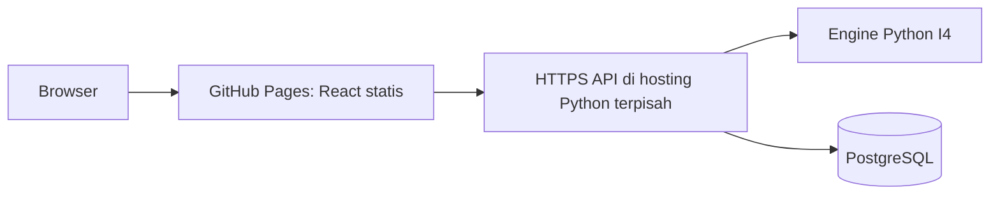
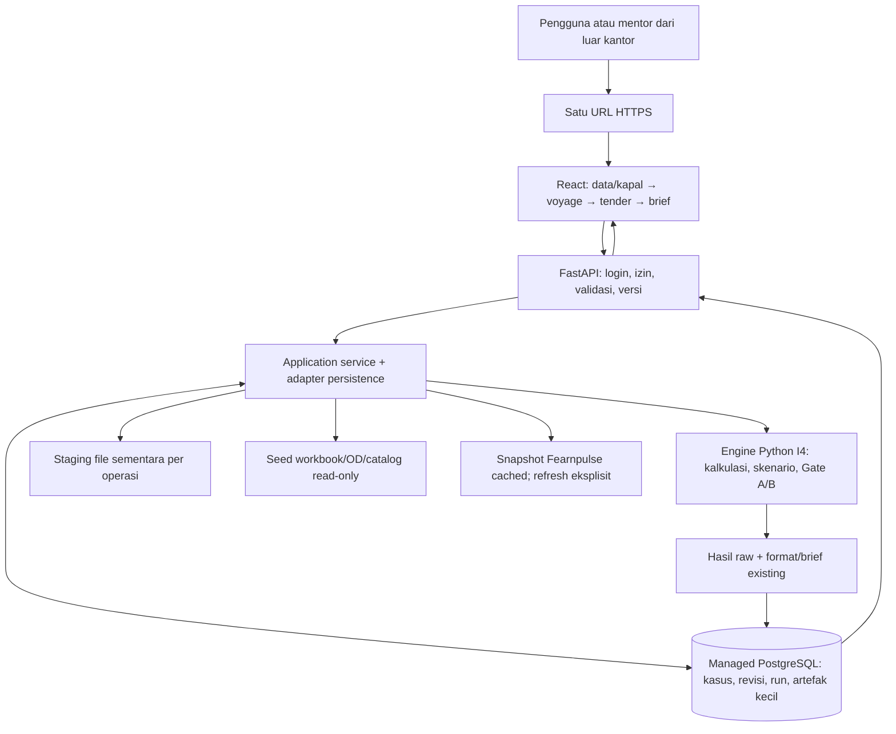

# Rencana Iterasi 5 — demo web CFR DSS untuk 1–3 pengguna

Diperbarui 28 Oktober 2026 (D-072). Status: perencanaan; belum implementasi/deploy. I4 telah diterima mentor. Baseline [57257c0](https://github.com/aidanismail/pilog-cfr-dss/commit/57257c07299cd74d7172a84d3ec158e5679a7c1e) sudah dipush ke origin/dev; 239/239 tes release lulus. Repo tetap PRIVATE.

## 1. Kebutuhan yang sudah dijawab

| Hal | Konfirmasi pengguna |
|---|---|
| Akses | Bisa dari luar kantor |
| Infrastruktur | Belum ada server/VM/cloud yang tersedia |
| Gagasan hosting | GitHub Pages/github.io untuk demo |
| Pengguna awal | Perkiraan 1–3 orang |
| Hak penggunaan | Perlu membuat dan mengubah kasus, bukan hanya membaca |
| Audiens | Mentor dan rencana demonstrasi ke PIHC |
| System design | Pengguna sedang membuat kotretan; akan diunggah kemudian |

Informasi ini menggantikan asumsi VM/intranet dan matriks role kompleks pada plan awal. I5 diperkecil menjadi **demo fungsional**, bukan deployment enterprise. Kapasitas 1–3 adalah kebutuhan awal, bukan hasil load benchmark. Rancangan perlu disinkronkan dengan kotretan pengguna setelah diterima; belum mengklaim telah membacanya.

Tujuan: pengguna membuka URL HTTPS, login, membuat/mengubah kasus, menjalankan alur empat langkah dan mengunduh hasil tanpa memasang Python/Node dan tanpa laptop pengembang harus menjadi server.

## 2. Keputusan arsitektur yang direkomendasikan

**Satu web service untuk React build + FastAPI + engine Python existing, dengan PostgreSQL terkelola.** Contoh kandidat layanan: Render untuk aplikasi dan Neon untuk database. Ini rekomendasi, bukan akun/layanan yang telah dibuat atau pilihan provider yang sudah disetujui pengguna.

| Bagian | Pilihan demo |
|---|---|
| Kalkulasi | Python Decimal/modules I4 yang sudah diterima |
| API | FastAPI + Pydantic + Uvicorn sebagai adapter |
| UI | React + TypeScript + Vite; UX/logo/warna I4 dipertahankan |
| Hosting utama | Satu web service HTTPS; FastAPI menyajikan build statis React dan /api |
| Database | Managed PostgreSQL, contoh Neon; bukan DB baru yang dioperasikan sendiri |
| Identitas | 1–3 akun demo individual, dibuat terbatas; tidak perlu SSO/role enterprise dahulu |
| Akses kasus | Workspace demo dengan izin membuat/mengubah kasus; actor dan revision tetap tercatat |
| Artefak awal | JSON/MD/audit/snapshot kecil disimpan di DB, ZIP disusun saat unduh dari bytes tersimpan |
| Pengemasan | Satu image multi-stage atau native build yang reproducible, mengikuti host terpilih |
| Lokal | Docker Compose opsional untuk development/rehearsal; bukan syarat mempunyai VM sendiri |

Satu origin memudahkan login/sesi, routing dan request API. Node hanya diperlukan saat build frontend; perhitungan tetap di server Python. FastAPI mendukung penyajian static files. Route /api harus didaftarkan dengan benar; fallback React tidak boleh menyamarkan error API. [FastAPI Static Files](https://fastapi.tiangolo.com/tutorial/static-files/).

React dipilih karena form, tabel dan state empat langkah. Tidak perlu PHP tambahan. Kalau cuma ingin akses remote secepatnya, Streamlit existing juga dapat di-host; porting dipilih untuk UI/API terpisah, bukan karena Streamlit tidak bisa dibuka dari laptop lain.

## 3. Apa yang bisa dan tidak bisa dilakukan GitHub Pages

Pages dapat menyajikan hasil build React/HTML/CSS/JavaScript. **Pages tidak menjalankan server Python/FastAPI, PHP atau database.** Jadi Pages saja belum menjadi hosting untuk sistem yang menghitung dan menyimpan perubahan kasus di backend. [GitHub Pages](https://docs.github.com/en/pages/getting-started-with-github-pages/what-is-github-pages), [membuat Pages](https://docs.github.com/en/pages/getting-started-with-github-pages/creating-a-github-pages-site).

Jika tetap memakai github.io:



Konsekuensi praktis:
- Minimal ada tempat hosting backend selain Pages.
- GitHub Free mendukung Pages untuk repo publik; private-repo Pages bergantung paket yang mendukung. Paket akun pengguna belum diverifikasi. Jangan mengubah repo DSS private menjadi public agar Pages aktif.
- Situs Pages default dapat diakses publik meskipun sumbernya private. Hanya build frontend yang boleh dipublikasikan; dataset, dokumen internal, OE/HPS, bid, source snapshot, kredensial dan hasil tidak masuk bundle statis.
- Jangan mempublikasikan root repo atau seluruh docs sebagai site; folder tersebut memuat materi yang tidak diperlukan frontend.
- API tetap memeriksa login dan izin. CORS bukan pengganti autentikasi.
- Untuk frontend dan API berbeda origin, desain sesi/token harus sesuai browser; jangan mengandalkan third-party cookie pasti berfungsi atau hardcode satu API secret pada React.
- Atur base path Vite /pilog-cfr-dss/ dan routing statis yang benar; HashRouter dapat dipakai agar refresh URL kasus tidak memerlukan fallback server Pages.
- Private repository tidak otomatis berarti private website.

**Rekomendasi tetap satu URL aplikasi**, karena lebih sedikit konfigurasi lintas origin dan layanan yang perlu dirawat. Pages merupakan alternatif frontend, bukan keharusan dan bukan pilihan backend.

## 4. Diagram utama demo



Tidak ada Kubernetes, Redis, queue worker, multi-replica atau websocket auction yang diwajibkan demo ini. Persiapan scaling cukup pada adapter, persistence dan kontrak API yang tidak menyimpan shared state hanya di memori.

## 5. Keterbatasan free tier yang memengaruhi demo

Dokumentasi Render yang dibaca 28 Oktober menyebut free web service tidur setelah 15 menit tanpa traffic, bangun kembali sekitar satu menit, filesystem ephemeral dan tidak mendukung persistent disk. Free Render Postgres mempunyai masa berlaku 30 hari dan tidak menyediakan backup. Karena itu jangan menaruh satu-satunya salinan kasus di SQLite/file lokal free web service dan jangan menganggap free DB 30 hari sebagai penyimpanan demo jangka panjang. [Render free services](https://render.com/docs/free).

Neon menawarkan PostgreSQL free tier untuk prototipe dengan kuota pemakaian/storage dan scale-to-zero; itu kandidat persistence di luar web service, bukan jaminan tanpa batas atau SLA. Paket/kuota perlu dicek lagi saat memilih provider. [Neon plans](https://neon.com/docs/introduction/plans), [Neon pricing](https://neon.com/pricing).

| Kebutuhan | Rencana demo |
|---|---|
| Latihan awal berbiaya rendah | Free app service + managed free DB sebagai kandidat, tunduk kuota |
| Kasus tetap ada setelah restart/sleep | Canonical state dan hasil tersimpan di DB |
| Demo PIHC | Uji akses jaringan nyata, buka aplikasi dan jalankan kasus sebelum sesi |
| Waktu membuka aplikasi penting | Pertimbangkan instance aplikasi always-on berbayar kecil jika anggaran tersedia |
| Cold start/gangguan | Siapkan baseline lokal I4 dan paket hasil yang bisa dibuka sebagai fallback |
| Backup | Export database/snapshot demo dan verifikasi satu restore; jangan menganggap free tier punya semua backup |

Tidak mengaktifkan paket berbayar, memasukkan kartu atau membuat akun dalam tahap plan. Free adalah opsi awal untuk dibahas, bukan anggaran yang sudah dikonfirmasi. Jangan mengakali free tier dengan janji always-on/ping buatan; pilih paket yang sesuai kebutuhan presentasi.

## 6. Logika yang tidak berubah

- PI menjual barang, PILOG menjual jasa freight. Tidak ada penggantian otomatis kerugian freight dari PI.
- FOB = indeks + alpha buyer; CFR = FOB + freight tetap. Alpha tidak digandakan.
- Gate A: latest-valid bid dan FOB >= OE/HPS. Itu floor barang, bukan bukti laba PI.
- Gate B: screen awal kelas/gross DWT dan kontribusi PILOG >= 0. Nol lolos, raw negatif tetap gagal walaupun tampil -0,00.
- Gate A gagal → Gate B belum dievaluasi; outcome bisnis GO/NO GO saja, reason tetap.
- Komisi nol, OD hanya jarak, dry-bulk satu arah, empat profil sampai Supramax; Godau proxy Handysize eksplisit.
- Fearnpulse mengikuti profil, raw source/date/units dipertahankan, refresh tidak mereprice kasus fixed.
- Reforecast biaya pada quote/bid sama, versi/waktu/alasan tercatat; penawaran baru merupakan revisi eksplisit.
- Putaran 180 detik sesuai clock kasus; bukan live auction.
- Python Decimal/raw string tetap; UI/brief dua desimal Indonesia HALF_UP, minimum impas CEILING.
- Engine/rule I4.1 dan brief I4-BRIEF.8 tetap sampai perubahan bisnis terpisah disetujui.
- Empat analisis pendukung tetap cakupan dasar existing; tidak menambah hedge/FFA, AI, optimizer kapal, actual readiness atau profit PI.

I5 memindahkan cara akses dan penyimpanan, bukan menghitung ulang bisnis di React/PHP. Dataset accepted tetap dipakai; perubahan sumber tidak dijadikan proyek audit ulang yang menghalangi demo.

## 7. State dan persistensi yang cukup untuk 1–3 editor

InteractiveCase I4 tidak mengimpor Streamlit, tetapi menyimpan context/rows/preparation/result dalam object serta menggunakan IO file. API tidak boleh membagikan satu instance mutable antar-user/request.

- Simpan canonical case, revision dan fixed quote dalam DB. Rehidrasi service dari salinan, bukan mengambil object global.
- Akun individual tetap berguna untuk mencatat siapa mengubah kasus, meskipun hak demo sama.
- Request perubahan membawa expected_revision; konflik ditolak 409, bukan silent overwrite.
- Klik ulang/retry menggunakan idempotency key dan request hash untuk menghindari quote/run duplikat.
- Ekonomi engine tetap dapat menerima file: materialisasikan CSV/context ke staging privat sementara, lalu simpan hasil lengkap ke DB sebelum staging dibersihkan.
- Simpan result JSON, teks MD/audit final, manifest dan captured input bytes kecil dalam DB. Tidak perlu provider object storage tersendiri untuk demo kecil ini.
- ZIP diunduh dari bytes/text immutable yang sudah disimpan. Jangan merender ulang hasil lama menggunakan versi formatter baru tanpa versioning.
- Snapshot/source besar dapat dideduplikasi berdasarkan hash; workbook seed tetap read-only dalam aplikasi, bukan disalin sebagai upload besar setiap kasus.
- Jika proses terhenti, run partial tidak dianggap READY. Retry/reopen harus dapat pulih dari canonical state.
- Tidak menyimpan seluruh source repo dalam direktori static; unduhan run melewati API berizin.

Volume/object storage adalah jalur pengembangan jika artefak membesar. Ukuran/kuota DB perlu diukur pada contoh nyata; tidak mengklaim kapasitas tak terbatas.

## 8. API, login dan UX minimal

Frontend menggunakan React TS/Vite dengan komponen form/tabel sederhana dan styling I4. React Router/TanStack Query/form helper dapat digunakan sesuai kebutuhan; tidak membangun design system besar.

API minimal /api/v1:
- Session/login/logout dengan library auth yang dipelihara; akun demo dibuat terbatas, tidak ada signup publik.
- Katalog profil, market snapshot cached dan refresh eksplisit sesuai izin.
- Create/list/read/update case, revision dan prepare voyage.
- Fix freight, apply bid/scenario, tender preview, cost forecast dan new-offer revision.
- Evaluate, read run dan download brief/audit/JSON/ZIP.
- Liveness/readiness termasuk akses DB.

Semua endpoint kasus/run/unduhan diperiksa backend. HTTP 401/403 untuk akses, 422 schema invalid, 409 konflik versi; business NO GO tetap respons evaluasi valid. Cookie/session aman pada satu origin; secret berada di environment server, tidak di VITE_* atau bundle React.

Tidak perlu SSO korporat, matriks RBAC besar atau dashboard per divisi untuk demo. Fondasi akses tetap jelas; role resmi menjadi pengembangan berikutnya. Metode auth/provider belum dipasang dan disesuaikan dengan host terpilih.

Empat langkah I4, satu pemilih kapal, sumber harga terpisah, tabel tender per putaran dan brief tetap. Hasil stale disembunyikan ketika edit belum diterapkan. Backend menyediakan raw dan presentation; browser tidak menentukan gate atau menghitung uang dengan floating point.

## 9. Batch dan struktur saat implementasi

| Batch | Cakupan demo | Bukti selesai |
|---|---|---|
| I5-0 | Sinkron kotretan, pilih provider/anggaran, kontrak API/auth | Diagram final dan pilihan hosting disepakati |
| I5-1 | Persistence ringan dan revision adapter | Create/edit/reopen tetap ada setelah restart; konflik terdeteksi |
| I5-2 | FastAPI + engine + akun demo | API/CLI raw parity, fixed quote/reforecast dan download benar |
| I5-3 | React empat langkah, disajikan app yang sama | UX I4 setara dan bisa dipakai lewat satu URL |
| I5-4 | Uji 1–3 editor, retry, snapshot/source failure | Tidak tertimpa/duplikat; raw/format dan izin konsisten |
| I5-5 | Hosting demo, backup/export dan cold-start rehearsal | URL luar kantor bekerja, data survive restart, fallback tersedia |
| I5-6 | Mentor/PIHC rehearsal dan feedback | Create/edit/evaluate/reopen/download dari laptop lain teruji |

Jumlah user kecil mengurangi scope infrastruktur; seluruh logika empat langkah tetap harus dipertahankan. Estimasi jadwal dirapikan setelah kotretan/provider dipilih, tidak menjanjikan migrasi seluruh produk selesai satu hari.

```text
apps/streamlit_app.py                 # baseline I4 tetap
apps/web/                            # React build
src/pilog_cfr_dss/api/                # HTTP/auth adapter
src/pilog_cfr_dss/persistence/        # DB/repository/blob metadata
src/pilog_cfr_dss/application/        # reuse + seam IO
src/pilog_cfr_dss/calculations/       # tetap
src/pilog_cfr_dss/decisions/          # tetap
src/pilog_cfr_dss/reporting/          # tetap
migrations/                          # versioned DB schema
infra/Dockerfile.demo                 # opsional multi-stage satu app image
tests/api/                           # parity/auth/revision/retry
tests/ui/                            # browser flow
data/raw/ dan data/processed/         # seed backend read-only
docs/it_5/ITERATION_05_PLAN.md         # rencana ini
```

Folder tersebut baru rencana. Tidak ada scaffold, dependency, akun, database, container atau deployment baru yang dibuat.

## 10. Acceptance demo dan persiapan PIHC

| Cek | Hasil yang diwajibkan |
|---|---|
| Paritas I4 | GO, floor NO GO, economic NO GO; index/bid/cost/contribution/reason sama |
| Angka | Raw presisi tetap, format dua desimal dan minimum impas aman |
| Fixed/reforecast | Quote/time/bid tidak berubah otomatis |
| Hak edit | Akun demo dapat membuat/mengubah kasus; akses luar kantor teruji |
| Dua editor | Konflik versi terlihat, tidak saling menimpa |
| Retry | Tidak membuat dua quote/run |
| Persistence | Restart/sleep/redeploy tidak menghapus canonical cases dan hasil |
| Unduhan | MD/JSON/audit/ZIP berasal dari run yang sama |
| Gangguan sumber | Snapshot cached tetap bisa dipakai; error tidak menjadi angka nol/GO |
| Presentasi | Uji browser laptop lain dan jaringan luar kantor, bukan localhost saja |

Baseline 239 tes dipertahankan; tambah tes API/parity/concurrency/akses dan Playwright. Golden values dari engine accepted, bukan LLM. Source refresh tidak diwajibkan saat presentasi; tanggal snapshot ditampilkan apa adanya.

Sebelum PIHC: siapkan tiga kasus contoh yang jelas, dry rehearsal lengkap, cek cold start/network, akun siap, export data dan hasil, serta jalur lokal I4 jika layanan eksternal bermasalah. Provider free tidak dianggap memiliki SLA demo.

## 11. Yang ditunda

VM sendiri, reverse proxy kustom, HA/multi-replica, Kubernetes, queue worker, object storage terpisah, SSO penuh, RBAC/dashboard per divisi, live auction, integrasi AIS/SAP/Fleetra, AI market reports, FFA/hedging dan model ekonomi baru. Tambahkan hanya jika kebutuhan berikutnya jelas.

GitHub Pages hanya ditambahkan jika memang dipilih untuk frontend; jangan menambahnya otomatis karena sudah ada source di GitHub.

## 12. Referensi dan batas informasi

Dibaca 28 Oktober; harga/kuota provider diverifikasi kembali sebelum pembuatan layanan.
- [GitHub Pages static hosting](https://docs.github.com/en/pages/getting-started-with-github-pages/what-is-github-pages).
- [GitHub Pages: private repo, public site dan batas server-side](https://docs.github.com/en/pages/getting-started-with-github-pages/creating-a-github-pages-site).
- [FastAPI static files](https://fastapi.tiangolo.com/tutorial/static-files/).
- [Render FastAPI deployment](https://render.com/docs/deploy-fastapi).
- [Render free limits: sleep, ephemeral filesystem, DB expiry](https://render.com/docs/free).
- [Neon plans](https://neon.com/docs/introduction/plans), [Neon pricing](https://neon.com/pricing).
- [React/Vite](https://react.dev/learn/build-a-react-app-from-scratch).
- [Vite static deployment](https://vite.dev/guide/static-deploy).
- [FastAPI deployment concepts](https://fastapi.tiangolo.com/deployment/concepts/).

Provider/free tier adalah kandidat engineering, bukan layanan yang sudah diprovision. Konfirmasi pengguna menyelesaikan akses/jumlah editor/infrastruktur yang tidak ada; belum menetapkan provider, anggaran atau mengizinkan deployment aktual.

## 13. Langkah berikutnya

Gabungkan kotretan system design setelah diunggah, lalu finalkan satu opsi hosting dan urutan implementasi. Tidak mengklaim telah membaca gambar yang belum diterima.

Satu pertanyaan tersisa yang memengaruhi hosting: apakah tahap awal harus Rp0 sepenuhnya, atau boleh anggaran hosting kecil agar aplikasi tidak cold start pada hari presentasi PIHC? Sambil menunggu, rencana memakai free-tier sebagai kandidat latihan awal, bukan janji always-on.
