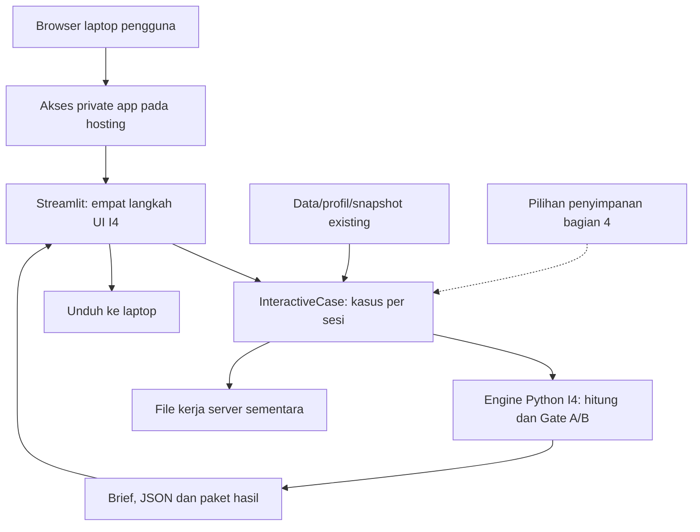

# Rencana Iterasi 5 — aplikasi I4 bisa dipakai dari laptop lain

Diperbarui 29 Oktober 2026 (D-076). Status: revisi dataset/pilihan UI dan diversifikasi profil/contoh bid-risiko acak selesai teknis, deployment Streamlit masih rencana. I4 diterima melalui konfirmasi pengguna. Baseline [57257c0](https://github.com/aidanismail/pilog-cfr-dss/commit/57257c07299cd74d7172a84d3ec158e5679a7c1e), 239/239 tes release lulus. Repo tetap PRIVATE.

## 1. Keputusan arah

**Prioritas: host aplikasi Streamlit existing agar dapat digunakan dari laptop beliau. Tunda porting FastAPI/React.** Ini mengganti rekomendasi porting pada D-071/D-072, bukan membuang engine atau UI I4.

Pengguna menegaskan belum ada kebutuhan RBAC yang pasti. Alasan teknis penundaan API adalah belum ada konsumen API terpisah atau kebutuhan UI yang mengharuskan porting. FastAPI tidak mensyaratkan RBAC; sebaliknya Streamlit tetap memerlukan pembatasan akses bila dibuka melalui internet.

| Kebutuhan | Status |
|---|---|
| Akses dari luar kantor | Dikonfirmasi |
| Pengguna awal | Perkiraan 1–3 orang, bukan hasil load test |
| Aktivitas | Membuat/mengubah kasus, menghitung, membaca dan mengunduh hasil |
| Server tersedia | Belum ada |
| Tujuan dekat | Dipakai dari laptop beliau; kemudian demonstrasi PIHC |
| Stack | Pertahankan Streamlit + modul Python I4 |
| RBAC per jabatan/divisi | Belum ditetapkan; ditunda |
| Penyimpanan kasus lintas sesi/restart | Belum dikonfirmasi; perlu memilih bentuk sederhana |
| Kotretan desain pengguna | Akan diunggah; belum dibaca |
| Implementasi/deployment | Belum dimulai atau diotorisasi oleh revisi rencana ini |

Ukuran keberhasilan I5 adalah aplikasi dapat dipakai dengan hasil setara I4. Pergantian framework bukan ukuran keberhasilan.

## 2. Hosting yang direkomendasikan

**Kandidat utama: Streamlit Community Cloud, aplikasi private dari repo existing, akses melalui URL HTTPS.** Verifikasi akses akun GitHub, slot private app dan build saat persiapan; belum membuat layanan atau mengirim undangan.

Dokumentasi mendukung satu private app dengan viewer yang diberi akses lewat email. Viewer berarti akses aplikasi, bukan izin mengubah source/deployment; kontrol UI aplikasi tetap menentukan apa yang dapat dilakukan di dalam kasus. Tidak perlu memberikan akses repo GitHub kepada beliau hanya untuk memakai aplikasi. [Pengaturan sharing](https://docs.streamlit.io/deploy/streamlit-community-cloud/share-your-app).

| Komponen | Pilihan minimal |
|---|---|
| Browser | Laptop beliau/pengguna |
| Aplikasi | Streamlit existing, entrypoint apps/streamlit_app.py |
| Logika | Application service, calculations, decisions dan reporting I4 |
| Data awal | Workbook/register/profil/snapshot existing yang diperlukan |
| Akses | Private app dan viewer terbatas; tanpa membangun role korporat |
| Hasil | Brief MD, hasil JSON, paket snapshot/ZIP existing |
| Kasus tersimpan | Ditentukan pada bagian 4 sebelum implementasi |
| GitHub | Source private; bukan host runtime melalui GitHub Pages |

Ini rekomendasi engineering untuk demo. Provider belum dipilih pengguna dan ketersediaan slot/akses akun belum diperiksa. Tidak menjanjikan always-on/SLA atau kapasitas tertentu.

Jika platform tersebut tidak cocok, host Streamlit pada satu layanan Python lain; evaluasi persistence dan aksesnya terlebih dahulu. Render/Neon bukan lagi komponen wajib. GitHub Pages tidak menjalankan server Python, sehingga bukan jalur utama.

## 3. Alur yang akan di-host

Tidak ada lapisan React, API terpisah atau dashboard per peran dalam pekerjaan awal ini. Matematika tetap di engine; UI tidak menghitung ulang uang.

## 4. Penyimpanan: keputusan yang masih dibutuhkan

Ada perbedaan antara **mengubah kasus saat aplikasi sedang dibuka** dan **menemukan kasus yang sama setelah sesi/server restart**.

Temuan kode:
- views.py menyimpan InteractiveCase pada st.session_state; masing-masing sesi memiliki object kasusnya.
- Menu Draft lokal mencari ui_*/revision_*/case_fixture.json pada folder bersama outputs/ui_cases.
- InteractiveCase.save menulis context dan CSV pada server, bukan otomatis ke laptop pengguna.
- Download brief/JSON/ZIP tersedia setelah evaluasi. Paket hasil existing belum berarti sudah ada fitur UI impor untuk melanjutkan draft.
- Session State berlaku per sesi, bukan database. [Streamlit Session State](https://docs.streamlit.io/develop/concepts/architecture/session-state).
- Community Cloud tidak menjamin local-file persistence. Jangan mengklaim tombol Simpan draft sudah menyimpan permanen. [Penyimpanan lokal](https://docs.streamlit.io/develop/concepts/connections/connecting-to-data).

### Opsi A — paket kasus untuk demo ringan

Rekomendasi awal bila tidak membutuhkan daftar kasus permanen:
- Kasus kerja per sesi; jangan memperlihatkan draft sesi lain melalui daftar folder global.
- Pertahankan unduhan hasil existing.
- Tambahkan ekspor/impor **paket kasus yang dapat diedit kembali**, termasuk context/CSV yang diperlukan; bukan hasil JSON saja.
- Pengguna mengunduh paket ke laptop dan membukanya kembali saat diperlukan.
- Impor perlu validasi schema, ukuran, path dan kesesuaian quote/input; tidak mengekstrak ZIP tanpa pembatasan.
- Folder server dipakai sebagai ruang kerja sementara. Perubahan yang belum diekspor dapat hilang ketika sesi/restart berakhir.

Ini membutuhkan pekerjaan kecil pada kode dan tes; **belum diimplementasikan**. Jangan menyebut pengalaman menyimpan permanen bila memilih opsi ini.

### Opsi B — kasus tetap tersimpan di aplikasi

Jika beliau perlu membuka kembali daftar kasus tanpa mengunggah paket:
- Tambahkan penyimpanan persisten langsung pada service Streamlit.
- Pilih managed DB atau host dengan persistent volume sesuai kebutuhan dan anggaran.
- Untuk 1–3 pengguna, managed DB dapat menyimpan context, CSV, revision dan artefak kecil; tidak perlu API eksternal.
- Atur workspace yang jelas, versi/konflik penulisan, backup dan reopen setelah restart.
- SQLite/file pada filesystem ephemeral bukan solusi permanen; volume persisten juga membutuhkan backup.

Opsi B tidak otomatis memerlukan FastAPI/React. Jangan memasang DB hanya karena kelak akan ada RBAC, tetapi jangan menunda persistence bila ternyata itu kebutuhan penggunaan sekarang.

## 5. Persiapan deployment yang benar-benar diperlukan

Inspeksi awal sudah menemukan pekerjaan berikut; belum dilakukan perubahan runtime:
- Root requirements.txt berisi openpyxl/pypdf, sedangkan pin Streamlit ada di requirements-ui.txt. Deployment harus memasang dependency UI yang benar, bukan mengandalkan versi default hosting.
- .streamlit/config.toml mengikat server.address ke 127.0.0.1. Sesuaikan binding/port sesuai hosting tanpa merusak penggunaan lokal; uji di lingkungan target.
- Cloud berjalan di Linux: periksa case-sensitive filename, separator/path relatif dan file yang benar-benar tercatat di Git. Entrypoint existing sudah membentuk ROOT dari lokasi file.
- Pastikan profil empat workbook, i4_context/CSV, snapshot Fearnpulse dan logo ada pada deployment. Jangan mengandalkan file yang hanya ada di laptop atau outputs yang di-ignore.
- latest_saved harus memperoleh cached snapshot saat start; network refresh bukan syarat selalu sukses pada demonstrasi.
- Data/sumber seed tetap read-only. Refresh yang menulis snapshot dan run harus memakai ruang kerja yang dapat ditulis sesuai deployment, tidak mengubah sumber accepted.
- Bersihkan/lingkupi draft serta file temporer per sesi; jangan mengandalkan sesi Streamlit memisahkan file global secara otomatis.
- Jangan menjalankan server demo dari laptop pengembang sebagai ketergantungan harian. Laptop beliau cukup browser/internet.

Community Cloud memakai Linux dan dependency file; cocokkan Python/dependency dengan lingkungan yang diuji. [Dependensi cloud](https://docs.streamlit.io/deploy/streamlit-community-cloud/deploy-your-app/app-dependencies).

## 6. Logika bisnis tetap

- PI menjual barang; PILOG menjual freight. Tidak ada penggantian otomatis kerugian PILOG dari PI.
- FOB = indeks + alpha buyer sekali; CFR = FOB + freight tetap.
- Gate A: latest valid bid dan FOB >= OE/HPS; bukan bukti laba PI.
- Gate B: screen awal kelas/gross DWT dan kontribusi PILOG >= 0. Gate A gagal → B belum dievaluasi.
- Outcome GO/NO GO, komisi nol, OD hanya jarak, dry bulk laden satu arah.
- Profil/snapshot/source/time/proxy tetap; refresh tidak mereprice fixed quote.
- Cost reforecast dan revisi penawaran eksplisit mengikuti kontrak existing.
- Python Decimal/raw strings tetap; tampilan Indonesia dua desimal HALF_UP dan minimum impas CEILING.
- Engine/rule I4.1 dan brief I4-BRIEF.8; tidak memperluas risiko/FFA/AI/optimizer atau menghubungkan Fleetra.
- UI empat langkah, satu pemilih kapal dan tabel tender per putaran dipertahankan.

## 6.1. Revisi sebelum deploy — empat voyage dan profil kapal terpisah

D-074: pengguna mengizinkan perubahan isi dan nama sheet dalam Voyage Estimate.xlsx, termasuk nilai contoh yang wajar, dengan format/warna/posisi tabel/ukuran kolom dan baris tetap. Tindakan ini diizinkan sekarang; bukan izin porting atau deploy. Empat kasus urea: Bontang–Mundra 30.000 MT, Bontang–Davao 28.000 MT, Bontang–Bangkok 32.000 MT dan Bontang–Hai Phong 29.000 MT. Jarak berasal dari OD yang tidak diubah. Handling, waiting dan port expenses merupakan asumsi demo eksplisit, bukan tarif/produktivitas aktual.

Step 1 memiliki dua pilihan independen: Voyage Estimate untuk rute/cargo/handling/waiting/port expenses dan Profil kapal untuk DWT/speed/consumption/running. Fearnpulse mengikuti kelas kapal dan tetap memasok harga bunker. Memilih voyage tidak memaksa profil dari sheet yang sama. Dua profil Supramax dibedakan kecepatannya. Sheet asal hanya provenance, bukan nama kapal/rute yang disamakan.

Pembaca mengambil isi workbook yang aktif dengan cache berdasarkan hash, sehingga perubahan file tidak berhenti di JSON processed yang stale. Parse rumus handling yang didukung secara eksplisit, bukan mengeksekusi Excel secara umum. Tanda asumsi dan sumber sel masuk audit/context. Pergantian basis fixed harus lewat revisi; quote/bid/hasil lama tidak dimutasi. Contoh GO/NO GO dan perbandingan kapal mempertahankan voyage terpilih. Workbook asli I4 diarsipkan untuk regresi/histori; seed I4/CLI lama tidak dirusak akibat nama tab baru.

V0..V4: inspeksi → isi/nama sheet dengan format identik → source/service catalogs → dua pemilih UI → validasi sel/format, 16 kombinasi, GO/NO GO, replay serta UI. Belum menganggap 239 tes lama evidence hasil revisi ini.

## 6.2. Hasil revisi workbook dan UI

| Sheet voyage | Muatan MT | Jarak NM | Muat MT/hari | Bongkar MT/hari | Tunggu hari | Port/other USD |
|---|---:|---:|---:|---:|---:|---:|
| Bontang-Mundra | 30.000 | 3.906 | 5.000 | 5.000 | 0 | 200.000 |
| Bontang-Davao | 28.000 | 697 | 5.000 | 4.500 | 0,5 | 90.000 |
| Bontang-Bangkok | 32.000 | 1.751 | 5.000 | 4.000 | 1 | 120.000 |
| Bontang-Hai Phong | 29.000 | 1.577 | 5.000 | 5.000 | 0,5 | 110.000 |

Seluruhnya urea granular bulk dan laden satu arah. Muatan/handling/waiting/biaya port adalah asumsi demo yang diizinkan, bukan quote terminal. Total port diturunkan dari komponen I33:I37, tidak termasuk bunker/running. J33 menjumlahkannya sekali; merge J33:J37 pada sheet bekas AQABA tetap. Rumus/range/tata letak/style/warna/ukuran asli dipertahankan kecuali isi/formula yang relevan. Shared formula lama diekspansi menjadi formula per sel agar cache hasil dihitung ulang dengan benar; bukan mengubah model ekonomi.

Sumber utama data/raw/Voyage Estimate.xlsx, mirror Experiments/Voyage Estimate.xlsx identik. Arsip docs/it_4/Voyage Estimate I4.xlsx byte-identik dengan source I4 dan menjaga preparer historis. Nama tab dapat berubah tanpa mengganti ID kapal: kode B3 HS36/SUP58A/SUP58B/HMX47 mengikat profil. UI memakai kelas/DWT/speed; technical IDs lama hanya kompatibilitas CLI.

Aplikasi membaca workbook aktif melalui source/service dan cache hash. scripts/sync_voyage_inputs.py memperbarui JSON derived tanpa fetch. Edit workbook tidak otomatis mengganti quote/kasus fixed: tombol Gunakan workbook terbaru membuat basis baru tanpa bid lama. Header/perhitungan/brief menggunakan voyage dan kapal yang benar-benar dipilih. Contoh sidebar memuat source valid untuk pilihan tersebut, sehingga input manual invalid tidak terbawa.

Verifikasi: full suite 252/252 lulus (45,498 detik), 37 targeted final setelah default dinamis/guard return-leg lulus, 16 pasangan voyage/kapal dan replay offline, cached Excel versus engine pada empat sheet sama, serta browser GO/floor NO GO/economy NO GO + unduhan + 390px PASS/0 JavaScript error. Worksheet styles/row/column/merge serta ZIP parts di luar sheet/workbook identik. Server uji dihentikan; tidak ada deployment atau server pengguna yang dinyalakan.

## 6.3. Diversifikasi profil — D-075, 29 Oktober

Pengguna meminta eksekusi dua Handysize dan dua Supramax. Physical profile berikut adalah asumsi demo eksplisit, bukan datasheet kapal aktual atau spesifikasi dari Fearnpulse.

| Kode | Kelas | DWT MT | Speed laden knot | Fuel oil laut MT/hari | Diesel laut MT/hari | Diesel port MT/hari | Running USD/hari |
|---|---|---:|---:|---:|---:|---:|---:|
| HS36 | Handysize | 36.000 | 11,5 | 17 | 0,12 | 2,52 | 4.800 |
| HS38 | Handysize | 38.000 | 12,5 | 20 | 0,15 | 2,856 | 5.200 |
| SUP54 | Supramax | 54.000 | 12 | 24 | 0,18 | 3,36 | 6.100 |
| SUP58 | Supramax | 58.000 | 13 | 28 | 0,20 | 3,864 | 6.500 |

Formula J6 tetap pola konsumsi port existing, faktor daya berubah sesuai asumsi profil dan dihitung Python/Excel. Speed/consumption ballast ikut dirapikan tetapi return leg tetap tidak dihitung. Keempat voyage, muatan/handling/waiting/port expenses, komisi nol, OD dan gate tidak diubah.

Snapshot Fearnpulse fp_0c09d954579d462399907cba2583d663 diambil 28 Oktober. Seri TC observasi 21 Oktober: Handysize 38k 14.500 USD/hari dan Supramax 58k 17.500 USD/hari. Kedua profil dalam kelas memakai benchmark kelas yang sama; tidak mengarang quote aktual atau premium antar ukuran. Harga bunker dari snapshot sama, tanggal aslinya tetap; bukan klaim live fetch 29 Oktober. Fearnpulse tidak memasok physical specifications sintetis di tabel. Acuan: https://fearnpulse.com/#2.

VE-PROFILES.3 dan source_status simulation_only_workbook_vessel_profile disimpan di catalog/lineage; UI menandainya sebagai asumsi. Alias kode HS38/SUP54/SUP58 menjaga technical ID CLI ve_aqaba/ve_sby/ve_godau, bukan mengubah isi quote/kasus lama. Cache berdasarkan hash dan workbook reload eksplisit tetap berlaku. Sumber aktif/mirror disinkronkan, format dan arsip I4 dipertahankan.

Regresi: 254/254 full suite lulus; termasuk 16 pasangan, cached Excel-engine parity, source binding, dua kelas tepat, variasi field dan pembacaan Handymax historis. Angka stress beberapa tes diubah dari port 450k ke 600k karena profil baru masih untung pada 450k; gate tidak diubah untuk memaksa NO GO. Full suite 45,411 detik; browser GO/floor NO GO/economy NO GO/unduhan/390px PASS, 0 JS error. Server uji berhenti; bukti di state/task. Tidak deploy/porting.

## 6.4. Contoh bid/risiko acak — D-076

Pengguna meminta variasi tombol Isi contoh bid tiga putaran karena contoh existing selalu GO. Tombol lama membaca fixture GO yang sama. Freight dasar dirancang mengikuti target TCE, alpha memengaruhi floor PI/Gate A dan stress risiko bukan veto Gate B. Jangan mengubah aturan untuk memaksa campuran outcome.

Generator membuat tiga buyer/tiga putaran, offset alpha bersama plus variasi buyer dan kenaikan per putaran di sekitar alpha minimum turunan indeks/OE. Tidak menebak alpha aktual atau probabilitas pasar; semua input acak berlabel contoh sintetis. Waktu bid mengikuti jendela 180 detik/cutoff kasus, tidak mereset clock. Harga FOB valid/nonnegatif. Acak fuel shock, delay dan kombinasi keduanya; tidak mengubah baseline cost, index, OE/HPS, freight fixed, vessel atau voyage.

Seed 64-bit/version/hash disimpan saat contoh diterapkan untuk trace/replay. Evaluasi tetap deterministik dari snapshot; tidak ada RNG dalam kalkulasi/ranking/gate. Pilihan acak tidak membaca desired outcome. Campuran GO/NO GO harus berasal input yang memenuhi/gagal floor. NO GO ekonomi tetap memerlukan contribution negatif (misal explicit cost reforecast atau offer rendah), bukan sekadar label risiko.

Button awal mengisi draft editor; Acak ulang bid & risiko juga tersedia ketika bid sudah ada. Source case/quote/hasil tidak ditulis sebelum Terapkan bid & risiko. Editor dapat mengubah hasil contoh; metadata mencatat hash generated versus applied, bukan mengklaim seed mereproduksi edit manusia. Revisi penawaran menghapus metadata bid lama. Contoh sidebar GO/NO GO dan fixture CLI tetap eksplisit/deterministik.

Task BID1..3 selesai teknis: 262/262 tes lulus (53,546 detik), seed population menghasilkan GO/NO GO tanpa data invalid, clock/price validity dan replay tidak memakai RNG. Metadata membedakan generated/applied; workbook dan snapshot baru pengguna tidak diubah. Browser memverifikasi initial random draft, dua kali acak ulang, apply, seed/hash JSON, quote tetap dan unduhan; tiga scripted outcome ditambah satu random outcome PASS/0 JS error/390px. Server uji dihentikan. Tidak edit gate atau deploy. Satu tes tanggal lama diperbarui agar membaca tanggal source snapshot aktif, bukan memaksa 21 Oktober setelah pengguna refresh pasar.

## 7. Batch pelaksanaan setelah instruksi implementasi

| Batch | Pekerjaan | Kriteria selesai |
|---|---|---|
| I5-S0 | Pilih penyimpanan A/B, host dan build configuration | Kebutuhan penggunaan dan batas penyimpanan jelas |
| I5-S1 | Readiness Linux/dependency/assets/path/snapshot | Aplikasi start dengan data yang diperlukan |
| I5-S2 | File kerja per sesi dan penyimpanan terpilih | Tidak tertukar; reopen/export sesuai kontrak A/B |
| I5-S3 | Regresi dan browser smoke | GO, NO GO floor dan NO GO ekonomi setara I4; unduhan benar |
| I5-S4 | Deploy private, verifikasi login/URL | Beliau bisa memakai aplikasi dari luar kantor |
| I5-S5 | UAT dan handover | Buat/edit/hitung/unduh, restart/reopen dan fallback teruji |

P0..P4 terdahulu adalah pekerjaan rencana historis; checklist S mengganti batch porting API/React I5-0..6 yang belum pernah dijalankan. Tidak mengklaim semua baseline 239 tes sudah diulang pada revisi dokumen ini.

## 8. Acceptance dan demonstrasi

- Satu URL HTTPS dapat dipakai dari browser laptop beliau tanpa instal Python.
- Akses terbatas sesuai platform; tidak perlu role atau custom login baru bila akses platform mencukupi.
- Dua browser/sesi dapat mencoba kasus berbeda tanpa saling mengganti input/hasil atau membuka draft tidak sengaja.
- Uji tiga hasil: GO, NO GO floor dan NO GO kontribusi PILOG.
- Raw angka/gate/fixed quote identik untuk input sama; tampilan tetap dua desimal.
- Buat/edit/fix freight/tender/reforecast dan revisi penawaran tetap berjalan.
- Brief/JSON/ZIP merujuk run sama, hasil lama tidak disajikan sebagai hasil input baru.
- Opsi A: paket dapat diimpor dan menghasilkan input/perhitungan sama. Opsi B: restart/redeploy tidak menghilangkan kasus dan konflik edit ditangani.
- Siapkan kasus contoh, snapshot cached, unduhan serta baseline lokal I4 sebagai fallback PIHC. Kesiapan cloud diuji, bukan diasumsikan.

## 9. Yang ditunda dan alasan membuka kembali porting

Tunda FastAPI, React/PHP, RBAC per divisi, SSO kustom, live auction, queue/replica, Kubernetes, AI/FFA dan model ekonomi baru.

Evaluasi ulang API/frontend terpisah jika ada konsumen API/integrasi nyata, kebutuhan UX yang terhalang Streamlit, workflow multi-role yang sudah ditetapkan, atau hasil pengukuran menunjukkan batas concurrency/performa. RBAC sendiri juga tidak memaksa migrasi framework.

## 10. Langkah berikutnya

Konfirmasi apakah perlu daftar kasus permanen atau cukup paket unduh/impor untuk tahap penggunaan awal. Rekomendasi A bersifat usulan, bukan jawaban pengguna. Anggaran hosting belum dijawab; free cloud hanya kandidat.

Kotretan pengguna digabungkan setelah diunggah. V1..V4 dataset/UI telah diimplementasikan sesuai D-074. Belum membuat akun, mengundang viewer atau deploy; porting tetap ditunda.
