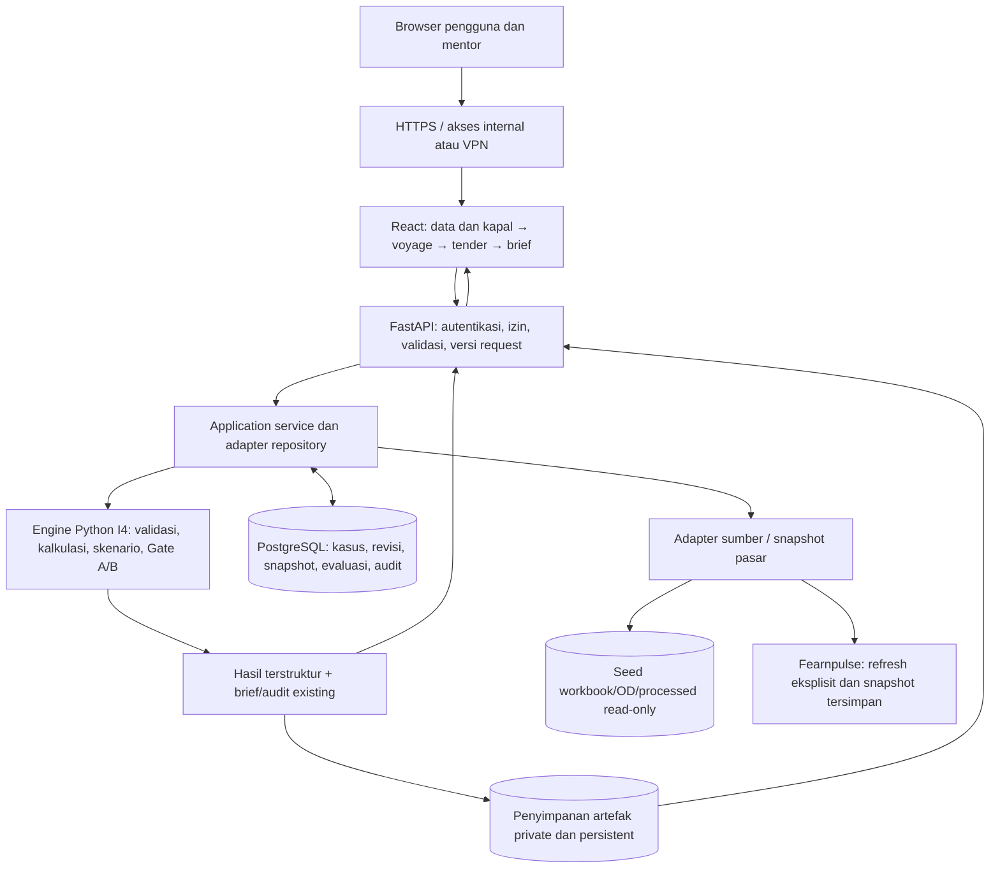

# Rencana Iterasi 5 — porting API, antarmuka web dan deployment pilot

Tanggal: 28 Oktober 2026. Status: rencana untuk review; belum implementasi. I4 telah diterima mentor berdasarkan konfirmasi pengguna (D-070). Pengguna meminta pertanyaan di akhir pekerjaan.

Baseline I4 yang sudah dipush ke origin/dev: [57257c0](https://github.com/aidanismail/pilog-cfr-dss/commit/57257c07299cd74d7172a84d3ec158e5679a7c1e). Repo PRIVATE diverifikasi. Regresi release **239/239 lulus** dalam 252,554 detik. Tidak ada migrasi stack, instalasi dependency baru, provisioning cloud atau deployment aplikasi yang dilakukan pada tahap rencana ini.

## 1. Hasil yang ingin dicapai

Mentor membuka URL dari browser laptopnya, login sesuai akses yang diberikan, membuat/membuka kasus, memilih kapal, menghitung voyage, menetapkan freight, mengisi bid dan membaca/mengunduh GO/NO GO. Hasil yang sama harus diperoleh tanpa laptop pengembang harus tetap menyala atau mentor memasang Python/Node.

Deployment dan pergantian stack adalah dua keputusan berbeda. Streamlit sendiri sudah berbentuk client-server dan dapat di-host. Jadi migrasi bukan syarat agar mentor dapat mengakses. Alasan memilih API + web UI adalah kebutuhan kontrol alur, penyimpanan lintas sesi, izin akses, pengembangan dashboard berikutnya dan pengujian antarmuka yang lebih terpisah. [Arsitektur resmi Streamlit](https://docs.streamlit.io/develop/concepts/architecture/architecture).

I5 adalah porting/deployment **pilot internal advisory** dengan aturan I4 yang diterima. Bukan live auction buyer, integrasi transaksi, keputusan award/pelayaran otomatis atau perluasan model risiko. Penerimaan I4 tidak otomatis menyatakan seluruh produk production-ready atau MVP komersial selesai.

## 2. Rekomendasi stack dan alasannya

| Komponen | Pilihan utama | Alasan |
|---|---|---|
| Engine | Python existing, Decimal, calculations/decisions/reporting I4 | Mempertahankan logika yang diterima dan seluruh regresinya |
| API | FastAPI + Pydantic + Uvicorn | Adapter HTTP/validasi/otorisasi di depan application service; bukan pengganti modul matematika |
| Frontend | React + TypeScript + Vite | Empat langkah, form, tabel, state edit dan brief lebih mudah dipisah menjadi komponen |
| Navigasi/state | React Router, TanStack Query, React Hook Form | Routing kasus, invalidasi state server, form terstruktur; tidak menghitung ekonomi di browser |
| Styling | CSS sederhana dengan token warna/layout I4 | Logo asli, biru #1E70B8, putih, tabel/kartu yang jelas; tidak mendesain ulang branding |
| Database | PostgreSQL + SQLAlchemy + Alembic | Kasus/revisi/identitas/hak akses/evaluasi tersimpan bersama dan mempunyai transaksi |
| Artefak | Private persistent volume pada satu server | MD/JSON/ZIP/snapshot tetap tersedia setelah restart; storage adapter menyiapkan jalur ke object storage bila dibutuhkan |
| Pengemasan | Docker Compose | Web/reverse proxy, API dan database pada satu host pilot, volume persistent |
| Web server | Nginx atau reverse proxy standar IT | Frontend build statis dan /api pada origin yang sama; TLS mengikuti infrastruktur IT |
| Identitas | SSO/OIDC organisasi jika tersedia; akun pilot individual jika belum | Pilihan final setelah info IT; library auth terpelihara, bukan implementasi kriptografi sendiri |
| Tes | unittest existing, FastAPI TestClient/HTTPX, Vitest seperlunya, Playwright | Paritas raw engine dan uji browser/akses bersama |

React + Vite adalah pilihan SPA untuk kebutuhan ini; kita belum membutuhkan SEO, server rendering atau framework fullstack kedua. React mendokumentasikan Vite untuk aplikasi yang dibangun sendiri, sekaligus menjelaskan trade-off routing/data-fetching yang harus ditangani. Pilihan ini bukan klaim bahwa Vite paling tepat untuk semua produk. [React](https://react.dev/learn/build-a-react-app-from-scratch), [Vite deployment](https://vite.dev/guide/static-deploy).

Versi dependency dipilih dan dikunci saat implementasi agar reproducible; tidak memasang latest tanpa pin. Gunakan Python 3.12 sebagai titik awal yang sudah menjalankan I4, Node LTS yang kompatibel, dan database yang didukung IT. Biaya layanan/akun tidak dibuat dari rencana ini.

### Perbandingan alternatif

| Alternatif | Cocok bila | Penilaian untuk proyek |
|---|---|---|
| Host Streamlit existing | Mentor perlu akses paling cepat dan alur masih review terbatas | Jalur sementara yang valid; tetap perlu host, akses, persistensi dan pemisahan kasus |
| FastAPI + React/TypeScript | UI/state berkembang, beberapa pengguna dan dashboard berbasis izin | Rekomendasi utama I5 |
| FastAPI + HTML/Jinja2/HTMX atau vanilla JS | Prioritas sangat sedikit dependency frontend dan interaksi terbatas | Opsi lebih ringan, tetapi state wizard/tabel masih perlu dikelola |
| PHP frontend/server + Python API | Ada standar portal PHP, tim pemelihara atau integrasi IT yang mengharuskannya | Bisa, tetapi menambah runtime dan integrasi tanpa manfaat yang telah dikonfirmasi |

PHP berjalan di server; React/vanilla JS berada pada sisi browser. Tidak perlu menggabungkan PHP, React dan Python sekaligus. Standar IT perusahaan dapat mengubah pilihan akhir.

## 3. Temuan dari kode saat ini

| Kondisi I4 yang diperiksa | Implikasi porting |
|---|---|
| apps/streamlit_app.py → ui/views.py → application/interactive_case.py | UI dapat diganti tanpa memindahkan rumus ke frontend |
| InteractiveCase tidak mengimpor Streamlit | Cocok sebagai dasar service adapter; belum berarti sudah stateless/multi-user |
| context/rows/preparation/result/run_dir tersimpan pada object sesi | Browser/session memory tidak boleh menjadi satu-satunya penyimpanan kasus |
| save() menulis context JSON dan CSV ke outputs/ui_cases | Perlu repository persistence, versi kasus dan ownership |
| evaluate() memakai cache object dan persist_run() menulis direktori artefak | Perlu idempotency lintas request serta status artefak lengkap |
| UI menampilkan draft dari folder lokal tanpa identitas pengguna | File listing lokal bukan permission model untuk server bersama |
| sumber workbook/OD/snapshot berada di repo | Seed input dapat dipaketkan read-only; state runtime dipisah dari source Git |
| market refresh menulis snapshot lokal dan apply_market eksplisit | Refresh server terpusat, kasus tetap terikat snapshot yang dipilih |
| seluruh matematika Python; frontend sekarang hanya presentasi | Semua rumus, TCE, freight, alpha/CFR, gate dan ranking tetap di backend |
| browser smoke existing memakai Edge Windows | Harness deployment/CI harus dapat memakai Chromium tersedia; bukan memerlukan Chrome remote debugging/Fleetra |

Dataset yang diterima tetap dipakai. I5 tidak memulai audit sumber ulang sebagai penghalang porting. Kondisi tanggal/proxy/manual tetap terlihat dan validasi teknis existing tetap jalan.

## 4. Arsitektur target



Satu aplikasi modular, bukan microservices. API dapat dimulai dengan satu proses, satu database dan volume private. Menambah worker bukan pengganti database: proses mempunyai memori terpisah. Tidak menyimpan shared case/lock/idempotency hanya dalam dictionary global. [Konsep deployment FastAPI](https://fastapi.tiangolo.com/deployment/concepts/).

## 5. Invarian bisnis yang harus identik dengan I4

- PI menjual barang; PILOG menjual jasa freight. Tidak ada kompensasi kerugian freight otomatis dari PI.
- FOB = indeks + alpha buyer, sekali; CFR = FOB + freight tetap.
- Gate A: bid terakhir yang masih berlaku dan memenuhi FOB >= OE/HPS. OE/HPS adalah floor barang, bukan biaya barang atau bukti laba PI.
- Gate B: screen awal kelas/gross DWT dan kontribusi PILOG >= 0. Tepat nol lolos; negatif sekecil apa pun tetap gagal meskipun tampil -0,00.
- Bila Gate A gagal, Gate B belum dievaluasi. Outcome bisnis hanya GO/NO GO, dengan reason yang sama.
- Baseline/stress, tiga komisi nol, OD hanya jarak, satu arah dry bulk dan pemetaan empat profil sampai Supramax tetap.
- Acuan Fearnpulse mengikuti kelas; Godau memakai proxy Handysize yang eksplisit. Market refresh tidak mereprice quote fixed.
- Reforecast biaya membuat salinan terversi pada quote/bid yang sama. Penawaran baru harus revisi eksplisit dan melepas bid lama.
- Putaran tetap 180 detik dan last valid bid mengikuti clock kasus existing. Porting tidak menjadikannya live auction.
- Raw Decimal dan satuan tetap, JSON numerik presisi sebagai string; presentasi Indonesia dua desimal HALF_UP dan minimum impas CEILING.
- Engine matematika/rule I4.1 dan report I4-BRIEF.8 tetap, kecuali kelak ada perubahan bisnis yang disetujui terpisah. Versi aplikasi I5 tidak otomatis berarti versi rumus baru.
- Empat analisis pendukung tetap analisis dasar; tidak menambahkan probabilitas risiko/FFA, optimizer kapal, full-cycle/ballast, neto PI atau actual terminal readiness.

## 6. Batas API dan service

FastAPI menerima request, mengidentifikasi pengguna, memeriksa izin/versi, memanggil service dan mengembalikan hasil. Handler tidak memiliki rumus keuangan. JavaScript tidak menentukan gate, ranking atau menghitung CFR/freight dari angka tampilan.

Repository menyimpan canonical context/rows sebagai snapshot. Untuk reuse yang paling kecil risikonya, service dapat menghidrasi InteractiveCase dari salinan canonical state, mematerialisasi input ke private staging untuk evaluator file existing, lalu menyimpan revisi/artefak. Tidak membagikan instance mutable yang sama antar-request. Sesudah paritas tercapai, IO seam dapat dirapikan tanpa mengubah fungsi matematika.

| Endpoint rencana /api/v1 | Tanggung jawab |
|---|---|
| GET /session | Identitas/izin pengguna, tanpa secret |
| GET /vessel-profiles | Katalog profil dan pemetaan benchmark |
| GET /market-snapshots; POST /market-snapshots/refresh | Snapshot versioned dan refresh sesuai izin |
| POST/GET /cases | Buat/list kasus yang boleh diakses pengguna |
| GET/PATCH /cases/{id} | Baca/ubah draft dengan expected_revision |
| POST /cases/{id}/prepare | Durasi, biaya, indikasi freight dari engine |
| POST /cases/{id}/freight | Tetapkan quote eksplisit, reason dan waktu |
| PUT /cases/{id}/bids; POST /cases/{id}/tender-preview | Terapkan bid/clock dan harga turunan dari engine |
| POST /cases/{id}/cost-forecasts | Reforecast pada quote tetap dan revisi baru |
| POST /cases/{id}/revisions | Salinan untuk penawaran baru |
| POST /cases/{id}/evaluations | Evaluasi idempotent, menghasilkan run immutable |
| GET /runs/{id} | Raw result dan presentation view yang diotorisasi |
| GET /runs/{id}/brief, /audit, /bundle | MD/JSON/ZIP melalui izin backend |
| GET /health/live dan /health/ready | Liveness serta kesiapan dependency |

Nama akhir endpoint dapat dirapikan saat desain OpenAPI. Input unknown/forged field ditolak; client tidak mengirim passed=true, harga hasil hitung, actor_role atau user_id yang menjadi sumber otorisasi.

HTTP 401/403 untuk autentikasi/izin, 422 untuk schema invalid, 409 untuk konflik versi/aksi fixed. Business NO GO adalah hasil evaluasi yang valid, bukan HTTP error. DATA_ISSUE engine tetap dijelaskan sesuai kontrak I4.

## 7. Persistensi, concurrency dan artefak

### Data yang disimpan

Tabel minimum: users/external identities sesuai auth terpilih, cases, case_revisions, source_snapshots, evaluations, artifacts dan audit_events. History source dan quote tidak ditimpa. Context/rows disimpan sebagai JSON dengan angka Decimal string; metadata dipisah untuk pencarian/ownership/status.

- Case revision memuat owner/access scope, input snapshot ID/hash, version, fixed quote, source snapshot, reason dan actor/time.
- Evaluation menyimpan revision + versi engine/rule + status proses + raw result/artefact manifest.
- Artefak mempunyai checksum dan izin; volume tidak disajikan sebagai direktori web publik.
- ID API adalah opaque ID server, bukan path Windows atau path file yang dipasok pengguna.
- Revisi published/hasil immutable; edit menghasilkan revision berikutnya dan menandai hasil lama sebagai histori, bukan hasil terbaru.

### Dua pengguna mengedit kasus yang sama

Request perubahan membawa expected_revision. Backend memeriksa secara transactional; request pada versi lama mendapat 409 dan UI menawarkan reload/copy. Tidak ada silent last-write-wins. Idempotency key dan request hash mencegah klik ulang/retry menciptakan dua quote/run; key sama dengan body berbeda ditolak. Identitas actor berasal sesi server.

PostgreSQL memberi fasilitas transaksi, tetapi strategi revision check/unique constraint tetap harus ditulis; database tidak otomatis memahami konflik bisnis. [PostgreSQL transaction isolation](https://www.postgresql.org/docs/current/transaction-iso.html).

### Penyimpanan hasil

Gunakan private staging, validasi hash, finalisasi artefak dan status READY sebelum unduhan diizinkan. Partial failure tidak dipresentasikan sebagai hasil lengkap. Run ID aplikasi dapat memetakan folder engine historis tanpa mengganti nama run lama. Crash/restart harus menyisakan state yang dapat dipulihkan, bukan case hilang.

Volume dan DB dibackup bersama manifest. Uji restore ke deployment terpisah dan cocokkan checksum satu run. Tidak mengasumsikan filesystem image/container atau hosting serverless bersifat persistent.

## 8. UI yang dipertahankan dan diperbaiki

Migrasi memindahkan UX I4 yang diterima, bukan membuat produk baru:

1. Satu pemilih profil pada Step 1, kartu pengiriman/spesifikasi dan referensi harga terpisah.
2. Step 2 menggunakan pilihan sama: durasi/kebutuhan bunker serta biaya/kontribusi.
3. Tender per putaran dengan alpha, FOB, freight dan CFR. Freight fixed terlihat dan tidak berubah dari frontend.
4. Commercial brief utama, tabel gate/gross/biaya/neto, lalu empat analisis pendukung.
5. Sumber/tanggal/proxy/manual/reforecast terlihat; copy berulang yang diminta pengguna dihapus tetap tidak dikembalikan.
6. Draft input lokal yang belum diterapkan dibedakan dari versi server. Hasil lama tidak tampak seolah hasil input baru.
7. Respons raw dan presentation dipisahkan. Backend memakai formatter existing untuk dua desimal/minimum; frontend tidak mengulang rumus atau memakai Number sebagai sumber uang untuk kalkulasi.

Tambahkan daftar kasus/saved runs dan identitas pengguna secukupnya. Tidak perlu dashboard besar, grafik dekoratif, UI AI/chat atau pengganti empat langkah. Label role resmi ditentukan kemudian.

## 9. Autentikasi dan izin awal

OE/HPS, bid pihak lain dan ekonomi internal sudah diklasifikasikan internal. Pilot tetap memerlukan akses yang sesuai: SSO/gateway organisasi jika tersedia, atau akun individual lewat library terpelihara untuk pilot. Pilihan bergantung IT; tidak membuat auth kustom dari nol.

Skenario izin sementara untuk dibahas: pengguna membuat/mengedit kasus miliknya, membagikan hasil/kasus secara eksplisit, dan mentor mencoba/mengkloning sesuai izin. Jangan mengasumsikan mentor read-only atau mengasumsikan semua user boleh melihat seluruh kasus.

Ownership/access diperiksa pada API case, snapshot, run, refresh dan unduhan; menyembunyikan tombol bukan otorisasi. Cookie/session aman dan CSRF bila memakai cookie, TLS, secret di runtime/environment, bukan repo/browser localStorage. Jika SSO dipilih, ikuti provider dan verifikasi token/session pada backend.

Kebutuhan RBAC dashboard per peran yang sebelumnya ditargetkan I5 dicatat. Fondasi auth/permission masuk pilot; matriks role/dashboard lengkap hanya setelah peran resmi dikonfirmasi. Tidak menciptakan hak approve tender/hedge/kontrak.

## 10. Pilihan deployment

| Jalur | Kapan dipilih | Persyaratan/kelemahan |
|---|---|---|
| VM/server internal + reverse proxy + VPN/intranet | Rekomendasi bila IT menyediakan infrastruktur | Host, DNS/TLS dan jaringan disiapkan IT; mentor cukup browser |
| Cloud/VM private yang disetujui organisasi | Jika mentor perlu akses luar kantor dan cloud diizinkan | Anggaran, lokasi data, akun/domain, auth, backup dan pemilik operasi dikonfirmasi |
| Streamlit existing di host yang diizinkan | Bila akses harus tersedia sebelum migrasi selesai | Jalur sementara, bukan bukti kebutuhan migrasi; tetap periksa akses dan file/draft sharing |
| Instal di masing-masing laptop | Hanya fallback jika belum ada host | Setup/dependency dan data terpisah, review bersama sulit; bukan target utama |
| Laptop pengembang sebagai host | Demo sementara pada jaringan yang diizinkan | Bergantung laptop/jaringan menyala; tidak menjadi deployment andalan |

Tidak menggunakan link tanpa login, public tunnel atau hosting publik untuk data internal tanpa keputusan organisasi. Ini persyaratan akses konkret karena laporan memuat OE/HPS/bid, bukan alur approval baru untuk pekerjaan lokal.

Satu origin: React build statis disajikan web server, /api diteruskan ke FastAPI. Database hanya di private network, bukan port publik. Mentor tidak perlu akses GitHub/terminal untuk menggunakan aplikasi. Git push menyimpan source; aplikasi tetap memerlukan host yang menjalankannya.

Docker Compose memisahkan service dan persistent volumes. Vite dev server/preview bukan server produksi. Gunakan build statis dan reverse proxy. Deploy harus menangani TLS, startup, restart dan healthcheck, bukan sekadar membuka port. [Docker Compose](https://docs.docker.com/compose/intro/compose-application-model/), [FastAPI containers](https://fastapi.tiangolo.com/deployment/docker/), [FastAPI reverse proxy](https://fastapi.tiangolo.com/advanced/behind-a-proxy/).

## 11. Skalabilitas yang proporsional

Asumsi perencanaan: awalnya pengguna + mentor, contoh uji 2–5 pengguna aktif; bukan kapasitas yang telah diukur. Jumlah sebenarnya ditanyakan di akhir.

| Tahap | Bentuk | Pemicu langkah berikutnya |
|---|---|---|
| Pilot | Satu host, API worker awal, PostgreSQL, volume persistent | Ukur latency/errors/DB contention dan pemakaian bersama |
| Lebih banyak pengguna | Tambah worker/kapasitas setelah case state tidak bergantung memori proses | p95/CPU/memori dan antrian request menjadi hambatan |
| Beberapa replica | DB dan artefak bersama, object storage bila perlu | Host tunggal tidak memenuhi kapasitas/ketersediaan yang disepakati |
| Pekerjaan lama/refresh berat | Job record dan worker terpisah jika diperlukan | Durasi request benar-benar melebihi batas operasional |

Tidak memulai Kubernetes, Redis/Celery, microservices atau websocket auction dari kebutuhan dua laptop. FastAPI async tidak otomatis mempercepat CPU-bound Decimal atau memperbaiki stale shared state. Kalkulasi normal dapat berjalan sinkron di endpoint yang sesuai; refresh jaringan memakai timeout/retry terbatas dan snapshot cached agar tidak terjadi fetch setiap request.

Ukur cached calculate/evaluate p50/p95, error rate, waktu source refresh, konflik revision, biaya storage dan backup/restore. SLO final ditetapkan setelah benchmark di host target, bukan menjanjikan jumlah user/rps dari laptop pengembang. Sizing awal VM seperti 2 vCPU/4 GB hanya kandidat untuk diuji dan disetujui IT, bukan kebutuhan yang telah dibuktikan.

## 12. Rencana direktori saat implementasi

Belum membuat folder source baru pada tahap plan.

```text
pilog-cfr-dss/
├── apps/
│   ├── streamlit_app.py           # baseline/fallback I4 selama transisi
│   └── web/                      # React/TypeScript/Vite
│       └── src/
│           ├── api/              # transport + type OpenAPI
│           ├── components/       # kartu/tabel/form/stepper
│           ├── features/         # cases, voyage, tender, decision
│           └── styles/           # token visual I4
├── src/pilog_cfr_dss/
│   ├── calculations/             # tetap
│   ├── decisions/                # tetap
│   ├── validation/               # existing + schema binding adapter
│   ├── reporting/                # tetap + presentation view
│   ├── sources/                  # adapter sumber existing
│   ├── application/              # reuse + command/repository seam
│   ├── orchestration/            # existing engine/replay
│   ├── api/                      # app, schemas, dependencies, routers
│   └── persistence/              # DB models, repository, storage adapter
├── migrations/                   # Alembic
├── infra/                        # Dockerfiles, Compose, proxy template
├── data/raw/ dan data/processed/  # seed read-only, bukan mutable per-user
├── public/                       # logo asli
├── tests/
│   ├── unit/ dan integration/    # regresi I4
│   ├── api/                      # auth, revision, idempotency, parity
│   └── ui/                       # baseline + browser I5
├── docs/it_4/                    # histori baseline diterima
├── docs/it_5/ITERATION_05_PLAN.md
└── .agents/                      # plan/task/review/state
```

State runtime berada di DB/volume yang dikonfigurasi, di luar folder source dan di luar Git. Hindari memindah seluruh package atau menyalin rumus ke apps/api demi struktur baru.

## 13. Batch implementasi dan kriteria selesai

| Batch | Pekerjaan | Bukti selesai |
|---|---|---|
| I5-0 | Kunci akses/hosting/pilot, kontrak API, baseline dan keputusan auth | Tiga pertanyaan terjawab; scope/direktori/OpenAPI/izin disepakati |
| I5-1 | Repository/seam state, versioned snapshots dan storage | Dua kasus/pengguna terpisah, restart tidak menghapus draft, konflik revisi terdeteksi |
| I5-2 | FastAPI vertical slice: auth, case, prepare, quote, bid, forecast, evaluate, download | Endpoint memanggil engine existing, API/CLI raw parity lulus, unauthorized ditolak |
| I5-3 | React empat langkah dan daftar kasus sederhana | UX I4 setara, harga/source/format konsisten, hasil stale disembunyikan dan konflik jelas |
| I5-4 | Uji integrasi/shared access, concurrency, source refresh, export dan failure paths | Retry tidak duplikat, fixed price immutable, market failure tidak menghapus snapshot |
| I5-5 | Build reproducible, private staging, backup/restore, healthcheck, dokumentasi operasi | Fresh deploy/startup/restart/restore/rollback diuji; mentor akses dari laptop sendiri |
| I5-6 | UAT mentor dan feedback loop | Mentor menjalankan kasus GO/floor/economics, menyimpan/membuka/unduh; hasil direview dan accepted/needs-revision dicatat |

Perkiraan engineering awal **sekitar 10–15 hari kerja** untuk irisan lengkap API/UI/persistence/auth/pilot, dengan engine existing dan kebutuhan terbatas. Ini perkiraan untuk direncanakan ulang setelah pilihan IT/auth; waktu pengadaan server/domain/SSO tidak diasumsikan termasuk. Jika akses diperlukan segera, bahas jalur Streamlit sementara tanpa menganggap porting selesai.

Tidak mengeksekusi batch implementasi dari dokumen ini saja. Pengguna saat ini meminta plan; lakukan implementasi setelah pengguna memberi instruksi lanjut.

## 14. Acceptance/parity matrix

| Pemeriksaan | Harus terjadi |
|---|---|
| CLI I4 vs API I5 pada input sama | Index, harga seluruh bid, biaya/hari, kontribusi, reason dan Gate A/B identik; abaikan hanya identitas/waktu runtime |
| GO/floor NO GO/economic NO GO | Ketiga jalur sama dengan baseline diterima; tidak menambah outcome atau gate |
| Quote/reforecast | Harga/price_id/fixed_at dan bid tidak berubah saat biaya diperbarui |
| Raw/dua desimal | API raw precision string; UI sama dengan formatter backend dan minimum recovery tetap cukup |
| Pemilihan kapal | Satu pemilih, empat profil, source family/proxy dan seluruh hasil sinkron |
| Dua user/tab mengedit | Perubahan stale ditolak 409; tidak saling menimpa diam-diam |
| Refresh/retry/double click | Tidak ada double quote/run; source refresh tidak mengganti kasus fixed |
| Izin kasus/run/unduhan | Resource milik/berbagi sesuai izin, bukan sekadar tombol tersembunyi |
| Error teknis | Tidak tampil hasil lama sebagai hasil input baru, tidak dianggap GO, artefak partial tidak dapat diunduh |
| Restart dan backup restore | Kasus/run/manifest tetap ada dan checksum cocok |
| Jaringan laptop mentor | Login, input, evaluate, reopen dan unduh berhasil dari laptop mentor, bukan hanya localhost pengembang |
| Regression | Full 239 baseline tetap; tes API/UI baru ditambahkan sesuai perilaku baru |

Golden fixtures disiapkan dari snapshot hasil engine accepted pada batch implementasi, tidak dihitung manual/LLM. Tes core unittest tetap, API TestClient/HTTPX, frontend seperlunya dan Playwright browser. Harness Linux dapat memakai Chromium; jangan bergantung pada Edge Windows pada server CI. Tidak memasukkan kredensial nyata dalam test/CI.

## 15. Deploy, operasi dan rollback

- Buat image dari commit SHA yang sudah lolos tes, pin dependency/lockfile dan catat app/engine/report version.
- Sediakan konfigurasi runtime terpisah: database URL, storage root, allowed origin, auth/provider dan secrets. .env/secrets/log tidak masuk Git.
- Jalankan migrasi DB sekali pada urutan release yang jelas; jangan tiap worker berlomba menjalankannya.
- Seed workbook/catalog/snapshot yang diperlukan dari repo read-only. Perhitungan offline cached harus tetap bisa, refresh memerlukan egress yang diizinkan.
- Log request ID, actor/case/action, status dan durasi. Jangan log password/token atau seluruh bid/OE sebagai dump request.
- Healthcheck readiness membedakan API hidup dan DB/storage siap. Restart policy dan persistent volumes diuji.
- Backup DB + artifacts/manifest sebelum release. RPO/RTO mengikuti persetujuan pilot/IT, tidak diklaim sudah ada.
- Rollback aplikasi ke image sebelumnya; migrasi schema harus dirancang kompatibel atau mempunyai recovery dari backup. Jangan menimpa source I4 atau menghapus run lama untuk rollback.
- Penyerahan: URL, akun/SSO sesuai prosedur, cara restart/backup/restore, pemilik host, runbook insiden dan catatan known limitations.
- Streamlit I4 tetap baseline/fallback selama UAT; penghapusan hanya setelah port diterima dan rollback tersedia. Tidak menjalankan dua sumber state aktif yang saling bertentangan.

## 16. Fakta, rekomendasi dan hal yang belum diputuskan

| Jenis | Isi |
|---|---|
| Fakta | Mentor menerima I4, user mengizinkan push, origin dev PRIVATE, 239 tes release lulus |
| Fakta | Engine sudah modular dan service tidak mengimpor Streamlit; state/persistence masih lokal |
| Rekomendasi | FastAPI + React TS/Vite + PostgreSQL + Compose, satu deployment private |
| Asumsi untuk menyusun plan | Pengguna awal terbatas dan sumber data/rule I4 tetap; ini bukan kapasitas/role yang telah dikonfirmasi |
| Belum diputuskan | Akses kantor/VPN versus luar kantor, host/cloud yang diizinkan, identitas/SSO, jumlah pengguna dan hak edit mentor |
| Belum dilakukan | Install/scaffold/migrasi/DB/container/cloud/deploy aplikasi I5 |
| Tidak termasuk | Fleetra, LLM/market-report AI layer, hedging/FFA, transaksi produksi, live buyer auction dan optimizer ekonomi baru |

## 17. Referensi teknis primer yang dibaca

- [Streamlit client-server architecture](https://docs.streamlit.io/develop/concepts/architecture/architecture): host dan browser dapat berbeda; migrasi bukan syarat akses laptop mentor.
- [FastAPI deployment concepts](https://fastapi.tiangolo.com/deployment/concepts/): HTTPS/startup/restart/process/memory/resource.
- [FastAPI Docker](https://fastapi.tiangolo.com/deployment/docker/): image/container dan strategi proses.
- [FastAPI behind a proxy](https://fastapi.tiangolo.com/advanced/behind-a-proxy/): forwarded headers dan prefix pada reverse proxy.
- [React from scratch](https://react.dev/learn/build-a-react-app-from-scratch): Vite dan trade-off routing/data fetching tanpa framework.
- [Vite static deployment](https://vite.dev/guide/static-deploy): build statis dan batas preview server.
- [Docker Compose model](https://docs.docker.com/compose/intro/compose-application-model/): service, network, config dan volume.
- [Docker Compose production](https://docs.docker.com/compose/how-tos/production/): konfigurasi dan release single-server.
- [PostgreSQL transactions](https://www.postgresql.org/docs/current/transaction-iso.html): perilaku transaksi/isolation; revision policy tetap tanggung jawab aplikasi.
- [Alembic](https://alembic.sqlalchemy.org/en/latest/): versioned schema migrations.

Referensi memberi dasar kemampuan tools; pemilihan stack, perkiraan waktu dan rancangan pilot adalah rekomendasi engineering untuk konteks proyek ini, bukan aturan industri pelayaran atau hasil benchmark yang telah dijalankan.

## 18. Konfirmasi di akhir

1. Mentor perlu mengakses hanya dari jaringan kantor/VPN, atau juga dari rumah/luar kantor?
2. Apakah sudah tersedia server/VM internal atau cloud yang diizinkan IT (dan SSO/domain bila ada)? Jika belum, cukup jawab belum.
3. Berapa pengguna awal yang akan memakai bersamaan, dan apakah mentor perlu membuat/mengubah kasus atau hanya melihat hasil?

Jawaban mengunci deployment/auth/izin; tidak mengubah baseline rumus. Sampai dijawab, ini rencana dengan rekomendasi, bukan klaim infrastruktur sudah tersedia.
