# Iterasi 5 — rencana dan status penguatan logika pipeline

## Rencana hardening berikutnya — kapal sewa dan ekonomi voyage

**Status: disetujui pengguna, diimplementasikan dan diverifikasi lokal pada 5 November 2026; menunggu review manusia.** Rencana ini membangun fondasi jangka panjang; demo kepada PIHC merupakan milestone terdekat. Kedua kelas kapal pada sistem adalah **kapal sewa**, bukan kapal milik PILOG. Asumsi kapal milik dan rumus lama yang bertentangan pada catatan historis di bawah tidak lagi menjadi acuan kasus aktif. Deployment dan push Git tidak dilakukan dari pekerjaan ini. Bagian 7–8 memuat evidence implementasi dan review akhir.

### 1. Arah produk dan batas keputusan

- Lingkup aktif: perhitungan pra-tender voyage ekspor dry bulk, Handysize dan Supramax, memakai kasus satu perjalanan/laden sesuai arahan mentor. Komisi 0%. PI menjual barang; PILOG menyediakan freight. Tidak ada penggantian kerugian PILOG oleh PI yang diasumsikan otomatis.
- Estimasi voyage membantu menyusun dasar penawaran. Harga freight yang dihitung dari biaya **belum** membuktikan buyer menerima harga tersebut, dan belum merupakan hasil tender atau keputusan award. Logika tender dan commercial decision brief historis tetap disimpan untuk tahap berikutnya.
- Basis yang disetujui: estimasi time charter berbasis tarif harian untuk satu perjalanan. Durasi = hari muat + laden + bongkar + tunggu. Vessel index rate/TC Rates Fearnpulse adalah acuan pembentuk freight, sedangkan Hire/day adalah input biaya sewa tersendiri. Keduanya bersatuan USD/hari, tetapi tidak diikat ke satu nilai yang sama. On-hire aktual kontrak, positioning/ballast dan off-hire bukan persyaratan tambahan untuk menjalankan estimasi ini; voyage charter menjadi pengembangan kemudian.
- Klarifikasi lanjutan pengguna: hapus variabel dan nilai **running cost kapal milik** dari input, perhitungan biaya dan hasil kasus aktif. Gantikan perannya dengan **Hire/day (USD/hari)** dan total hire = Hire/day × hire days. Jangan menyalin angka F44 running cost menjadi default hire atau menjumlahkan running cost dengan hire. Sumber asli dan regresi kasus historis tetap disimpan sebagai riwayat, bukan input aktif.
- Detail dan kualitas input dapat diperbaiki bertahap. Pemeriksaan matematika, satuan, kapasitas, status sumber, serta pemisahan hasil terhitung dan yang belum diketahui tetap harus jelas; jangan menambahkan gate kualitas data yang tidak disetujui.

### 2. Keputusan sumber tarif yang direkomendasikan

**Keputusan terbaru pengguna: vessel index rate/TC Rates tetap dari Fearnpulse sesuai kelas kapal; Hire/day menjadi field terpisah dalam tabel input, default USD 13.000/hari dan editable.** Default Hire/day merupakan input contoh historis yang disetujui untuk kasus saat ini, bukan tarif aktual penawaran kapal atau data Baltic. Angka USD 13.000 tercatat pada workbook ekstraksi audit, AQABA!B66, dengan referensi sel sumber L38. Workbook aktif sudah mengalami revisi label/nilai; jangan mengambil ulang sel tersebut tanpa memeriksa maknanya. Default yang sama untuk kedua kelas diizinkan pengguna untuk konteks ini dan tidak diklaim sebagai tarif pasar kedua kelas. Perubahan kelas atau refresh pasar tidak mengganti Hire/day yang sudah diterapkan. Nilai manual harus ikut ekspor/impor kasus. Metadata Fearnpulse tetap menampilkan seri, ukuran acuan, tanggal dan waktu fetch; periksa tenor sebelum membuat klaim spesifik mengenai seri.

| Sumber | Peran dan catatan |
| --- | --- |
| [Fearnpulse](https://fearnpulse.com/) | Acuan vessel index rate/TC Rates per kelas untuk membentuk freight indikatif. Bukan default Hire/day. Jika fetch gagal, gunakan snapshot terakhir dengan status dan waktu yang jujur; jangan tampilkan sebagai harga live. |
| [KOBC Handysize](https://www.kobc.or.kr/ebz/shippinginfo/handy/gridList.do?mId=0301000000) dan [Supramax](https://www.kobc.or.kr/ebz/shippinginfo/supramax/gridList.do?mId=0301000000) | Tersedia tabel TC Average dan rute dalam USD/day. Kandidat pembanding tambahan; definisi rute, periode, kapal acuan, kondisi tarif dan hak penggunaan otomatis harus diperiksa sebelum dijadikan default atau fallback. TC Average tidak otomatis setara dengan 1-year TC Fearnpulse. |
| [HandyBulk: ship charter rates](https://www.handybulk.com/ship-charter-rates/) dan [Baltic Dry Index](https://www.handybulk.com/baltic-dry-index/) | Referensi pasar dan cross-check, bukan biaya kontrak kapal aktual. Periksa tanggal, tenor, basis kapal dan ketentuan penggunaan sebelum integrasi. |
| [Baltic Exchange — dry services](https://www.balticexchange.com/en/data-services/market-information0/dry-services.html) | Rujukan pengetahuan/metodologi yang sudah ada. Langganan dan integrasi BDI dikeluarkan dari pekerjaan hardening ini sesuai arahan pengguna. |

Jangan merata-ratakan atau berpindah otomatis antarseri dengan tenor dan definisi berbeda. Default Fearnpulse tetap dapat diedit sebagai asumsi kasus, dan perubahan manual dicatat. Data historis pasar diterima untuk pengembangan logika, tetapi tanggal observasi dan waktu fetch tidak boleh disamakan atau disembunyikan.

### 3. Rumus dan batas interpretasi

Selaras dengan formula pada materi mentor, dengan rincian komponen yang benar-benar tersedia pada kasus:

```text
Durasi                 = hari muat + laden + bongkar + tunggu
Biaya hire indikatif   = Hire/day (default 13.000 USD/hari; editable) × durasi
Voyage expenses        = biaya bunker + biaya pelabuhan
Total biaya voyage     = biaya hire indikatif + voyage expenses
Freight indikatif      = (TC Rates Fearnpulse × durasi + voyage expenses) ÷ muatan
Freight impas          = total biaya voyage ÷ muatan
Net freight revenue    = freight indikatif × muatan − komisi (komisi 0%)
Estimated surplus      = net freight revenue − voyage expenses − biaya hire indikatif
TCE hasil voyage       = (net freight revenue − voyage expenses) ÷ total voyage days
```

Contoh ilustratif, diverifikasi dengan Python Decimal: TC Rates USD 15.000/hari, Hire/day USD 13.000/hari, 10 hari, bunker USD 60.000, pelabuhan USD 20.000 dan muatan 20.000 MT. Freight indikatif **USD 11,50/MT**, pendapatan pada indikasi USD 230.000, hire USD 130.000, total biaya USD 210.000 dan estimated surplus **USD 20.000**. Angka selain default Hire/day adalah ilustrasi, bukan data pasar aktual. Formula mentor dipertahankan tanpa markup tambahan. Audit pemetaan port/other dan running cost lama agar komponen tidak terhitung dua kali atau hilang tanpa penjelasan. Running cost kapal milik tidak dimasukkan dalam model aktif.

**Tidak menambahkan input harga jual, markup, atau gate harga jual independen.** TCE pada indikasi = (net freight revenue − voyage expenses) ÷ durasi; kembali mendekati TC Rates karena konstruksi rumus. Dengan durasi yang sama dan komisi 0%, estimated surplus sebelum pembulatan = (TC Rates − Hire/day) × durasi. Baseline tidak dipaksa positif: TC Rates > Hire/day menghasilkan surplus, sama menghasilkan impas, dan lebih rendah menghasilkan defisit. Nilai Hire/day tidak diturunkan otomatis untuk memperbaiki hasil. Ini estimasi pada freight indikatif, bukan bukti penerimaan buyer, quote kapal aktual atau laba bersih perusahaan.

Dalam sensitivitas, freight indikatif baseline ditahan tetap sebagai basis skenario; kenaikan biaya atau tambahan hari dapat menghasilkan defisit terhadap indikasi awal. Ini pengujian ketahanan estimasi, bukan bukti ada kontrak harga tetap. Indikasi baru akibat perubahan biaya boleh ditampilkan terpisah, tanpa mengganti basis skenario secara otomatis.

### 4. Alur target

```mermaid
flowchart LR
    A[Input rute, muatan, kapal sewa, Hire per hari dan asumsi voyage] --> B[TC Rates Fearnpulse sesuai kelas dan sumber pasar]
    B --> C[Hari voyage, hire, bunker dan biaya pelabuhan]
    C --> D[Freight indikatif sesuai formula mentor]
    D --> E[Rincian biaya dan hasil pada freight indikatif]
    E --> F[Sensitivitas dengan freight indikatif baseline tetap]
    F --> G[Pembanding pasar dan penjelasan hasil]
    G --> I[Proses tender dan keputusan komersial tahap berikutnya]
```



Diagram menunjukkan arah logika, bukan klaim bahwa fitur atau koneksi tender sudah aktif. Peta harga pasar barang, freight sebanding, TC Rates dan tarif sewa yang disepakati tetap dibedakan.

### 5. Batch implementasi setelah rencana disetujui

- [x] **H0 — klarifikasi dasar:** time charter indikatif, kapal sewa Handysize/Supramax, TC Rates/vessel index rate Fearnpulse untuk pembentuk freight; Hire/day default USD 13.000 editable sebagai biaya sewa terpisah; durasi muat + laden + bongkar + tunggu; formula mentor tanpa markup tambahan. Klarifikasi selesai; bukan status implementasi kode.
- [x] **H1 — kontrak data dan kompatibilitas:** schema I5-CHARTER.1 dan paket PILOG-CASE.2 membedakan kasus sewa dari histori kapal milik. Sumber, satuan, tanggal, status dan override tetap tersimpan.
- [x] **H2 — engine voyage:** hire dihitung sekali; bunker dan port/other tetap terpisah; Decimal, komisi 0%, TCE sebelum hire dan surplus sesudah hire diverifikasi.
- [x] **H2a — penghapusan running cost aktif:** input, biaya, sensitivitas dan hasil aktif memakai Hire/day default USD 13.000 editable. Nilai F44 tidak dibaca sebagai biaya default profil aktif. Histori tetap memakai running cost aslinya dan tidak diubah makna. Refresh/perubahan kelas tidak menimpa Hire/day.
- [x] **H3 — sumber dan UI:** TC Rates Fearnpulse dan Hire/day berada di tabel yang sama dengan sumber berbeda. Fetch otomatis dan timestamp dipertahankan. Tidak ada integrasi tarif KOBC/BDI baru; sumber tersebut tetap bahan evaluasi, bukan syarat runtime.
- [x] **H4 — hasil dan risiko:** rincian hire, bunker, pelabuhan, net freight revenue, total biaya, TCE, impas dan surplus tersedia. Skenario menahan freight baseline dan dapat menghasilkan defisit; tidak ada markup/harga jual baru atau pemaksaan hasil positif.
- [x] **H5 — verifikasi:** 277 tes lulus; input-to-output, tiga kondisi surplus/impas/defisit, default/edit/persistensi Hire/day, sensitivitas, kasus historis dan UI tercakup. Browser desktop menampilkan hasil tanpa error JavaScript. Evidence lebih rinci di bagian 7.
- [ ] **H6 — validasi produk dan arah lanjutan:** walkthrough bersama mentor untuk kasus Bontang–Mundra dan variasi kelas/rute; catat asumsi, limitations dan keputusan. Perluas kontrak charter, data komersial, tender, risiko/hedging, RBAC, sumber berlisensi dan integrasi berdasarkan kebutuhan yang disetujui, tanpa menyatakan fitur tersebut sudah tersedia.

**Kesiapan:** implementasi lokal selesai sesuai izin eksekusi. Review manusia atas hasil aplikasi berikutnya; H6 tetap memuat UAT dan arah pengembangan yang belum diimplementasikan. Pengguna meminta hanya rating/review setelah pekerjaan selesai; tidak ada perbaikan lanjutan dari temuan review tanpa arahan baru.

### 6. Audit pemakaian variabel dan nilai

Audit statis kode dilakukan saat penyusunan rencana ini, bukan uji bahwa perubahan kapal sewa sudah berjalan. TCE tetap menjadi output: **(net freight revenue − voyage expenses) / total voyage days**, sebelum biaya hire. Estimated surplus mengurangkan hire setelah voyage expenses. Tanda kurung pada rumus TCE wajib dipertahankan; bukan net freight revenue dikurangi hasil pembagian voyage expenses/hari.

Tidak semua sel workbook merupakan input sistem. Angka total/hari/surplus hasil formula Excel tidak dimasukkan ulang sebagai parameter independen; engine menghitung ulang dari input kasus. Data sumber, identitas dan pembanding juga tidak perlu dipaksa masuk rumus uang. Pemetaan input aktif yang ditemukan:

| Variabel/input | Pemakaian | Sumber/default dan perlakuan nilai |
| --- | --- | --- |
| PoL, PoD | Resolusi jarak dan konteks pembanding pasar | Pilihan port; bukan lookup otomatis biaya terminal aktual |
| Kelas/profil kapal | Pemilihan benchmark Fearnpulse, default spesifikasi dan batas kelas | Profil aktif memakai snapshot Baltic untuk DWT, speed dan konsumsi laut; input lain dari workbook, kecuali override pengguna |
| Muatan, MT | Hari muat/bongkar, pendapatan freight, freight per MT dan pemeriksaan kapasitas | Input kasus; bukan selalu DWT kapal |
| Jarak, NM; speed, knot | Hari laut = jarak / (speed × 24) | Jarak routing/manual; perubahan speed manual tidak mengubah konsumsi secara otomatis |
| Loading/discharge rate, MT/hari | Hari muat/bongkar = muatan / rate masing-masing | Default workbook, editable; bukan otomatis tarif/rate terminal rute baru |
| Waiting days | Hari pelabuhan dan total hari; konsumsi diesel pelabuhan; biaya harian | Default kasus, editable |
| Fuel oil laut, MT/hari | Hari laut × konsumsi × harga fuel oil | Default profil, editable |
| Diesel laut, MT/hari | Hari laut × konsumsi × harga diesel | Default profil, editable; nol tetap nilai yang digunakan jika profil menyatakan nol |
| Diesel pelabuhan, MT/hari | (Muat + bongkar + tunggu) × konsumsi × harga diesel | Default diturunkan dari formula J6 workbook; input yang sudah diturunkan ini dipakai engine, bukan mengulang seluruh detail daya mesin dalam UI |
| Harga fuel oil/diesel, USD/MT | Biaya bunker | Benchmark Singapore Fearnpulse atau override; tidak dianggap bukti pembelian bunker di PoL/PoD |
| Port/other total, USD | Voyage expenses | Parser workbook menjumlahkan I33:I37 sekali; komponen tidak ditambahkan ulang ke total |
| Vessel index rate / TC Rates, USD/hari | Pembentuk freight indikatif | Fearnpulse sesuai kelas atau nilai efektif yang diedit pengguna; berbeda fungsi dari Hire/day |
| Hire/day, USD/hari | Hire/day × hire days; total biaya, impas, surplus dan sensitivitas | Implementasi aktif: default historis USD 13.000, editable, tersimpan dalam paket kasus |
| DWT, allowance bunker, constants, MT | Batas cargo = DWT − allowance bunker − constants; headroom dan pemeriksaan kelas | Bukan komponen biaya bunker. Allowance massa tidak ditambahkan ke biaya fuel atau diklaim sudah dihitung dari konsumsi voyage |
| Komisi freight/broker/additional | Gross-to-net revenue dan formula freight | Ketiganya tetap 0% sesuai kebijakan aktif; tidak menjadi field margin terselubung |
| Tambahan hari dan kenaikan harga bunker skenario | Sensitivitas biaya pada freight baseline yang ditahan tetap | Parameter skenario; tidak mengubah baseline diam-diam |
| Produk dan basis perjalanan | Pembatas lingkup urea granular bulk/dry bulk/laden satu arah | Validasi dan identitas kasus; tidak dijadikan multiplier harga buatan |
| Argus/Fertecon harga barang dan freight voyage | Pembanding pasar dengan basis/wilayah sumber | Bukan input otomatis untuk mengubah freight atau surplus pada kalkulasi pra-tender aktif |
| Timestamp, sumber, hash dan status override | Penelusuran nilai efektif dan paket kasus | Metadata; tidak harus mengubah nominal biaya |

**Batas dan temuan audit:**

- Input numerik pada tabel aktif sekarang digunakan untuk kalkulasi atau capacity screen. Ini bukan klaim seluruh variabel di semua workbook, snapshot dan fixture ikut menentukan hasil finansial.
- Temuan sebelum implementasi: kode memakai running_usd_day dari F44 dan mewajibkan mode owned. H1/H2/H2a sudah mengganti keduanya pada jalur aktif bersama schema, parser profil, state editing, sensitivitas, UI dan paket kasus; kontrak lama tetap khusus histori.
- Pembanding market, indeks barang/OE-HPS, alpha, bid, clock tender dan selection merupakan konteks/perhitungan lain atau jalur historis tender; tidak dinyatakan aktif menghitung voyage pra-tender hanya karena tersimpan dalam context. OD tidak masuk rumus atau default jarak jalur aktif.
- Laycan, draft, ruang muat dan availability kapal belum merupakan pemeriksaan operasional lengkap pada kalkulasi aktif. Jangan mengeklaim kapasitas DWT membuktikan semuanya aman.
- Nilai efektif pada kasus yang diterapkan menjadi input engine. Nilai workbook yang diganti profil/snapshot atau override tidak boleh sekaligus ikut dijumlahkan; sumber dan nilai efektif harus terlihat.

**Tambahan penerimaan H5:** verifikasi setiap input numerik pada tabel terhadap fungsi yang memakainya. Uji perubahan input dengan faktor lain tetap; pastikan perubahan menuju hasil yang seharusnya (atau constraint yang seharusnya), bukan mewajibkan semua input mengubah surplus. Contoh: allowance mengubah kapasitas; Hire/day mengubah biaya/surplus tetapi bukan TCE sebelum hire atau freight indikatif; pada freight yang dibentuk ulang dari biaya, perubahan biaya dapat ikut mengubah freight sehingga tidak selalu mengubah surplus. Uji hasil TCE tetap tampil, sama dengan formula di atas, dengan net freight revenue sesudah komisi dan pembulatan hanya untuk tampilan.

Modul yang diperiksa untuk pemetaan: models/case.py, sources/voyage_profiles.py, sources/voyage_estimates.py, application/market_case.py, ui/views.py, calculations/voyage_economics.py, calculations/freight_pricing.py, calculations/capacity.py, orchestration/case_evaluation.py dan validation/case.py. Bagian audit ini mula-mula bersifat statis; verifikasi runtime setelah implementasi tercatat berikut.

### 7. Implementasi dan evidence — 5 November 2026

**Kontrak aktif:** I5-CHARTER.1; vessel_mode=chartered, pricing basis=tce_net_voyage_before_hire, Hire/day terpisah dari pricing.target_tce yang masih menjadi nama internal acuan TC Rates. Case CSV aktif tidak mengandung running_usd_day; hasil aktif menggunakan hire_usd, hire_days, tce_usd_day dan hire_per_mt_usd. Schema I4.1, field dan output historis tetap didukung untuk replay, tanpa mengganti file sumber/snapshot.

Alur kode: ui/views.py → application/market_case.py (default, profil dan pasar) → application/interactive_case.py (edit atomik, invalidasi, persiapan kasus) → validation/case.py (schema dan satuan sesuai versi) → orchestration/case_evaluation.py → calculations/voyage_economics.py (hari dan biaya hire/bunker/port) → calculations/freight_pricing.py (freight, net revenue, TCE, impas, surplus) → UI dan sensitivitas. Paket kasus melewati application/case_package.py.

- Parser profil aktif melewati F44 running cost. Hire/day default 13.000 adalah keputusan kasus yang disetujui dengan provenance historis AQABA, bukan angka F44 yang diganti nama.
- UI menampilkan Hire/day editable pada posisi biaya harian di tabel. Edit menghapus hasil lama; pergantian kelas/refresh pasar mempertahankan hire. TCE tetap terlihat dan definisi rumus tersedia pada Dasar perhitungan.
- Paket charter memakai PILOG-CASE.2. Ekspor/impor mempertahankan nilai presisi dan sumber Hire/day, lalu menghitung ulang hasil. Paket historis masih dapat dibaca engine; UI menjelaskan basis lama dan meminta Kasus baru agar running cost tidak disalin menjadi hire.
- Sensitivitas delay menambah hire dan diesel pelabuhan sesuai input. Harga bunker yang naik memengaruhi bunker, bukan hire. Freight indikatif baseline tetap selama sensitivitas.
- Contoh pengujian Decimal: TC Rates 15.000, hire 13.000, 10 hari, voyage expenses 80.000, cargo 20.000 → freight 11,50; net freight revenue 230.000; hire 130.000; total biaya 210.000; TCE 15.000/hari; surplus 20.000. Hire diubah menjadi 15.000 → impas; 17.000 → defisit 20.000, freight/TCE baseline tetap.
- Uji pemakaian input mengubah cargo, jarak, speed, loading/discharge rate, tunggu, konsumsi/harga bunker, port/other dan hire secara terpisah. DWT/allowance diuji terhadap kapasitas, bukan dipaksa mengubah profit. Komisi nonzero ditolak sesuai kebijakan.
- **Suite akhir: 277/277 tes lulus, 25,218 detik**, menggunakan venv/Scripts/python.exe (Python 3.11.9), src pada sys.path, unittest discover tests. Log lokal: outputs/hardening_full_tests.log. Lingkungan .venv Python 3.12 sebelumnya tidak memiliki pypdfium2; evidence final memakai venv proyek yang lengkap. TemporaryDirectory membutuhkan eksekusi tes di luar sandbox Windows; tidak ada perubahan dependensi atau penyesuaian aturan tes untuk menutupi masalah lingkungan.
- **Browser Chromium:** kalkulasi desktop berhasil, TCE/caption baru terlihat, 0 error JavaScript. Screenshot desktop dan viewport 390px disimpan lokal pada outputs/ui_review/. Pada screenshot resize mobile, sidebar masih terbuka dan menutupi sebagian konten; ini bukan bukti UAT mobile selesai. Server agent localhost port 18651 dihentikan setelah pengujian. Sesi/server pengguna tidak disentuh.
- Fetch Fearnpulse otomatis berhasil pada smoke browser; tampilan menunjukkan waktu fetch 5 November 2026 dan tanggal TC Rates 4 November 2026. Tes deterministik tetap menggunakan snapshot tersimpan; tanggal fetch tidak mengganti tanggal observasi. Cache smoke terpisah dari seed data.
- README diselaraskan. Tidak ada workbook/raw dataset atau PDF pasar yang diubah, tidak ada transaksi, push, atau deployment cloud. Jalur CLI/histori tidak otomatis dipindahkan ke model sewa.

### 8. Review akhir dan rating — tanpa implementasi lanjutan

Rating berikut merupakan penilaian engineering/produk berdasarkan scope estimasi pra-tender, bukan approval operasional atau skor otomatis dari jumlah tes.

| Aspek | Rating | Penilaian |
| --- | --- | --- |
| Konsistensi logika estimasi kapal sewa | 8,5/10 | Acuan pembentuk freight dan biaya hire terpisah; TCE dan surplus berbeda dengan rekonsiliasi numerik; hasil negatif/impas didukung. |
| Ketahanan implementasi dan keterlacakan | 8,5/10 | Input diuji, Decimal, schema/version paket, provenance dan regresi histori tersedia. Provider/kontrak aktual tetap belum divalidasi penuh. |
| Kejelasan UI desktop | 8/10 | Hire, sumber dan hasil mudah ditelusuri; istilah TC Rates versus TCE tetap perlu dipahami. Label surplus panjang dapat terpotong pada kartu; layar mobile perlu UAT tersendiri. |
| Kesiapan demo alur estimasi | 8,5/10 | Alur hitung, edit hire, pindah kelas, sensitivitas dan paket kasus berjalan. Tidak mengklaim tender/brief aktif atau kesiapan transaksi. |
| Kesiapan keputusan charter aktual | 6/10 | Default hire historis, benchmark kelas dan biaya pelabuhan contoh belum membuktikan kapal/penawaran aktual, cakupan delivery/redelivery atau biaya risiko rute lengkap. |

**Penilaian keseluruhan untuk tahap produk saat ini: 8/10.** Fondasi estimasi lebih konsisten dibanding model kapal milik sebelumnya. Peningkatan ini berasal dari perbaikan cost boundary dan perilaku sistem, bukan dari membuat angka surplus lebih besar.

Temuan yang hanya dicatat sesuai permintaan pengguna:

1. Freight dibentuk untuk mencapai TC Rates, sehingga TCE baseline kembali mendekati acuan tersebut. Itu identitas model; belum menjadi validasi bahwa freight dapat diterima buyer. Profit positif juga bergantung pada input Hire/day yang lebih rendah.
2. Default hire 13.000 untuk kedua kelas adalah keputusan contoh. Nilai sewa nyata akan bergantung pada kapal/kontrak; mengganti situs benchmark saja tidak menggantikannya dengan quote aktual.
3. Pada freight yang dihitung ulang, biaya tambahan dapat ikut diteruskan ke indikasi baru. Untuk melihat risiko penawaran lama, baca tabel sensitivitas yang menahan freight tetap.
4. Scope hire masih mengikuti durasi satu arah yang disetujui. Ballast/positioning, delivery/redelivery, off-hire, komponen kontrak dan biaya khusus rute belum dimodelkan lengkap. Capacity screen belum mencakup draft/grain capacity/terminal.
5. Pembulatan freight ke atas 0,0001 USD/MT dapat memberi selisih kecil ketika TC Rates sama dengan hire. Selisih tersebut tidak boleh dianggap margin komersial; tes membatasi efeknya secara eksplisit.
6. Paket historis tidak dimigrasikan otomatis ke charter; pengguna perlu memulai kasus baru untuk menghindari salah tafsir nilai lama. RBAC, persistence server dan transaksi tetap scope terpisah.

Refleksi: model lama dan klarifikasi baru sempat tercampur. Pemisahan eksplisit vessel index rate/TC Rates untuk pembentuk freight versus Hire/day untuk biaya sewa menyelesaikan kebingungan inti. Acceptance teknis sudah ada; review mentor atas makna hasil dan input aktual tetap merupakan langkah berikutnya. Tidak ada perbaikan lanjutan dari daftar review ini yang dieksekusi.

---

## Riwayat implementasi sebelumnya — basis kapal milik

Diperbarui 4 November 2026. Bagian ini mencatat implementasi terdahulu dan bukan acuan untuk asumsi kapal sewa yang baru; lihat rencana hardening di atas. Checklist mencerminkan status saat itu, bukan bukti bahwa rencana baru sudah selesai. Aplikasi tetap Streamlit.

### Tindak lanjut review produk

- Peralihan profil mempertahankan TC Rates serta harga bunker yang diedit manual. TC Rates yang belum diedit mengikuti benchmark kelas baru; spesifikasi kapal manual tetap diganti oleh profil baru dengan pemberitahuan.
- Acuan TC Rates dan ukuran serinya ditampilkan; perubahan speed manual ditandai karena konsumsi tidak berubah otomatis.
- Tabel harga menyatakan basis CFR dan kecocokan negara/kawasan. Freight disebut konteks voyage; baris menampilkan kawasan, asal, tujuan, tonase, jenis komoditas, tanggal dan selisih aritmetika hanya ketika kedua kawasan dipetakan cocok. Peringkat global berdasarkan tonase, bukan validasi komersial.
- Kesalahan pembacaan Argus dan Fertecon dinyatakan per penerbit, terpisah dari kondisi seri wilayah tidak tersedia.
- Sensitivitas menyertakan besaran kenaikan bunker, tambahan hari, hasil dan status; freight tetap. Surplus baseline tetap memakai freight indikasi dan bukan bukti penerimaan buyer.
- Verifikasi lokal: suite lengkap 255 tes lulus; setelah penyesuaian label dan status terakhir, 33 tes integrasi dan UI terkait lulus. UAT mentor, kalibrasi data aktual dan validasi deployment belum dilakukan; angka rating bukan jaminan hasil.

## Keputusan bisnis yang berlaku

- Urea granular bulk, kapal milik, satu arah laden. Tender dan commercial decision brief tetap disembunyikan pada UI aktif; engine historis tetap dapat diuji.
- Seluruh biaya satu voyage dibebankan ke cargo kasus; tidak ada alokasi part cargo atau asumsi pendapatan cargo lain. Muatan kecil tetap dapat dihitung tanpa minimum buatan.
- Komisi 0%. PI menjual barang, PILOG menjual freight; tidak ada kompensasi otomatis dari PI atas kerugian PILOG.
- Nama input tetap **TC Rates**. Default berasal dari benchmark Fearnpulse sesuai keluarga kapal. TCE hasil tetap ditampilkan; tidak ada angka target TCE duplikat pada hasil.
- Freight indikasi dihitung untuk memenuhi TC Rates. Surplus pada freight indikasi tidak membuktikan harga tersebut diterima buyer. Tidak menambahkan input freight penawaran manual.
- Allowance bunker dan constants dataset digunakan untuk pemeriksaan kapasitas. Lolos pemeriksaan ini belum membuktikan draft, volume ruang muat, terminal, jadwal atau kapal tersedia.
- Pilihan kelas tetap Handysize/Supramax; profil angka adalah acuan, bukan klaim ukuran universal atau kapal aktual.
- Jarak aktif melalui Searoute atau input manual; tidak memakai OD sebagai default/fallback. Jalur historis tetap memakai kontraknya sendiri.
- Pembanding CFR barang dan freight voyage terpisah, bersifat informasi, dan tidak otomatis menghasilkan quote atau GO/NO GO.
- Ekspor/impor paket kasus lebih dahulu; daftar kasus permanen, database dan RBAC menyusul bila requirement ditetapkan.

## Alur aktif

Pilih rute dan kelas/profil kapal → resolve jarak → edit tabel input → validasi angka, unit, kelas dan kapasitas setelah allowance → hitung hari, bunker, biaya dan freight indikasi → tampilkan TCE, impas dan surplus → sensitivitas dengan freight baseline tetap → pembanding pasar → unduh paket kasus untuk melanjutkan input yang sama.

Perubahan input menghapus hasil yang tidak lagi sesuai. Edit diterapkan secara atomik: jika validasi gagal, basis kasus sebelumnya tidak setengah berubah. Perubahan profil dapat mengganti spesifikasi manual; UI memberitahukan perilaku ini.

## Batch L1 — sumber input dan kontrak kasus

- [x] Jalur startup aktif membaca Voyage Estimate tanpa membuka, meng-hash atau memvalidasi terhadap OD; pembaca historis tetap tersedia.
- [x] Semua input utama dalam tabel editable; tanpa tombol terapkan atau gunakan pasar terbaru.
- [x] TC Rates, harga bunker, satuan, sumber dan tanggal tampil; waktu fetch dibedakan dari tanggal observasi sumber.
- [x] Perubahan rute menjelaskan bahwa handling/waiting/port cost tetap input kasus, bukan otomatis tarif pelabuhan tujuan.
- [x] Mempertahankan presisi string sumber jika widget numerik tidak berubah, meskipun representasi float tampilan lebih pendek.
- [x] Angka invalid, rentang indeks invalid, perubahan komisi aktif dan edit tidak dikenal gagal sebelum perubahan kasus dikomit.
- [x] Fallback geocoding/routing hanya jarak manual, bukan OD atau jarak rute sebelumnya.

## Batch L2 — kapasitas dan konsistensi profil

- [x] Tolak cargo di atas gross DWT.
- [x] Tolak cargo di atas DWT dikurangi allowance bunker dan constants, memakai nilai dataset yang editable.
- [x] Tolak DWT manual yang keluar dari rentang kebijakan kelas terpilih.
- [x] Pemeriksaan kapasitas berada pada jalur kalkulasi bersama, sehingga prepare dan evaluasi tidak memiliki celah aturan berbeda.
- [x] Tampilkan kapasitas tersisa dan cargo/gross-DWT sebagai informasi; bukan persentase utilisation DWCC yang sudah tervalidasi.
- [ ] Validasi kapal nyata, stowage factor, grain capacity, draft dan terminal: fase data/operasional kemudian; jangan membuat default palsu.

## Batch L3 — penjelasan harga dan sensitivitas

- [x] Pertahankan TC Rates sebagai input dan TCE hasil sebagai output tanpa metrik target duplikat.
- [x] Tampilkan freight indikasi, freight impas dan estimasi surplus/defisit voyage PILOG.
- [x] Perjelas bahwa surplus merupakan hasil pada freight indikasi, belum bukti penerimaan pasar atau laba bersih perusahaan.
- [x] Rincian biaya per MT menunjukkan pengaruh pembebanan seluruh biaya ke cargo kasus, termasuk kasus muatan sangat kecil.
- [x] Skenario biaya dari parameter kasus menggunakan freight baseline tetap. Delay atau kenaikan bunker tidak memicu repricing yang menyembunyikan risiko.
- [x] Tampilkan biaya, TCE, surplus/defisit dan perubahan surplus per skenario.
- [x] Matematika uang memakai Decimal di calculations; UI dan source parser tidak menghitung rumus harga sendiri.
- [ ] Demurrage/despatch, cash flow, charter hire dan biaya kapital: perlu scope/definisi bisnis tersendiri, bukan dipaksakan ke model kapal milik saat ini.

## Batch L4 — assessment pembanding dan sumber pasar

Pembaruan 4 November: parser Argus membaca assessment granular CFR tambahan berdasarkan nama wilayah/negara/port yang eksplisit; FOB North Africa ditampilkan sebagai konteks FOB, bukan CFR. Untuk tujuan Afrika Utara tanpa rute asal yang cocok, contoh freight Fertecon ke Morocco boleh ditampilkan dengan label **asal berbeda**, tanpa gap harga seolah rute sama. Audit katalog saat ini menemukan CFR untuk 19 dari 50 port; sisanya belum terbukti tersedia sebagai CFR pada sumber dan mapping yang dibaca. Angka laporan tetap sesuai tanggal edisi, bukan live.

Pembaruan berikutnya: sesuai arahan pengguna, bila tidak tersedia assessment tujuan atau regional, tampilkan konteks FOB Asia Tenggara sebagai pasar global dengan label wilayah dan basis asli. Freight ditampilkan berjenjang: dua kawasan cocok, tujuan cocok, asal cocok, lalu contoh rute global berdasarkan kedekatan tonase; kelas terakhir tidak diklaim sebagai rute terdekat atau quote kasus. Selisih numerik hanya ditampilkan bila kedua kawasan cocok. Seluruh pasangan 50 port mendapatkan konteks ketika kedua laporan berhasil dibaca; konteks global bukan bukti harga tujuan atau kesebandingan komersial.

- [x] Fertecon sebagai prioritas awal untuk CFR granular dan tabel freight pupuk dry bulk.
- [x] Memilih edisi PDF berdasarkan tanggal laporan; tidak lagi gagal hanya karena ada lebih dari satu tanggal edisi.
- [x] Dua dokumen berbeda bertanggal sama tidak dipilih sembarangan. Hash file mengikat hasil parsing dan cache.
- [x] Validasi assessment finite, positif, low <= high, berikut produk/basis, seri, halaman, unit, tanggal dan hash sumber.
- [x] Pembanding voyage menyebut asal, tujuan dan tonase asli; tidak menyesuaikan tarif secara linear menjadi quote rute lain.
- [x] Rute tanpa pasangan yang cukup cocok ditampilkan tidak tersedia. Assessment tidak menjadi gate otomatis.
- [x] Snapshot Fearnpulse yang berhasil diambil disimpan atomik di cache runtime, terpisah dari seed; file cache rusak tidak mematikan seluruh fallback.
- [x] Cache runtime menggunakan satu snapshot terakhir agar tidak terus menambah file setiap refresh.
- [ ] Inventarisasi/penyetaraan seluruh seri Argus dan perluasan mapping pasar adalah pengayaan sumber berikutnya; tidak menjadi penghalang pengujian logika. Tidak mengklaim seluruh 50 port punya assessment.
- [ ] Pembaruan data aktual, lisensi/API provider, freshness policy dan kalibrasi TC benchmark memerlukan validasi pemilik data. Belum ada ambang stale atau faktor koreksi buatan.

## Batch L5 — paket kasus dan penyimpanan

- [x] Sidebar menggunakan unduh dan buka paket kasus JSON, menggantikan daftar draft server bersama.
- [x] Paket memuat context dan input, bukan klaim approval atau hasil terkini. Hasil dihitung ulang setelah impor.
- [x] Versi paket, ukuran maksimal 5 MiB, duplicate JSON keys, schema/unit dan nilai input diperiksa.
- [x] Nama dataset pada paket tidak boleh menentukan lokasi filesystem; importer memakai nama internal pada temporary directory.
- [x] Tidak ada daftar file draft sesi lain yang ditampilkan di UI.
- [x] Ruang kerja pengujian terpisah sehingga tes tidak mengotori daftar draft pengguna.
- [ ] Persistence server, SSO/RBAC, konflik edit, retention dan backup produksi menunggu scope operasional; ekspor kasus merupakan cara melanjutkan input antar-refresh saat ini.

## Batch L6 — verifikasi dan penerimaan

- [x] Uji startup aktif tanpa pembacaan OD.
- [x] Uji kapasitas setelah allowance dan DWT di luar kelas.
- [x] Uji rollback edit invalid.
- [x] Uji sensitivitas: freight tetap, tambahan biaya/waktu menurunkan surplus dan TCE.
- [x] Uji paket kasus: ekspor/impor menghasilkan baseline dan skenario yang sama.
- [x] Uji cache korup serta fallback snapshot.
- [x] Tes UI historis yang mengharapkan empat profil/tender aktif diganti kontrak UI I5; regresi engine tender historis tetap diuji.
- [x] Verifikasi final 4 November: seluruh suite aktif 249/249 tes lulus (24,705 detik), termasuk unit, integration dan Streamlit AppTest. Perintah: Python venv dengan src pada sys.path, unittest discover tests; output tes diarahkan ke temporary directory. git diff --check lulus. Server browser tidak dijalankan.
- [ ] UAT mentor: pilih rute/kapal, edit input, hitung, periksa sensitivitas/pembanding, unduh paket, refresh, impor dan hitung ulang.
- [ ] Visual QA browser pada desktop/layar sempit dan verifikasi cloud setelah pengguna mengotorisasi update deployment.

## Modul untuk audit

- application/market_case.py: menyusun default voyage/profil/market; jalur aktif bebas OD.
- application/interactive_case.py: state kasus, edit atomik, invalidasi hasil dan fixed quote.
- application/case_package.py: paket kasus portable.
- calculations/voyage_economics.py: hari, bunker, port/other, running cost.
- calculations/freight_pricing.py: indikasi freight, TCE, surplus, impas, diagnostik harga.
- calculations/capacity.py: pemeriksaan DWT dan headroom.
- orchestration/case_evaluation.py: jalur hitung bersama dan sensitivitas freight tetap.
- sources/market_comparables.py: ekstraksi assessment dan pemetaan terbatas.
- sources/fearnpulse.py: fetch, normalisasi dan cache/fallback.
- ui/views.py dan ui/presentation.py: input/output dan label sumber; tidak menetapkan keputusan komersial.

## Batas penerimaan

Penguatan logika tidak berarti seluruh angka sudah merupakan data operasional. Dataset yang tersedia diterima sebagai basis eksperimen; unit, keterkaitan input, kapasitas dan rumus tetap diperiksa. Tidak menambah gate kualitas data yang menghentikan simulasi hanya karena sumber historis.

Pengguna dan mentor tetap menilai apakah perilaku pipeline sudah tepat. Rating agent bukan approval bisnis. Tidak ada perubahan deployment atau push Git dari pekerjaan lokal ini.
