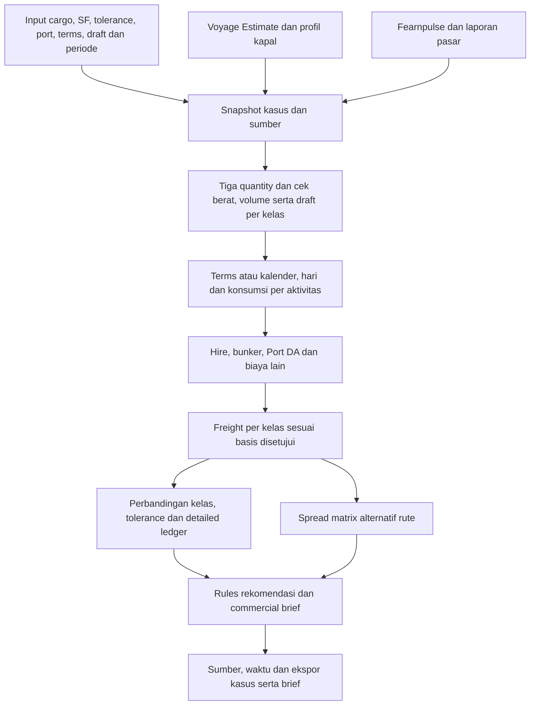

# Iterasi 5 — rencana revisi PILOG Freight Desk

> **Rencana tambahan 17 November:** lihat bagian 15 untuk investigasi jarak dan usulan port margin setelah perbandingan CMNavigator. Bagian tersebut merupakan rencana, belum implementasi.

Tanggal revisi: 13 November 2026.
Status: **FD.1 selesai teknis setelah execute pengguna; 77 tes lulus, browser desktop lulus; menunggu review pengguna/domain**.

File ini menggantikan rencana sebelumnya dalam file yang sama. Baseline aplikasi adalah I5-CHARTER.1, commit `90b9e29`. Baseline tersebut digantikan runtime FD.1 sesuai D-078. Workbook/PDF sumber tidak ditulis ulang; snapshot spesifikasi Baltic dikoreksi dan output FD.1 baru dibuat. Evidence 277 tes pada catatan lama adalah baseline, bukan jumlah tes revisi ini. Bukti implementasi ada di bagian 14.

## 1. Arah produk yang dikunci pengguna

Produk menjadi freight desk/calculator untuk PI/PILOG: masukkan pengiriman, hitung freight dan ekonomi voyage, bandingkan kelas kapal serta alternatif rute, lalu keluarkan commercial brief preskriptif bagi pimpinan PI/PILOG. Brief menjawab tindakan yang disarankan, alasan, angka pendukung dan batasan. Benchmark UX adalah referensi CMNavigator dari meeting pengguna, dengan identitas putih–biru PILOG.

- Tendering dikeluarkan dari produk aktif: bid, alpha buyer, putaran, winner selection, OE/HPS tender serta Gate A/B tender akan dihapus dari alur dan dependensi aktif ketika implementasi diizinkan.
- Tetap penyempurnaan Iterasi 5; tidak membuka iterasi baru atau porting teknologi.
- Dahulukan logika pipeline dan UX. Data contoh/historis/proxy tetap boleh dipakai dengan label; penguatan kualitas data berlangsung kemudian.
- Port charge muat dan bongkar dipisahkan. Fuel ditampilkan sebagai VLSFO dan LSMGO dengan pemetaan sumber yang jujur.
- Spread matrix membandingkan freight antarrute terhadap kasus utama.
- Fokus satu periode/bulan pengiriman yang dipilih. Tidak membuat forward curve, forecast sepuluh/dua belas bulan atau hedge.
- Sumber, satuan, tanggal observasi dan waktu fetch/calculation yang relevan tetap terlihat serta tersimpan.
- Empat input aktif yang direncanakan: stowage factor 1,315 m³/MT editable; tolerance ±10% editable; 23 terms: 22 dari screenshot dan THEX3 dari koreksi pengguna; summer draft kapal dan batas draft kedua port. Gear dan fitur CMN lainnya tidak ditambahkan otomatis.
- Fleetra tetap proyek terpisah.

Kebutuhan perusahaan BUMN diterjemahkan menjadi angka yang dapat direkonsiliasi, sumber yang dapat ditelusuri, dan rekaman perubahan. Ini dukungan pemeriksaan, bukan klaim bahwa suatu model/transaksi sudah disetujui BPK atau otoritas internal.

**Keputusan terbaru pengguna, 13 November:** opsi komoditas dibatasi menjadi **urea, ammonium sulphate/ZA, dan ammonium chloride**, dengan pembacaan laporan pasar untuk masing-masing. Tidak menambah komoditas lain karena sekadar muncul dalam laporan. Arah ammonia pada jawaban 12 November digantikan oleh scope dry bulk ini.

Konfirmasi terbaru pengguna: SF memakai m³/MT; nominal menjadi hasil utama dengan skenario minimum/maksimum tolerance; tanggal mulai muat dan kalender per port boleh ditambahkan; summer draft kapal dipisahkan dari batas draft port. Dua screenshot terms sudah diberikan. Model rinci di bagian 3.5–3.8 telah diimplementasikan setelah perintah execute; batas metode tetap berlaku.

Keputusan pricing/default yang sudah disetujui tetap: freight utama berbasis total biaya termasuk hire; TC Rates sebagai benchmark; tambahan waktu default nol; fuel proxy bersumber diperbolehkan; Port DA awal 100.000 USD muat + 100.000 USD bongkar. Persetujuan definisi dan permintaan edit rencana bukan perintah implementasi.

### Tiga opsi komoditas dan satu model dry bulk

| Opsi UI | ID canonical yang direncanakan | Bentuk/batas awal |
|---|---|---|
| Urea | `urea_granular` | Granular bulk sesuai kasus/profil aktif; tidak otomatis menambah varian prilled sebagai opsi baru |
| Ammonium sulphate / ZA | `ammonium_sulphate` | Padat curah; grade standard/compacted/granular sumber tetap dibedakan dalam assessment |
| Ammonium chloride | `ammonium_chloride` | Padat curah; berbeda dari ammonia NH3; assessment utama Argus diberi label sesuai tabel sumber |

- Ketiganya memakai fondasi dry bulk Handysize/Supramax. Komoditas bukan multiplier freight buatan: durasi dan biaya mengikuti cargo, kapal, handling dan cost input yang benar-benar dipakai.
- Default handling atau biaya yang diwariskan dari Voyage Estimate tetap asumsi editable, bukan spesifikasi komoditas/terminal aktual yang disimpulkan hanya dari nama produknya.
- Ammonia NH3, UAN, NPK, AN/CAN, phosphates dan komoditas lainnya tidak menjadi opsi aktif revisi ini. PDF Ammonia tetap sumber historis yang tidak perlu dihapus, tetapi tidak dipakai untuk mengisi harga ketiga opsi aktif.
- Case, snapshot, report filter dan spread matrix menyimpan commodity ID. Mengganti komoditas membersihkan hasil/pembanding lama agar harga urea tidak terbawa ke ZA/chloride.

## 2. Referensi dan batas bukti

Sepuluh gambar pada `docs/UI References/` menjadi acuan, termasuk dua tambahan terms yang diperiksa 13 November:

| File | Temuan yang digunakan |
|---|---|
| CM Nav inputs.png | Input ringkas; cargo/hire/bunker; kartu PoL dan PoD dengan cadence, terms dan Port DA; satu Calculate |
| CM Nav output .png | Hasil expandable per kelas dengan cargo intake, hire, hari dan freight |
| CM Nav output 2.png | Ringkasan Handysize dan biaya/quantities pada kedua port |
| CM Nav output 3.png | Ringkasan Supramax pada kasus pengiriman yang sama |
| CM Nav detailed output.png | Ledger aktivitas muat, sailing, bongkar dan generic; hire, fuel, Port DA dan biaya tambahan |
| CM Nav detailed matrix.png | Asal sebagai kolom, tujuan sebagai baris; base rate; Flat/Delta; Spread berbeda dari Sensitivity |
| pilog input.png | Input efektif dan provenance baseline PILOG |
| pilogh output.png | Hasil PILOG 12 November dan rincian biaya/hari |
| terms_1.jpeg | Sebelas opsi terms dan faktor waktunya |
| term_2.jpeg | Sebelas opsi terms berikutnya; gabungan dua screenshot berjumlah 22 opsi |

Referensi lain:

- [Freight Rate Calculator - FAQ.pdf](../../../references/Freight%20Rate%20Calculator%20-%20FAQ.pdf), dibaca seluruh 5 halaman.
- [CMN homepage](https://cmnavigator.com/).
- [Freight calculator resmi](https://cmnavigator.com/freight-calculator).
- [Freight matrix resmi](https://cmnavigator.com/freight-rate).
- Kode `calculations/`, `application/`, `orchestration/`, `sources/` dan `ui/views.py`.
- [Baltic Guide to Market Benchmarks v8.8, September 2026](https://www.balticexchange.com/content/dam/balticexchange/consumer/documents/data-services/documentation/ocean-bulk-guides-policies/GMB.pdf), halaman PDF 83–84: BSI63/BHSI38, summer salt-water draft, grain capacity dan TPC.
- [BIMCO Laytime Definitions 2013](https://www.bimco.org/media/qy2neqim/laytime-definitions-for-charter-parties-2013-v2.pdf): perbedaan laytime, working days, holidays, pengecualian dan waktu yang digunakan; berlaku sesuai definisi yang diinkorporasikan dalam kontrak para pihak.

Platform `https://cmnavigator.com/platform/freight/single` tidak dapat dibaca web reader; tidak ada klaim akses sesi berlogin. Screenshot pengguna menjadi bukti UI yang lebih langsung.

FAQ halaman 3 menyebut sekitar **40 data streams**, bukan bukti 40 endpoint API publik yang tersedia untuk PILOG. Bagian FAQ yang menyatakan input belum editable sudah tertinggal dibanding screenshot baru. Situs resmi juga mencantumkan urea dan sejumlah fertilizer pada cakupan dry bulk: benchmark tidak terbatas grain.

Tidak mengadopsi janji akurasi vendor sebagai akurasi PILOG. Model internal CMN, optimisasi speed, premium/basis dan metode perkiraan forward tidak diketahui seluruhnya dari screenshot/FAQ.

### 2.1 Ketersediaan laporan untuk setiap komoditas

Pemeriksaan PDF menggunakan PDFium. Halaman di bawah adalah nomor halaman PDF. Salinan dua laporan Nitrogen di `public/` tersedia dan hash-nya cocok dengan file dalam folder referensi pada pemeriksaan 13 November.

| Komoditas | Argus yang tersedia | Fertecon yang tersedia | Perlakuan |
|---|---|---|---|
| Urea granular | Argus Nitrogen 10 September 2026, halaman 1–2: tabel granular FOB/CFR; halaman 2 juga memiliki urea freight | Fertecon Nitrogen 10 September 2026, halaman 1–2: granular FOB/CFR dan tabel dry-bulk fertilizer freight | Pisahkan harga barang dari freight; pilih assessment dengan produk, wilayah, unit dan basis yang jelas |
| Ammonium sulphate / ZA | Argus Nitrogen halaman 1–2: standard/compacted/granular bulk, termasuk CFR Southeast Asia | Fertecon Nitrogen halaman 1–2: ammonium sulfate caprolactam/compacted dan assessment CFR/FOB | Alias sulphate/sulfate/ZA menunjuk produk yang sama; grade dan wilayah tidak dilebur otomatis |
| Ammonium chloride | Argus Nitrogen halaman 2: Ammonium chloride - bulk, CFR Southeast Asia. Halaman 9 memuat commentary tambahan | Tidak ditemukan ammonium chloride dalam file Fertecon Nitrogen yang tersedia | Gunakan Argus sebagai sumber yang tersedia; tidak mengarang sumber Fertecon atau menggantinya dengan ammonia/urea |

**Arti fetch laporan pada tahap ini:** sistem membaca/mengekstrak otomatis PDF yang tersedia di repo, termasuk saat refresh atau hash file berubah. Ini bukan login atau download otomatis edisi terbaru Argus/Fertecon; pengguna hanya memiliki PDF, bukan akses API yang terkonfirmasi. Penambahan edisi dilakukan dengan mengganti/menambahkan PDF sumber sesuai workflow repo, lalu parser/cache memprosesnya. As-of tetap tanggal edisi, bukan tanggal refresh aplikasi.

Kontrak pembacaan laporan:

1. Dataset assessment menyimpan `commodity_id`, grade/form, publisher, filename/hash, halaman, tanggal laporan/assessment, label pasar, region, basis FOB/CFR/FCA/CIF, unit/currency, low/high/close dan tipe bukti tabel/commentary.
2. Parser memilih bagian produk yang benar sebelum membaca baris harga. Nilai nutrient per unit N, harga natural gas, biaya produksi dan freight tidak dibaca sebagai harga barang USD/MT.
3. Harga setiap penerbit tetap terlihat sendiri. Tidak merata-ratakan grade, currency atau basis berbeda. Aturan midpoint hanya dipakai pada range yang memang dipilih, bukan mengganti seluruh tabel menjadi satu indeks.
4. Urutan pembanding: produk/grade dan pasar yang relevan, lalu assessment regional produk yang sama dengan label cakupan. Jika hanya FOB tersedia, tampilkan sebagai konteks FOB, bukan mengubahnya menjadi CFR tujuan.
5. Chloride memiliki bukti regional CFR Southeast Asia; untuk tujuan di luar region itu, assessment boleh tampil sebagai referensi pasar regional dengan gap wilayah yang jelas, tanpa klaim harga CFR pelabuhan tujuan.
6. Bila tidak ada pembanding yang cukup cocok, tampilkan status ketersediaan dan sumber produk yang ada. Jangan memakai harga produk lain agar panel selalu berisi angka. Perhitungan freight biaya tetap dapat berjalan jika input biayanya lengkap karena assessment barang bukan input wajib rumus biaya.
7. Freight assessment bertanda urea hanya pembanding urea. Tabel generic dry-bulk fertilizer freight tidak otomatis menjadi quote ZA/chloride yang cocok; cakupan komoditas/rute/tonase sumber dipertahankan dan diberi label konteks bila perlu.
8. Reader lama yang khusus urea telah diganti sources/fertilizer_reports.py. Ekstraksi bagian produk, unit, basis dan grade diuji; dropdown tidak menjadi pengganti parser.
9. `public/` menyediakan PDF yang dapat dibaca deployment tanpa path vault laptop. Input hash + versi parser menjadi cache key; raw PDF tetap utuh dan normalized snapshot dapat direplay. Snapshot/as-of tidak ditulis ulang sebagai observasi baru hanya karena file dibaca lagi.

Syarat penerimaan sumber: ketiga opsi memiliki setidaknya satu assessment tabel dari PDF yang sudah diverifikasi pada mapping di atas. Tidak mensyaratkan kedua publisher memuat semua komoditas. Tanggal historis yang jelas tetap diterima; kegagalan parser tidak disembunyikan sebagai data yang berhasil diambil.

## 3. Perbedaan perhitungan yang harus diselesaikan

### 3.1 Baseline PILOG

Dengan komisi nol dan scope satu arah yang sekarang disetujui:

```text
Hari laut             = jarak / (speed × 24)
Hari muat             = cargo / loading rate
Hari bongkar          = cargo / discharge rate
Total hari            = laut + muat + bongkar + tunggu
Voyage expenses       = bunker + port/other
Total biaya           = voyage expenses + Hire/day × hire days
Freight indikatif     = (TC Rates × total hari + voyage expenses) / cargo
TCE pada indikasi     = (net freight revenue − voyage expenses) / total hari
Surplus pada indikasi = net freight revenue − total biaya
```

TC Rates membentuk harga, sedangkan Hire/day membentuk biaya. TCE kembali mendekati TC Rates karena konstruksi formula. Sebelum pembulatan, jika hire days = total hari, surplus pada indikasi menjadi `(TC Rates − Hire/day) × hari`. Biaya yang dihitung ulang langsung masuk ke indikasi freight, sehingga kenaikan biaya tidak selalu menurunkan surplus.

Ini bukan alasan menyebut baseline salah aritmetika. Tujuan pricing berbeda: kita perlu memilih antara harga untuk mencapai TC Rates dan freight berdasarkan total biaya sewa yang diasumsikan.

### 3.2 Rekonsiliasi screenshot, bukan memaksa kesamaan output

Angka pemeriksaan dihitung dengan Python Decimal. Tampilan CMN sudah dibulatkan; raw calculation vendor tidak tersedia.

| Komponen | PILOG screenshot 12 November | CMN Handysize screenshot |
|---|---|---|
| Rute/cargo | Bontang–Mundra; 30.000 MT | Sama |
| Hire/day | 13.000 USD/hari | 13.000 USD/hari |
| Jarak | 4.015,8365 NM | 4.237 NM pada detailed view |
| Speed terlihat | 12 knot | VLSFO sailing 13,5 knot; LSMGO 12 knot |
| Hari muat | 6,00 | 7,46 pada baris hire port muat |
| Hari bongkar | 6,00 | 7,50 pada baris hire port bongkar |
| Hari laut | 13,94387674 | 13,08 pada hire sailing |
| Tambahan waktu | Tunggu 0 | Bunker delay 1,50 hari terlihat |
| Total durasi | 25,94387674 | 29,53 pada summary |
| Fuel allocation | FO laut; DO laut dan port | VLSFO muat/laut/bongkar; LSMGO nol pada kasus yang terlihat |
| Port charge | Agregat 200.000 USD | 100.000 USD muat + 100.000 USD bongkar |
| Biaya tambahan | Masuk port/other | Cleaning 2.500 USD; ballast bonus nol |
| Total biaya termasuk hire | 684.394,80 USD | 760.030 USD |
| Freight utama | 24,4563 → 24,46 USD/MT | 760.030 / 30.000 = 25,334333… → 25,33 USD/MT |
| Dasar freight | TC Rates 14.900 × hari + expenses, dibagi cargo | Hubungan total biaya termasuk hire / cargo konsisten pada screenshot ini |

Perbedaan dipilah menjadi:
1. **Metode pricing:** target TC versus total biaya termasuk hire.
2. **Cakupan komponen:** cleaning, bunker delay dan pembagian fuel.
3. **Asumsi operasional:** tambahan waktu port, speed, consumption dan margin.
4. **Data kasus:** distance/profil/tanggal feed; kualitasnya disempurnakan kemudian.
5. **Pembulatan:** angka baris tampilan bukan raw intermediate.

Pemeriksaan aritmetika CMN dari baris tampilan:

- Hire: 96.954 + 169.992 + 97.500 + 19.500 = 383.946 USD.
- Bunker: 10.247 + 146.161 + 17.175 = 173.583 USD.
- Hire + bunker + Port DA 200.000 + cleaning 2.500 = 760.029 USD, berbeda 1 USD dari summary. Tidak menciptakan biaya 1 USD; raw rounding vendor belum diketahui.
- Quantities VLSFO: 22,37 + 319,13 + 37,50 = 379,00 MT.
- Hari baris tampilan 7,46 + 13,08 + 7,50 + 1,50 = 29,54, sementara summary 29,53; gunakan hidden precision vendor sebagai kemungkinan, bukan klaim pasti.
- Margin port 24,30% dan 25% secara numerik mendekati tambahan hari port pada contoh. Ini hipotesis pembacaan, bukan formula yang sudah disetujui. Sea margin 6% tidak otomatis diterapkan ke hari laut.
- Dua sailing speeds tidak berarti dua perjalanan yang boleh dijumlahkan.

Dengan input PILOG yang sama, total biaya/cargo = **22,81315997 USD/MT**, berbeda dari indikasi berbasis TC Rates **24,4563 USD/MT**. Menyamakan dataset tidak menghilangkan perbedaan definisi tersebut.

### 3.3 Dasar freight yang disetujui pengguna

Pengguna menyetujui fungsi calculator mengikuti basis biaya yang direkomendasikan:

```text
Voyage expenses = bunker per aktivitas + Port DA muat + Port DA bongkar
                  + biaya lain yang termasuk beban PILOG
Hire cost       = Hire/day × hire days
Total biaya     = voyage expenses + hire cost
Freight biaya   = total biaya / (cargo × (1 − commission))
```

Komisi tetap 0% sesuai kebijakan aktif, jadi freight biaya = total biaya/cargo. Rate ini menutup cakupan biaya yang dimodelkan; belum memuat margin atau premium pasar yang tidak dimasukkan.

TC Rates Fearnpulse tetap tersedia sebagai benchmark per kelas dry bulk. TC Rates tidak ditambahkan lagi sebagai biaya di atas Hire/day. Perubahan definisi dari D-077 ini disetujui untuk rencana baru; implementasi FD.1 telah menggantikan basis pricing lama. Benchmark dry bulk tidak dipakai sebagai hire/TC ammonia.

Jika ingin menilai surplus dan TCE komersial, tarif jual/quote freight independen perlu tersedia:

```text
Net freight revenue = tarif jual × cargo × (1 − commission)
TCE                 = (net freight revenue − voyage expenses) / total voyage days
Surplus/defisit      = net freight revenue − voyage expenses − hire cost
```

Tanpa tarif jual independen, jangan mengarang pendapatan atau menyebut freight biaya sebagai profit. TCE dari freight biaya akan mendekati Hire/day jika durasinya sama: identitas model, bukan bukti kecocokan pasar.

Keputusan UI: freight biaya sebagai headline, TC Rates sebagai konteks; hasil biaya tidak diklaim profit. Evaluasi tarif jual independen tetap opsional bila field tersebut benar-benar disediakan; jangan menambah markup, margin floor, atau harga jual otomatis. Persetujuan ini tidak mewajibkan input tarif jual untuk memakai calculator.

### 3.4 Waktu, hire dan fuel

- Aktivitas canonical: muat → laden sailing → bongkar → aktivitas tambahan yang diaktifkan.
- Hire hanya sekali pada cakupan waktu sewa. Tetap satu arah, tanpa ballast/round voyage tambahan otomatis.
- Waiting, port allowance dan bunker delay berbeda. Jangan menghitung durasi yang sama dua kali.
- Grade dan konsumsi per aktivitas eksplisit. Profil dapat memakai VLSFO, LSMGO atau keduanya; nol harus input eksplisit, bukan pengganti missing.
- Jangan otomatis mengganti DO port menjadi VLSFO port hanya agar cocok dengan CMN. Pemakaian mengikuti profil/asumsi yang dipilih dan dilabeli.
- Speed yang diedit tidak diberi kurva konsumsi kubik/optimisasi buatan.
- Terms memengaruhi estimasi waktu port sesuai bagian 3.7. Tambahan waktu masuk hire dan konsumsi port/idle; faktor terms dan kalender tidak dihitung bersamaan untuk waktu yang sama.
- SF dan draft memeriksa kapasitas; tolerance memicu tiga kalkulasi penuh. Input tidak harus mengubah harga jika constraint tidak mengikat atau terms memang ekuivalen. Gear tetap di luar tambahan scope ini.

### 3.5 Stowage factor dan tolerance

Default SF **1,315 m³/MT**, editable dan disimpan dengan satuan, telah dikonfirmasi pengguna. Ini default kasus, bukan klaim SF seluruh grade urea/ZA/chloride identik. Jangan tertukar dengan densitas MT/m³ atau cbft/MT.

- Volume cargo = Q MT × SF m³/MT.
- Batas cargo berdasarkan volume = usable grain capacity m³ / SF.
- Batas berat = DWT efektif − allowance non-cargo yang cakupannya jelas.
- Kapasitas screening = minimum batas volume dan berat, termasuk penyesuaian draft yang tersedia.

Baseline memakai grain capacity profil sebagai pendekatan ruang curah tersedia. Jika ada pengurangan usable capacity karena kondisi palka, segregation atau trimming, harus input eksplisit; jangan menciptakan persentase pengurang. Tidak mengklaim volume nominal palka menjamin cargo pasti termuat.

Tolerance bukan markup harga atau tambahan cargo otomatis:

- Q minimum = Q nominal × (1 − tolerance).
- Q nominal = input cargo.
- Q maksimum = Q nominal × (1 + tolerance).

Default ±10%, editable; validasi 0 ≤ tolerance < 100%, cargo/SF/rates positif dan finite. Pengguna menyetujui nominal sebagai hasil utama dan skenario minimum/maksimum sebagai pendamping. Jalankan tiga full calculation per kelas dengan snapshot yang sama: handling days, bunker, hire, pembagi freight dan revenue jika ada quote mengikuti Q masing-masing. Tolerance nol boleh berbagi satu hasil identik.

Tidak diam-diam memilih Q maksimum, memangkas quantity agar kapal lolos, atau menentukan pihak yang memegang opsi cargo. Jika nominal lolos tetapi maksimum gagal, tampilkan batas yang mengikat dan sarankan batas muatan/kelas alternatif yang dihitung. Rate pada Q minimum tidak otomatis menjadi minimum freight: urutkan dari hasil engine.

### 3.6 Summer draft kapal dan batas draft port

Summer draft adalah spesifikasi kapal. Batas draft PoL/PoD adalah input terpisah. Pengguna menyetujui keduanya; jangan menyalin summer draft menjadi fakta batas pelabuhan. Batas port yang kosong berarti belum dimodelkan, bukan nol meter atau cek yang sudah lolos. Estimasi biaya dasar tetap dapat berjalan dengan cakupan tersebut dinyatakan pada brief.

| Profil Baltic | DWT MT | Summer salt-water draft m | Grain capacity m³ | TPC MT/cm |
|---|---:|---:|---:|---:|
| BHSI38 Handysize | 38.200 | 10,538 | 47.125 | 49 |
| BSI63 Supramax | 63.500 | 13,418 | 80.500 | 61,4 |

Sumber: Baltic Guide v8.8, halaman PDF 83–84, di bagian referensi. Profil dipakai sebagai satu set source/version; draft/TPC BSI63 tidak ditempel pada DWT 58.200 dari profil lain. Presisi sumber tetap disimpan di engine/JSON; dua desimal untuk ringkasan.

Rancangan screening:

1. Selalu periksa berat dan volume. Jika batas port belum tersedia, jangan menampilkan draft sebagai PASS.
2. Untuk scope laden satu arah ini, batas draft muat dan bongkar yang lebih rendah mengikat sebagai pendekatan konservatif. Jangan mengurangkan UKC dua kali bila sudah masuk batas draft yang diberikan.
3. Pendekatan linear TPC: pengurangan berat ≈ max(0, summer draft − batas draft) × 100 × TPC. DWT efektif = DWT summer − pengurangan tersebut; port lebih dalam tidak menaikkan DWT melebihi summer DWT. Kurangi allowance non-cargo, lalu bandingkan dengan batas volume.
4. Ini pendekatan screening, bukan hydrostatic curve/loading computer, perhitungan density/trim/stability atau jaminan keselamatan. Akurasi jauh dari summer draft tidak dapat dijamin. Opsi yang dibatasi draft membawa metode/angka dan tindakan konfirmasi intake, bukan label pasti aman berlayar.
5. TPC hilang, unit tidak cocok atau kapasitas nonpositif tidak diganti nilai rekaan. Jangan merekomendasikan cargo sebagai mampu berdasarkan bukti yang tidak tersedia.

Allowance bunker/stores/constants harus didefinisikan sebagai total atau komponen yang tidak bertumpuk. Fuel burned untuk biaya tidak otomatis sama dengan bunker onboard untuk kapasitas. Jangan membuat loop konsumsi–kapasitas dari asumsi yang belum disetujui.

### 3.7 Terms: seluruh opsi yang terbaca dan model waktu

Daftar memuat 22 opsi dari dua screenshot dan satu koreksi THEX3 dari pengguna. Angka adalah **faktor estimasi yang ditampilkan CMN**, bukan ketentuan universal BIMCO atau bukti formula internal vendor.

| ID | Keterangan pada screenshot | Faktor tampilan | Sumber |
|---|---|---:|---|
| CQD1 | Customary Quick Despatch SHINC | 1 | terms_1.jpeg |
| FHEX1 | Fri. & holidays excluded | 1,1667 | terms_1.jpeg |
| FHEX2 | Wed. 17:00 to Sat. 08:00 excluded | 1,6 | terms_1.jpeg |
| FHEX3 | Fri. 12:00 to Sun. 08:00 excluded | 1,3548 | terms_1.jpeg |
| FHEX4 | Fri. 12:00 to Mon. 08:00 excluded | 1,68 | terms_1.jpeg |
| FHINC | Fri. & holidays included | 1 | terms_1.jpeg |
| SHEX0 | Sun. & holidays excluded | 1,1667 | terms_1.jpeg |
| SHEX1 | Sat. 12:00 to Sun. 24:00 excluded | 1,2727 | terms_1.jpeg |
| SHEX10 | Sat. 18:00 to Mon. 08:00 excluded | 1,2923 | terms_1.jpeg |
| SHEX2 | Sat. 12:00 to Mon. 08:00 excluded | 1,3548 | terms_1.jpeg |
| SHEX3 | Fri. 24:00 to Sun. 24:00 excluded | 1,4 | terms_1.jpeg |
| SHEX4 | Fri. 17:00 to Sun. 24:00 excluded | 1,4867 | term_2.jpeg |
| SHEX5 | Fri. 24:00 to Mon. 08:00 excluded | 1,5 | term_2.jpeg |
| SHEX6 | Fri. 17:00 to Mon. 08:00 excluded | 1,6 | term_2.jpeg |
| SHEX7 | Fri. 20:00 to Mon. 08:00 excluded | 1,55 | term_2.jpeg |
| SHEX8 | Sat. 14:00 to Sun. 24:00 excluded | 1,3333 | term_2.jpeg |
| SHEX9 | Sat. 17:00 to Mon. 08:00 excluded | 1,3023 | term_2.jpeg |
| SHINC | Sun. & holidays included | 1 | term_2.jpeg |
| SSINCHEX | Sat. & Sun. included; holidays excluded | 1,04 | term_2.jpeg |
| THEX | Thu. 12:00 to Sun. 08:00 excluded | 1,68 | term_2.jpeg |
| THEX1 | Thu. 16:00 to Sun. 08:00 excluded | 1,615 | term_2.jpeg |
| THEX2 | Thu. 17:00 to Sat. 08:00 excluded | 1,3 | term_2.jpeg |
| THEX3 | Thu. 12:00 to Sat. 08:00 excluded | 1,35 | Konfirmasi pengguna 13 November 2026 |

Seluruh 23 opsi masuk catalog dan dropdown per port; default SHINC direncanakan untuk menjaga basis berjalan existing. ID bukan kode universal kontrak. Label ringkas dengan penjelasan jadwal dan sumber pada bantuan.

**Rancangan basis durasi, saling eksklusif:**

- **Estimasi faktor:** waktu handling dasar = Q/rate; estimasi elapsed port time = waktu dasar × faktor terpilih. Tambahan waktu memengaruhi hire dan konsumsi port/idle, bukan menambah cargo-handling work. Ini asumsi perencanaan bahwa pengecualian mencerminkan waktu operasi yang tidak tersedia, bukan kesimpulan bahwa terms sendiri membuktikan terminal tutup. Faktor sumber menjadi default awal yang bisa ditelusuri; tidak mengalikan lagi port allowance untuk jam yang sama.
- **Kalender operasi kasus:** pengguna dapat mengisi tanggal/jam mulai muat, zona waktu, jam kerja dan pengecualian/holiday per port, sesuai konfirmasi pengguna. Hitung elapsed time dengan menelusuri interval kerja hingga kebutuhan handling selesai. Kebutuhan kerja = Q/rate × 24 jam untuk rate berbasis 24 jam kerja; basis rate disimpan eksplisit. Mode ini menggantikan faktor screenshot, tidak dikalikan lagi dengannya.

Waktu mulai bongkar diturunkan dari selesai muat + laden sailing + waiting yang relevan, atau override manual bersumber. Tanggal awal periode boleh menjadi default jadwal perencanaan editable, bukan jadwal aktual yang diklaim diketahui. Zona waktu/manual calendar harus lengkap sebelum basis kalender dinyatakan berlaku. Jangan menebak hari libur, weather downtime atau kerja saat hari yang dikecualikan. Jika kalender belum lengkap, basis faktor ditawarkan secara eksplisit, tidak terjadi fallback diam-diam.

Bedakan **contractual laytime counter** dari **physical elapsed time**. SHEX tidak otomatis membuktikan terminal berhenti pada hari Minggu. Kalender kerja fisik dapat berbeda dari pengecualian laytime. Tidak menghitung demurrage/despatch atau settlement dari terms saja tanpa NOR, actual events, allowed time, rate dan kontrak. CQD tidak menjanjikan durasi tertentu; Q/rate tetap estimasi produktivitas kasus.

SHINC, FHINC dan CQD1 dapat sama-sama menghasilkan faktor 1. Tidak membuat premium buatan supaya semua label menghasilkan harga berbeda. Faktor vendor yang dibulatkan pada screenshot dipertahankan sebagai angka referensi, bukan diklaim sama dengan kalender presisi penuh. Opsi WWD/UU lain yang tidak tampak pada dua screenshot tidak ditambahkan otomatis.

### 3.8 Urutan hitung dan verifikasi empat input

Snapshot → Q minimum/nominal/maksimum → cek berat/volume/draft per kelas → handling dengan terms/kalender → hari laden → hire/fuel/Port DA/other → freight → rekomendasi dan brief. Kelas yang tidak mampu tidak menghalangi perhitungan kelas yang mampu.

Uji wajib: SF membatasi volume saat DWT masih lolos; berat mengikat lebih dahulu; nominal lolos/maksimum gagal; tepat batas kapasitas; port lebih dalam tidak menambah DWT; draft lebih rendah mengurangi intake menurut metode yang dinyatakan; allowance tidak double count; terms hanya mengubah port terkait; tambahan waktu mengubah hire/fuel dengan benar; faktor 1 ekuivalen; kalender lintas pekan/holiday/zona waktu; faktor dan kalender tidak terhitung bersamaan.

## 4. Port DA dan cakupan biaya

Kontrak baru memisahkan `loading_port_da_usd`, `discharge_port_da_usd`, dan daftar `other_costs` ber-ID, label, nilai, satuan dan sumber.

Agregat `port_other_total_usd` lama tidak dijumlahkan lagi dengan komponen baru. Default lama 200.000 USD tidak membuktikan pembagian per pelabuhan. Pengguna menyetujui default **100.000 USD muat + 100.000 USD bongkar** sebagai asumsi awal editable, bukan hasil ekstraksi workbook. Default biaya lain nol/daftar kosong; tidak otomatis menambahkan cleaning 2.500 USD milik contoh vendor.

Pengguna menyetujui allowance waktu muat/bongkar serta bunker delay sebagai input editable dengan **default nol**. Waiting existing tidak dihitung ulang sebagai allowance/delay. Margin 24,3%/25% dan delay 1,5 hari vendor tidak disalin sebagai default.

FAQ halaman 2 memakai FIOST: cargo-handling costs berada pada freight buyer dalam model vendor. Port DA tidak otomatis sama dengan stevedoring/stowing/trimming. Hari muat/bongkar tetap masuk durasi meskipun biaya handling dibayar pihak lain. Cakupan biaya PILOG mengikuti kontrak/model yang dipilih, bukan menyalin seluruh kewajiban legal vendor.

Canal, EU ETS, war-risk, demurrage/despatch, cargo insurance dan pajak khusus yang belum dimodelkan tidak diberi angka rekaan. Tampilkan batas cakupan bila relevan.

## 5. Nama VLSFO/LSMGO dan sumbernya

UI memakai **VLSFO (USD/MT)** dan **LSMGO (USD/MT)**; konsumsi menggunakan MT/hari, quantity MT.

Temuan kode `sources/fearnpulse.py`: seri 306 = Singapore 380 CST, seri 307 = Singapore MGO. Label seri ini belum membuktikan grade VLSFO/LSMGO. Viskositas 380 CST tidak menetapkan kadar sulfur; MGO generik tidak otomatis LSMGO. [Rujukan IMO](https://www.imo.org/en/mediacentre/hottopics/pages/sulphur-2020.aspx).

Rencana:
1. Periksa seri dengan grade dan unit yang cocok pada provider existing.
2. Pengguna mengizinkan nilai existing sebagai proxy kasus jika seri grade tepat belum tersedia, dengan sumber pasar dan status proxy jelas. Nilai tersebut tidak dihasilkan oleh tebakan LLM.
3. Simpan grade yang diminta, grade/seri sumber, status nilai, raw source, as-of dan override.
4. Harga 458/902 pada contoh tidak diklaim menjadi observasi grade baru hanya dengan mengubah nama.
5. Provider baru kemudian dapat menggantikan proxy tanpa mengubah rumus.

Ini tidak menjadikan kualitas feed sebagai penghambat demo. Yang dijaga adalah kejujuran makna input yang dipakai.

## 6. UX target putih–biru

### Input tunggal

Urutan kerja:
1. Pilihan **Urea, Ammonium sulphate/ZA, Ammonium chloride**, cargo nominal MT, tolerance ±%, SF m³/MT dan periode/tanggal mulai. Pergantian produk otomatis mengganti pembanding ke assessment produk tersebut serta menghapus hasil lama yang sudah tidak sesuai.
2. Hire/day, VLSFO dan LSMGO; benchmark TC Rates terlihat ringkas. Refresh feed tidak otomatis mengubah hire manual.
3. Kartu PoL: nama port, loading rate, terms, batas draft port, waiting/allowance aktif dan Port DA muat. Jadwal/zona waktu/kalender kerja pada detail bila basis kalender dipakai.
4. Kartu PoD: nama port, discharge rate, terms, batas draft port, waiting/allowance aktif dan Port DA bongkar; jadwal mengikuti rangkaian voyage atau override eksplisit.
5. Profil kapal/advanced: summer draft, grain capacity, DWT, TPC, speed, consumption, allowance kapasitas, biaya lain dan cakupan model. Spesifikasi kapal tidak menjadi input batas port.
6. **Hitung freight** dan **Reset**.

Port selection memperbarui distance lookup otomatis. Satu tempat mengedit setiap nilai. Input baru membatalkan atau menandai hasil lama; tidak perlu tombol Terapkan tambahan. Pending/error route lookup tidak menghapus input lain.

Sumber ringkas dekat field/ikon informasi, rincian dalam expander dan unduhan. Hindari tabel audit panjang sebagai satu-satunya pintu memasukkan data. Copy pendek, logo PILOG existing, warna putih–biru.

Tetap Streamlit + Python. Tidak memigrasikan FastAPI/React/RBAC atau membangun 40 integrasi demi kemiripan UI.

### Hasil per kelas

Tampilkan satu baris expandable per Handysize/Supramax dari shared shipment dan snapshot pasar yang sama:

| Kelas/profil | Cargo MT | Hire/day | Hari | Total biaya USD | Freight USD/MT |
|---|---:|---:|---:|---:|---:|
| Handysize | Engine | Input efektif | Engine | Engine | Engine |
| Supramax | Engine | Input efektif | Engine | Engine | Engine |

Nominal menjadi hasil utama, minimum/maksimum tolerance menjadi perbandingan. Tampilkan batas berat, volume dan draft yang mengikat. Kapasitas gagal ditampilkan per kelas dengan alasan, bukan baris murah yang seolah feasible. Harga termurah tidak otomatis menjadi rekomendasi kapal tersedia.

Catatan basis profil: aplikasi memakai benchmark Baltic 63.500 DWT di keluarga Supramax, sedangkan screenshot CMN memisahkan Supramax 58.200 dan Ultramax 63.500. Perbedaan label/basis profil dibuat terlihat; tidak mengklaim kedua profil identik atau menambah kelas otomatis. Data profil dapat disempurnakan kemudian.

Satu hire global untuk dua kelas dapat dipakai jika itu input pengguna. Jangan menciptakan quote kelas berbeda tanpa data. Profil fisik setiap kelas tetap menentukan hari dan konsumsi.

### Detailed cost view

| Aktivitas | Komponen | Hari | VLSFO MT | LSMGO MT | Rate + satuan | Total USD | Sumber/status |
|---|---|---:|---:|---:|---|---:|---|
| Muat | Hire, fuel, Port DA | Engine | Engine | Engine | Sesuai cost line | Engine | Input asal |
| Sailing | Hire dan fuel | Engine | Engine | Engine | Sesuai cost line | Engine | Input asal |
| Bongkar | Hire, fuel, Port DA | Engine | Engine | Engine | Sesuai cost line | Engine | Input asal |
| Tambahan | Hanya item aktif | Sesuai model | Sesuai model | Sesuai model | USD atau USD/hari | Engine | Input asal |

Total dan rincian berasal dari satu engine. Subtotal tidak dijumlahkan sebagai biaya tambahan. Label sumber tersedia/manual/proxy tidak menjadi badge Verified yang meniru otoritas CMN.

### Commercial brief: hasil utama untuk pimpinan PI/PILOG

Brief tetap output akhir yang dapat diserahkan kepada pimpinan, dengan rekomendasi tindakan dan dasar angka. Calculator, ledger dan matrix mendukung keputusan tersebut. Refactor renderer brief existing; jangan menghapusnya bersama seluruh logic tender.

Lima bagian singkat:

1. **Rekomendasi komersial:** kelas yang disarankan, cargo/rentang yang dapat ditangani, freight penutup biaya dan tindakan utama. Tabel cek berat, volume, draft bila dimodelkan, rentang tolerance, cakupan biaya dan ekonomi jika ada tarif jual. Belum dimodelkan berbeda dari PASS.
2. **Exposure:** biaya dan hari yang ditanggung, komponen terbesar, serta perubahan terhadap base yang benar-benar dihitung. Tidak membuat probabilitas atau VaR.
3. **Risiko:** penyebab konkret, dampak terhitung dan tindakan. Contoh tarif jual di bawah biaya → naikkan sampai minimum yang dihitung atau ubah opsi kapal/operasi yang feasible.
4. **Dampak logistik:** batas intake, waktu muat/laut/bongkar, efek terms dan tiga quantity. Tidak mengklaim kapal atau slot terminal tersedia.
5. **Konsekuensi harga:** total biaya, freight penutup biaya/impas, alternatif comparable dan TCE/surplus bila tarif jual independen tersedia. Harga barang bukan pendapatan atau margin freight PILOG.

Rules rekomendasi yang direncanakan:

- Pilih freight biaya terendah dari opsi feasible pada cargo dan snapshot yang sama. Tampilkan alasan dan selisih alternatif; jika sama, nyatakan setara, jangan membuat tie-break ekonomis palsu.
- Nominal lolos/maksimum gagal → rekomendasikan batas cargo yang dihitung atau kelas alternatif; jangan menjanjikan seluruh rentang ±10%.
- Semua opsi gagal → jangan lanjutkan opsi cargo/profil tersebut; sebutkan constraint dan perubahan yang dapat dicoba. Tidak membagi cargo otomatis ke beberapa kapal.
- Tanpa tarif jual independen → rekomendasi batas penawaran berbasis biaya dan pilihan operasi tetap tersedia. Jangan mengklaim profit/GO komersial dari freight biaya sendiri atau membuat quote wajib baru.
- Dengan tarif jual → tampilkan net freight revenue, voyage expenses, hire, surplus/defisit dan TCE. Jika defisit, berikan minimum kenaikan tarif atau alternatif yang benar-benar dihitung. Stress menahan tarif jual base tetap, tidak otomatis repricing agar untung.
- Minimum penawaran dibulatkan ke atas pada increment quote supaya tidak di bawah biaya; raw calculation tetap presisi dan ringkasan lain dua desimal.
- Rekomendasi tidak menetapkan award, OE/HPS, kepastian laku atau approval operasional. Tender tetap dikeluarkan.

Copywriting: satu kalimat tindakan di awal, tabel angka/cek, baru alasan yang relevan. Hindari uraian generik berulang, label pipeline atau banner mentor. Seluruh angka dan rule berasal dari Python; renderer/LLM tidak menghitung bisnis.

## 7. Spread matrix

Versi pertama mengikuti screenshot **Spread**:
- Kolom = port asal; baris = port tujuan.
- **Flat** = freight suatu cell dalam USD/MT.
- **Delta** = freight cell − freight base.
- Positif berarti lebih mahal; negatif lebih murah. Bukan laba, alpha tender, atau FFA spread.
- Satu matrix memakai satu profil kapal, produk, basis Q nominal/minimum/maksimum terpilih, SF/tolerance, periode dan snapshot pasar. Pilih kelas sebagai tab/selector; jangan mencampur basis dalam satu angka.
- Setiap pasangan port memakai distance service sendiri. Terms, kalender, batas draft dan jadwal tiba terikat port/kasus turunan; jangan menyalin hasil base tanpa menghitung ulang. Port DA/rates dapat diubah per port; default yang diwariskan tetap diberi label asumsi.
- Add load/discharge port, pilih base, lalu klik cell untuk detailed case turunan tanpa menimpa base.
- Cell invalid/unavailable memiliki alasan; tidak diganti nol/angka acak/rata-rata rute lain.
- Freeze satu market snapshot, route cache, hanya hitung pasangan yang berubah, batasi jumlah cell demo.
- Base cell harus sama persis dengan single calculator; delta base nol.
- Sensitivity hire/bunker/waktu berbeda dari spread antarrute. Tab itu tidak otomatis menyalin seluruh fitur CMN.

## 8. Sumber, timestamp dan konsistensi hasil

Setiap input efektif menyimpan nilai, unit/currency, source reference, as-of bila tersedia, fetched_at bila tersedia, default/manual/proxy/derived status serta nilai asal ketika di-override.

Setiap hasil menyimpan case ID, input hash, formula version, selected period, calculated_at, profil dan market snapshot yang dipakai. Month pengiriman berbeda dari tanggal observasi pasar. Jangan mengarang tanggal untuk sumber tanpa tanggal.

Refresh mengikuti cache/fetch existing. Kedua kelas dan semua cell satu calculation batch memakai snapshot yang sama. Input manual dipertahankan saat feed diambil ulang; kembali ke sumber adalah aksi jelas. Hasil lama tidak ditulis ulang mengikuti harga baru secara diam-diam.

Ekspor paket kasus/JSON + ledger harus replayable offline. Provenance ringkas terlihat pada UI, detail tersedia untuk audit. Tidak mengklaim lisensi provider, API CMN atau integrasi SAP/Fleetra yang belum ada.

## 9. Arsitektur dan refactor



Matematika tetap fungsi Python Decimal deterministik. Tidak menambah LLM runtime untuk menghitung atau mengarang input. Hubungan dengan paper automation: input terstruktur → normalisasi → calculation engine → perbandingan → hasil yang bisa ditelusuri; fitur AI vendor yang tidak diketahui tidak diklaim ditiru.

| Lapisan / file aktif | Tanggung jawab |
|---|---|
| models/freight_desk.py | Schema PILOG-FREIGHT.1, formula FD.1, tiga komoditas, 23 terms dan hash screenshot |
| validation/numbers.py | Angka finite, timestamp dengan zona waktu, duplicate JSON keys |
| sources/fearnpulse.py, route_distance.py, voyage_estimates.py, voyage_profiles.py, baltic_profiles.py | Sumber pasar, jarak dan default workbook/profil; tanpa import model tender |
| sources/fertilizer_reports.py | Parser NITROGEN.1, bagian produk/grade/unit/basis/page/date, cache hash dan error eksplisit |
| calculations/capacity.py, port_time.py, freight_desk.py, fuel.py, costs.py, voyage_days.py | Kapasitas, kalender/faktor, quantity, aktivitas, biaya, freight, TCE dan surplus; satu tempat matematika |
| application/freight_desk.py | Snapshot input/sumber, workflow, import/export/replay dan matrix; tidak memiliki rumus finansial |
| decisions/freight_desk.py | Feasible termurah, tie, batas tolerance, tindakan reprice/revise; tanpa award/tender |
| reporting/commercial_brief.py, formatting.py | Lima bagian brief dan format angka; tidak menghitung biaya di renderer |
| ui/views.py, apps/streamlit_app.py | Input tunggal, dua kartu port, dua kelas, detail, brief, matrix dan provenance |
| scripts/run_market_simulation.py | CLI aktif tanpa fixture GO/NO GO tender; paket, result, ledger CSV dan brief |

Penghapusan tender telah dijalankan setelah audit caller/import; rinciannya ada pada state/section 14:
- UI tender, sidebar/seeds, clock, generator bid, winner selection dan rule Gate A/B tender.
- `application/tender_examples.py`, `models/tender_clock.py`, `calculations/tender.py`, `tender_pricing.py`, `decisions/tender_decision.py` dan fixture/CLI/test khusus tender yang tidak relevan.
- Helper calculator yang masih dipakai diekstrak dahulu. Modul bercampur tidak dihapus tanpa memindahkan tanggung jawab yang masih diperlukan.
- Dokumen aktif, README dan agent context memakai scope freight desk.
- Histori Git tidak ditulis ulang. Raw source/PDF tidak dihapus sembarangan.
- Paket lama punya migrasi eksplisit atau penolakan versi yang jelas. Bid/OE/HPS lama tidak dibaca sebagai keputusan produk baru.

Tidak membuat framework/lapisan baru yang tidak diperlukan. Reuse rumus yang masih benar, jangan copy arithmetic ke UI/matrix.

## 10. Batch pekerjaan setelah persetujuan

### B0 — kunci scope dan basis harga

- [x] Periksa delapan gambar, FAQ lengkap, halaman resmi, source/cost/pricing baseline.
- [x] Rekonsiliasi angka screenshot dengan Python; pisahkan metode vs asumsi/data.
- [x] Susun rencana dalam file existing.
- [x] Konfirmasi cost-based freight, allowance/delay default nol, proxy fuel bersumber dan Port DA 100.000 + 100.000 USD.
- [x] Scope direvisi pengguna menjadi tiga opsi dry bulk: urea, ammonium sulphate/ZA, ammonium chloride; ammonia dan tambahan lainnya dikeluarkan.
- [x] Pemetaan sumber ketiganya diperiksa: urea/ZA di kedua laporan Nitrogen; chloride di Argus Nitrogen halaman 2.
- [x] User mengonfirmasi SF m³/MT, nominal + min/maks tolerance, tanggal/kalender editable dan draft kapal/port terpisah.
- [x] Dua screenshot terms dibaca; 22 opsi ditranskripsi; Baltic summer draft/grain/TPC diperiksa.
- [x] Review/audit rencana final, termasuk desain faktor/kalender, screening TPC dan brief preskriptif.
- [x] Perintah execute pengguna.

Acceptance: freight headline, arti TCE/surplus, scope commodity, defaults dan retire tender tidak ambigu.

### B1 — kontrak data dan lepas dependensi tender

- [x] Audit import/caller/CLI/schema/test yang terpakai.
- [x] Kontrak freight desk versi baru: Port DA terpisah, fuel/activity, hire, period, provenance dan price basis.
- [x] SF/unit, tolerance, summer draft, grain/TPC, port limits, 23 terms dan calendar/timezone masuk schema/source catalog; missing berbeda dari nol.
- [x] Catalog komoditas dibatasi tiga ID; normalisasi ZA/sulphate/sulfate tanpa mencampur NH4Cl dengan ammonia NH3.
- [x] Parser laporan dan kontrak assessment mencakup ketiga opsi sesuai bagian 2.1. Preserve table/page/date/basis/unit/grade; tidak mensyaratkan data Fertecon chloride yang tidak ada.
- [x] Ekstrak service mandiri; retire kode, fixtures dan UI tender yang tidak dipakai.
- [x] Migrasi total lama/paket lama hanya dengan aturan eksplisit; tidak menyamarkan asumsi.

Acceptance: kasus dapat dihitung tanpa buyer/bid/alpha/OE/auction; app tidak mengimpor modul retired; tidak ada kehilangan komponen biaya; ketiga produk menghasilkan record assessment bersumber sebelum opsi dinyatakan selesai.

### B2 — engine waktu, biaya dan freight

- [x] Ledger muat/sailing/bongkar/tunggu dan tambahan yang diaktifkan.
- [x] Fuel per aktivitas/grade, DA tiap port, misc costs dan hire tepat sekali.
- [x] Terapkan basis freight yang disetujui; running cost tidak masuk model charter aktif.
- [x] Capacity/unit/finite validation tetap berjalan; data proxy boleh dipakai tanpa gate freshness baru.
- [x] SF/grain, allowance berat dan draft screening terikat metode; tiga quantity dihitung ulang pada kedua kelas.
- [x] Terms faktor vs kalender eksklusif; hire/fuel bertambah sekali; holiday/weather tidak ditebak.
- [x] TCE dan surplus memakai basis pendapatan yang sah; jangan menganggap hasil pricing sebagai validasi profit.

Acceptance: subtotal = total, cost line = quantity × rate, jumlah durasi konsisten, pembulatan hanya di batas yang disepakati. Nilai impas/defisit tidak dipaksa positif.

### B3 — input UI dan sumber

- [x] Input tunggal dan dua kartu port; putih–biru/logo existing.
- [x] Hitung freight membaca input terakhir tanpa Terapkan tambahan.
- [x] Route update otomatis; error tidak mereset seluruh form.
- [x] VLSFO/LSMGO, unit dan status proxy terlihat; timestamps dipertahankan.
- [x] Ketiga pilihan komoditas membaca assessment yang sesuai otomatis. Header harga menyebut produk terpilih, bukan selalu Harga urea. Chloride menampilkan Argus dan cakupan regionalnya tanpa panel Fertecon palsu.
- [x] SF/tolerance, 23 terms per port, draft profil vs port limits serta tanggal/kalender terhubung ke engine dengan unit/bantuan pendek.
- [x] Field lain yang nonaktif disembunyikan/disabled dengan status jelas; periode bukan forecast palsu.

Acceptance: user bisa menjelaskan nilai yang diedit, asalnya dan pemakaiannya tanpa tabel audit panjang.

### B4 — hasil per kelas, detailed ledger dan commercial brief

- [x] Kedua kelas memakai shipment/market snapshot yang sama dan profilnya masing-masing.
- [x] Expandable results, Port DA per port, fuel quantity dan hire jelas.
- [x] Detail/summary/export membaca hasil engine yang sama.
- [x] Invalid capacity per kelas; hasil stale tidak terlihat sebagai hasil input baru.
- [x] Perbandingan quantity minimum/nominal/maksimum dan constraint yang mengikat.
- [x] Rules rekomendasi dan brief lima bagian: tindakan, angka, cek status, alasan dan sumber.
- [x] Tanpa quote beri batas biaya/opsi; dengan quote beri surplus/defisit dan recovery. Tidak menghidupkan tender atau membuat profit dari identitas pricing.

Acceptance: ringkasan, ledger, brief dan export merekonsiliasi angka sampai presisi engine; rekomendasi menjawab pilihan/tindakan/alasan; lowest rate tidak menjadi bukti kapal siap.

### B5 — spread matrix

- [x] Origin × destination; Flat/Delta; base route dan selector kelas.
- [x] Per-cell route lookup dan operasi/biaya port yang terikat port atau inheritance jelas.
- [x] Shared snapshot, cache dan batas ukuran matrix.
- [x] Klik cell membuka turunan, bukan menimpa base; export menyimpan seluruh basis per cell.
- [x] Invalid/unavailable cell mempunyai alasan.

Acceptance: base = single calculator, delta base nol, semua selisih berasal dari dua hasil comparable dengan formula version sama.

### B6 — verifikasi dan review akhir

- [x] Unit tests durasi/fuel/hire/DA/misc/rate/commission/invalid ranges dan pembulatan.
- [x] SF/grain/draft/TPC/allowance, tolerance min/nom/maks, tepat batas dan unit salah.
- [x] Seluruh 23 terms terpetakan, faktor 1 ekuivalen, kalender lintas pekan/holiday/timezone dan no double adjustment.
- [x] Brief: feasible termurah, tie, nominal lolos/maks gagal, semua gagal, draft belum dimodelkan, quote absent/impas/defisit dan minimum-safe rounding.
- [x] Input sama melalui single/class/detail/matrix menghasilkan angka identik.
- [x] Port total lama tidak terhitung dua kali; allowance kapasitas bukan biaya fuel.
- [x] Provider gagal, manual override, stale result, invalid capacity dan replay ditangani.
- [x] Uji ekstraksi source untuk ketiga komoditas, termasuk Argus chloride yang tidak punya pasangan Fertecon; jangan menukar ammonium chloride dengan ammonia atau mengambil harga urea saat produk berganti.
- [x] Uji perubahan hash PDF, cache, halaman/date, deployment dari `public/`, grade/unit/basis yang berbeda, parsing gagal dan regional fallback. Pemeriksaan sumber bukan uji bahwa seluruh rute dunia memiliki assessment yang cocok.
- [x] Bedakan menghitung ulang tarif baru dari stress biaya pada tarif baseline yang ditahan.
- [x] Rekonsiliasi screenshot CMN hanya untuk arithmetic yang terlihat, tanpa janji vendor parity.
- [x] Retired tender tests dicatat; suite calculator/regresi yang relevan dijalankan.
- [x] Browser desktop: edit/reset SF, tolerance, terms, kalender dan draft; dua kelas/tiga quantity, detail, brief, matrix, source/timestamp dan unduhan.
- [x] Update README/state/review setelah implementasi, hentikan server agent.
- [x] Commit/push/deploy hanya bila diminta tersendiri.

Acceptance keseluruhan: calculator dapat dipakai tanpa tender, biaya bisa ditelusuri, output/input koheren, proxy jujur dan fitur tidak diklaim aktif hanya karena tampil di layar.

## 11. Kritik desain dan pengaman

| Risiko | Penanganan |
|---|---|
| Mengubah UI tetapi objek harga tetap ambigu | Kunci cost-based vs TC-target sebelum B2 |
| Freight biaya diklaim menghasilkan profit | Pisahkan quote jual independen dan biaya estimasi |
| Memaksa harga sama CMN | Rekonsiliasi metode/komponen, bukan curve fitting |
| 380 CST/MGO direlabel menjadi grade verified | Preserve seri asal dan proxy status |
| Agregat port lama + dua DA dijumlahkan | Skema baru menjadikan total sebagai derived, bukan input tambahan |
| Tiap kelas/cell memakai snapshot baru | Freeze satu snapshot per calculation batch |
| Default port rute lama dianggap quote rute baru | Tandai inherited assumption per cell |
| Field terlihat aktif tetapi tidak dihitung | SF/draft sebagai constraint, tolerance tiga kalkulasi, terms basis waktu; tidak memalsukan premium |
| Faktor kalender dianggap ketentuan kontrak | Sumber screenshot dan basis estimasi jelas; kalender menggantikan faktor |
| Summer draft dianggap batas port atau jaminan aman | Input terpisah; TPC screening berlabel pendekatan |
| Brief panjang tanpa keputusan | Tindakan + angka + cek status dahulu; alasan spesifik kemudian |
| NH4Cl tertukar dengan ammonia NH3 | Tiga ID dry bulk eksplisit; laporan Ammonia tidak dipakai oleh dropdown aktif |
| Opsi baru ditampilkan tanpa pembanding produk yang terbaca | Parser/catalog/source coverage menjadi acceptance B1/B3; sumber chloride Argus-only dinyatakan jelas |
| Refactor menghapus helper aktif | Audit dependency, extract lalu delete |
| Data quality ditunda sehingga unit/angka salah dibiarkan | Proxy boleh; validasi aritmetika dan satuan tetap wajib |

## 12. Apa yang belum dapat diklaim

Belum ada 40 data streams proprietary CMN, prediksi akurat tradable offer, ketersediaan kapal/terminal, optimalisasi speed, settlement laytime/demurrage/despatch kontraktual lengkap, emissions/risk premium atau audit approval resmi. Kalender yang dimodelkan adalah untuk estimasi operasi, bukan penyelesaian klaim charter party. Ketepatan data operasional dapat ditingkatkan setelah fondasi logika; tidak ada hard gate baru hanya karena tanggal sumber historis.

Pengujian FD.1 dan bukti browser tercatat di bagian 14. Output historis tidak ditulis ulang menjadi definisi baru. Paket lama ditolak secara eksplisit; replay FD.1 mengunci input, source snapshot, formula dan terms.

## 13. Keputusan final untuk audit pengguna

| Poin | Jawaban pengguna | Dampak rencana |
|---|---|---|
| Produk | Urea, ammonium sulphate/ZA, ammonium chloride | Hanya tiga opsi dry bulk; tidak menambah ammonia, UAN, NPK, AN/CAN atau phosphates |
| Sumber komoditas | Setiap opsi harus dapat membaca laporan pasar | Urea dan ZA: Argus/Fertecon Nitrogen; chloride: Argus Nitrogen. Tidak mengarang sumber yang tidak tersedia |
| Freight utama | Setuju rekomendasi cost-based | Hire + bunker + DA + other, dibagi cargo; TC Rates hanya benchmark |
| Tambahan waktu | Boleh default nol | Allowance dan bunker delay editable, tanpa meniru faktor vendor |
| Fuel proxy | Boleh asal sumber pasar jelas | Preserve identitas seri, as-of dan status proxy |
| Default Port DA | Boleh 100.000 + 100.000 USD | Dua input, agregat lama tidak dijumlahkan lagi |
| Stowage factor | 1,315 m³/MT editable | Volume = Q × SF; cek grain capacity |
| Tolerance | ±10% editable, nominal + min/maks disetujui | Tiga kalkulasi per kelas, nominal utama |
| Terms | Dua screenshot dropdown diberikan | 23 opsi; desain faktor/kalender bagian 3.7 untuk audit |
| Tanggal/kalender | Boleh ditambahkan | Waktu/hire/fuel sesuai basis; libur tidak ditebak |
| Draft | Summer kapal dan batas kedua port terpisah | Profil Baltic satu set; TPC screening pendekatan |
| Output akhir | Commercial brief preskriptif PI/PILOG | Tindakan + alasan/angka; tender tetap dikeluarkan |

Klarifikasi ammonia ditutup oleh pilihan scope dry bulk terbaru. Tidak ada model gas atau tambahan komoditas yang dimulai dari rencana ini.

**Checklist saat membaca rencana:**

- [ ] Tiga pilihan komoditas sudah sesuai kebutuhan PI/PILOG dan mapping sumber pada bagian 2.1 dipahami.
- [ ] Fetch laporan berarti membaca PDF repo secara otomatis; bukan klaim mengambil edisi terbaru dari layanan berbayar.
- [ ] Harga commodity sebagai konteks pasar berbeda dari komponen pembentuk freight biaya pada bagian 3.3.
- [ ] Perbedaan satu publisher chloride, regional coverage, grade dan FOB/CFR tidak disamarkan untuk memaksakan adanya pembanding.
- [ ] SF/tolerance dan 23 terms sesuai; draft kapal/port terpisah; desain faktor vs kalender dan TPC bagian 3.5–3.8 dipahami.
- [ ] Brief lima bagian tetap hasil utama; tanpa quote tidak dibuat profit dari freight biaya.
- [ ] Batch B0–B6 dan rencana penghapusan tender sesuai scope yang ingin dieksekusi.

Spread matrix mengikuti screenshot: origin × destination, Flat/Delta terhadap base, periode sama, terpisah menurut komoditas dan kelas kapal. **Implementasi FD.1 selesai teknis; hasil menunggu review pengguna/domain. Belum commit, push atau deploy.**

## 14. Hasil implementasi dan review — 13 November 2026

### Perubahan yang selesai

- FD.1 memakai freight berbasis total biaya termasuk hire. TC Rates tetap benchmark, tidak ditambahkan lagi sebagai cost.
- Tiga komoditas dry bulk dipisahkan. PDF aktual menghasilkan 37 assessment urea, 19 sulphate dan 1 chloride; freight 14 Argus urea dan 20 Fertecon fertilizer. Ini jumlah record yang berhasil dibaca, bukan bukti semua rute/grade identik.
- Dua profil Baltic mempertahankan pasangan spesifikasi yang sama. Bug baseline Supramax 14 knot + konsumsi baris 12 knot dikoreksi menjadi 14 knot + 29 MT/hari VLSFO. Handysize 12 knot + 18 MT/hari tetap; port consumption/allowance tambahan bersumber workbook.
- SF, tolerance, 23 terms, kalender operasi, batas draft port dan pendekatan TPC terhubung ke kalkulasi. Muatan nominal menjadi hasil utama; seluruh quantity dihitung ulang.
- Port DA muat/bongkar terpisah; allowance waktu dan bunker delay default nol; other costs ber-ID/unit. Total port lama tidak ditambah lagi.
- Commercial brief tetap lima bagian yang memberi tindakan dan tabel pemeriksaan. Quote jual opsional; tanpa quote tidak dibuat estimasi profit.
- UI putih–biru/logo existing; tanggal/jam mudah diedit, sumber dan timestamp dipertahankan. Presisi input SF/draft dipertahankan; hasil ringkas dua desimal.
- Spread matrix maksimal 25 sel, Flat/Delta, pilihan quantity/kelas, parameter port tambahan, detail sel tanpa menimpa base dan unduhan.
- Paket PILOG-FREIGHT.1 menyimpan input, hash, sumber, override dan snapshot terms; perubahan versi/faktor yang tidak kompatibel ditolak.
- Browser menemukan state widget lama dapat mengubah input impor; widget generation dipisahkan dan ditambah regresi agar impor tidak ditimpa input kasus sebelumnya.
- Kode aktif bebas tender/auction/OE/winner. Audit AST mengidentifikasi 29 source modules tidak lagi dipakai dan dihapus. Dua modul matematika generik dipertahankan untuk regresi; workbook/PDF dan histori Git tidak dihapus.

### Evidence

| Pemeriksaan | Hasil |
|---|---|
| Suite unittest aktif, Python 3.11.9 | 80/80 lulus; run final 14,356 detik |
| Unit + integrasi engine/source/package/matrix | Aritmetika independen, boundary kapasitas, terms/kalender, defisit/positif, input hash dan replay lulus |
| Streamlit AppTest | 10 tes UI: input, komoditas, terms, kalender, oversize, quote/TCE, override, route, reset dan widget impor lulus |
| Browser Edge headless desktop | Input, dua kelas, brief lima bagian, download/import paket, quote defisit 20 USD/MT dan matrix dasar lulus |
| Error JavaScript pada browser | 0 |
| CLI output | outputs/latest_freight/case.json, result.json, ledger.csv, commercial_brief.md |
| CLI replay offline | Input hash dan hasil perhitungan sama; memakai snapshot paket sendiri |
| Source runtime dependency | Tidak memanggil modul tender yang telah dihapus; pemeriksaan import/compile dilakukan pada final check |
| Server uji | Server milik agen dihentikan; tidak tersambung browser/login pengguna |

Artefak browser berada di outputs/ui_review/fd_*. Desktop screenshot diperiksa visual. Capture 390 px menunjukkan sidebar masih menutupi konten setelah resize; mobile bukan UAT selesai dan tidak diklaim siap sebagai target utama. Perubahan ini ditujukan pada pemakaian laptop.

**Perubahan suite bukan klaim seluruh suite historis masih dijalankan.** Sebanyak 19 file tes/230 metode milik workflow tender/owned lama dipensiunkan bersama modulnya; 6 metode round-clock pada file source test juga dikeluarkan. Tes parser Fearnpulse, workbook, matematika generik, sumber OD historis, formatting dan Baltic yang relevan dipertahankan. File UI lama diganti tes untuk scope baru. Manifest rinci ada pada freight_desk_revision.retirement_manifest di iteration state. Tes FD.1 menilai tujuan baru; bukan bukti kesetaraan keputusan tender lama.

### Pemeriksaan angka dan cara review

Basis contoh tersimpan: Bontang–Mundra, cargo nominal 30.000 MT, hire 13.000 USD/hari, SF 1,315 m³/MT, tolerance ±10%, SHINC kedua port, Port DA 100.000 + 100.000 USD. Harga bunker mengikuti snapshot paket, bukan disamakan dengan tanggal saat membaca catatan.

1. Buka aplikasi dan lihat seluruh input sebelum Hitung freight.
2. Bandingkan biaya/freight kedua kelas serta quantity minimum/nominal/maksimum.
3. Ubah terms salah satu port, lalu cek perubahan hari, hire dan bunker port tersebut.
4. Ubah SF/draft/cargo agar constraint mengikat; cek tindakan dan alasan, bukan memaksa semua opsi feasible.
5. Isi tarif jual independen untuk menilai surplus/defisit dan TCE. Tarif jual bukan commodity price dan bukan TC Rates.
6. Unduh brief untuk pimpinan; detail/ledger/paket menjadi bukti perhitungan. Replay tidak mengambil harga baru.

### Batas yang tetap berlaku

- Draft TPC adalah pendekatan; kapasitas aktual memerlukan hydrostatic/loading/terminal evidence. Draft port kosong ditampilkan belum dimodelkan.
- Faktor terms bersumber screenshot sebagai estimasi operasi; kalender hanya mengetahui hari/jam/holiday yang dimasukkan. Tidak menghitung settlement NOR/demurrage/despatch.
- Harga bunker masih proxy Singapore 380 CST/MGO yang dinyatakan jelas. Data edisi PDF historis tetap diterima sesuai arahan pengguna.
- Tarif biaya bukan quote pasar yang pasti laku atau profit. TCE/surplus komersial hanya ada bila tarif jual diisi.
- Rute matrix baru mewarisi input port yang ditandai; batas draft tidak ikut disalin. Pengguna dapat mengubah parameter port tambahan.
- Tidak ada forecasting, hedge, booking, transaksi, RBAC atau approval komersial otomatis. Tidak ada commit/push/deploy dari pekerjaan ini.

Status review: selesai teknis, menunggu review pengguna/domain; tidak dinyatakan mentor-approved hanya karena tes lulus.

### Koreksi THEX3 — 13 November 2026

THEX3 ditambahkan atas konfirmasi pengguna: Kamis 12:00–Sabtu 08:00 dikecualikan, faktor 1,35. Dalam basis faktor, Q/rate dikalikan 1,35; tambahan waktu masuk hire dan bunker port, kemudian total biaya/freight. Dalam basis kalender, interval pengecualian dihitung melalui jadwal dan faktor tidak dikalikan ulang. Catalog CMN-TERMS.2 menyimpan sumber konfirmasi pengguna; tidak mengarang bukti hash screenshot untuk opsi baru. Catalog v1 tetap replayable dengan hasil sama; memilih THEX3 pada kasus lama secara eksplisit memakai catalog v2. Suite final 80/80 lulus (14,356 detik), termasuk dampak biaya, pengecualian kalender dan replay versi lama. Tidak push/deploy.

## 15. Rencana investigasi dan perbaikan port days serta jarak — 17 November 2026

**Status 17 November: diimplementasikan dan diuji secara lokal.** Pembaruan pengguna berikutnya menetapkan default margin **25%** untuk kedua port pada kasus baru; rincian awal 0% di bawah adalah histori. Paket tersimpan mempertahankan nilainya dan migrasi FD.1 memakai 0%. Aplikasi terdeploy belum diperbarui. Tender tetap proses bisnis PI Group; kalkulator menyediakan masukan freight.

### 15.1 Temuan port days dan batasnya

Pada screenshot CMN kasus Kerteh–Hai Phong, quantity 24.000 MT, cadence 4.000/6.000 MT per hari dan SHINC. Sistem PILOG menghitung 6 dan 4 hari dasar; CMN menampilkan 7,46 dan 4,97 hari. Keduanya cocok dengan 6 × 1,243 = 7,458 dan 4 × 1,243 = 4,972. Kasus Bontang–Mundra sebelumnya juga cocok secara numerik dengan 24,30% dan 25% yang terlihat pada kolom Sea/Port Margin.

Ini **hipotesis yang konsisten pada dua contoh**, belum bukti dokumentasi CMN atau bahwa persentase tersebut merupakan standar industri. Nilai di screenshot berada pada baris konsumsi bahan bakar; hubungan persisnya dengan hari dan asal nilai perlu diverifikasi. Jangan menyatakan rumus internal CMN sudah terbukti. Jangan menetapkan 24,30% atau 25% sebagai default semua port atau standar PILOG.

### 15.2 Temuan jarak yang sudah diuji

- Pemanggilan langsung fungsi rute di checkout lokal untuk Kerteh, Malaysia → Hai Phong, Vietnam menghasilkan **1.197,59 NM**; paket contoh 02 yang tersimpan juga memiliki angka tersebut. CMN pada screenshot menunjukkan **1.308 NM**. Selisih sekitar −110,41 NM (−8,44% terhadap CMN); keduanya estimasi, belum dibuktikan jarak navigasi aktual atau rute yang sama.
- Koordinat yang dipakai lokal: Kerteh MYKER **4,31° N, 103,27° E** dari katalog Searoute; Hai Phong VNHPH **20,85° N, 106,683333° E** dari katalog UN/LOCODE. Itu titik indikatif, belum tentu terminal yang dipakai CMN. Perlu memeriksa geometri rute dan titik snapping, bukan langsung memilih angka CMN sebagai ground truth.
- Screenshot aplikasi menampilkan 10,64 hari laut. Jika speed hasil tersebut 12 knot dan tanpa komponen waktu laut lain, nilai itu mengimplikasikan kira-kira **3.064 NM**; screenshot hasil saja tidak memperlihatkan speed, jarak input, riwayat edit atau versi aplikasi. Penyebab tepatnya belum terbukti.
- Risiko yang perlu direproduksi: sinkronisasi widget tabel Streamlit dan state jarak setelah pergantian port atau edit manual, hasil hitung lama, impor paket kasus/snapshot, cache, dan perbedaan versi lokal dengan aplikasi terdeploy. Kode memperbarui jarak pada perubahan port tetapi tabel jarak menggunakan data editor yang ber-state; ini **hipotesis bug**, belum hasil reproduksi. Hasil tersimpan `outputs/latest_freight/case.json` yang diperiksa adalah kasus lain, bukan bukti untuk screenshot tersebut.

### 15.3 Batch A — reproduksi state jarak dan bukti rute

1. Cocokkan commit/versi lokal dan deployment yang digunakan saat screenshot; jangan menyimpulkan keduanya identik tanpa bukti.
2. Jalankan ulang alur pengguna: pilih Kerteh dan Hai Phong dari kasus baru dan dari kasus lama; ulangi setelah edit jarak manual, pergantian masing-masing port, impor paket, refresh, lalu hitung. Catat nilai tabel, `case.distance_nm`, sumber/koordinat dan nilai yang masuk hasil. Jangan menimpa paket atau output pengguna.
3. Uji fungsi rute dengan koordinat katalog yang sama serta simpan inspeksi geometri/snapping secara lokal untuk review; periksa lintasan laut, urutan longitude/latitude dan unit. Jangan mengklaim beda 110 NM adalah kesalahan provider tanpa bukti jalur/terminal yang sebanding.
4. Uji beberapa rute kontrol jarak dekat dan jauh, dengan port yang dikenal dan batas unit, serta sumber yang gagal; hindari mengasumsikan setiap angka CMN identik dengan rute fisik yang dipakai kalkulator.

### 15.4 Batch B — perbaikan jarak sesuai penyebab yang terbukti

- Perbaiki state widget jika reproduksi membuktikan nilai jarak lama menimpa perhitungan baru. Perubahan rute harus menyegarkan jarak, sumber dan identitas rute secara atomik; nilai manual terdahulu tidak diam-diam ikut ke rute baru.
- Kasus impor tetap mereproduksi snapshot aslinya. Pengguna dapat memperbarui rute secara jelas bila menginginkan estimasi baru; tandai sumber manual atau hasil estimasi dan jangan menimpa snapshot diam-diam.
- Pertahankan manual override untuk jarak. Jika pencarian gagal, kosongkan dan minta nilai manual; jangan diam-diam memakai jarak dari rute lain. Hasil harus menampilkan rute, nilai jarak yang digunakan dan sumbernya secara jelas.
- Jika ditemukan masalah koordinat atau jaringan rute, perbaiki berdasarkan sumber yang mendukung dan dokumentasikan keterbatasannya. Jangan hardcode 1.308 NM khusus agar cocok dengan CMN; jangan menetapkan toleransi akurasi yang belum divalidasi.
- Perubahan input setelah perhitungan harus menandai hasil sebagai belum diperbarui dan mencegah hasil lama disalahartikan sebagai hasil rute baru.

### 15.5 Batch C — input margin waktu pelabuhan untuk evaluasi

Usulan: input **margin waktu pelabuhan (%)** terpisah untuk muat dan bongkar, default 0%, dapat diedit dan ditampilkan sebagai asumsi pengguna. Nilai screenshot dapat dimasukkan manual untuk eksperimen, bukan dipasang sebagai ketentuan seluruh pelabuhan.

Perhitungan yang direncanakan secara eksplisit:

1. Waktu kerja dasar = quantity / cadence.
2. Hitung waktu operasi menurut pilihan faktor terms **atau** kalender yang digunakan saat ini; keduanya tetap tidak dikalikan bersamaan.
3. Margin adalah asumsi tambahan atas waktu operasi yang sudah dipilih: durasi port = durasi hasil langkah 2 × (1 + margin/100). Ini rancangan PILOG untuk pengujian, belum klaim definisi resmi CMN. Tampilkan waktu dasar, waktu setelah terms/kalender, margin dan waktu akhir agar pengguna bisa memeriksa potensi overlap.
4. Tambahkan allowance dan waiting yang sudah ada **sekali saja**, dengan urutan dijelaskan; seluruh hari kalender yang ditambahkan memengaruhi biaya hire dan konsumsi bahan bakar di pelabuhan sesuai profil. Margin tidak otomatis mengubah tarif muat atau memilih quantity tolerance.
5. Kalender yang sudah mewakili hambatan operasional dapat overlap dengan margin; default 0 dan perlu input sadar pengguna. Tidak menganggap rumus ini laytime legal, demurrage, maupun jaminan peniruan CMN.

### 15.6 Batch D — integrasi dan verifikasi

- Gunakan input margin yang sama dalam engine, UI, detail ledger, commercial brief, spread matrix dan paket kasus. Untuk paket lama yang tidak memilikinya, tetapkan 0% dengan versi/aturan migrasi yang jelas agar hasil lama tetap dapat direproduksi; verifikasi checksum sebelum migrasi dan jangan memodifikasi file asli.
- Uji 24.000 MT/4.000 dan 6.000 MT/hari pada SHINC: margin 0% = 6 dan 4 hari; 24,30% = 7,458 dan 4,972 hari sebelum pembulatan; pastikan hire dan bunker menggunakan durasi akhir. Uji port dengan margin berbeda, invalid, factor terms, kalender, allowance, waiting, tolerance dan batas kapasitas.
- Uji pergantian port dan jarak manual pada UI, kalkulasi dan paket; uji tidak ada perubahan saat input lain diperbarui. Uji failure provider dan hasil usang. Uji matrix dan replay paket lama/baru.
- Bandingkan kembali output rute dan port days dengan kedua contoh CMN, jelaskan asumsi dan perbedaan yang tersisa. Jangan menjadikan kecocokan dua contoh sebagai bukti validasi semua rute atau terms.

### 15.7 Hal yang masih perlu dikonfirmasi saat review

- Apakah CMN menyatakan Sea/Port Margin memengaruhi hari, konsumsi, atau keduanya? Adakah default dan sumbernya? Sampai ada jawaban, input kita adalah asumsi pengguna.
- Untuk screenshot ±3.000 NM, paket kasus yang di-download dari sesi yang sama dan versi aplikasi akan membantu menentukan apakah masalahnya nilai lama, edit manual atau masalah lain; investigasi reproduksi tetap bisa dimulai tanpa paket tersebut.

### 15.8 Hasil implementasi dan review

- Formula aktif FD.2 menambahkan `time_margin_percent` per port; default 0%. Waktu dasar, waktu setelah terms/kalender, margin dan durasi operasi ditampilkan per port; waiting dan allowance tetap terpisah. Hari tambahan masuk hire dan bunker port. Brief dan spread matrix memakai nilai yang sama.
- Paket PILOG-FREIGHT.1 / FD.1 diperiksa hash-nya sebelum migrasi in-memory ke FD.2 dengan margin 0%; file sumber tidak berubah. Enam paket contoh lama telah diuji terhadap hasil FD.1 dan tetap menghasilkan angka yang sama.
- Reproduksi lokal menunjukkan Kerteh–Mundra sekitar 3.065,70 NM saat baru port muat diganti; setelah port bongkar Hai Phong dipilih hasil 1.197,59 NM. Ini mungkin menjelaskan angka screenshot, tetapi bukan bukti pasti tanpa paket kasus/sesi pengguna. Editor jarak sekarang diperbarui ketika port berubah; hasil lama disembunyikan hingga dihitung ulang dan hasil menyatakan rute serta jaraknya. Uji kegagalan lookup memastikan jarak lama tidak dipakai.
- Geometri Searoute yang diperiksa memiliki 13 titik dan menggunakan node jaringan laut terdekat; titiknya bukan terminal persis. Selisih 110,41 NM dari CMN 1.308 NM belum dapat diatribusikan secara pasti. Tidak mengubah koordinat atau memaksa nilai CMN.
- Pengujian lokal Python 3.11: **87 tes lulus**, termasuk contoh margin 24,30%, batas input, kalender, biaya tambahan, perubahan port, kegagalan lookup, matrix dan migrasi paket. Tes UI memakai Streamlit AppTest; tidak mengklaim pengujian browser/deployment atau validasi bisnis mentor pada revisi ini.
- Batas: angka margin dan mekanisme CMN belum diverifikasi dari dokumentasi CMN. Tidak ada push/deploy, perubahan sumber workbook/PDF, atau transaksi. Review pengguna/domain masih diperlukan.

## 16. Riset sumber benchmark hire berdasarkan rute — 18 November 2026

**20 November — persetujuan pelaksanaan:** pengguna menyetujui KOBC, fallback rata-rata kelas dan toleransi data satu minggu, serta meminta pelaksanaan setelah sumber dipastikan. Standar KOBC resmi berhasil diperoleh melalui tombol Standards pada halaman KDCI: Handysize 33.000 DWT, Supramax 58.000 DWT; deskripsi MH/MS, duration dan basis 5% commission. Batas ini berbeda dari profil Baltic di kalkulator dan komisi PILOG 0%; tampilkan secara jelas. Implementasi hanya memetakan kandidat rute yang didukung definisi tersebut; rute lain fallback ke TC Average per kelas, bukan mapping yang dikarang. Data baru dipakai sebagai nilai awal hire per kelas, tetap editable; paket lama dipertahankan. Hari kalender 0–7 digunakan sebagai asumsi satu minggu.

**Konfirmasi pengguna, 20 November 2026:** jika tidak ada pembanding rute yang cocok, basket regional atau rata-rata kelas boleh digunakan sebagai nilai awal hire/day. Data hingga satu minggu sebelumnya masih boleh digunakan. Batas teknis yang lebih rinci (hari kalender atau hari kerja dan perilaku ketika data melewati satu minggu) belum ditetapkan.

**Status: riset dan rancangan untuk diaudit, belum ada perubahan kode atau integrasi sumber baru.** Tujuan: mencari pembanding USD/hari untuk Handysize/Supramax berdasarkan rute yang dipilih; jika sesuai dapat menjadi nilai awal hire/day yang tetap editable. Benchmark adalah estimasi pasar, bukan quotation kapal aktual.

### 16.1 Penemuan penting: basket regional Baltic

Selain Handysize global HS7TC, Baltic meluncurkan HSPTC (Pacific: HS5 33%, HS6 34%, HS7 33%) dan HSATC (Atlantic: HS1–HS4 masing-masing 25%) pada 13 April 2026. HSPTC lebih fokus secara regional, tetapi tetap rata-rata basket, bukan quotation untuk setiap rute Asia. Sumber: [circular Baltic 24/26](https://www.balticexchange.com/en/data-services/Circulars/market-announcements-/category-a/2026/circular-24-26--go-live---handysize-atlantic-and-pacific-baskets.html). BDI global dalam poin bukan nilai USD/hari.

### 16.2 KOBC — kandidat utama yang perlu dibuktikan detail rute

- [Halaman Handysize](https://www.kobc.or.kr/ebz/shippinginfo/handy/gridList.do?mId=0301000000): MH1–MH5 dan TC Average, USD/hari; [halaman Supramax](https://www.kobc.or.kr/ebz/shippinginfo/supramax/gridList.do?mId=0301000000): MS1, MS2, MS4–MS7 dan TC Average, USD/hari. Tabel dapat dibaca publik pada saat riset dan menampilkan data bertanggal; ketersediaan otomatis tidak diuji dari deployment.
- Metadata [dataset KDCI pada portal data pemerintah Korea](https://www.data.go.kr/data/15131503/fileData.do) menyatakan gratis dan cakupan izin tanpa pembatasan; [halaman Open API KOBC](https://www.kobc.or.kr/ebz/kor/userOpenApi/view.do?mId=0607000000&oapiNo=3) menyebut aplikasi melalui data.go.kr dan atribusi. **Jangan samakan otomatis izin dan cakupan dataset KDCI tertentu dengan seluruh halaman MH/MS, API, atau hak redistribusi aplikasi**; periksa ketentuan endpoint aktual. Registrasi, akses dari Indonesia dan respons API belum diuji. Metadata menyebut 27 rute, tetapi belum membuktikan response API berisi kode rute individual.
- KOBC menyatakan KDCI memberi bobot pada rute Asia dan segmen kecil: [KOBC maritime information](https://www.kobc.or.kr/ebz/eng/contents.do?mId=0802010000). Ini mendukung kredibilitas organisasi dan relevansi umum, bukan jaminan kecocokan tiap pengiriman PILOG.
- Belum ditemukan sumber primer terkini yang menjelaskan semua rute MH/MS, delivery/redelivery, spesifikasi kapal, cargo dan dasar komisi. Hingga ada dokumen tersebut, **jangan mapping kode ke POL/POD otomatis** atau menyebut TC Average sebagai route-specific.

### 16.3 FIS — nilai rute dan basket Baltic yang ditemukan, izin perlu diverifikasi

[Laporan FIS 30 Oktober 2026](https://fisapp.com/wp-content/uploads/2026/10/Freight-Index-Report-2026-10-30-1.pdf) memuat HS5–HS7, HS7TC, S8/S10/S11TC serta baris Handysize Pacific dan Supramax Pacific 3TC. Ini bukti tersedia sebagai laporan historis publik pada tanggal tersebut, **bukan bukti adanya API terbuka atau ketersediaan pembaruan otomatis yang berkelanjutan**. Nilai dari laporan itu adalah historis, bukan hari ini.

Data Baltic yang ditampilkan oleh FIS tidak otomatis menjadi bebas dipakai ulang. Baltic menyatakan penggunaan benchmark tunduk pada subscription/licence; cakupan penggunaan dan pengolahan data pihak ketiga harus dipastikan sesuai [kebijakan market data Baltic](https://www.balticexchange.com/en/data-services/Methodology/market-data.html) dan ketentuan penyedia. Jangan membangun parser produksi/menyebarkan data tersebut dengan asumsi PDF publik berarti hak penggunaan otomatis.

### 16.4 Shanghai Shipping Exchange (SSE) — kandidat parsial

[Far East Dry Bulk Index](https://en.sse.net.cn/indices/fdinew2.jsp) mempublikasikan sejumlah benchmark rute Supramax Asia dalam USD/hari, termasuk Singapore via Indonesia ke southern China. Daftar publik juga memuat rute voyage USD/ton dan indeks poin: **satuan dan tipe tidak boleh dicampur menjadi hire/day**. Cakupan Handysize serta relevansi Bontang–Mundra belum dibuktikan. [Ketentuan indeks SSE](https://en.sse.net.cn/indices/agreetext.htm) menyatakan pembatasan reuse/penggunaan publik atau komersial tanpa otorisasi, sehingga tidak direkomendasikan sebagai integrasi otomatis sampai haknya jelas.

### 16.5 Matriks awal kecocokan untuk dua kasus

| Kasus dan kelas | Kandidat riset | Penilaian sementara |
|---|---|---|
| Kerteh–Hai Phong, Handysize | HS5/Handysize Pacific; KOBC MH jika definisi cocok | HS5 punya cakupan regional SEA ke Singapore–Japan, tetapi kesetaraan rute dan kontraknya belum dibuktikan. HSPTC adalah basket regional, bukan quote rute. Kode MH belum terverifikasi. |
| Kerteh–Hai Phong, Supramax | S10 atau SSE Singapore via Indonesia–southern China; KOBC MS jika definisi cocok | Arah regional serupa, tetapi delivery, rute via, tujuan dan komoditas tidak otomatis sama. Kandidat saja, bukan exact match. |
| Bontang–Mundra, kedua kelas | Kode KOBC/basket regional atau quotation broker | Mundra di west coast India; S8 adalah via Indonesia ke **east coast India**, sehingga tidak boleh diberi label cocok dengan Mundra. Kandidat rute spesifik masih belum dibuktikan. |

Definisi rute Baltic: [halaman dry services](https://www.balticexchange.com/en/data-services/market-information0/dry-services.html). Satu benchmark tidak harus tersedia untuk semua kemungkinan rute. Kecocokan rute perlu mempertimbangkan arah, delivery/redelivery, charter period, ukuran kapal, cargo, dan terms.

### 16.6 Rekomendasi dan rencana tahap selanjutnya

1. Verifikasi spesifikasi resmi KOBC tiap kode serta apakah dataset/API KDCI mencakup nilai MH/MS; uji akses dari lingkungan aplikasi, format, pembaruan dan syarat pemakaian endpoint yang sebenarnya. Jangan meminta/menggunakan kredensial sampai jalur yang relevan terbukti.
2. Bila didukung bukti dan hak penggunaan, bangun daftar referensi yang mencatat penyedia, jenis seri, kode, kelas, rute/delivery/redelivery, USD/hari, basis komisi, tanggal, waktu ambil, sumber dan tingkat kesesuaian. Jangan menganggap nilai period 1 Year T/C Fearnpulse sebagai spot TC Baltic atau quote kapal.
3. Rekomendasikan benchmark dengan urutan **assessment rute relevan → basket regional relevan → TC average per kelas → hire/day manual**. Tampilkan alasan dan perbedaan; tidak mengarang nilai atau memaksakan mapping untuk seluruh port. Rute campuran basin atau lintas wilayah perlu review komersial; tidak otomatis ditentukan dari negara tujuan saja.
4. Jika tersedia nilai yang sesuai dan penggunaannya diizinkan, isi sebagai default hire/day untuk kelas tersebut. Pengguna dapat override dengan quotation kapal; pemilihan rute/kelas baru tidak diam-diam menimpa quotation manual. Simpan snapshot/versi sehingga hasil dan paket kasus dapat direplay.
5. Jika feed gagal, tidak cocok atau usang, tampilkan status dan pertahankan input manual/estimasi yang jelas asal dan tanggalnya; jangan mengklaim update real-time. Kebijakan stale/fallback final perlu persetujuan pengguna.
6. Verifikasi pembanding menggunakan minimal dua rute dan kedua kelas, satu rute tanpa kecocokan, perubahan tanggal dan pembulatan, input manual, feed failure, kemampuan penggunaan, serta tidak adanya pencampuran USD/MT dan poin dengan USD/hari.

**Pertanyaan untuk mentor:** apakah benchmark regional boleh menjadi default hire/day ketika tidak ada assessment rute yang cocok, atau untuk kasus tersebut pengguna harus memasukkan harga sendiri? Berapa umur data yang masih diterima untuk estimasi? Saat ini belum ada persetujuan untuk memperlakukan nilai publik yang belum diuji dan belum jelas haknya sebagai feed produksi.

### 16.7 Hasil implementasi KOBC — 20 November 2026

- Pengguna menyetujui KOBC dan meminta implementasi setelah penelusuran. Dokumen standar resmi KOBC diperoleh melalui tombol **Standards** pada [halaman KDCI](https://www.kobc.or.kr/ebz/shippinginfo/kdci/gridList.do?mId=0301000000). Standar tersebut mencatat Handysize 33.000 DWT, Supramax 58.000 DWT, duration dan 5% total commission. Kelas fisik pada kalkulator memiliki spesifikasi berbeda; pembanding pasar bukan quotation kapal dan komisi kasus PILOG tetap 0%.
- FD.3 memakai hire/day berbeda per kelas dan sumber KOBC dapat diperbarui otomatis. Pemetaan saat ini sengaja sempit: Supramax MS5 Bontang–Haldia/Tuticorin, MS6 Bontang–Ningbo, Handysize MH3 Bontang–Qingdao. Ini **pembanding rute/koridor** dengan delivery/redelivery sesuai standar, bukan bukti shipment identik. Rute lain menggunakan KOBC TC Average per kelas; basket regional belum diterapkan. Jangan mengklaim seluruh POL/POD dipetakan.
- Parser memeriksa header, nilai positif, tanggal unik dan umur 0–7 hari kalender menurut Asia/Seoul; snapshot dan provenance tersimpan dalam paket. Jika feed gagal, snapshot sebelumnya hanya digunakan sampai umur 7 hari; benchmark otomatis yang kemudian stale dikosongkan untuk input manual. Jika belum pernah tersedia benchmark, asumsi awal 13.000 USD/hari tetap terlihat dan diberi peringatan untuk diperiksa/diganti. Quotation manual dan replay paket impor tidak ditimpa.
- Pengujian langsung read-only 20 November: KOBC merespons untuk kedua kelas, tanggal assessment 19 November; Bontang–Mundra memakai TC Average Handysize 16.353 dan Supramax 22.373 USD/hari sebagai contoh pengujian, bukan nilai tetap atau quotation. Perhitungan dan export/import memakai nilai per kelas yang benar. Jaringan di sandbox default dibatasi; pengujian langsung memakai akses jaringan yang diizinkan, bukan bukti bahwa deployment sudah diuji.
- FD.1/FD.2 tetap dibaca dengan hire tunggal historis; FD.1 dimigrasi ke FD.2 dengan margin 0% seperti sebelumnya. FD.3 menyimpan hire masing-masing kelas. Spread matrix memilih kembali pembanding menggunakan snapshot dan rute sel kecuali hire telah dioverride pengguna.
- Hak penggunaan KOBC untuk sumber/endpoint dan tampilan deployment harus dikonfirmasi sesuai lingkup aktual; metadata dataset KDCI terbuka tidak otomatis membuktikan seluruh izin halaman/API. Belum ada push/deploy, browser UAT atau validasi mentor atas mapping. Tidak mengimplementasikan feed FIS/SSE/Baltic.

### 16.8 Persiapan redeploy

- Haldia dan Tuticorin (India), serta Ningbo dan Qingdao (China), tersedia di PoL dan PoD. Jarak dari dan ke Bontang dapat dihitung dengan koordinat katalog. Uji UI mengonfirmasi MS5, MS6, dan MH3 mengikuti kelas yang dipetakan.
- Refresh Fearnpulse memperbarui harga bunker dan sumbernya bersamaan. Paket impor memakai data yang tersimpan. Batas draft pelabuhan dan perubahan input spread matrix mengikuti pelabuhan yang benar. Biaya tambahan dari paket tetap terbaca sebagai angka. Hire nol ditolak untuk kasus FD.3, dan brief membedakan input yang belum lengkap dari kapasitas yang tidak cukup.
- Dependensi aplikasi dipusatkan di `requirements.txt`. Fixture tender usang, keluaran yang dapat dibuat ulang, dan dua salinan PDF ammonia dikeluarkan dari repo aktif. Laporan nitrogen, dataset sumber, dan paket contoh tetap tersedia.
- Verifikasi lokal mencakup tes perhitungan dan UI, replay tujuh paket, serta smoke test Edge untuk hitung, download, impor, defisit, dan spread matrix. Deploy Community Cloud dilakukan secara terpisah.

## 17. Rencana fitur Risiko dan Opsi Mitigasi

**Status:** Diimplementasikan sebagai tambahan opsional versi 1 untuk Freight Desk FD.3, 20 November 2026. Branch preview `feature/freight-risk-mitigation`. Review domain mentor berikutnya memakai dua paket contoh di §17.8.

### 17.1 Hasil yang harus bisa dijelaskan ke mentor

Setelah memasukkan satu kasus voyage, pengguna dapat menjawab empat hal: **risiko apa yang masih terbuka, siapa yang menanggungnya, berapa dampaknya jika asumsi berubah, dan tindakan mana yang bisa diambil sekarang**. Untuk setiap risiko yang relevan, brief menampilkan tindakan utama dan opsi alternatif beserta syaratnya. FFA muncul untuk exposure harga freight yang relevan dan dapat dipetakan, dengan status kajian bila data atau kewenangan belum cukup.

> Input voyage dan komitmen → biaya, TCE jika ada tarif jual, dan kelayakan kapal → exposure per pihak → uji perubahan biaya → opsi mitigasi → Commercial Brief.

Voyage economics tetap menghasilkan biaya dasar yang sama. Lapisan risiko memakai hasil dasar sebagai pembanding, dan hasilnya masuk sebelum pernyataan tindakan akhir. Contohnya, opsi kapal dengan biaya dasar lebih rendah masih bisa diberi kondisi untuk melengkapi quotation yang mengikat atau memastikan batas draft sebelum penawaran. Analisis tetap per kasus dan per opsi kapal yang berhasil dihitung.

### 17.2 Aturan tanggung jawab yang sudah diklarifikasi

Penjual CFR di entitas PI Group mengatur dan membayar pengangkutan ke tujuan yang disepakati. Untuk penawaran CFR tetap yang sudah diterima, selisih freight pada bagian yang belum dikunci mengurangi margin penjual, sesuai klausul penyesuaian yang berlaku. Jika PI sudah punya perjanjian freight tetap dan mengikat dengan PILOG, PILOG menanggung kenaikan biaya kapal yang menjadi tanggungannya, meskipun kapal belum dinominasikan. Status klausul dan cakupan komitmen harus berasal dari bukti kasus. Pembedaan ini mengikuti aturan carriage CFR dan klarifikasi pengguna mengenai kontrak PI–PILOG, yang merupakan perjanjian terpisah. [ICC Incoterms® 2020, CFR](https://library.iccwbo.org/content/tfb/BOOKS/BK_0049/BK_0049_05_RulesSea.htm?AGENT=ICC_HQ)

| Komitmen | Keadaan yang perlu dicatat | Peran di analisis risiko |
|---|---|---|
| PI → buyer | Harga CFR indikatif atau mengikat, dasar harga tetap/dapat disesuaikan, tanggal, rujukan kesepakatan dan klausul | Menentukan apakah PI sudah mengunci pendapatan barang dan apakah kenaikan freight bisa diteruskan sesuai kontrak. |
| PILOG → PI | Tarif jasa freight indikatif atau mengikat, dasar harga tetap/dapat disesuaikan, volume yang dicakup, tanggal, rujukan | Menentukan apakah PI sudah mengunci pembayaran freight dan apakah PILOG sudah mengunci pendapatan jasa. |
| Shipowner → PILOG | Quotation atau sewa mengikat, dasar sewa, tarif, periode atau hari yang dicakup, masa berlaku dan rujukan | Menentukan biaya yang sudah dikunci dan biaya yang masih terbuka. Nominasi kapal dicatat terpisah. |

| Kondisi | Hasil yang diharapkan |
|---|---|
| CFR mengikat pada harga tetap, freight PI belum mengikat, tanpa penyesuaian | PI terekspos kenaikan harga freight. Dampak PI diukur dari perubahan **harga freight yang dibayar PI**, bukan langsung dari perubahan hire harian PILOG. |
| Freight PILOG ke PI mengikat pada tarif tetap, hire masih terbuka | PILOG terekspos kenaikan hire. Kondisi ini berlaku walaupun kapal belum dinominasikan. |
| Hire sudah dikunci pada tarif dan cakupan yang sama | Tandai kenaikan tarif hire sebagai tertutup untuk cakupan itu. Tambahan jumlah hari sewa, bunker dan biaya pelabuhan yang masih ditanggung tetap diperiksa satu per satu. |
| PILOG sudah mengambil komitmen sewa, penjualan atau kargo belum mengikat | Periksa risiko kapasitas tidak terpakai dan tarif jual turun. Mitigasi utama menyasar kepastian kargo atau penggunaan alternatif. |
| Ada klausul penyesuaian atau baru sebagian volume/periode dikunci | Tunjukkan bagian tertutup dan terbuka jika cakupannya diketahui. Klausul yang belum dibaca menjadi tugas konfirmasi. Tidak menetapkan otomatis bahwa seluruh selisih ditanggung salah satu pihak. |
| Bukti hanya berupa angka di aplikasi, benchmark KOBC, atau data kontrak kosong | Status indikatif atau belum dikonfirmasi. Tampilkan sensitivitas perencanaan jika input cukup. Minta bukti komitmen sebelum menetapkan pemilik exposure atau arah hedge untuk transaksi. |

### 17.3 Lingkup versi pertama

**Input di awal alur.** Tambahkan satu bagian ringkas bernama **Status transaksi** setelah input pengiriman. Isinya tiga komitmen di atas dengan pilihan yang mudah dibaca: belum diketahui, indikatif, dan mengikat. Jika mengikat, tunjukkan input harga atau referensi harga, basis tetap/dapat disesuaikan, volume atau periode yang tercakup, tanggal, dan referensi bukti. Simpan penanda pihak yang membayar bunker/biaya pelabuhan dan statusnya hanya saat pengguna perlu mengevaluasi biaya itu. Rujukan bukti berupa ID atau catatan pendek yang bisa ditelusuri oleh pengguna berwenang. Paket demo bisa memakai referensi sintetis yang jelas.

**Daftar exposure.** Satu baris per risiko yang relevan, memuat bagian yang masih terbuka, pihak yang menanggung, dasar penetapan, besaran atau periode exposure, dan data yang perlu dikonfirmasi. Jangan otomatis menyimpulkan “terbuka” saat data kosong. Bedakan **kenaikan harga**, **tambahan durasi**, **batas fisik**, dan **kualitas data**. Jika transaksi menunjukkan perbedaan mata uang, potensi tanggung jawab maritim, atau masalah lain di luar hitungan voyage, tampilkan sebagai tugas konfirmasi untuk fungsi terkait. Gunakan bukti kasus sebelum menetapkan pemilik atau cakupan risiko.

**Uji sensitivitas.** Sistem membandingkan kondisi dasar dengan perubahan yang dipilih pengguna. Nilai uji demo diberi label ilustrasi. Tampilkan perubahan biaya di USD dan USD/MT, perubahan surplus/defisit jika pendapatan relevan sudah tersedia, dan batas impas jika dapat dihitung dengan basis yang sama. Skenario dibagi menjadi:

| Skenario | Cara menghitung |
|---|---|
| Hire naik atau turun | Ubah hire/day untuk bagian biaya terbuka. Jalankan ulang mesin yang sama. Dalam skenario dengan durasi dan biaya lain tetap, selisihnya mengikuti perubahan rate × hari sewa yang terekspos. |
| Harga freight fisik naik atau turun | Untuk pembayaran freight PI yang masih terbuka, gunakan perubahan quote fisik USD/MT × tonase yang terekspos. Tampilkan dampak pada komponen freight PI. Untuk perubahan pendapatan PILOG, uji tarif jual jasa secara terpisah. |
| Harga bunker berubah | Uji VLSFO atau LSMGO terpisah dan hanya untuk bagian yang masih ditanggung kasus. Catat grade, lokasi, dan tanggal bila tersedia. |
| Tambahan hari muat/bongkar | Ubah waktu tunggu atau allowance pada pelabuhan yang terdampak. Mesin menghitung ulang hari, hire, bunker dan TCE sesuai skenario. Demurrage atau penalti hanya muncul sebagai angka apabila jumlah, basis, dan pihak yang menanggung diberikan. |
| Kapasitas atau draft berubah | Jalankan ulang pemeriksaan berat, ruang palka dan draft dengan muatan atau batas yang baru. Tunjukkan kelas atau opsi yang masih bisa dipertimbangkan. |

Pisahkan skenario kenaikan harga freight fisik dan kenaikan hire ketika keduanya mewakili kenaikan pasar yang sama. Gabungkan hanya jika dinyatakan sebagai dua arus kas yang berbeda dan tanggungannya jelas. *Stress test* menunjukkan apa yang terjadi **jika** input berubah. Peluang terjadinya perubahan memerlukan data tersendiri.

### 17.4 Pilihan mitigasi dan cara menyusun brief

| Risiko yang terdeteksi | Opsi yang ditampilkan | Cara kerja dan syarat kasus |
|---|---|---|
| **Hire atau biaya freight naik setelah harga jual mengikat** | Fix kapal atau beli freight secara *back-to-back*. Tampilkan **beli FFA** sebagai opsi kajian bagi pihak yang masih menanggung biaya terbuka. | Fixture mengunci layanan kapal dan tarif dalam cakupan kontrak. Cocokkan rute, volume, jadwal, dan biaya yang dicakup. Bandingkan quotation dengan batas impas pada basis yang sama. Posisi beli FFA mendapat selisih jika indeks settlement melebihi tarif FFA dan membayar selisih jika indeks lebih rendah. Efek terhadap biaya kapal bergantung pada kesesuaian indeks, kelas, bulan, dan cakupan. [Baltic Exchange tentang FFA](https://www.balticexchange.com/en/news-and-events/news/member-news/2026/Understanding-FFAs-What-are-FFAs-and-why-they-matter.html) |
| **Pendapatan freight turun setelah sewa mengikat** | Amankan kargo atau kontrak angkutan. Evaluasi **COA bertarif tetap** untuk program pengiriman berulang. Tampilkan **jual FFA** sebagai opsi kajian bila ada risiko penurunan tarif jual. | COA berlaku untuk volume, rute dan periode yang disepakati. Cek kewajiban volume, jadwal, dan klausul penyesuaian. Posisi jual FFA mendapat selisih jika indeks settlement turun di bawah tarif FFA. Kapasitas yang menganggur tetap bisa menimbulkan biaya meski ada FFA. [BIMCO GENCOA](https://www.bimco.org/contractual-affairs/bimco-contracts/contracts/gencoa-a-2022/) · [Baltic Exchange tentang FFA](https://www.balticexchange.com/en/news-and-events/news/member-news/2026/Understanding-FFAs-What-are-FFAs-and-why-they-matter.html) |
| **Harga bunker naik sebelum pembelian** | Harga fisik tetap dari pemasok, *pay-fixed bunker swap*, *call option*, atau klausul penyesuaian bunker. | Harga fisik tetap berlaku untuk grade, lokasi, volume dan periode yang dicakup. Swap mengunci harga acuan secara finansial untuk bagian yang dicakup. Call memberi perlindungan di atas *strike* dengan biaya premi, sambil mempertahankan manfaat jika harga turun. Klausul meneruskan perubahan harga sesuai formula dan batas yang disepakati. Cek sisa risiko karena beda grade, lokasi, waktu, atau volume aktual. Lakukan uji sensitivitas hanya atas bagian bunker yang masih menjadi tanggungan. [Bunkerist](https://bunkerist.com/en/protection-from-fluctuating-fuel-prices/) · [Klausul penyesuaian BIMCO](https://www.bimco.org/contractual-affairs/bimco-clauses/current-clauses/bunker_price_adjustment_clause_2004/) |
| **Tambahan hari di pelabuhan** | Selaraskan ketentuan laytime dan demurrage di kontrak yang relevan. Siapkan skenario untuk hari yang tidak bisa ditagihkan kembali. | Hitung tambahan hire dan bunker sebagai biaya operasi. Tampilkan demurrage terutang atau yang dapat ditagih sebagai pos terpisah jika dasar klaim, pihak yang membayar, rate, dan waktu yang memenuhi syarat diketahui. Nilai klaim dapat berbeda dari biaya aktual. Waktu port dari kalkulator membantu menguji dampak durasi. Hak klaim mengikuti ketentuan kontrak. [BIMCO Laytime Definitions 2013, hal. 4](https://www.bimco.org/media/qy2neqim/laytime-definitions-for-charter-parties-2013-v2.pdf) |
| **Kurs berubah sebelum pembayaran** | Cocokkan penerimaan dan pembayaran dalam mata uang dan periode yang sama. Teruskan sisa exposure ke Treasury untuk evaluasi *FX forward*. | Catat mata uang, jumlah dan tanggal arus kas per entitas. Jika freight diterima dalam USD dan ada Port DA dalam IDR, ukur kewajiban IDR yang belum tertutup setelah memperhitungkan arus kas IDR di periode yang sesuai. Treasury menilai kurs, jatuh tempo dan besaran yang bisa dikunci. Versi pertama menampilkan tindakan saat sumber arus kas jelas. [U.S. International Trade Administration tentang FX](https://www.trade.gov/foreign-exchange-risk) |
| **Klaim kargo, polusi, atau tanggung jawab maritim** | Minta Legal/Insurance memeriksa **Protection & Indemnity (P&I)**, termasuk perlindungan tanggung jawab charterer jika relevan. | Polis dapat menanggung tanggung jawab yang tercakup, sesuai pihak tertanggung, ruang lingkup, batas, deductible, dan pengecualian. Brief mencatat dokumen atau konfirmasi yang dibutuhkan sebelum ada kesimpulan bahwa risiko ditanggung. [International Group of P&I Clubs](https://www.igpandi.org/article/about/) |
| **Draft, muatan, atau jadwal tidak aman** | Konfirmasi terminal, sesuaikan kuantitas atau jadwal, atau bandingkan kapal dan rute alternatif. | Jalankan kembali pemeriksaan kapasitas dan skenario pada opsi yang benar-benar bisa dijalankan. Draft yang tidak lolos menjadi kendala fisik yang harus diselesaikan sebelum penawaran. |

Urutkan opsi berdasarkan tindakan yang bisa dijalankan dan bukti yang tersedia. Jika penawaran masih indikatif, tampilkan opsi penyesuaian harga atau masa berlaku. Jika sudah mengikat, gunakan klausul yang disepakati dan arahkan tindakan ke exposure yang masih terbuka. Untuk **FFA, swap, dan option**, tampilkan syarat kajian seperti basis, jatuh tempo, likuiditas, kebutuhan pendanaan, dan kewenangan. Untuk **FX dan P&I**, versi pertama memberi rujukan tindakan ke fungsi terkait. Jika prasyarat atau bukti belum ada, brief menyebutkan apa yang perlu diminta, siapa yang menindaklanjuti, dan kapan perlu eskalasi.

Commercial Brief memakai bagian yang sudah ada. **Exposure** menjawab siapa dan apa yang terbuka. **Risiko dan tindakan** mengurutkan opsi berdasarkan masalah, keterlaksanaan, dan bukti. **Konsekuensi harga** menampilkan skenario, dampak, dan batas impas. Ringkasan di atas memberi satu tindakan utama, pemilik tindakan, syarat atau tenggat jika diketahui, dan alasan. Pimpinan dapat melihat detail perhitungan dari tabel kasus. Keputusan kontrak atau eksekusi hedge tetap pada pihak berwenang.

**Contoh penerimaan:** paket Bontang–Hai Phong, Handysize, 29.000 MT, tarif jasa **USD 23,50/MT**. Untuk demo ini, tandai tarif PILOG ke PI sebagai mengikat dan seluruh hire masih terbuka. Hasil dasar yang sudah dihitung ulang adalah **surplus USD 42.284,69**. Kenaikan hire dari **USD 16.353** menjadi **USD 18.353/hari** menambah biaya **USD 45.031,88** dan membuat **defisit USD 2.747,19**. Batas hire impas sekitar **USD 18.230,99/hari** pada asumsi kasus tetap. Brief harus menjelaskan: **PILOG terekspos kenaikan hire, minta quotation yang berlaku dan bandingkan dengan batas impas.** Jika status tarif PILOG ke PI kemudian diubah menjadi indikatif, angka uji tetap bisa diperiksa, tetapi kesimpulan tentang komitmen dan pemilik exposure harus berubah.

### 17.5 Arsitektur, penyimpanan, dan tahap FFA kuantitatif

- Model kasus menerima bagian risiko opsional. Field perhitungan dasar, komitmen aktual, asumsi skenario, rekomendasi, dan status persetujuan disimpan terpisah. Paket lama tanpa bagian risiko dapat dibuka kembali. Kasus lama memakai status komitmen belum diketahui sampai pengguna mengisinya.
- Pada jalur `evaluate()`, jalankan kalkulasi dasar sekali, susun exposure, jalankan ulang skenario dari salinan kasus, lalu gabungkan hasil dengan rekomendasi. Gunakan `Decimal` dan fungsi Python yang dapat diuji. UI dan pembuat brief hanya menyajikan hasil. Sumber, tanggal observasi, asumsi yang berubah, hasil sebelum/sesudah, dan alasan tindakan ikut dalam paket.
- Pisahkan rekomendasi dan perhitungan risiko dari fungsi Spread Matrix. Matrix tetap membandingkan freight antar rute. Komitmen dan quotation dari voyage dasar hanya boleh dipakai pada rute, volume, dan periode yang memang dicakup kontrak.
- Data saat ini cukup untuk daftar exposure dan uji sensitivitas dengan input manual. KOBC adalah input referensi hire. TC Fearnpulse tetap pembanding 1 tahun. Profil Baltic adalah spesifikasi kapal. Ketiganya tidak menyediakan rangkaian data yang dibutuhkan untuk menghitung hedge ratio atau risiko residual secara valid.
- **Tahap lanjutan, setelah bukti tersedia:** masukkan quotation FFA per bulan dan referensi kontraknya, histori freight fisik dan FFA yang sebanding, basis kapal/kontrak, tanggal expose dan kuantitas, likuiditas serta batas risiko dan pendanaan margin yang telah disetujui. Uji kesesuaian benchmark dan hedge ratio, lalu bandingkan skenario fisik tanpa hedge dan dengan hedge. Jika cukup tervalidasi, baru tampilkan ukuran kontrak, estimasi dampak cash settlement, risiko residual, dan VaR dengan tanggal serta metode jelas. Basis KOBC/FFA dan aturan ukuran kontrak harus diverifikasi terpisah. [Spesifikasi SGX](https://www.sgx.com/derivatives/products/ffa-futures?cc=SWF) · [Settlement Baltic](https://www.balticexchange.com/en/FFAS/How-to-trade-an-FFA/Part-four-Settlement.html)

### 17.6 Batch implementasi setelah persetujuan

| Batch | Pekerjaan | Kriteria penerimaan |
|---|---|---|
| **1. Kontrak data** | Tambah tiga komitmen, sumber bukti, deadline, cakupan, dan aturan pihak penanggung. | Kasus lama tetap bisa dibuka. Tarif indikatif dan kapal belum dinominasikan tidak salah terbaca sebagai status komitmen. Status parsial dan tidak diketahui diuji. |
| **2. Exposure dan sensitivitas** | Hubungkan daftar risiko ke hasil voyage. Jalankan skenario hire, freight, bunker, waktu dan kapasitas dengan unit yang sesuai. | Contoh Bontang–Hai Phong sesuai angka di §17.4. Perubahan status memindahkan atau menutup exposure tanpa mengubah hitungan dasar. Hire tetap dengan tambahan hari menghasilkan dampak durasi yang terpisah. |
| **3. Aturan mitigasi** | Bentuk pilihan dan tindakan utama berdasarkan kondisi kasus. Tampilkan metode fisik, kontraktual, operasional, serta opsi yang diteruskan untuk kajian finansial atau asuransi. | Status komitmen dan klausul menghasilkan tindakan yang berbeda. COA ditampilkan untuk program berulang. Kasus delay memisahkan biaya tambahan dan potensi demurrage. FFA tanpa basis layak tetap berstatus kajian, dan FX/P&I memerlukan bukti arus kas atau polis yang relevan. |
| **4. UI dan Commercial Brief** | Tambah input Status transaksi dan masukkan hasil ke bagian brief serta ekspor/impor. | Pengguna bisa melihat **siapa, berapa, tindakan apa** tanpa membaca ledger. Brief dan tampilan memakai data kasus yang sama. Paket yang dibuka ulang menghasilkan risiko dan alasan yang sama. |
| **5. Uji dan review** | Jalankan uji angka, uji kondisi kontrak, regresi paket dan browser. Siapkan contoh demo yang membandingkan dua keadaan finansial atau dua pemilik exposure. | Semua rangkaian lulus, termasuk paket lama, refresh sumber, Spread Matrix, dan kasus tanpa tarif jual. Rekam versi aturan, batas data, dan temuan untuk review mentor. |

### 17.7 Bahan untuk review mentor

Tidak ada data tambahan yang menghalangi review rencana atau pembuatan versi pertama dengan paket contoh. Untuk validasi penggunaan nyata, masukan yang paling berguna adalah **satu contoh yang disamarkan** mengenai apa yang dianggap komitmen mengikat di tiap perjanjian, termasuk kapan harga berlaku dan siapa menanggung penyesuaian. Gunakan nama peran **Commercial PI, Commercial/Chartering PILOG, Operations dan Finance/Treasury** sebagai usulan tampilan sampai penanggung jawab resminya dikonfirmasi. Batas nominal risiko, aturan margin, instrumen yang disetujui, dan kewenangan eksekusi menjadi prasyarat untuk tahap FFA kuantitatif.

Rujukan utama di vault: *Where Freight Price Risk Enters a CFR Trade*, PDF hal. 5–6 dan 10 untuk urutan komitmen, exposure register dan memo. *Freight Price Risk and Historical Data*, PDF hal. 5 dan 10 untuk data pembanding dan basis hedge. Paper 3 *What Automation Can Change*, PDF hal. 9–12 untuk skenario, rekomendasi dan review. *Freight Trading in Bulk Commodity Supply Chains*, hal. cetak 142–148 dan 162–184 untuk FFA, basis risk dan VaR. *SGX Freight Derivatives*, PDF hal. 23 dan 50–51 untuk spesifikasi kontrak dan margining. *FFA Hedging Formulas* dan *CFR Calculation and Hedging Worked Examples* untuk konversi unit dan contoh perhitungan tahap lanjutan.

### 17.8 Hasil implementasi dan bahan uji

| Paket Bontang–Hai Phong, 29.000 MT | Perubahan | Hasil yang perlu dicek di brief |
|---|---|---|
| [PILOG, hire belum dikunci](../../outputs/test_cases/fd3_risk_pilog_open_hire.json) | Hire Handysize naik dari USD 16.353 ke USD 18.353/hari | Kenaikan biaya USD 45.031,88. Surplus USD 42.284,69 menjadi defisit USD 2.747,19. Minta quotation baru dan bandingkan dengan hire impas USD 18.230,99/hari. |
| [PI, freight belum dikunci](../../outputs/test_cases/fd3_risk_pi_open_freight.json) | Harga freight fisik yang dibayar PI naik USD 2,00/MT | Tambahan biaya PI USD 58.000,00 untuk volume yang terekspos. Minta quotation freight yang mencakup volume dan periode penjualan CFR. |

Kedua paket memakai hitungan voyage yang sama dan rujukan komitmen sintetis. Paket PILOG memasukkan tarif jasa, sementara paket PI mengosongkannya karena tarif tersebut belum dikunci. Status transaksi memisahkan **Belum diketahui**, **Indikatif**, **Belum dikunci** yang dikonfirmasi melalui rujukan, dan **Mengikat**. Perubahan rute, komoditas, muatan atau jadwal meminta konfirmasi ulang cakupan. Porsi parsial boleh dipakai jika basisnya cocok. Alokasi hari sewa terhadap volume kontrak parsial memerlukan data yang menghubungkan keduanya. Kuantitas, hak klaim dan kewenangan tetap perlu dikonfirmasi oleh fungsi pemilik. Spread Matrix memakai hasil freight per rute tanpa membawa komitmen kasus dasar ke sel lainnya.

Jalur runtime `models/risk.py` → `decisions/risk.py` dan `calculations/risk.py` → Commercial Brief dan editor Streamlit. Ekspor kasus menyimpan fakta dan asumsi uji. Ekspor hasil menyimpan rincian kalkulasi, opsi dan alasan. FFA, bunker swap, call option dan FX forward disajikan sebagai opsi kajian. Versi ini menguji sensitivitas transaksi dan memandu tindakan fisik, operasional atau kontraktual.

Verifikasi lokal pada Python 3.12: **107 tes lulus**. Uji browser Edge mencakup refresh sumber, paket lama, impor kasus risiko, unduhan brief lima bagian, kasus defisit, dan Spread Matrix. Browser tidak melaporkan error JavaScript dan server uji sudah dihentikan. Pengujian akses mentor dilanjutkan setelah app preview dibuat.
