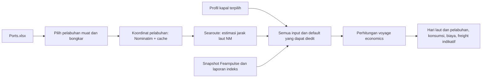

# Rencana Iterasi 5 — input dinamis dan voyage economics

Tanggal: diperbarui 3 November 2026. **Rencana untuk diaudit; tunggu perintah execute sebelum implementasi lanjutan.** Iterasi 5 menjadi wadah penyempurnaan berikutnya; tidak perlu membuat iterasi baru untuk setiap penyesuaian kecil. Aplikasi Streamlit sudah dideploy menurut konfirmasi pengguna. Perubahan lokal tidak otomatis mengubah aplikasi deployment.

## Arah dan batas

- Fokus saat ini: input pengiriman, rute, kapal, pasar, dan perhitungan voyage economics.
- Tahap 3 tender dan tahap 4 commercial decision brief disembunyikan sementara di UI; kode, perhitungan, data dan riwayat keputusan dipertahankan untuk penyesuaian selanjutnya. Jangan menampilkan hasil GO/NO GO lama seolah berasal dari input baru.
- Semua input untuk perhitungan voyage ditampilkan di awal, memiliki default yang terlihat, serta dapat diedit. Pilihan rute dan kapal mengubah default yang terkait; edit harus diaplikasikan secara eksplisit dan hasil lama ditandai tidak berlaku.
- Data yang belum tersedia atau tidak berhasil diperoleh jangan diganti dengan nilai seolah-olah aktual. Berikan sumber, tanggal observasi dan status input secukupnya.
- Urea dry bulk dihitung satu arah laden. Komisi default 0%. Angka yang ditampilkan dua desimal; ketelitian perhitungan tetap dipertahankan.
- PI dan PILOG tetap entitas berbeda. Tidak mengubah rumus tender, gate, harga yang telah ditetapkan, maupun aturan bisnis lain tanpa permintaan.

## Alur yang dituju

## Batch 1 — pelabuhan dan estimasi jarak

1. Baca `data/raw/Ports.xlsx` sebagai sumber pilihan PoL/PoD: kolom `Country` dan `Primary Port`. Pemeriksaan awal menemukan 50 nama pelabuhan, termasuk Bontang dan Antwerp; abaikan baris kosong dan jaga pasangan nama-negara.
2. Tambahkan dua dropdown yang menunjukkan nama dan negara. Pastikan keduanya berbeda dan jangan menggunakan jarak rute lama ketika pilihannya berubah.
3. Untuk pelabuhan yang dipilih, gunakan geopy dengan Nominatim, nama pelabuhan **dan negara**, user-agent aplikasi yang mengidentifikasi aplikasi, timeout, rate limit bersama serta cache; jangan geocode seluruh daftar setiap F5. Jika lokasi ambigu, bukan pelabuhan, atau tidak ditemukan, tampilkan status dan minta koreksi; jangan memilih lokasi salah secara diam-diam.
4. Kirim koordinat sebagai `[longitude, latitude]` ke `searoute` dengan unit `naut`; tampilkan jarak, identitas lokasi/sumber dan waktu. Ini estimasi berbasis graph, bukan jarak navigasi/operasional yang tervalidasi. Fallback otomatis saat geocoding/routing gagal: (a) cache rute dengan pasangan PoL–PoD dan basis yang cocok; (b) data OD workbook hanya untuk pasangan asal–tujuan yang cocok secara eksplisit; lalu (c) input jarak manual. Jika semua gagal, biarkan kosong dan jangan memakai jarak rute sebelumnya. Contoh OD Bontang–Mundra 3.906 NM; OD tidak mencakup semua kombinasi 50 port. Nilai fallback wajib memuat sumber, tanggal bila ada, dan status.
5. Pisahkan penyedia koordinat, perhitungan jarak, dan pembacaan workbook dalam modul source; berikan pengujian mock jaringan, port ambigu, data gagal, urutan koordinat dan perhitungan NM. Periksa apakah `OD-DISTANCE.1` dan validator yang saat ini mewajibkan OD perlu diganti secara terversi, tanpa mengubah kasus lama.

Rujukan: [kebijakan Nominatim](https://operations.osmfoundation.org/policies/nominatim/), [dokumentasi geopy](https://geopy.readthedocs.io/en/stable/), dan [searoute](https://pypi.org/project/searoute/). Server publik Nominatim membatasi seluruh aplikasi maksimal satu request/detik; cache dan atribusi diperlukan. Searoute menyatakan hasilnya untuk visualisasi, bukan navigasi kapal.

## Batch 2 — dua pilihan profil kapal

- Sediakan hanya **Handysize 38.200 DWT** dan **Supramax 63.500 DWT** pada pilihan aktif, sesuai profil benchmark yang dipublikasikan Baltic; profil lama tetap ada untuk membaca kasus lama. Pengguna menerima perubahan Supramax dari 58.000 ke 63.500, dengan catatan kecil pada UI.
- Tampilkan satu profil per kelas yang mudah dipahami, menggunakan spesifikasi Baltic yang tersedia dan acuan harga Fearnpulse yang sesuai kelas. Untuk nilai yang belum tersedia, cari lebih dulu pada Voyage Estimate dan referensi terdokumentasi; gunakan hanya nilai yang cocok dengan parameter dan konteksnya, dengan sumber tertera. Jika tidak ditemukan, biarkan kosong untuk diisi pengguna; jangan mengarang default atau mengklaim nilai workbook berasal dari Baltic.
- Secara internal tetap bedakan kapasitas/konsumsi fisik dan harga acuan time charter demi ketepatan hitung; tidak perlu memecahnya menjadi pilihan profil yang terpisah di UI. Uji perubahan kapal mengganti parameter terkait tanpa menghapus input manual yang sudah diterapkan secara diam-diam.

## Batch 3 — pembaruan sumber pasar otomatis

- Saat sesi dibuka atau browser direfresh, coba ambil data Fearnpulse terbaru secara otomatis tanpa tombol. Gunakan cache ber-TTL, timeout dan fallback snapshot terakhir; tampilkan tanggal observasi sumber dan waktu fetch, serta status jika refresh gagal. Rerun Streamlit akibat mengetik tidak boleh memicu fetch berulang.
- **Argus dan Fertecon:** pengguna mengonfirmasi hanya memiliki laporan PDF dan mengusulkan menaruh empat laporan di repo. Rancang pembacaan otomatis saat startup/F5 dari PDF yang sudah tersedia pada deployment, dengan ekstraksi deterministik seri granular FOB SEA, nilai dan tanggal; cache berdasarkan hash file. Empat laporan saat ini tersedia di vault (`references/Market Reports`), masing-masing nitrogen dan amonia untuk kedua penerbit; laporan urea dicari pada laporan nitrogen yang cocok, bukan diasumsikan berasal dari laporan amonia. Periksa isi dan format tiap sumber sebelum menetapkan parser. PDF yang tetap sama menghasilkan data historis yang sama: F5 tidak bisa membuat laporan terbaru tanpa ada pembaruan berkas pada deployment. Izin penyimpanan dan lisensi sumber tetap harus dipastikan; repo private bukan bukti izin redistribusi.
- Parser gagal/tidak menemukan seri: tunjukkan status dan pakai data terakhir yang benar-benar telah diekstrak atau input manual, jangan mengarang. Jika sistem tidak mengakses berkas PDF di luar repo saat dideploy, data tersebut harus ditempatkan di lokasi deployment yang memang dapat diakses dan legal digunakan.
- Pisahkan refresh snapshot pasar dari quote freight yang telah ditetapkan: F5 tidak boleh diam-diam mengubah harga fixed, bid atau hasil lama. Di layar tahap 1–2, tunjukkan sumber yang dipakai dalam perhitungan saat ini dan terapkan data terbaru melalui alur perubahan basis yang jelas.
- Uji sukses, provider down, timeout, cache, data usang, seri/units, tanggal observasi dan fallback. Persyaratan akses atau lisensi data pasar harus dikonfirmasi sebelum integrasi otomatis ke sumber berbayar.

### Komoditas dan seri indeks

Fokus tetap **urea granular bulk dan kapal dry bulk**. Tidak ada pemilih komoditas atau perhitungan ammonia dalam penyesuaian ini. Laporan nitrogen dari kedua penerbit menjadi sumber yang diperiksa untuk seri urea granular FOB Southeast Asia; laporan ammonia bukan sumber indeks urea. Harga hanya diambil dari seri, FOB/CFR, wilayah, satuan dan tanggal yang cocok. Angka September diterima sebagai data awal top-down dan tetap diberi tanggal sumber. Pemeriksaan visual tabel dan tes parser adalah bagian implementasi; pemeriksaan awal bukan sertifikasi seluruh seri atau harga.

Jika seri pasangan penerbit yang sebanding belum tersedia, tunjukkan bahwa indeks belum tersedia dan sediakan input manual yang bersumber; jangan mengambil CFR untuk menggantikan FOB atau mencampur bentuk/region/tanggal tanpa aturan yang disepakati.

## Batch 4 — input awal dan UI voyage

- Kelompokkan seluruh input yang dipakai hingga voyage economics di awal: rute/jarak; cargo dan aktivitas pelabuhan; kapal, kecepatan dan konsumsi; harga bahan bakar, biaya pelabuhan/running, target harian serta komisi. Gunakan default Voyage Estimate yang ada sebagai nilai awal yang editable, sesuai persetujuan pengguna; tampilkan asal default dan satuannya.
- Pertahankan model `InteractiveCase` dan engine Python sebagai satu sumber hitung. Jangan menduplikasi matematika di Streamlit. Terapkan input sebagai satu revisi kasus, invalidasi hasil yang sudah tidak sesuai dan cegah fixed quote lama berubah diam-diam.
- Tahap 2 menunjukkan rincian hari laut, hari muat/bongkar, bahan bakar, biaya voyage dan freight indikatif yang dihitung dari input aktif. Hindari tabel input yang tersebar di tahap lain, termasuk editor biaya, jika sudah dicakup di awal.
- Sembunyikan navigasi dan tampilan tahap 3–4; contoh tender/GO/NO GO di sidebar juga harus dievaluasi agar tidak memberi jalan menuju hasil tersembunyi atau menampilkan state yang membingungkan. Engine dan fixtures tetap tersedia.

## Urutan teknis dan penerimaan

1. Audit sumber dan kontrak data; tetapkan mapping default workbook dan perilaku sumber yang gagal. Tambahkan dependensi `geopy` dan `searoute` secara eksplisit setelah versi dan lingkungan deploy diverifikasi.
2. Implementasikan Batch 1–3 secara modular dengan tes unit dan integration yang memakai mock untuk jaringan. Hindari perubahan yang tidak perlu pada file sumber pengguna.
3. Implementasikan Batch 4 dan tes UI: input awal editable, dua kapal, perubahan rute/kapal, hitung ulang, tahap 3–4 tidak tampak, serta kondisi sumber gagal.
4. Jalankan regresi engine penting dan browser smoke: dua rute termasuk Bontang–Antwerp, dua kapal, pembulatan, perubahan input, F5, fallback, dan isolasi sesi. Rekonsiliasi hasil hitung secara independen; jangan mengklaim jarak estimasi sebagai jarak pelayaran aktual.
5. Uji Linux/cloud dan akses data pada deployment sebelum update; hindari membuat perubahan deployment sampai revisi siap dan diuji. Dokumentasikan perubahan, sumber, asumsi dan keterbatasan di dokumen ini agar repo tetap mudah dinavigasi.

## Keputusan terbuka

1. Pengguna menyatakan keempat PDF boleh disimpan dalam repo private dan digunakan aplikasi. Pembaruan edisi bukan prioritas saat ini; harga September dapat digunakan sesuai tanggalnya.
2. Tidak semua pasangan port tersedia dalam OD; jika cache dan OD sama-sama tidak punya pasangan yang cocok, input jarak manual tetap diperlukan. Tidak ada nilai default universal yang akurat.

## Status saat rencana dibuat

- `Ports.xlsx` ditemukan di `data/raw/` dan belum masuk Git; file tidak diubah.
- Tahap 3 dan 4 sudah disembunyikan dari fungsi `render` UI sesuai konfirmasi pengguna. Kode engine-nya tetap ada; pengujian regresi dan penyelarasan sidebar belum selesai.
- Empat batch lainnya belum diimplementasikan. Riwayat rencana lama mungkin menyebut deployment belum dilakukan; pengguna menyatakan aplikasi sudah dideploy dan telah dibagikan kepada mentor.

## Implementasi 3 November 2026 — hasil sementara

- Input PoL/PoD dari Ports.xlsx; perhitungan jarak searoute, fallback OD yang cocok dan input manual; sumber route versi I5-ROUTE.1. Geocoding menolak hasil ambigu/bukan pelabuhan. Uji aktual Nominatim untuk Bontang mengembalikan lokasi administratif, bukan pelabuhan; fallback dibutuhkan. Pengguna menyatakan belum memiliki koordinat yang disetujui.
- Dua profil fisik 38.200 dan 63.500 DWT dengan speed dan konsumsi dari spesifikasi Baltic yang dibaca; input lain dari workbook. Fetch langsung Baltic lewat program tidak mengembalikan halaman spesifikasi lengkap dalam uji ini, sehingga aplikasi memakai referensi yang dicatat 3 November, bukan mengklaim live verification.
- Fearnpulse dicoba otomatis pada sesi baru dan cached, dengan fallback snapshot. Uji koneksi lokal berhasil; tanggal observasi harga dan tanggal fetch berbeda. PDF nitrogen Argus/Fertecon dibaca otomatis dari public berdasarkan seri spesifik; hasil awal 415–425 dan 410–410 USD/MT, tanggal 10 September 2026. Parser berhenti saat format tidak cocok.
- Input editable di awal; tahap 3–4 disembunyikan. Perhitungan dan source code tender tetap ada. UI lama untuk tender/brief belum direvisi.
- Verifikasi: 224 unit/integration termasuk kasus dua profil dan rute manual lulus; pemeriksaan UI Streamlit otomatis tersedia. Tidak dilakukan verifikasi lengkap browser/deployment, pengujian live menyeluruh semua pelabuhan, atau penyesuaian ulang seluruh tes UI historis yang masih mengharapkan tahap 3–4.

## Perbaikan lokasi dan Baltic — 3 November 2026

- Katalog `data/processed/port_locations_unlocode.json` dibuat dari rilis resmi UN/LOCODE 2025-1, mencocokkan nama, negara, fungsi port dan kode secara eksplisit. Ketika koordinat UN/LOCODE kosong, koordinat katalog port Searoute 1.6.0 digunakan hanya jika kode lokasi sama dan titiknya unik. Koordinat bersifat indikatif, bukan berth. Katalog menyimpan sumber setiap titik dan hash arsip. Script pembangun memerlukan unduhan rilis resmi UN/LOCODE; arsip unduhan tidak disimpan di repo.
- 38 dari 50 nama port saat ini mendapatkan koordinat katalog; 12 lainnya masih mencari melalui Nominatim, lalu fallback OD atau manual jika tidak pasti. Davao ditahan dari katalog karena Searoute memiliki dua titik dengan kode yang sama. Nominatim menyaring kandidat bukan port dan negara tidak cocok, namun tetap menolak hasil port yang ambigu. OpenStreetMap diatribusikan saat dipakai.
- Uji offline: Bontang–Mundra sekitar 4.015,84 NM menurut Searoute dibanding 3.906 NM dalam OD; Bontang–Antwerp sekitar 9.511,50 NM menurut Searoute. Kedua sumber punya basis berbeda; angka bukan verifikasi rute navigasi atau kepastian jarak aktual.
- Acuan Baltic dipusatkan dalam `data/processed/baltic_vessel_benchmarks.json`, bersumber Guide to Market Benchmarks v8.8 September 2026, halaman 83–84. Program mencoba mengambil dan memeriksa PDF resmi, tetapi pengujian langsung menerima HTTP 403; saat gagal ia memakai snapshot terverifikasi, tanpa mengklaim live. Harga Fearnpulse tetap sumber tersendiri.
- Verifikasi: 230 tes unit dan integrasi lulus, termasuk katalog offline, penyaringan lokasi, satu voyage dengan jarak Searoute dan fallback dokumen Baltic. Tidak ada perubahan deployment atau push. Browser produksi/cloud belum diuji kembali.

## Koreksi input dan audit rute — 3 November 2026

- Dropdown PoL/PoD langsung menghitung ulang jarak saat pilihan berubah. Jika otomatis gagal, input jarak manual diterapkan bersama tombol `Terapkan input`; tombol `Terapkan rute` dihilangkan. Hasil lama dinonaktifkan selama rute baru belum valid.
- `Hai Phong` dicocokkan dengan ejaan `Haiphong` pada UN/LOCODE menggunakan normalisasi spasi, negara dan kandidat unik. Aqaba–Hai Phong terhitung sekitar 6.240,74 NM sebagai estimasi, bukan jarak operasional/terminal yang tervalidasi.
- Searoute port catalog juga digunakan jika ada kecocokan nama dan negara yang tepat, kode negara cocok, dan satu titik unik untuk kode tersebut; tidak memaksa pilihan untuk entri ambigu. Uji seluruh 2.450 pasangan berarah dari 50 pelabuhan secara offline: 1.980 estimasi, 1 fallback OD, 469 memerlukan input manual. Lima pelabuhan tanpa koordinat unik pada uji offline: Brunsbuettel, Davao, Jose, Mersa Al Brega, Zhanjiang. Pencarian live dapat memberikan hasil berbeda; audit offline bukan klaim semua pencarian live gagal. Bukti: `outputs/route_coverage_audit_i5.json`; jalankan ulang `venv/Scripts/python.exe scripts/audit_route_coverage.py`.
- MarBrokers ditambahkan sebagai tautan referensi umum kelas kapal, bukan dasar numerik spesifikasi kapal tertentu.
- Perhitungan voyage pada kasus baru versi I5 menolak cargo > DWT kapal; UI menampilkan alasan dan menonaktifkan tombol hitung. Lolos cek gross DWT bukan bukti DWCC, draft atau kelayakan pemuatan. Kasus historis tetap mempertahankan perilakunya.
- Verifikasi unit dan integrasi: 234 tes lulus. UI dicek dengan Streamlit AppTest; browser interaktif/cloud belum diuji. Belum push atau deploy.

## Toleransi ejaan pelabuhan — 3 November 2026

- Sesuai arahan pengguna, variasi ejaan Brunsbuettel/Brunsbuttel (DEBRB), Zhanjiang/Zhangjiang (CNZHA), dan Mersa Al Brega/Marsa El Brega (LYLMQ) diterima melalui katalog alias bersumber; negara dan kode lokasi tetap diperiksa dan titik harus unik.
- Audit offline 2.450 pasangan berarah setelah alias: 2.256 estimasi Searoute, 1 fallback OD, 193 memerlukan input manual. Davao dan Jose masih tanpa koordinat tunggal yang terpilih; pilihan Davao menunggu konfirmasi pengguna, dan pemetaan Jose ke Jose Terminal VEJOT belum dianggap pasti.
- Verifikasi khusus penyesuaian: 13 tes integrasi lulus. Bukti detail diperbarui di `outputs/route_coverage_audit_i5.json`. Belum push/deploy.

## Konfirmasi Davao dan Jose — 3 November 2026

- Pengguna memilih titik kedua Davao, latitude 7.066667 / longitude 125.633333, PHDVO; dan menyatakan Jose adalah Jose Terminal, latitude 10.1 / longitude -64.85, VEJOT. Disimpan di `data/processed/confirmed_port_locations.json` dengan urutan longitude, latitude dan keterangan sumber; bukan klaim koordinat berth.
- Audit ulang 2.450 pasangan berarah secara offline: seluruhnya menghasilkan estimasi Searoute; 0 memerlukan manual dan 0 fallback OD pada audit ini. Hasil menunjukkan kemampuan kalkulasi untuk katalog saat ini, bukan validasi navigasi, kelayakan terminal atau jarak komersial.
- Sebelum konfirmasi ada 193 pasangan manual karena melibatkan Davao atau Jose; satu fallback OD adalah Bontang → Davao 697 NM. Setelah lokasi tersedia, rute itu mengikuti alur utama Searoute, bukan OD. OD tetap fallback bila sumber utama gagal.
- 14 tes integrasi terkait lulus, termasuk verifikasi koordinat yang dipilih dan identitas masing-masing port. Belum push/deploy.
